<p align="center">
  
</p>

<details>
<summary><strong>Explore Verona: five heads, all 10 emotions, hairstyles and controls</strong></summary>

# Verona

**Type a sentence. Hear a local voice. Give it a face.**

Windows voices, CPU neural motion and an animated 3D face. **No camera,
microphone or cloud runtime.** This gallery shows the actual prototype, not
reference artwork or a photorealistic reconstruction.

[**Milestone 1 - v0.1.0**](https://github.com/Zanark/Verona/releases/tag/v0.1.0)
&middot; [Release notes and boundaries](docs/releases/v0.1.0.md)
&middot; [Setup and controls](docs/prototype-guide.md)
&middot; [All emotions](#all-ten-emotions---4x-and-bright-spokes)
&middot; [Both hairstyles](#every-hairstyle-in-motion)
&middot; [Engineering book](docs/README.md)

```powershell
.\Verona.cmd
```

One **session manager** creates and controls all heads. Choose a session name,
model and colors, then **Create separate head**. Select a head to change its
actual controls or speak through it. Two chats can have separate heads at once.
Fresh checkout? Follow [setup](docs/prototype-guide.md) first; this is a source
prototype, not a bundled installer. Desktop setup is explicit:
`.\Setup-VeronaDesktop.cmd`. `VeronaDesktop.cmd` opens this same manager;
different launchers are not needed.

All five choices are here: **original Claire, native MPFB,
structural-reference Claire, historical subtle-reference Claire and
Male-SharpJawline**. Claire is preserved. These are experimental identities,
not accepted Female profiles or anatomical-accuracy claims.
Independent **mesh, eyes, hair, lips and eyebrows** accept swatches or RGB hex.
Native MPFB hair is an optional static cap.
Each head has its own model, capability, speech RAM and audio clock.
**Exit manager and its heads** closes only heads this manager created;
closing the browser tab alone does not stop them.

**M1 freezes the working local speaking-face workspace, not a claim of perfect
lip sync or a production-ready assistant.** The gallery below retains the
milestone captures of the five remaining choices. The preserved hero, emotion, hair and presentation
loops record the vr-36 visual runtime; their unchanged visuals remain relevant,
but their old interfaces are not the current manager.
**4x expressions, glowing centers and bright spokes** are the selected
FaceMesh look throughout, including the opening talking hero. The emotion gallery shows all ten available single model controls
plus neutral; it does not preview combinations.

## Five heads, one local workspace

These actual-renderer GIFs use the same synthetic **"Hey, how are you?"**
greeting, Happy0.6/4x source and small authored turns. Distinct solid mesh tints
make the choices legible; other feature colors stay original. MPFB fits bounded
native controls, so 4x source is not4x native deformation.

<table width="100%">
  <tr><th colspan="2">Original Claire</th></tr>
  <tr><td colspan="2" align="center" valign="top">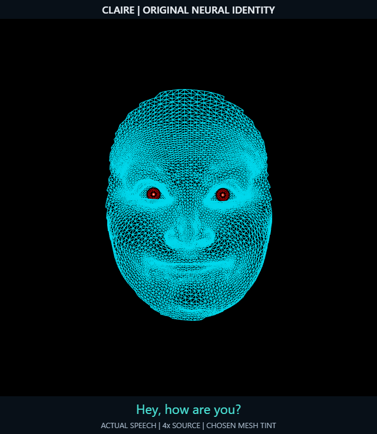</td></tr>
  <tr><th width="50%">Native MPFB</th><th width="50%">Structural-reference Claire</th></tr>
  <tr>
    <td width="50%" align="center" valign="top">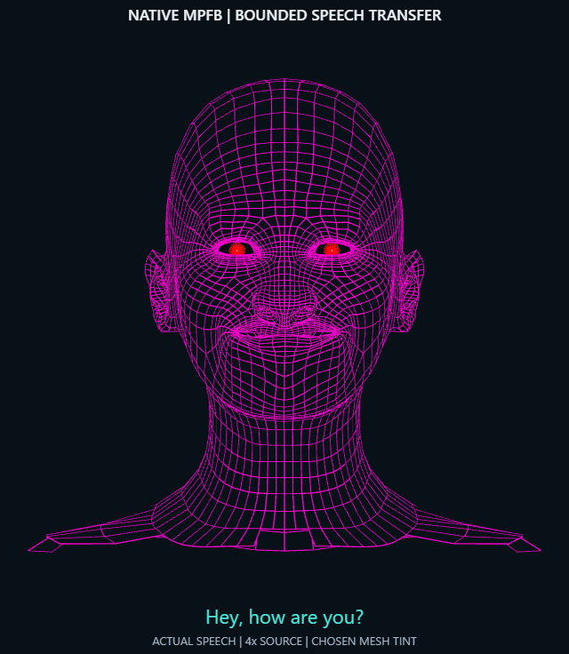<br>Independent native topology; transferred speech, not a new neural model.</td>
    <td width="50%" align="center" valign="top">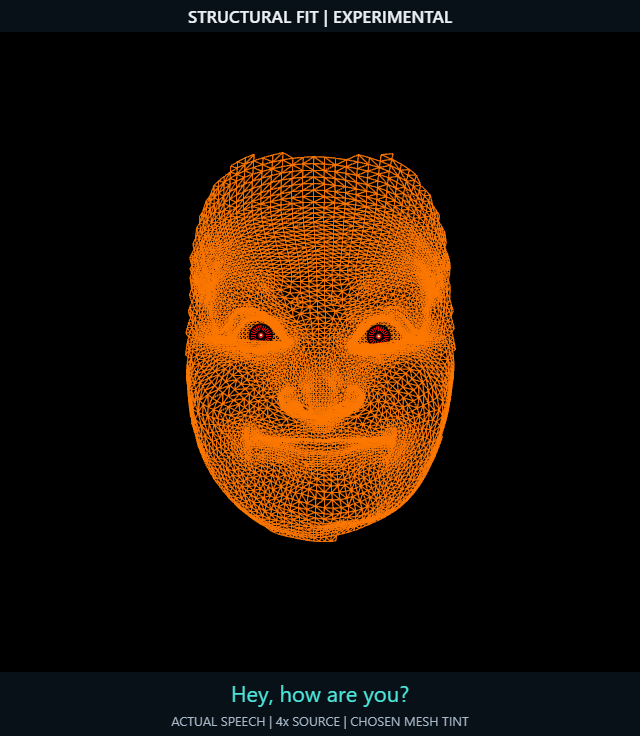<br>Experimental geometric fit, not an accepted likeness.</td>
  </tr>
  <tr><th width="50%">Historical subtle-reference</th><th width="50%">Male-SharpJawline</th></tr>
  <tr>
    <td width="50%" align="center" valign="top">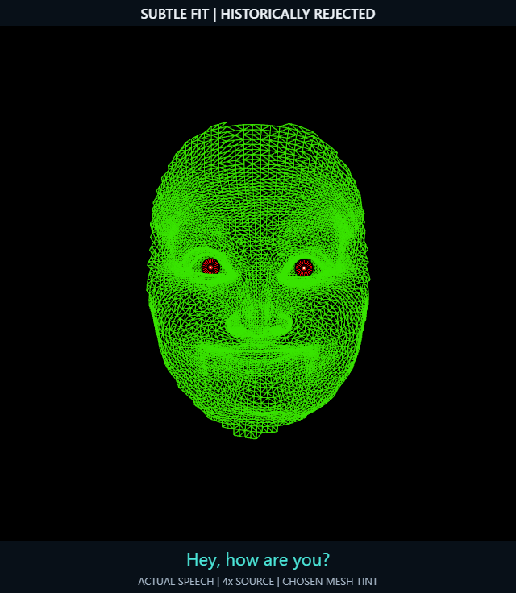<br>Historically rejected fit, retained for comparison.</td>
    <td width="50%" align="center" valign="top">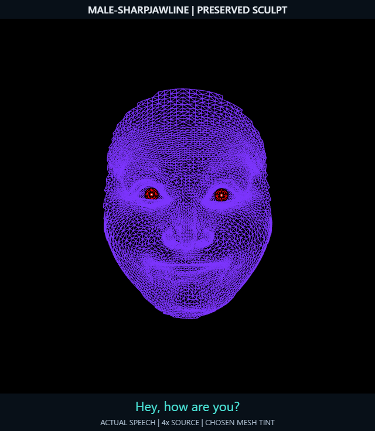<br>Preserved sculpt over Claire motion, not the native Mark identity.</td>
  </tr>
</table>

### A separate look at the actual Mark model

Mark v2.3 is **report-only, not a manager choice**. These paired
shaded/wire studies show its own native-derived topology, rest turntable and
neutral speech at native1x. They do not replace Claire or Male-SharpJawline.

<table width="100%">
  <tr><th width="50%">Mark rest turntable</th><th width="50%">Mark neutral greeting</th></tr>
  <tr>
    <td width="50%" align="center" valign="top">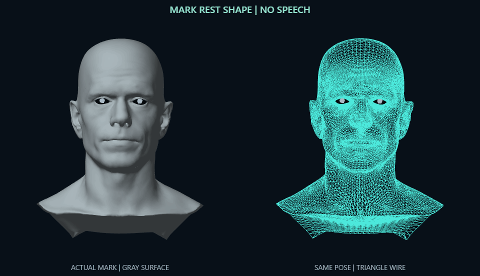</td>
    <td width="50%" align="center" valign="top">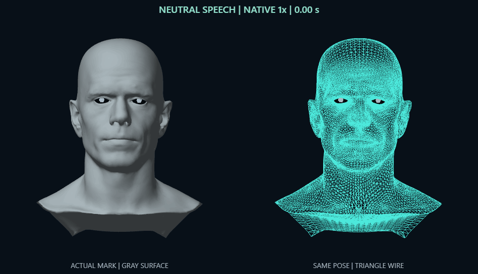</td>
  </tr>
</table>

## Let a selected local agent session speak

Open the manager once. An opted-in local chat can create its own warm head:

```powershell
.\VeronaAgent.cmd create --session work --model claire --hair-color "#442211" --lips-color "#B03060"
.\VeronaAgent.cmd create --session review --model mpfb --eyebrows-color "#6677AA"
.\VeronaAgent.cmd list
.\VeronaAgent.cmd status --session work

# Another terminal or an explicitly opted-in local agent session:
'The build is ready.' | .\VeronaAgent.cmd say --session work
'A quick spoken update.' | .\VeronaAgent.cmd say --session work --voice-only
.\VeronaAgent.cmd configure --session work --hair-color "#113355" --lips-color "#DD5577"
```

Wait for `"ready": true` before speaking. Named Claire-family heads start in
**FaceMesh, bright spokes, 4x**; native MPFB bounds transferred controls to0..1.
The host reuses its model, Windows speech worker and player. Voice-only skips
neural motion for faster narration; new animated sentences remain precomputed,
not instant. No global agent hook or automatic narration is installed.
[Commands, measured latency and cancellation](docs/prototype-guide.md#opt-in-speech-for-local-agent-sessions).

### Install the Verona agent skill

[The self-contained Verona skill](.github/skills/verona/SKILL.md) explains the
app, ownership/startup, all models, safe speech/cancellation, customization and
warm-host performance in depth. Its agent policy requires vivid, clearly
different color families across active heads, checking every feature before
and after creation/customization, not merely choosing another shade.
It documents simultaneous-agent reconciliation without pretending colors
are atomically reserved by the runtime. All application RGB choices stay free.

From a trusted checkout, Copilot CLI supports personal installation:

```powershell
copilot skill add .github\skills\verona\SKILL.md
```

For another Agency chat, including one already open, use the
[complete full-path handoff prompt](.github/skills/verona/SKILL.md#use-from-another-agency-session-including-an-already-open-chat).
The owner's identical library copy is
`C:\devdesk\homedesk\skill-library\skills\verona\SKILL.md`; no companion skill
files are required. The Verona checkout/runtime is still a separate prerequisite.

Installing instructions does not start a head, activate speech or devices,
download assets, or install an automatic narration hook. A prepared Windows
checkout and an explicitly opted-in local session are still required.

## All ten emotions - 4x and bright spokes

**Glowing centers, bright red spokes, 4x emotion.** All ten named model emotions
plus neutral, one at a time: same Hazel greeting, camera and timing.
No combinations are previewed.

<p align="center">
  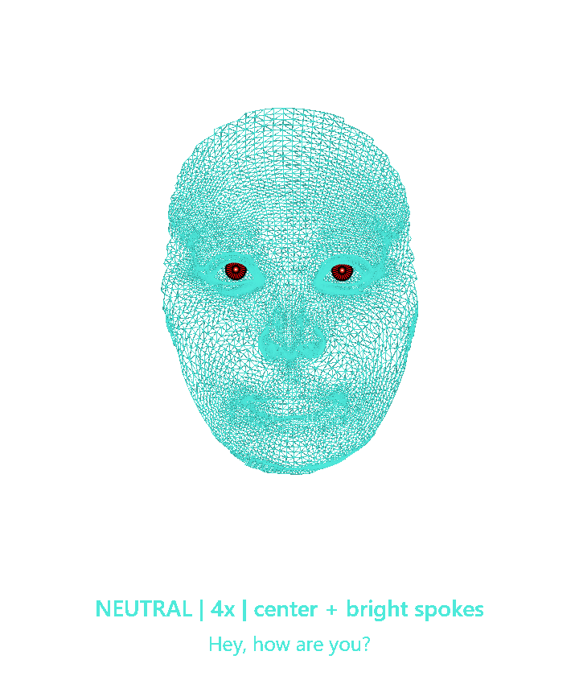
</p>

The overview loops through **neutral, amazement, anger, cheekiness, disgust,
fear, grief, joy, out of breath, pain and sadness** in 30.25 seconds.
Each individual loop below is 2.75 seconds.

<p align="center">
  
</p>

<table>
  <tr><th>Amazement</th><th>Anger</th></tr>
  <tr>
    <td width="50%" align="center" valign="top">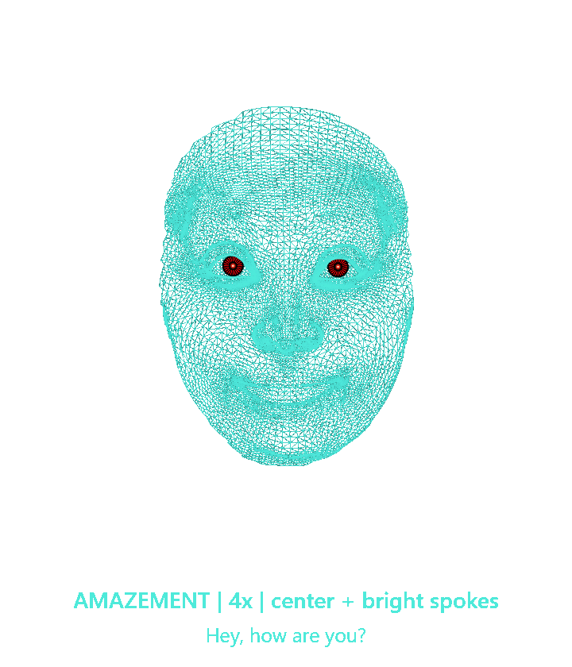</td>
    <td width="50%" align="center" valign="top">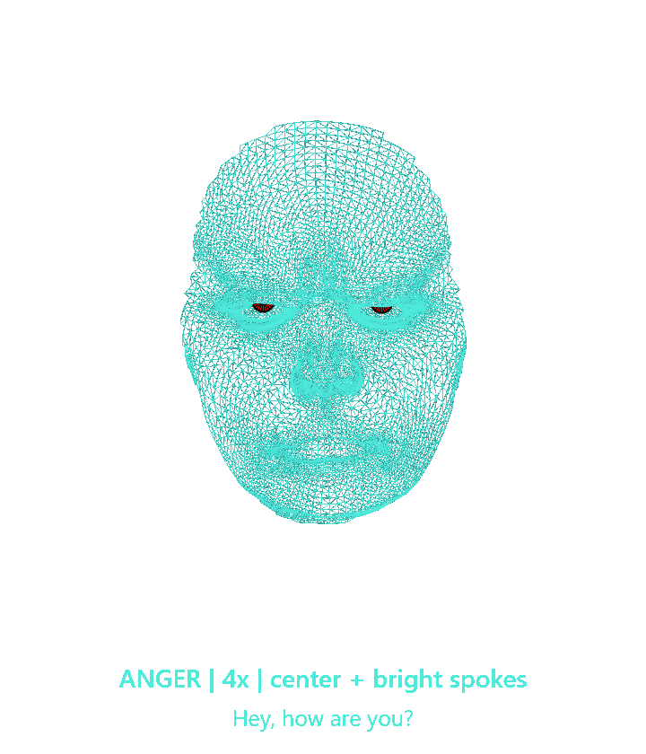</td>
  </tr>
  <tr><th>Cheekiness</th><th>Disgust</th></tr>
  <tr>
    <td width="50%" align="center" valign="top">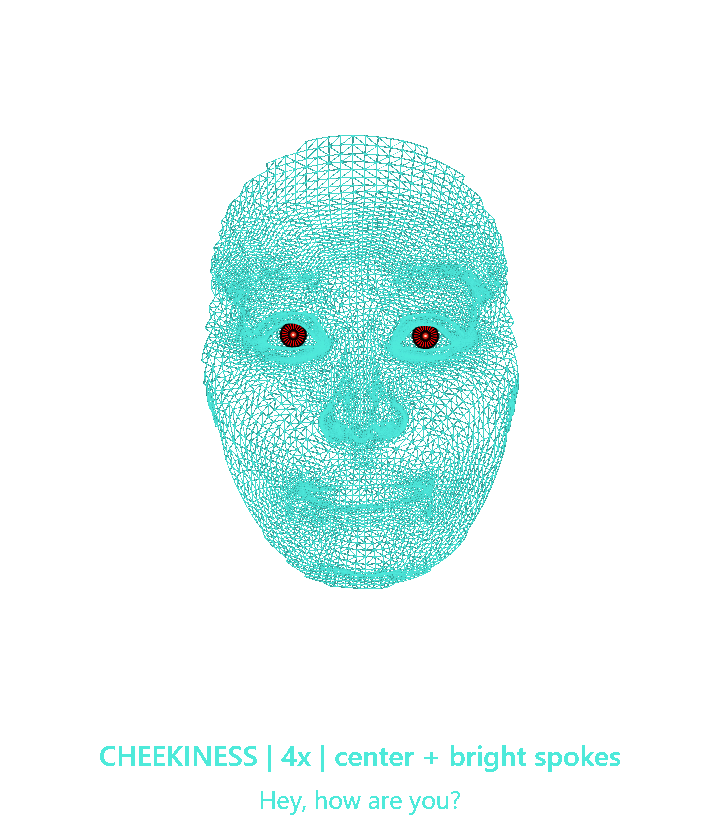</td>
    <td width="50%" align="center" valign="top">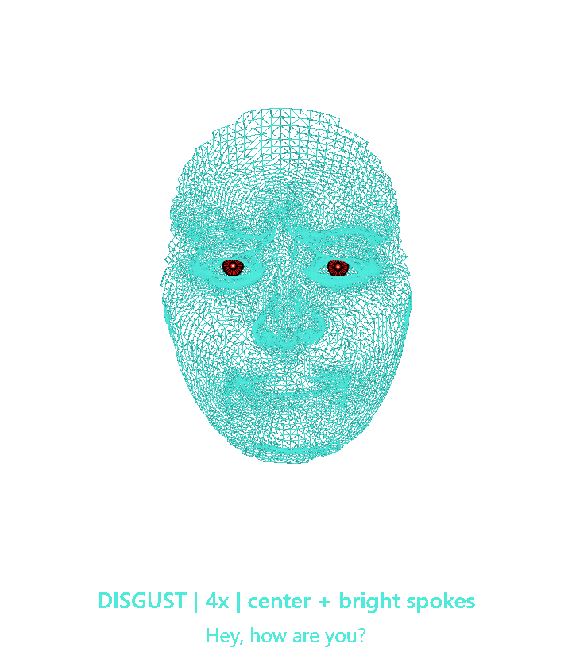</td>
  </tr>
  <tr><th>Fear</th><th>Grief</th></tr>
  <tr>
    <td width="50%" align="center" valign="top">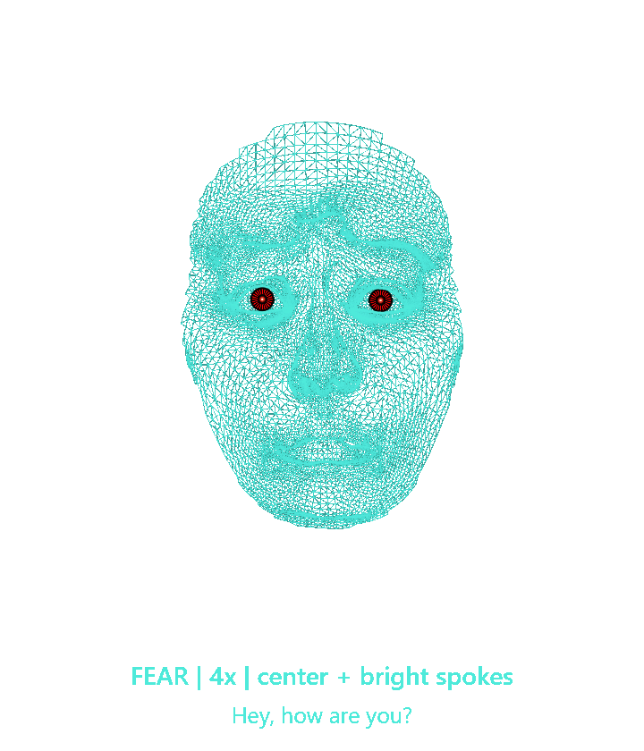</td>
    <td width="50%" align="center" valign="top">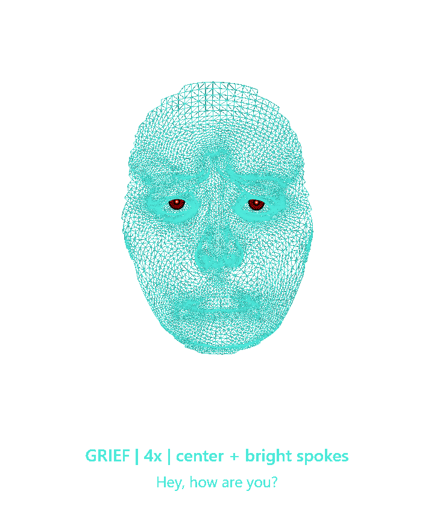</td>
  </tr>
  <tr><th>Joy</th><th>Out of breath</th></tr>
  <tr>
    <td width="50%" align="center" valign="top">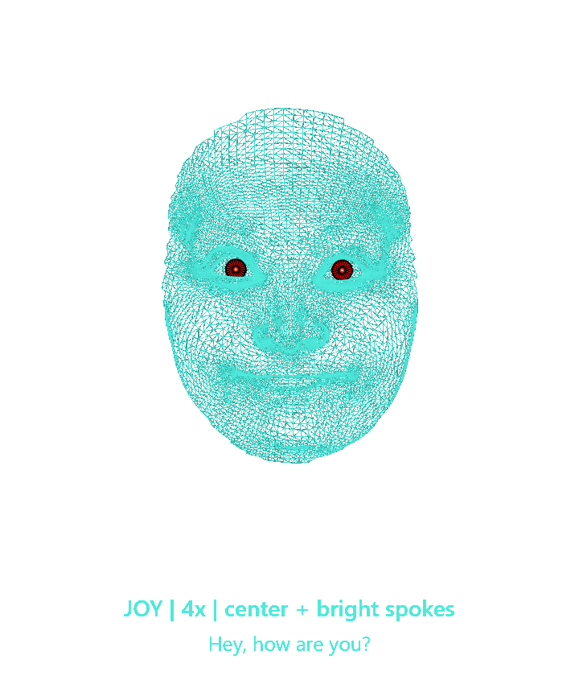</td>
    <td width="50%" align="center" valign="top">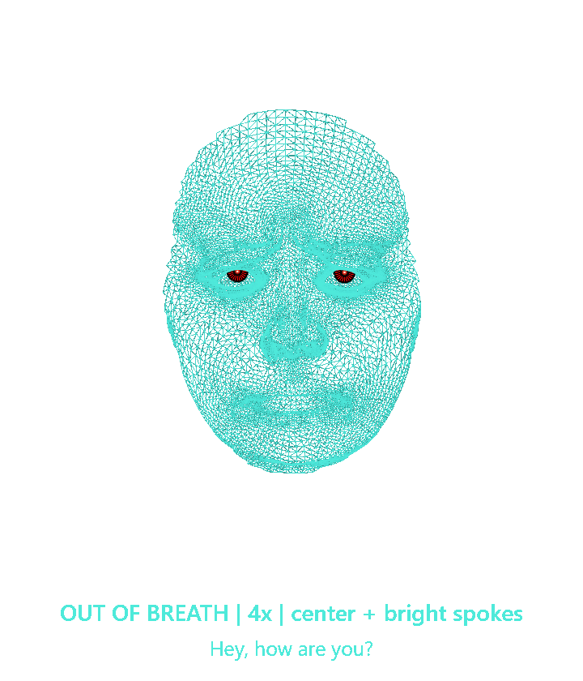</td>
  </tr>
  <tr><th>Pain</th><th>Sadness</th></tr>
  <tr>
    <td width="50%" align="center" valign="top">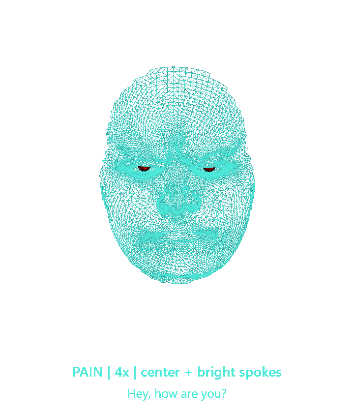</td>
    <td width="50%" align="center" valign="top">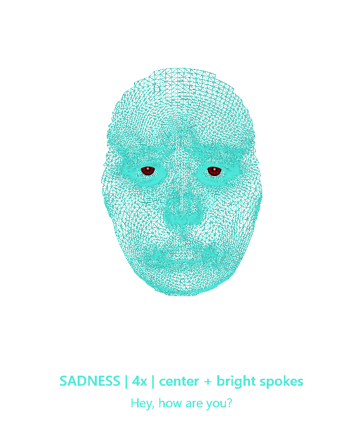</td>
  </tr>
</table>

Neutral speech is not amplified; the ten emotions use strength **0.6**.
Strong anger/pain lids naturally cover the pupil centers; light does not shine
through skin. These are explicit model controls, not detected emotions or a
human-accuracy guarantee. Out of breath changes the face, not the voice.
All ten single controls are now available in the app; Happy/Joy,
Surprised/Amazement and Sad/Sadness retain their existing selector names.
[Capture receipts and limits](docs/media/README.md).

## Use this look in the app

Choose **View -> FaceMesh**, **Emotion exaggeration -> 4x**, then
**Generate face**. Select **FaceMesh eye glow -> Center + bright spokes**;
optical selection changes immediately. **4x doubles the previous 2x emotional
deformation**, not ordinary neutral speech. Natural eyelids still hide covered eyes.
Named manager heads already select4x/bright spokes; the preserved standalone
browser's defaults remain **2x** and **Center + rings + spokes**.

**Independent colors:** use the manager's five swatches or
the built-in color picker, or type a hex code such as `#4F46E5` or `#0FF`.
**Apply colors** updates the selected live head without regenerating speech.
**Restore original colors** removes custom overrides. Controls and colors are
session-local, not saved preferences. Feature visibility depends on the view.

Earlier comparisons remain available as history:
[2x](docs/media/comparison-emotion-2x.gif),
[4x](docs/media/comparison-emotion-4x.gif),
[bright spokes](docs/media/comparison-eyes-spokes.gif),
[bright rings](docs/media/comparison-eyes-rings.gif) and
[original center-glow preview](docs/media/expression-glow-preview.gif).
They are not the current feature demos.

## FaceMesh in every direction

<p align="center">
  
</p>

The huge opening loop stays front-facing to address the reader: smiles, anger,
surprise and sadness use explicit neural expression inputs. Its cyan phrase
captions are embedded in the **same GIF frames**, below the face, so they cannot
drift into a separate loop. The spooky dialogue is fictional; Verona does not
capture faces. GIFs are silent; the app plays the voice.

This separate loop demonstrates signed **X/Y/Z** rotation with glowing centers
and bright spokes. Concentric rings stay dark in this selected look; light never
shines through eyelids. The optional combined look retains its earlier dimming.

## Every hairstyle in motion

**Only Claire waves (original) and Spiral curls. Both available options are below.**
Choose a human **View**, enable **Hair (this view)**, then pick **Hairstyle (shared)**.
Hair starts on in Claire and off in other views; each view remembers its choice
until reload. Hair follows that view's polygons, triangle edges, dots or grid.
These previews select **Reference color + makeup**, **Full bust** and **80% zoom**
to reveal the complete hair. The app still starts with the original
waves and cool **Transparent polygons**.

<table width="100%">
  <tr><th width="50%" align="center">Claire waves (original)</th><th width="50%" align="center">Spiral curls</th></tr>
  <tr>
    <td width="50%" align="center" valign="top"></td>
    <td width="50%" align="center" valign="top"></td>
  </tr>
</table>

**One speech system, two hairstyles.** Spiral curls now have **48 locks instead
of 24**, keeping the same per-lock detail. The other nine styles and their
gallery GIFs have been removed, not hidden. Hair changes do not regenerate speech.
These are procedural geometric styles, not strand simulation. **Head and neck**
trims long hair to the same jaw-following boundary; use **Full bust** to retain
its length.

These are manual view turntables at 10 sampled frames/second, not hair physics
or head motion inferred from speech. Only the selected alternative is built;
switching back restores the original Claire geometry.

## Four presentations. One speech session.

Change **View** without restarting or regenerating the current clip.

<table width="100%">
  <tr><th width="50%" align="center">Claire</th><th width="50%" align="center">FaceMesh</th></tr>
  <tr>
    <td width="50%" align="center" valign="top"><br>Original head, optional hair, cool contours or reference color/makeup.</td>
    <td width="50%" align="center" valign="top">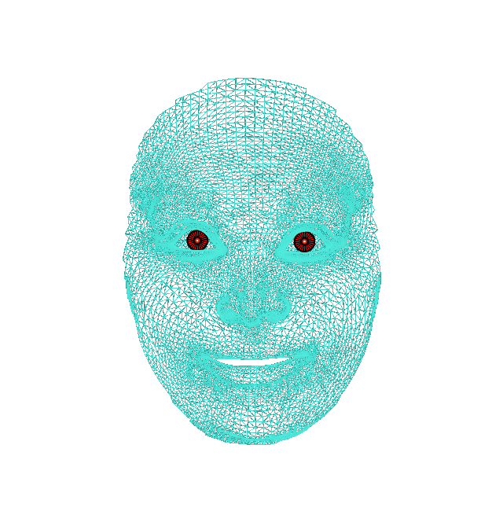<br>Front face only, mechanical red eyes. Optional triangle-edge hair. <b>Mesh detail 1-5</b>, native face detail at 5.</td>
  </tr>
  <tr><th width="50%" align="center">FaceDot</th><th width="50%" align="center">UniformPolygons</th></tr>
  <tr>
    <td width="50%" align="center" valign="top">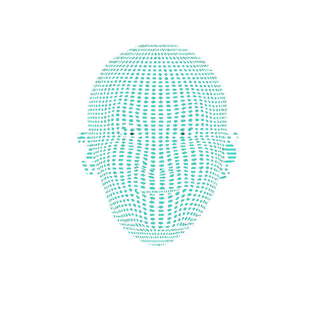<br>Dots on face, ears, eyes and neck; no connecting lines. Optional dotted hair, off here.</td>
    <td width="50%" align="center" valign="top">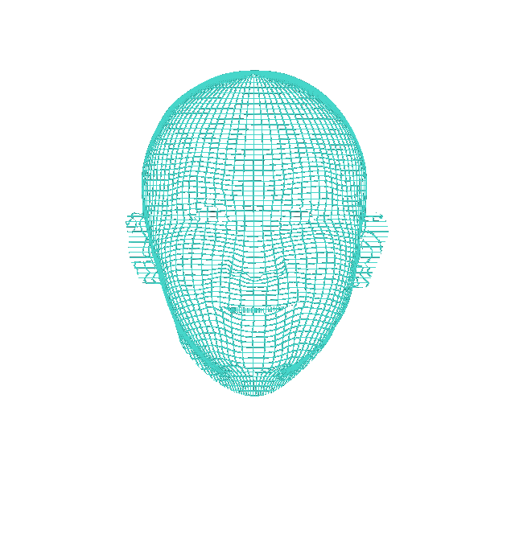<br>Rectangular surface-grid outlines on face, ears, eyes and neck. Optional grid hair, off here.</td>
  </tr>
</table>

These previews manually turn a paused generated pose. All four views share
the same Claire skin and one audio clock. Grid cells follow the curved
face: this is **not quad retopology**. **Realistic**, the future supplied-GLB
identity, remains parked and is not an implemented view.
The FaceDot previews select **0.75x density / 20% gap** for readable dots;
the app's unchanged defaults are **1x / 0%**.

### Hair follows the head's format

<table width="100%">
  <tr><th width="50%" align="center">Triangle-edge curls</th><th width="50%" align="center">Dotted curls</th></tr>
  <tr>
    <td width="50%" align="center" valign="top"></td>
    <td width="50%" align="center" valign="top">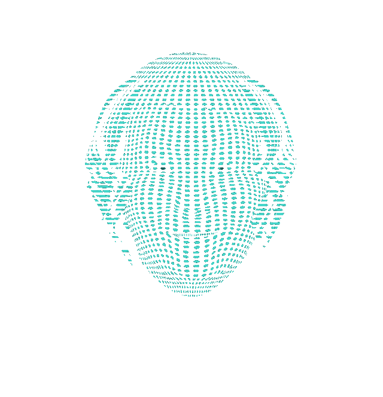</td>
  </tr>
  <tr><th colspan="2" align="center">Surface-grid curls</th></tr>
  <tr><td colspan="2" align="center" valign="top">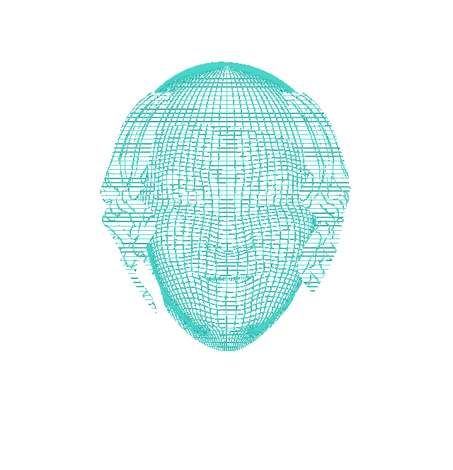</td></tr>
</table>

Hair is **off by default outside Claire**. Enable it when you want it.
The same shared hairstyle follows each view's wire,
dots or grid without regenerating the speech.

### More dots. More cells. More space.

<table width="100%">
  <tr><th width="50%" align="center">FaceDot density and gap</th><th width="50%" align="center">UniformPolygons density and gap</th></tr>
  <tr>
    <td width="50%" align="center" valign="top">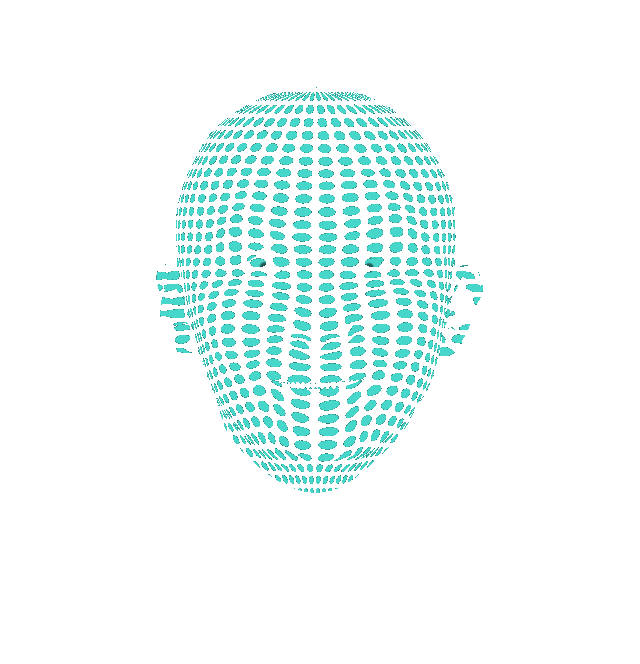</td>
    <td width="50%" align="center" valign="top"></td>
  </tr>
</table>

**Pattern density: 0.5x-3x. Cell gap: 0-80%.** Density changes the spacing and
number of surface samples; gap separates their visible marks. Each view retains
its own values until reload. These GIFs step through actual control states,
not new neural vertices, exact dot counts or performance measurements.

## Eyes follow, or the whole head follows

Enable **Follow cursor**, then select **Cursor mode**.

<table width="100%">
  <tr><th width="50%" align="center">Eyes follow cursor</th><th width="50%" align="center">Head follows cursor (eyes centered)</th></tr>
  <tr>
    <td width="50%" align="center" valign="top">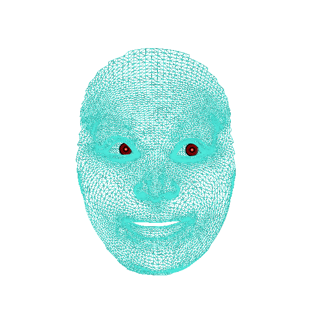</td>
    <td width="50%" align="center" valign="top"></td>
  </tr>
</table>

X/Y/Z remain manual orientation offsets. Tracking is bounded procedural aiming,
not calibrated 3D gaze or learned eye joints. These captures use synthetic pointer
positions inside the owned browser; they do not move the system cursor.

## A floating head, not a floating control panel

<p align="center">
  
</p>

The native overlay starts with a **tiny translucent glass ... tab centered
above the head**. Click to expand; **Escape** or clicking outside collapses it.
Expand for **Drag to move**, **- / + / Fit**, **Close**, the name and pin.
The preserved standalone shell also has **Controls** to return from pop-out;
managed heads keep their controls in the central manager.
The native window remembers its placement across Controls/pop-out for this run;
restart resets it. **Always on top is enabled by default, independently for each
head.** Its toggle and the head name appear only inside the expanded menu.
Transparent areas may intercept clicks; topmost cannot override secure desktops.

This GIF alternates two production-menu/actual MPFB WebGL qualification
captures over an opaque dark composite. It is not a recording of desktop
dragging, OS pinning or speech; independent native pinning was qualified
separately. The glass effect styles Verona's own web content.

<table width="100%">
  <tr><th width="50%" align="center">Decide how much neck is visible</th><th width="50%" align="center">Zoom in and out</th></tr>
  <tr>
    <td width="50%" align="center" valign="top">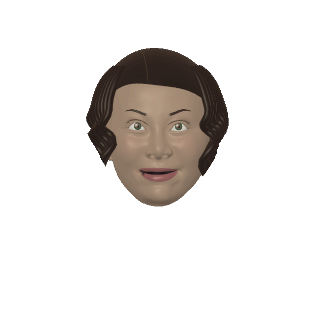</td>
    <td width="50%" align="center" valign="top">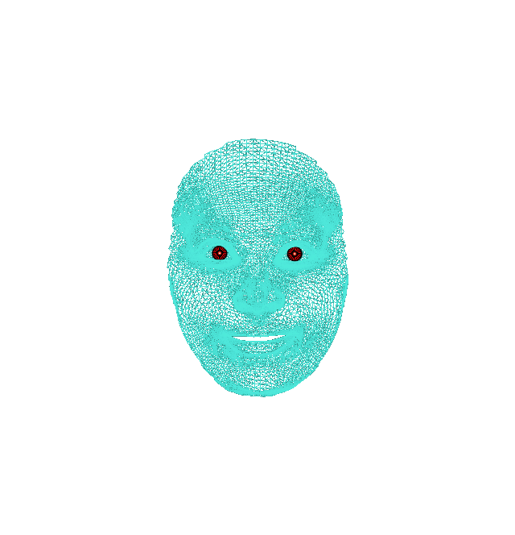</td>
  </tr>
</table>

**Framing -> Head and neck -> Visible neck** previews a curved jaw-following cut:
**0-6 cm**, default **1.7 cm**. Full bust restores the complete original geometry.
**Zoom: 35-230%; Fit: 100%.** The GIF samples browser zoom states; the native
buttons use the same control. High zoom intentionally can crop the model.

## Shape the voice

Preview, adjust pitch/speed/bass/treble/emphasis, generate. **Hazel** remains the
reset default. Choose an explicit expression; it is not guessed from the words.
Claire's **Edges**, **Points** and **Hair** remain independent.
Disable **Colors** in Claire for grayscale skin, eyes, makeup and hair in either
material. Re-enable it to restore colors; neither option changes your speech.

<p align="center">
  
</p>

### Current manager

<p align="center">
  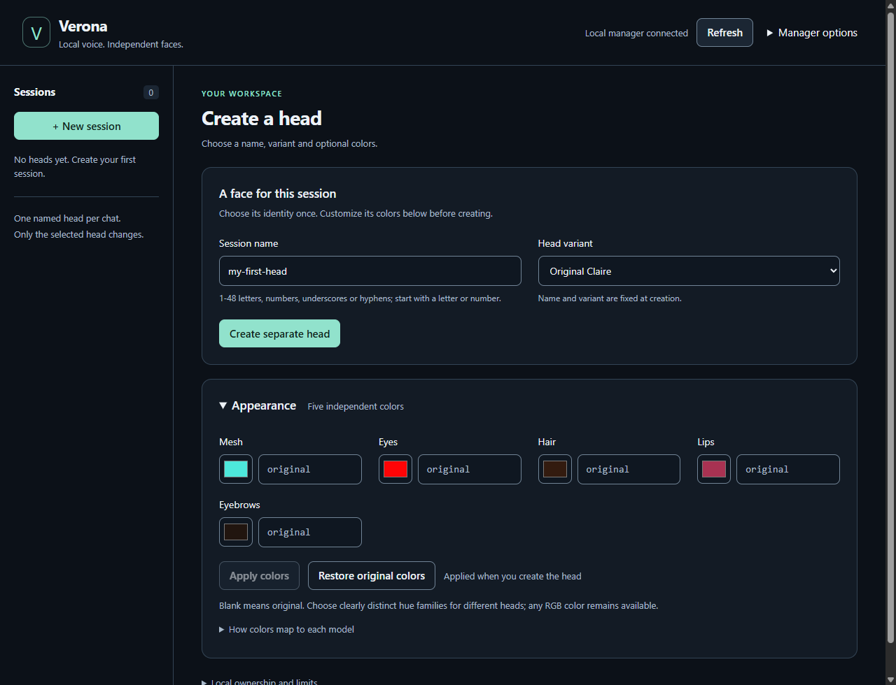
</p>

The real manager is connected in an isolated empty test lane; the example name
is unsubmitted, not an invented live session. Select a created head for its
speech-first workspace, **Editable now** and **Read-only settings**. Original
vr-36 standalone screenshots remain [historical](docs/media/README.md).

## Prototype boundaries

The trained speech identity remains **Claire v2.3.1**. Reference color/makeup is a
stylized study, **not an accepted likeness, photorealism or perfect expressions**.
Teeth/tongue/eye joints and full SDK contact correction remain omitted.
Phonetic accuracy and independent listening acceptance are still open.

Speech is generated ahead of playback: **30-fps neural motion** interpolated on
the audio clock, with a **60-fps display target**, not live generation or a universal
performance guarantee. Color rendering caps pixel density at 1.5x; polygons at 2x.
Historical frame-time outliers remain documented.

**All GIFs are silent sampled previews**, not 60-fps recordings or an audio demo.
Hairstyle turntables show view rotation; control GIFs may show discrete states.
[Media provenance and timings](docs/media/README.md) identify their exact sources.
No private transcripts, reference sheets, model assets or voice recordings are
included in the gallery.
The stronger sideways-cheekiness comparison remains a **report-only proposal**,
not the expression shown throughout this release. No broader approval is implied.
The 40 GIFs are deliberately media-heavy, especially the large captioned
intro; loading may take a moment on slower connections.

[Engineering book](docs/README.md) &middot; [Third-party terms](THIRD_PARTY.md)
&middot; [Immutable prototype 1](https://github.com/Zanark/Verona/releases/tag/v0.1.0-prototype.1)
&middot; [Immutable prototype 2](https://github.com/Zanark/Verona/releases/tag/v0.1.0-prototype.2)
&middot; [Immutable prototype 3](https://github.com/Zanark/Verona/releases/tag/v0.1.0-prototype.3)

</details>
