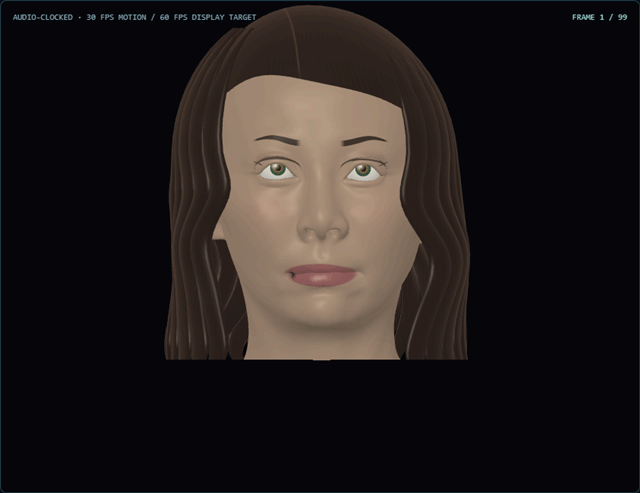
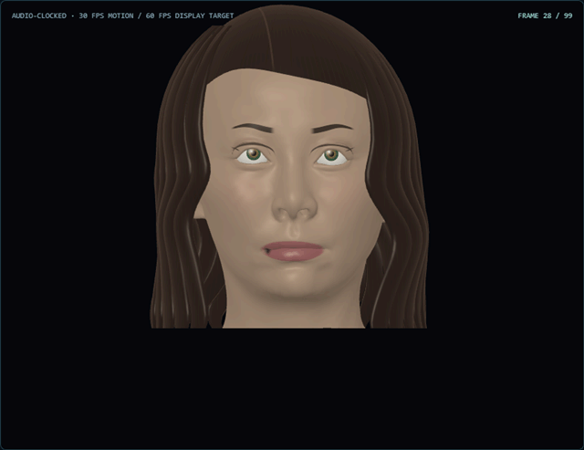
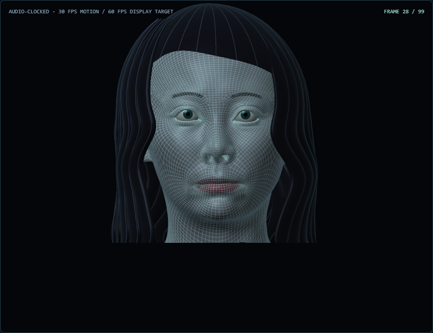
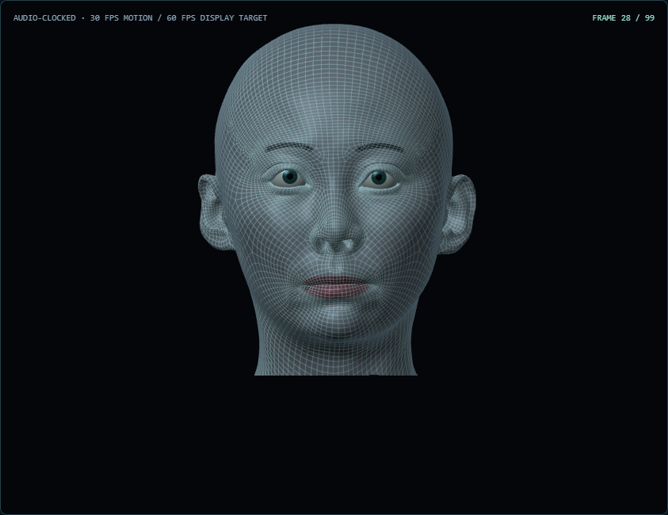

# Verona

**Type a sentence. Hear a local voice. Watch her speak.**



Windows voices, CPU neural motion, connected native contours. No camera, microphone or cloud runtime.

```powershell
.\VeronaDesktop.cmd
```

**Generate face**, **Play**, then **Pop out transparent head**.
Hover its top-left corner for **Move**, **Controls** or **Close**.
Eyes follow your cursor; X/Y/Z sliders rotate the head freely.
The browser version remains `.\Verona.cmd`.
Choose **View → Reference color + makeup** for olive skin, hazel-green eyes,
rosewood lips and espresso waves. **Transparent polygons** remains the default.
Fresh checkout? [Setup and controls](docs/prototype-guide.md).
[Current source prerelease](https://github.com/Zanark/Verona/releases/tag/v0.1.0-prototype.2).

## Color study

| Neutral geometry | Three-quarter geometry |
|---|---|
|  |  |




**A stylized reference-guided study—not a photorealistic reconstruction or an
accepted likeness.** The underlying speech model remains Claire.

## Desktop and transparent overlay


**Framing → Head and neck** hides shoulders and submits fewer polygons.
**Full bust** stays available/default. Cursor-following eyes and X/Y/Z rotation
work in both views. Always-on-top is optional; transparent areas may intercept clicks.
Desktop setup: `.\Setup-VeronaDesktop.cmd` once.

## Keep the polygon effect

| Transparent polygons | Same native skin, hair off |
|---|---|
|  |  |

## Shape the voice

Preview, adjust pitch/speed/bass/treble/emphasis, generate. Hazel remains the
reset default. **Edges**, **Points** and **Hair** remain independent.

**Early prototype:** procedural cursor gaze, not learned eye joints; articulation accuracy is not accepted.
Playback targets **60-fps display** over 30-fps neural motion, not live generation.
Color view caps high-DPI rendering at 1.5x; polygons at 2x.
Historical frame-time spikes remain documented. GIFs are silent sampled previews.

[Engineering book](docs/README.md) · [Media provenance](docs/media/README.md) · [Third-party terms](THIRD_PARTY.md) · [Original immutable prototype](https://github.com/Zanark/Verona/releases/tag/v0.1.0-prototype.1)
