<p align="center">
  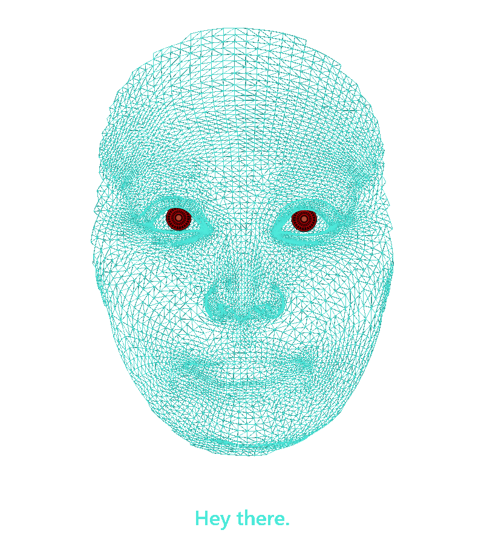
</p>

<details>
<summary><strong>Explore Verona: robot mode, animated demos, hairstyles and setup</strong></summary>

# Verona

**Type a sentence. Hear a local voice. Give it a face.**

Windows voices, CPU neural motion and an animated 3D face. **No camera,
microphone or cloud runtime.** This gallery shows the actual prototype, not
reference artwork or a photorealistic reconstruction.

[**Frozen prototype 3**](https://github.com/Zanark/Verona/releases/tag/v0.1.0-prototype.3)
&middot; [Setup and controls](docs/prototype-guide.md)
&middot; [Both hairstyles](#every-hairstyle-in-motion)
&middot; [Engineering book](docs/README.md)

```powershell
.\VeronaDesktop.cmd
```

**Generate face**, **Play**, then **Pop out transparent head**.
Fresh checkout? Follow [setup](docs/prototype-guide.md) first; this is a source
prototype, not a bundled installer. Desktop setup is explicit:
`.\Setup-VeronaDesktop.cmd`. Browser-only launch: `.\Verona.cmd`.

The current features are on **main**; the frozen release predates the robot,
mechanical eyes and this gallery. The opening hero and earlier demos retain
their capture snapshots; the comparison pairs show the latest options.

## Compare the new variants

The expression pair uses the same dialogue, voice, strengths and camera.
**4x is 100% more than the previous 2x emotion deformation**, not four times
ordinary speech. A fresh 2x reference uses the same wider framing as 4x;
the original GIF remains unchanged below.

<table>
  <tr><th>2x - current default</th><th>4x - 100% more exaggerated</th></tr>
  <tr>
    <td width="50%" align="center" valign="top">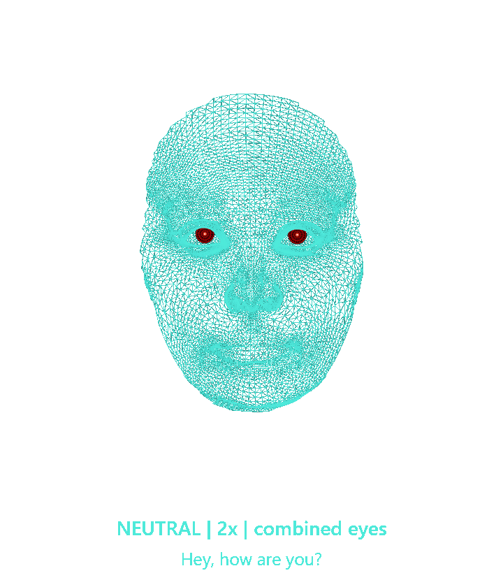</td>
    <td width="50%" align="center" valign="top">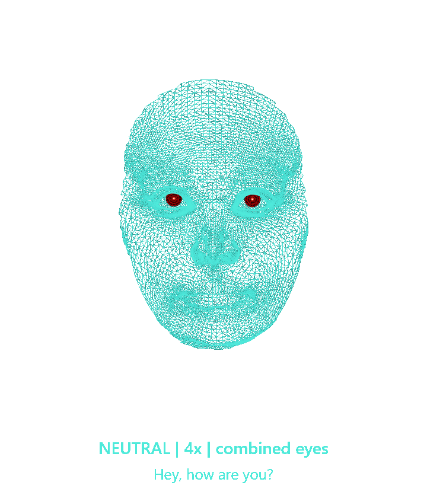</td>
  </tr>
</table>

The eye pair uses identical **4x** facial motion. **Both center dots glow**;
the selected spokes or concentric rings are brighter, while the other structure
stays dark. Natural eyelid occlusion is preserved.

<table>
  <tr><th>4x - glowing center + bright spokes</th><th>4x - glowing center + bright rings</th></tr>
  <tr>
    <td width="50%" align="center" valign="top">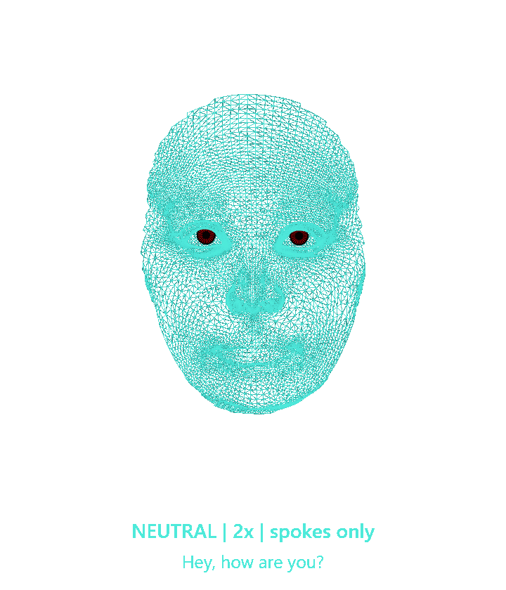</td>
    <td width="50%" align="center" valign="top">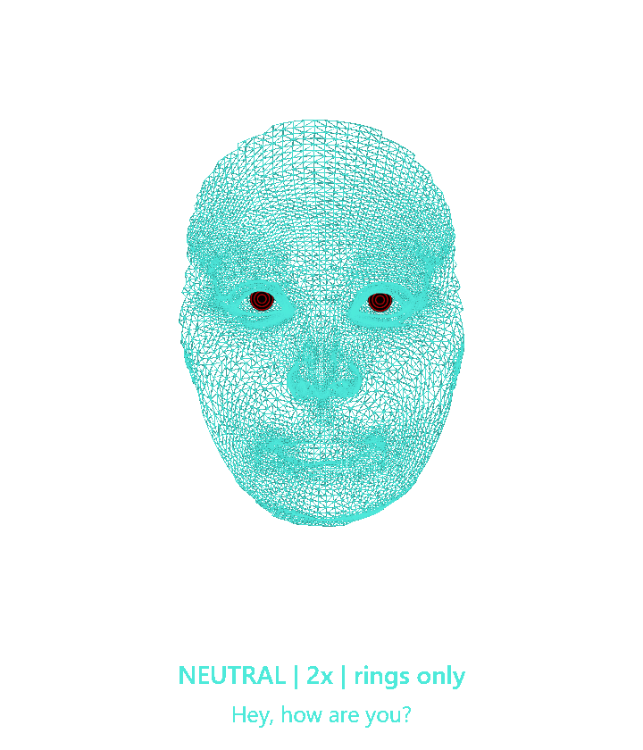</td>
  </tr>
</table>

In the app, choose **Emotion exaggeration**, then **Generate face**.
**FaceMesh eye glow** changes immediately. Defaults remain **2x** and
**Center + rings + spokes** while these alternatives are compared.
[Comparison capture receipts](docs/media/README.md).

## Glowing centers, stronger expressions

<p align="center">
  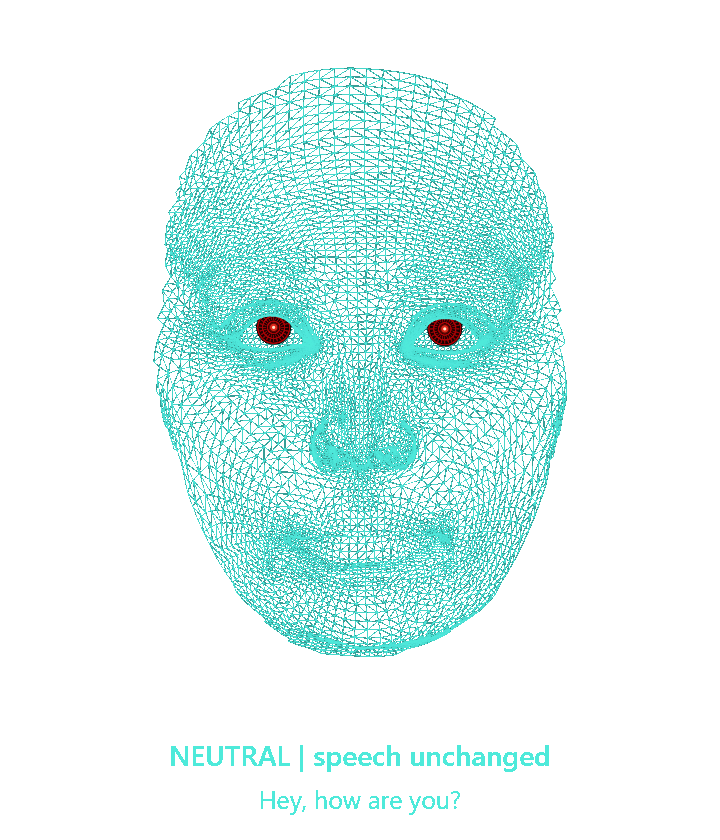
</p>

The center dots now glow; the outer red rings stay dimmed. Happy, sad,
surprised and angry use **100% stronger emotion deformation** relative to the
same neutral speech, without doubling ordinary speech movement. The labeled
loop shows all five states with the same voice and words. Non-neutral clips
need extra CPU generation, not extra playback work.
[Capture and numerical evidence](docs/media/expression-glow-provenance.json).

## Meet the armored voice

<p align="center">
  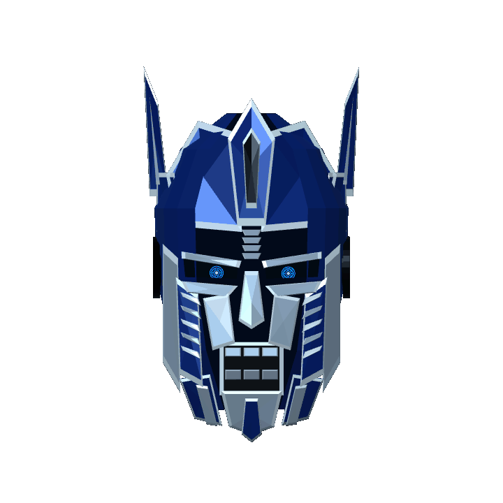
</p>

Choose **View -> Optimus-inspired robot**. Original blue/silver armor, tall
helmet fins, cyan mechanical eyes and articulated jaw, mouth and brow plates.
It follows the same speech clock, cursor modes, orientation and zoom as the
human presentations. No extra model or voice download.
This is our stylized procedural interpretation, not an official movie model,
transformation or character voice.

## FaceMesh in every direction

<p align="center">
  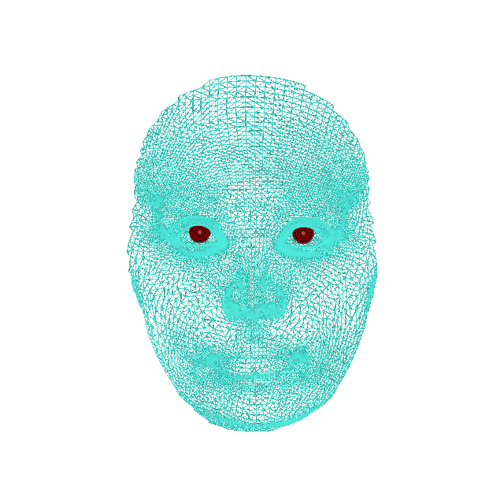
</p>

The huge opening loop stays front-facing to address the reader: smiles, anger,
surprise and sadness use explicit neural expression inputs. Its cyan phrase
captions are embedded in the **same GIF frames**, below the face, so they cannot
drift into a separate loop. The spooky dialogue is fictional; Verona does not
capture faces. GIFs are silent; the app plays the voice.

This separate loop demonstrates signed **X/Y/Z** rotation. FaceMesh's mechanical
red irises have a core, three concentric rings, radial spokes and a soft
depth-occluded halo, now **30% dimmer** than the first red-eye build.

## Every hairstyle in motion

**Only Claire waves (original) and Spiral curls. Both available options are below.**
Choose a human **View**, enable **Hair (this view)**, then pick **Hairstyle (shared)**.
Hair starts on in Claire and off in other views; each view remembers its choice
until reload. Hair follows that view's polygons, triangle edges, dots or grid.
These previews select **Reference color + makeup**, **Full bust** and **80% zoom**
to reveal the complete hair. The app still starts with the original
waves and cool **Transparent polygons**.

<table width="100%">
  <tr><th width="50%" align="center">Claire waves (original)</th><th width="50%" align="center">Spiral curls</th></tr>
  <tr>
    <td width="50%" align="center" valign="top"></td>
    <td width="50%" align="center" valign="top"></td>
  </tr>
</table>

**One speech system, two hairstyles.** Spiral curls now have **48 locks instead
of 24**, keeping the same per-lock detail. The other nine styles and their
gallery GIFs have been removed, not hidden. Hair changes do not regenerate speech.
These are procedural geometric styles, not strand simulation. **Head and neck**
trims long hair to the same jaw-following boundary; use **Full bust** to retain
its length.

These are manual view turntables at 10 sampled frames/second, not hair physics
or head motion inferred from speech. Only the selected alternative is built;
switching back restores the original Claire geometry.

## Five presentations. One speech session.

Change **View** without restarting or regenerating the current clip.

<table width="100%">
  <tr><th width="50%" align="center">Claire</th><th width="50%" align="center">FaceMesh</th></tr>
  <tr>
    <td width="50%" align="center" valign="top">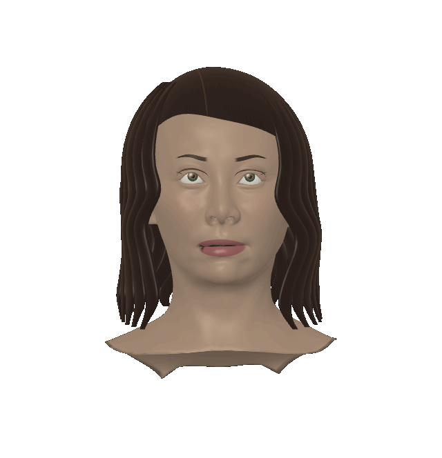<br>Original head, optional hair, cool contours or reference color/makeup.</td>
    <td width="50%" align="center" valign="top"><br>Front face only, mechanical red eyes. Optional triangle-edge hair. <b>Mesh detail 1-5</b>, native face detail at 5.</td>
  </tr>
  <tr><th width="50%" align="center">FaceDot</th><th width="50%" align="center">UniformPolygons</th></tr>
  <tr>
    <td width="50%" align="center" valign="top"><br>Dots on face, ears, eyes and neck; no connecting lines. Optional dotted hair, off here.</td>
    <td width="50%" align="center" valign="top">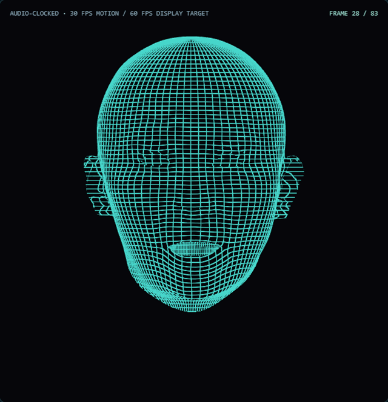<br>Rectangular surface-grid outlines on face, ears, eyes and neck. Optional grid hair, off here.</td>
  </tr>
</table>

These previews manually turn a paused generated pose. The four human views share
the same Claire skin; the robot retargets that motion to rigid armor plates.
All five share one audio clock. Grid cells follow the curved
face: this is **not quad retopology**. **Realistic**, the future supplied-GLB
identity, remains parked and is not an implemented view.
The FaceDot previews select **0.75x density / 20% gap** for readable dots;
the app's unchanged defaults are **1x / 0%**.

### Hair follows the head's format

<table width="100%">
  <tr><th width="50%" align="center">Triangle-edge curls</th><th width="50%" align="center">Dotted curls</th></tr>
  <tr>
    <td width="50%" align="center" valign="top">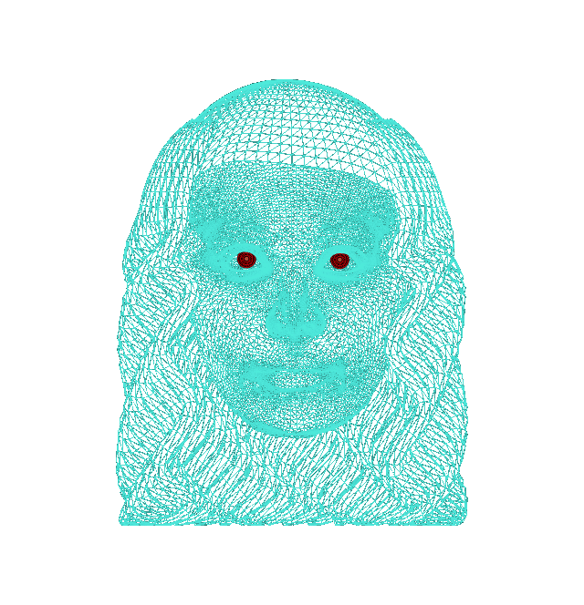</td>
    <td width="50%" align="center" valign="top">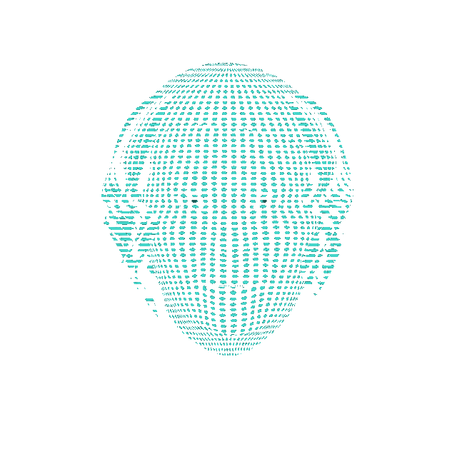</td>
  </tr>
  <tr><th colspan="2" align="center">Surface-grid curls</th></tr>
  <tr><td colspan="2" align="center" valign="top">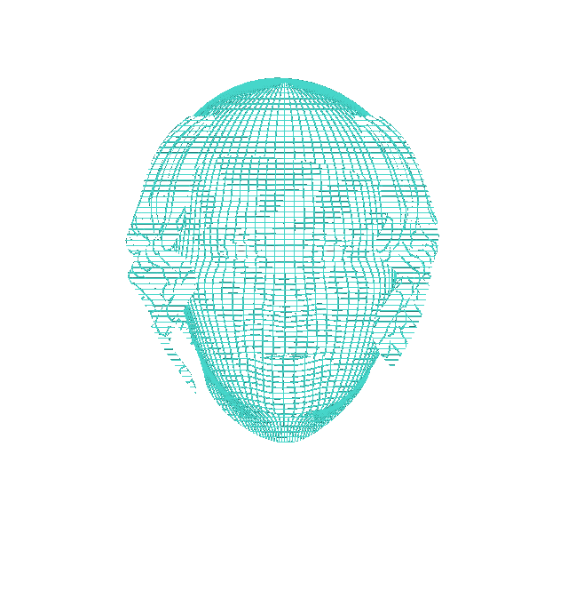</td></tr>
</table>

Hair is **off by default outside Claire**. Enable it when you want it; the robot
uses armor instead. The same shared hairstyle follows each human view's wire,
dots or grid without regenerating the speech.

### More dots. More cells. More space.

<table width="100%">
  <tr><th width="50%" align="center">FaceDot density and gap</th><th width="50%" align="center">UniformPolygons density and gap</th></tr>
  <tr>
    <td width="50%" align="center" valign="top">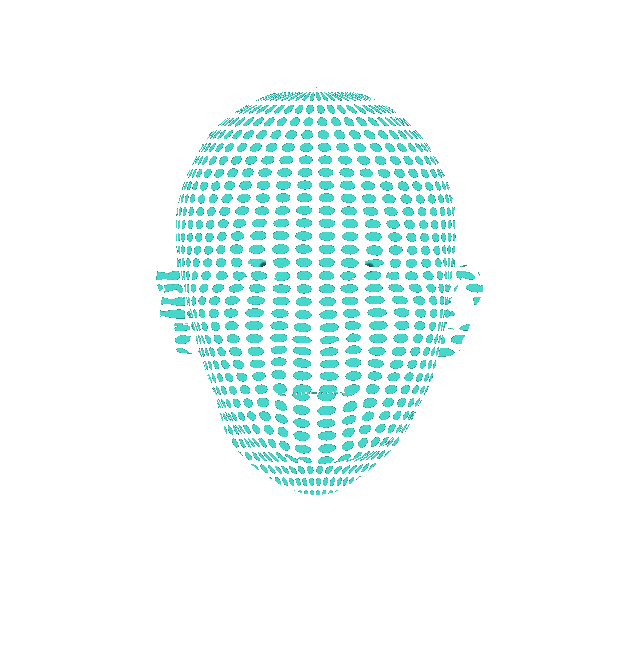</td>
    <td width="50%" align="center" valign="top"></td>
  </tr>
</table>

**Pattern density: 0.5x-3x. Cell gap: 0-80%.** Density changes the spacing and
number of surface samples; gap separates their visible marks. Each view retains
its own values until reload. These GIFs step through actual control states,
not new neural vertices, exact dot counts or performance measurements.

## Eyes follow, or the whole head follows

Enable **Follow cursor**, then select **Cursor mode**.

<table width="100%">
  <tr><th width="50%" align="center">Eyes follow cursor</th><th width="50%" align="center">Head follows cursor (eyes centered)</th></tr>
  <tr>
    <td width="50%" align="center" valign="top"></td>
    <td width="50%" align="center" valign="top"></td>
  </tr>
</table>

X/Y/Z remain manual orientation offsets. Tracking is bounded procedural aiming,
not calibrated 3D gaze or learned eye joints. These captures use synthetic pointer
positions inside the owned browser; they do not move the system cursor.

## A floating head, not a floating control panel

<p align="center">
  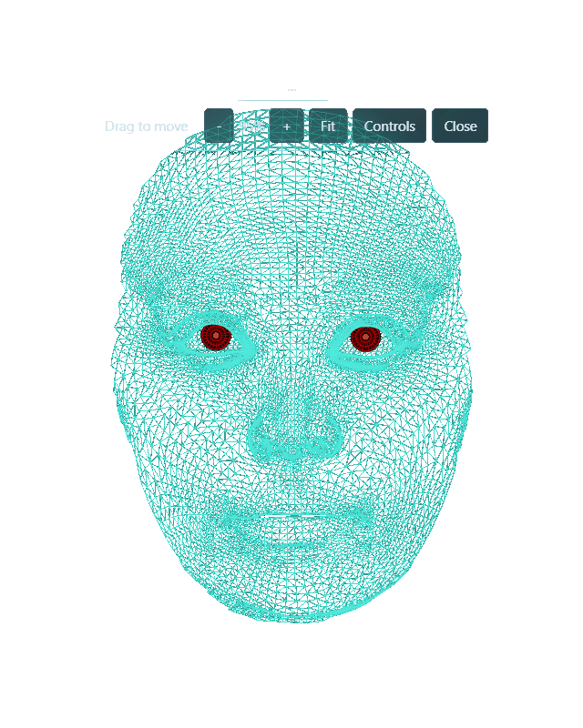
</p>

The native overlay starts with a **tiny translucent glass ... tab centered
above the head**. Click to expand; **Escape** or clicking outside collapses it.
Expand for **Drag to move**, **- / + / Fit**, **Controls** and **Close**.
The native window remembers its placement across Controls/pop-out for this run;
restart resets it. Always-on-top is optional, and transparent areas may intercept clicks.

The GIF alternates two actual Electron captures, preserving binary GIF
transparency. It is not a recording of desktop dragging or OS acrylic blur;
the glass effect styles Verona's own web content, and GIF cannot preserve its
full partial-alpha shading.

<table width="100%">
  <tr><th width="50%" align="center">Decide how much neck is visible</th><th width="50%" align="center">Zoom in and out</th></tr>
  <tr>
    <td width="50%" align="center" valign="top">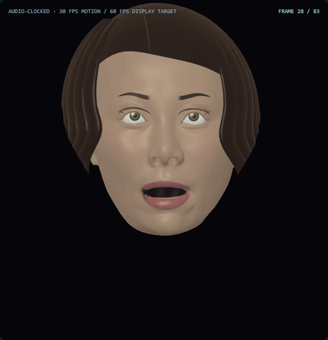</td>
    <td width="50%" align="center" valign="top"></td>
  </tr>
</table>

**Framing -> Head and neck -> Visible neck** previews a curved jaw-following cut:
**0-6 cm**, default **1.7 cm**. Full bust restores the complete original geometry.
**Zoom: 35-230%; Fit: 100%.** The GIF samples browser zoom states; the native
buttons use the same control. High zoom intentionally can crop the model.

## Shape the voice

Preview, adjust pitch/speed/bass/treble/emphasis, generate. **Hazel** remains the
reset default. Choose an explicit expression; it is not guessed from the words.
Claire's **Edges**, **Points** and **Hair** remain independent.
Disable **Colors** in Claire for grayscale skin, eyes, makeup and hair in either
material. Re-enable it to restore colors; neither option changes your speech.

<p align="center">
  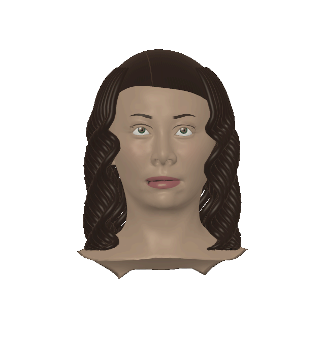
</p>

### Current app screenshots

<p align="center">
  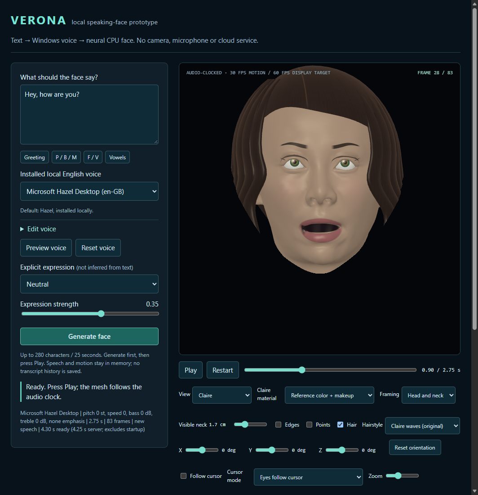
</p>
<p align="center">
  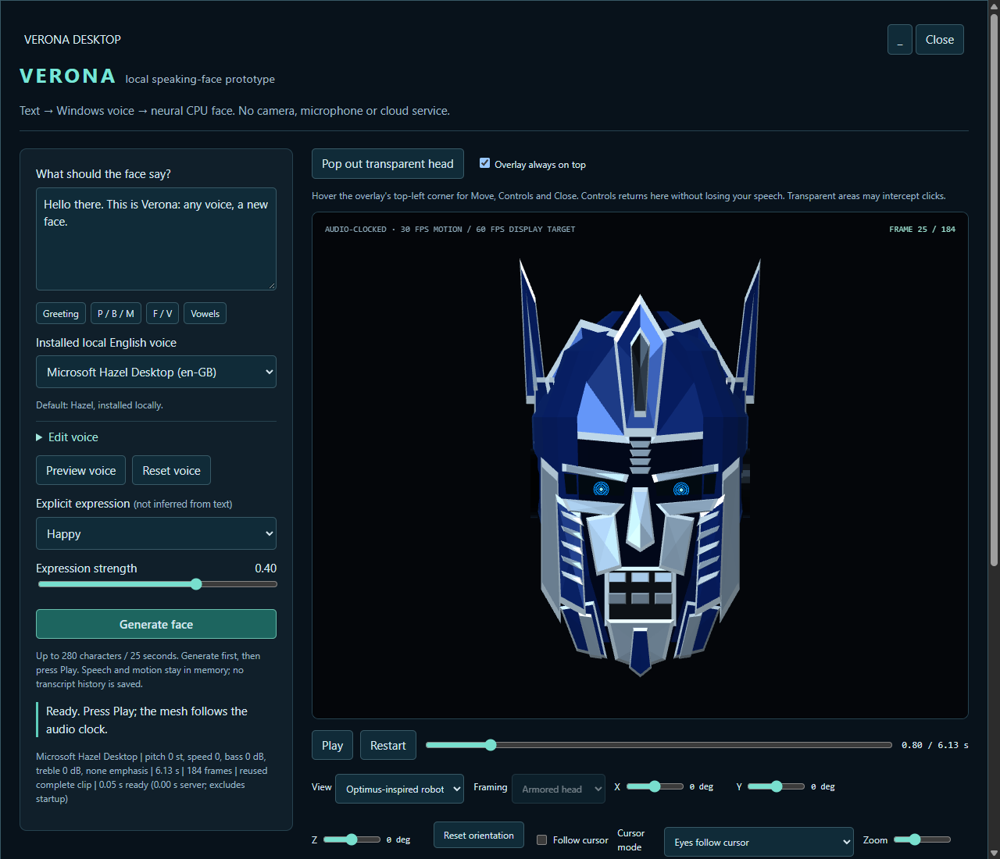
</p>

## Prototype boundaries

The trained speech identity remains **Claire v2.3.1**. Reference color/makeup is a
stylized study, **not an accepted likeness, photorealism or perfect expressions**.
Teeth/tongue/eye joints and full SDK contact correction remain omitted.
Phonetic accuracy and independent listening acceptance are still open.

Speech is generated ahead of playback: **30-fps neural motion** interpolated on
the audio clock, with a **60-fps display target**, not live generation or a universal
performance guarantee. Color rendering caps pixel density at 1.5x; polygons at 2x.
Historical frame-time outliers remain documented.

**All GIFs are silent sampled previews**, not 60-fps recordings or an audio demo.
Hairstyle turntables show view rotation; control GIFs may show discrete states.
[Media provenance and timings](docs/media/README.md) identify their exact sources.
No private transcripts, reference sheets, model assets or voice recordings are
included in the gallery.
The twenty GIFs are deliberately media-heavy, especially the large captioned
intro; loading may take a moment on slower connections.

[Engineering book](docs/README.md) &middot; [Third-party terms](THIRD_PARTY.md)
&middot; [Immutable prototype 1](https://github.com/Zanark/Verona/releases/tag/v0.1.0-prototype.1)
&middot; [Immutable prototype 2](https://github.com/Zanark/Verona/releases/tag/v0.1.0-prototype.2)

</details>
