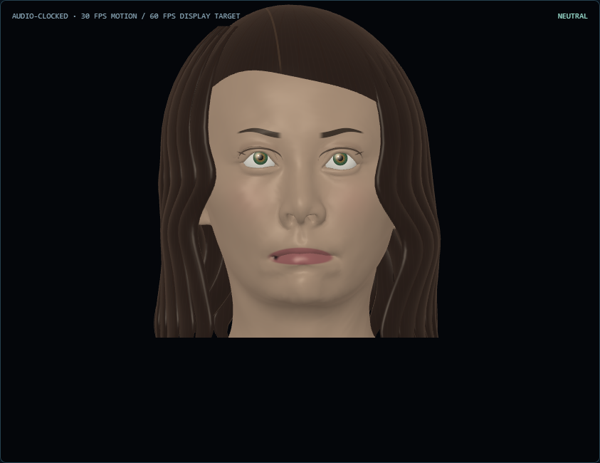
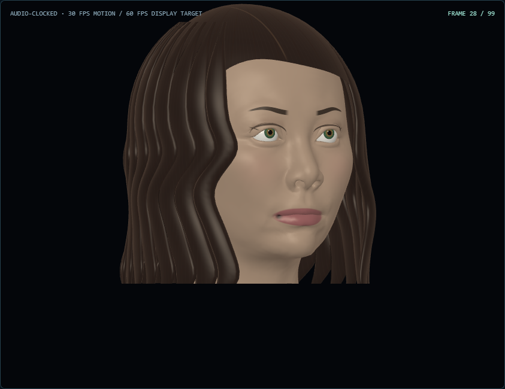
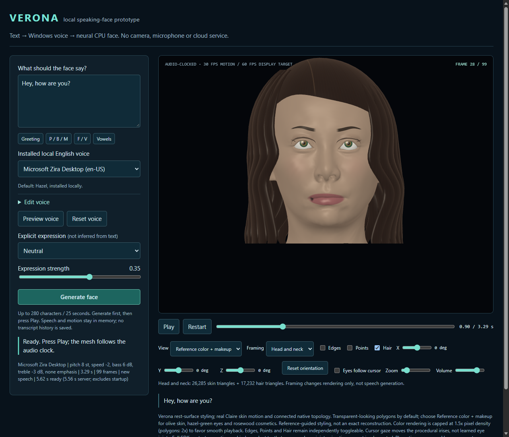
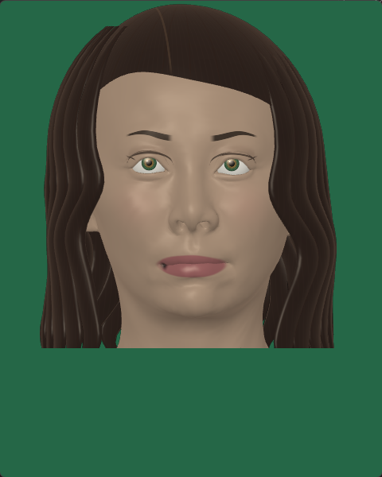
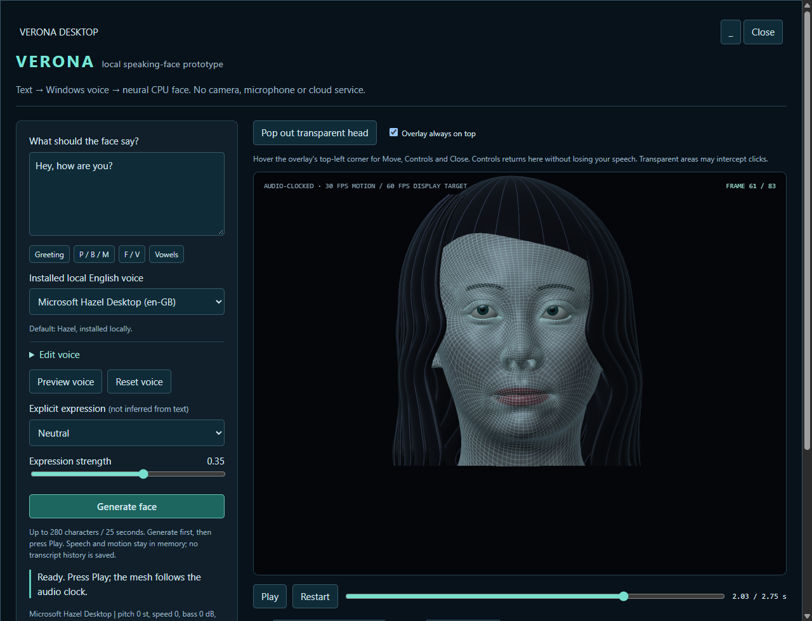

# Verona

**Type a sentence. Hear a local voice. Watch her speak.**


Windows voices, CPU neural motion, connected native contours. No camera, microphone or cloud runtime.

```powershell
.\VeronaDesktop.cmd
```

**Generate face**, **Play**, then **Pop out transparent head**.
Click the tiny glass **...** tab above the head for **Drag to move** and
**- / + / Fit** zoom controls. It starts collapsed; Escape collapses it again.
**Cursor mode** chooses moving eyes or a turning head with centered eyes.
**Follow cursor** enables either mode; X/Y/Z remain manual orientation offsets.
The browser version remains `.\Verona.cmd`.
**View → Claire** preserves the current head and speech motion.
Choose **Claire material → Reference color + makeup** for olive skin, hazel-green eyes,
rosewood lips and espresso waves. **Transparent polygons** remains the default.
**Hairstyle** offers the original Claire waves plus ten geometric alternatives:
pixie, bob, asymmetric bob, sleek layers, curls, ponytail, twin tails, top bun,
space buns and braided crown. Use Full bust for long styles; hair remains optional.
Fresh checkout? [Setup and controls](docs/prototype-guide.md).
[Current source prerelease](https://github.com/Zanark/Verona/releases/tag/v0.1.0-prototype.2).

## Color study

| Neutral geometry | Three-quarter geometry |
|---|---|
|  |  |




**A stylized reference-guided study—not a photorealistic reconstruction or an
accepted likeness.** The underlying speech model remains Claire.

## Desktop and transparent overlay





**Framing → Head and neck** hides shoulders and submits fewer polygons.
**Full bust** stays available/default. Cursor-following eyes and X/Y/Z rotation
work in both views. Always-on-top is optional; transparent areas may intercept clicks.
Desktop setup: `.\Setup-VeronaDesktop.cmd` once.

## Keep the polygon effect

The **View** selector adds presentations without regenerating or restarting speech:

| View | Presentation |
|---|---|
| **Claire** | Original face/hair, transparent polygons or optional makeup |
| **FaceMesh** | Front face only: triangular wireframe, no ears/neck/hair; **Mesh detail 1-5**, default 5 |
| **FaceDot** | Visible-surface dots, including ears/eyes/neck; no visible polygons, lines or hair |
| **UniformPolygons** | Surface-anchored rectangular grid, including ears/eyes/neck; no hair |

FaceDot and UniformPolygons expose **Pattern density** (0.5x-3x) and **Cell gap**
(0-80%). Density changes the number of dots/cells; gap separates their visible
marks without changing the speech mesh. Each view remembers its own settings
until reload. These are surface patterns, not extra model vertices or quad faces.

Dot/grid views start at Head and neck; Full bust remains available.
**Head and neck → Visible neck** previews a jaw-following cut live:
**0** for jawline-only, up to **6cm** for more neck (default1.7cm).
Claire retains its own framing and toggles. New unlit views skip animated-normal
updates; lower FaceMesh detail reduces submitted geometry, not inference time.
Grid cells follow the curved/deforming face, not perfectly flat rectangles.
**Realistic**, the future supplied-GLB identity, remains parked.

| Transparent polygons | Same native skin, hair off |
|---|---|
|  |  |

## Shape the voice

Preview, adjust pitch/speed/bass/treble/emphasis, generate. Hazel remains the
reset default. Claire's **Edges**, **Points** and **Hair** remain independent.

**Early prototype:** procedural cursor gaze, not learned eye joints; articulation accuracy is not accepted.
Playback targets **60-fps display** over 30-fps neural motion, not live generation.
Color view caps high-DPI rendering at 1.5x; polygons at 2x.
Historical frame-time spikes remain documented. GIFs are silent sampled previews.

[Engineering book](docs/README.md) · [Media provenance](docs/media/README.md) · [Third-party terms](THIRD_PARTY.md) · [Original immutable prototype](https://github.com/Zanark/Verona/releases/tag/v0.1.0-prototype.1)
