# Verona

**Type a sentence. Hear a local voice. Watch her speak.**

<p align="center">
  
</p>

Windows voices, CPU neural motion and an animated 3D face. **No camera,
microphone or cloud runtime.** This gallery shows the actual prototype, not
reference artwork or a photorealistic reconstruction.

[**Get prototype 3**](https://github.com/Zanark/Verona/releases/tag/v0.1.0-prototype.3)
&middot; [Setup and controls](docs/prototype-guide.md)
&middot; [All 11 hairstyles](#every-hairstyle-in-motion)
&middot; [Engineering book](docs/README.md)

```powershell
.\VeronaDesktop.cmd
```

**Generate face**, **Play**, then **Pop out transparent head**.
Fresh checkout? Follow [setup](docs/prototype-guide.md) first; this is a source
prototype, not a bundled installer. Desktop setup is explicit:
`.\Setup-VeronaDesktop.cmd`. Browser-only launch: `.\Verona.cmd`.

## Every hairstyle in motion

**Original Claire waves plus ten alternatives. Every available option is below.**
Choose any **View**, enable **Hair (this view)**, then pick **Hairstyle (shared)**.
Hair starts on in Claire and off in other views; each view remembers its choice
until reload. Hair follows that view's polygons, triangle edges, dots or grid.
These previews select **Reference color + makeup**, **Full bust** and **80% zoom**
to reveal tails, long layers and updos. The app still starts with the original
waves and cool **Transparent polygons**.

<table width="100%">
  <tr><th width="50%" align="center">Claire waves (original)</th><th width="50%" align="center">Tapered pixie</th></tr>
  <tr>
    <td width="50%" align="center" valign="top">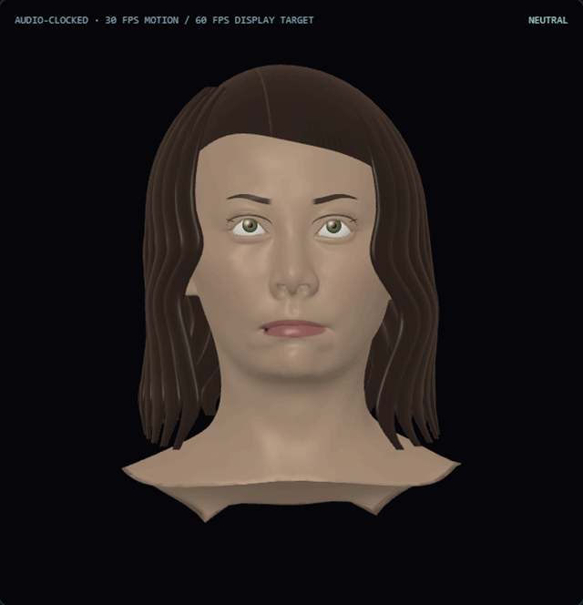</td>
    <td width="50%" align="center" valign="top">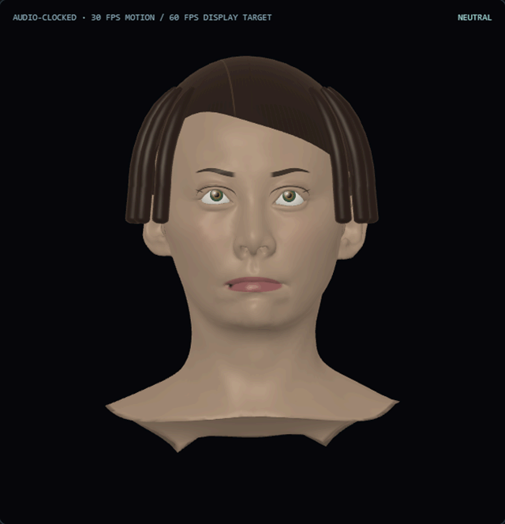</td>
  </tr>
  <tr><th width="50%" align="center">Rounded bob</th><th width="50%" align="center">Asymmetric angled bob</th></tr>
  <tr>
    <td width="50%" align="center" valign="top">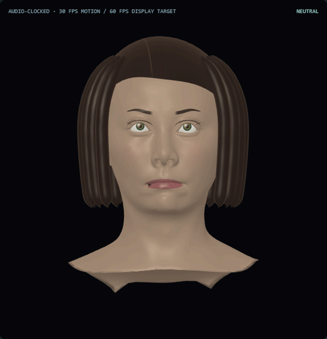</td>
    <td width="50%" align="center" valign="top">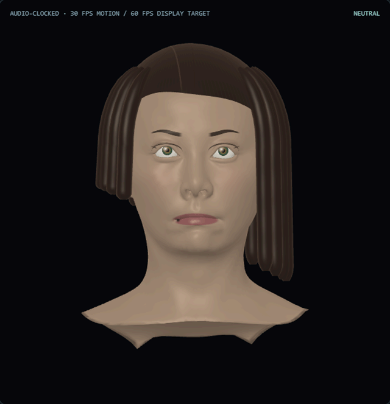</td>
  </tr>
  <tr><th width="50%" align="center">Long sleek layers</th><th width="50%" align="center">Spiral curls</th></tr>
  <tr>
    <td width="50%" align="center" valign="top">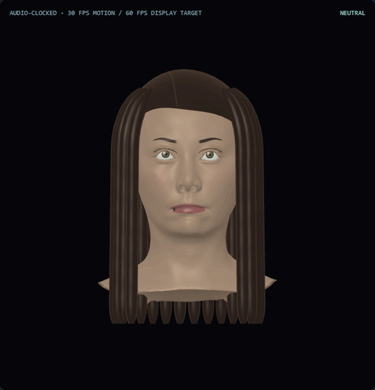</td>
    <td width="50%" align="center" valign="top"></td>
  </tr>
  <tr><th width="50%" align="center">High ponytail</th><th width="50%" align="center">Twin tails</th></tr>
  <tr>
    <td width="50%" align="center" valign="top">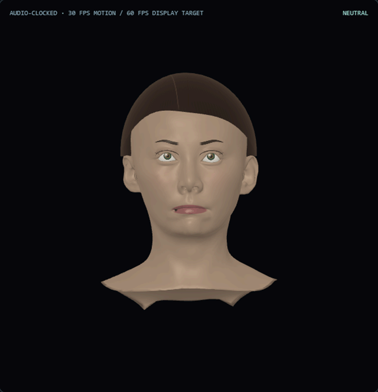</td>
    <td width="50%" align="center" valign="top">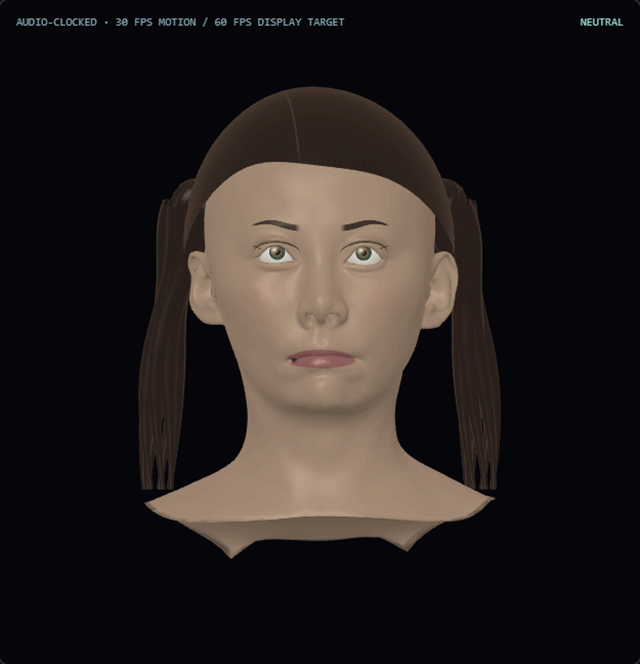</td>
  </tr>
  <tr><th width="50%" align="center">Coiled top bun</th><th width="50%" align="center">Double space buns</th></tr>
  <tr>
    <td width="50%" align="center" valign="top">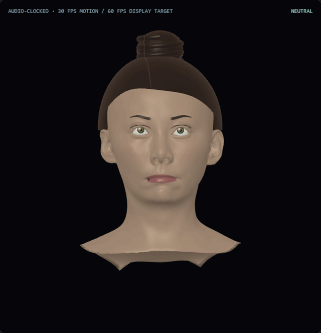</td>
    <td width="50%" align="center" valign="top">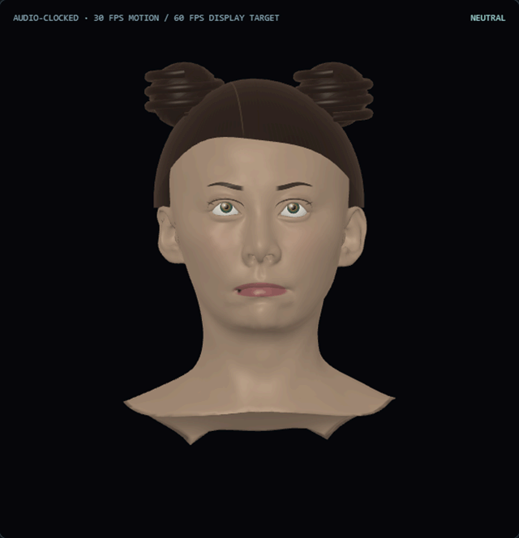</td>
  </tr>
  <tr>
    <td colspan="2" align="center" valign="top"><b>Braided crown</b><br>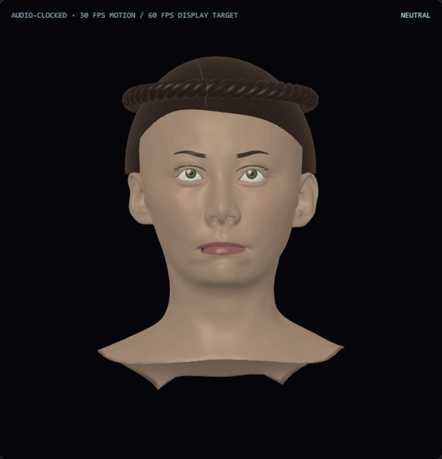</td>
  </tr>
</table>

**One speech system, eleven looks.** Hair changes do not regenerate speech.
These are procedural geometric styles, not strand simulation. **Head and neck**
trims long hair to the same jaw-following boundary; use **Full bust** to retain
its length. Longer styles keep their intentional fit margin.

These are manual view turntables at 10 sampled frames/second, not hair physics
or head motion inferred from speech. Only the selected alternative is built;
switching back restores the original Claire geometry.

## Four ways to see the same face

Change **View** without restarting or regenerating the current clip.

<table width="100%">
  <tr><th width="50%" align="center">Claire</th><th width="50%" align="center">FaceMesh</th></tr>
  <tr>
    <td width="50%" align="center" valign="top"><br>Original head, optional hair, cool contours or reference color/makeup.</td>
    <td width="50%" align="center" valign="top"><br>Front face only: no ears or neck. Hair off here; optional triangle-edge hair. <b>Mesh detail 1-5</b>, native face detail at 5.</td>
  </tr>
  <tr><th width="50%" align="center">FaceDot</th><th width="50%" align="center">UniformPolygons</th></tr>
  <tr>
    <td width="50%" align="center" valign="top">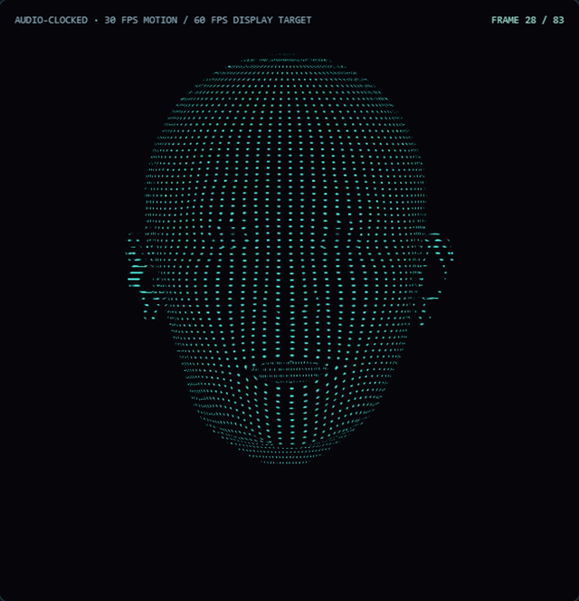<br>Dots on face, ears, eyes and neck; no connecting lines. Optional dotted hair, off here.</td>
    <td width="50%" align="center" valign="top"><br>Rectangular surface-grid outlines on face, ears, eyes and neck. Optional grid hair, off here.</td>
  </tr>
</table>

These previews manually turn a paused generated pose. All four views share the
same underlying Claire motion and audio clock. Grid cells follow the curved
face: this is **not quad retopology**. **Realistic**, the future supplied-GLB
identity, remains parked and is not an implemented view.

### More dots. More cells. More space.

<table width="100%">
  <tr><th width="50%" align="center">FaceDot density and gap</th><th width="50%" align="center">UniformPolygons density and gap</th></tr>
  <tr>
    <td width="50%" align="center" valign="top"></td>
    <td width="50%" align="center" valign="top">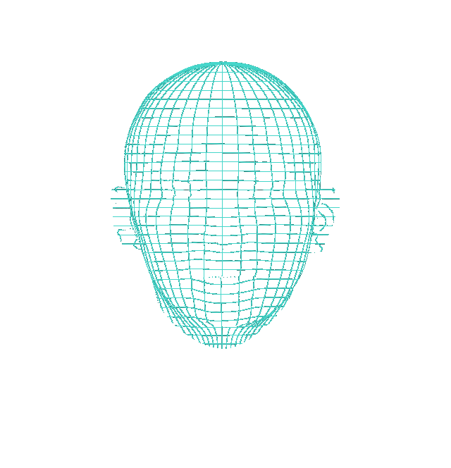</td>
  </tr>
</table>

**Pattern density: 0.5x-3x. Cell gap: 0-80%.** Density changes the spacing and
number of surface samples; gap separates their visible marks. Each view retains
its own values until reload. These GIFs step through actual control states,
not new neural vertices, exact dot counts or performance measurements.

## Eyes follow, or the whole head follows

Enable **Follow cursor**, then select **Cursor mode**.

<table width="100%">
  <tr><th width="50%" align="center">Eyes follow cursor</th><th width="50%" align="center">Head follows cursor (eyes centered)</th></tr>
  <tr>
    <td width="50%" align="center" valign="top">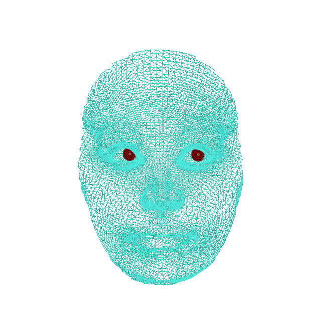</td>
    <td width="50%" align="center" valign="top">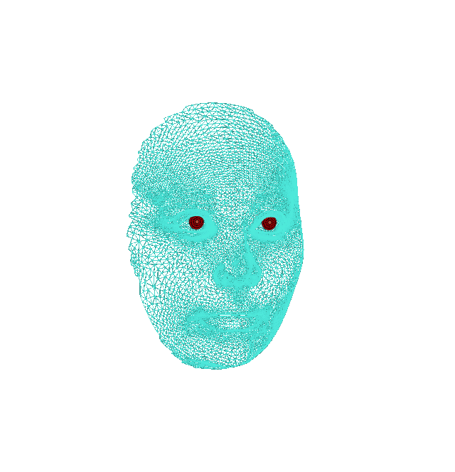</td>
  </tr>
</table>

X/Y/Z remain manual orientation offsets. Tracking is bounded procedural aiming,
not calibrated 3D gaze or learned eye joints. These captures use synthetic pointer
positions inside the owned browser; they do not move the system cursor.

## A floating head, not a floating control panel

<p align="center">
  
</p>

The native overlay starts with a **tiny translucent glass ... tab centered
above the head**. Click to expand; **Escape** or clicking outside collapses it.
Expand for **Drag to move**, **- / + / Fit**, **Controls** and **Close**.
The native window remembers its placement across Controls/pop-out for this run;
restart resets it. Always-on-top is optional, and transparent areas may intercept clicks.

The GIF alternates two actual Electron captures, with transparency flattened to
black for the image. It is not a recording of desktop dragging or OS acrylic blur;
the glass effect styles Verona's own web content.

<table width="100%">
  <tr><th width="50%" align="center">Decide how much neck is visible</th><th width="50%" align="center">Zoom in and out</th></tr>
  <tr>
    <td width="50%" align="center" valign="top"></td>
    <td width="50%" align="center" valign="top">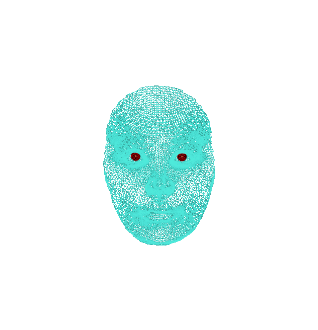</td>
  </tr>
</table>

**Framing -> Head and neck -> Visible neck** previews a curved jaw-following cut:
**0-6 cm**, default **1.7 cm**. Full bust restores the complete original geometry.
**Zoom: 35-230%; Fit: 100%.** The GIF samples browser zoom states; the native
buttons use the same control. High zoom intentionally can crop the model.

## Shape the voice

Preview, adjust pitch/speed/bass/treble/emphasis, generate. **Hazel** remains the
reset default. Choose an explicit expression; it is not guessed from the words.
Claire's **Edges**, **Points** and **Hair** remain independent.
Disable **Colors** in Claire for grayscale skin, eyes, makeup and hair in either
material. Re-enable it to restore colors; neither option changes your speech.


## Prototype boundaries

The trained speech identity remains **Claire v2.3.1**. Reference color/makeup is a
stylized study, **not an accepted likeness, photorealism or perfect expressions**.
Teeth/tongue/eye joints and full SDK contact correction remain omitted.
Phonetic accuracy and independent listening acceptance are still open.

Speech is generated ahead of playback: **30-fps neural motion** interpolated on
the audio clock, with a **60-fps display target**, not live generation or a universal
performance guarantee. Color rendering caps pixel density at 1.5x; polygons at 2x.
Historical frame-time outliers remain documented.

**All 23 GIFs are silent sampled previews**, not 60-fps recordings or an audio demo.
Hairstyle turntables show view rotation; control GIFs may show discrete states.
[Media provenance and timings](docs/media/README.md) identify their exact sources.
No private transcripts, reference sheets, model assets or voice recordings are
included in the gallery.

[Engineering book](docs/README.md) &middot; [Third-party terms](THIRD_PARTY.md)
&middot; [Immutable prototype 1](https://github.com/Zanark/Verona/releases/tag/v0.1.0-prototype.1)
&middot; [Immutable prototype 2](https://github.com/Zanark/Verona/releases/tag/v0.1.0-prototype.2)
