<p align="center">
  <picture>
    <source media="(prefers-color-scheme: dark)" srcset="docs/branding/verona-lockup-dark.png">
    
  </picture>
</p>

<p align="center">
  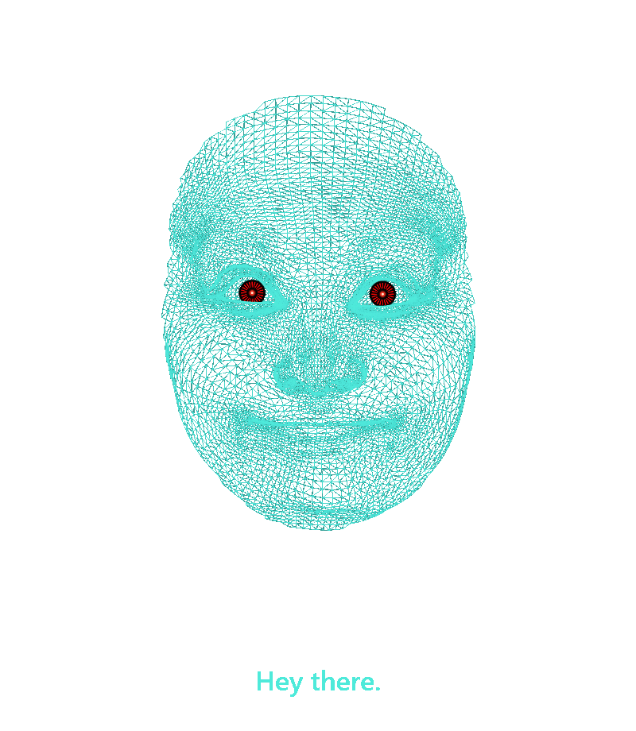
</p>

<details>
<summary><strong>Explore Verona: six heads, all 10 emotions, hairstyles and controls</strong></summary>

# Verona

**Type a sentence. Hear a local voice. Give it a face.**

Windows voices plus **28 optional offline neural voices**, CPU neural motion and an animated 3D face. **No camera,
microphone or cloud runtime.** This gallery shows the actual prototype, not
reference artwork or a photorealistic reconstruction.

[**Recorded local idle effects - v0.3.1**](https://github.com/Zanark/Verona/releases/tag/v0.3.1)
&middot; [Release notes and boundaries](docs/releases/v0.3.1.md)
&middot; [Native head parity](https://github.com/Zanark/Verona/releases/tag/v0.2.0)
&middot; [Milestone 1](https://github.com/Zanark/Verona/releases/tag/v0.1.0)
&middot; [Setup and controls](docs/prototype-guide.md)
&middot; [All emotions](#all-ten-emotions---4x-and-bright-spokes)
&middot; [All four hairstyles](#every-hairstyle-in-motion)
&middot; [Engineering book](docs/README.md)

```powershell
.\Verona.cmd
```

One **session manager** creates and controls all heads. Choose a session name,
model and colors, then **Create separate head**. Select a head to change its
actual controls or speak through it. Two chats can have separate heads at once.
Fresh checkout? Follow [setup](docs/prototype-guide.md) first; this is a source
prototype, not a bundled installer. Desktop setup is explicit:
`.\Setup-VeronaDesktop.cmd`. `VeronaDesktop.cmd` opens this same manager;
different launchers are not needed.

All six choices are here: **original Claire, native MPFB, actual Mark,
structural-reference Claire, historical subtle-reference Claire and
Male-SharpJawline**. Claire is preserved. These are experimental identities,
not accepted Female profiles or anatomical-accuracy claims.
Independent **mesh, eyes, hair, lips and eyebrows** accept swatches or RGB hex.
All six share four hairstyle choices and the same live controls. **Mark starts
with a short textured quiff**, with **Classic side part** as a second short option.
Each head has its own model, capability, speech RAM and audio clock.
**Exit manager and its heads** closes only heads this manager created;
closing the browser tab alone does not stop them.

### Different sessions, different local voices

New heads automatically choose an **unused voice**, preferring the installed
Kokoro pack: Heart, Bella, Michael, Emma and 24 more US/British English styles.
Choose another in the selected head's **Voice** control; its name appears on
the session card. Omitted CLI voice keeps that selection. Manually duplicated
choices are visibly marked **shared voice**.

This checkout has **31 voices: 28 Kokoro + Hazel, David and Zira**.
Fresh installations need [explicit optional setup](docs/prototype-guide.md#optional-28-voice-offline-pack);
runtime never downloads models. One shared neural model serves the styles
inside each requesting head, not 28 loaded models. Windows voices remain
available. Neural voices add CPU/memory and cold-start delay; pitch/emphasis
are explicitly unavailable for Kokoro, while speed, bass and treble work.
[Research, rights and actual measurements](docs/research/local-voices.md).
Voice support is included in v0.3.0 source. The optional voice pack is installed
separately; the v0.2.0 ZIP and frozen tag remain unchanged.

**M1 freezes the working local speaking-face workspace, not a claim of perfect
lip sync or a production-ready assistant.** The six model overviews below are
newer captures of the current renderers, including procedural blinks. The
preserved hero, hair, rotation and control demonstrations retain their earlier
provenance; their old interfaces are not the current manager.
**4x expressions, glowing centers and bright spokes** are the selected
FaceMesh look, including the opening talking hero. Each new model GIF shows
all ten available single emotions plus neutral, not emotion combinations.

## Six heads, one local workspace

**Choose a head model first, then its face type.** A model is the head's
geometry/identity; a face type is how that head is drawn. FaceMesh is not a
second neural model loaded alongside Claire.

Each large, dedicated GIF speaks **"Hey, how are you?"** through **neutral and
all ten emotions**. Every head shows its four face types together at matching
speech timestamps: **Surface, FaceMesh, FaceDot and UniformPolygons**.
The Surface panel alternates between **Transparent polygons**
and **Reference color + makeup** across emotions; its caption names the material.
Native MPFB keeps its own topology; actual Mark keeps its own neural identity.
These are silent, 10-fps sampled previews, not live performance tests.

**Shared across every model:** full/head-neck framing and visible-neck depth,
zoom, XYZ rotation, eyes-only or whole-head cursor following, five feature
colors, four hairstyle choices, natural blinking and live sideways
cheekiness strength. Surface has the two materials; FaceMesh has mesh detail/
optics; FaceDot and UniformPolygons have density/gap controls. Switching views
preserves each view's settings without loading another speech model.

**Idle life:** all six heads and four face types now choose among **30 occasional
animations** locally: smiles, smirks, brows, nose/lip/cheek movements,
jaw loosening, yawns, sneezes, looking around, double nods, neck stretches and
eye squeezes, **five eye-focused actions** and **ten new multi-feature expressions**.
Look-around moves the eyes horizontally and vertically in either cursor mode.
Yawns and sneezes use **prepared local male/female effects matched to the selected voice**.
Neither falls back to synthesis. Independent mute/level controls default to **20%,
also the hard maximum**. **Audible yawns are rare**: a 10% chance per yawn and
at least ten minutes between automatic sounds; most yawns stay silent.
The visual yawn retains **3x the selection weight** of another eligible action.
Yawning separates the lips around a dark cosmetic mouth cavity, not a pucker.
The supplied recordings stay local/ignored and are not included in this repository.
On a fresh checkout, mute idle sound until your authorized local clips are
prepared; missing files produce a visible error, not a downloaded replacement.
Verona waits 12-28 seconds between actions, avoids recent repeats
and stops them for speech or direct interaction. **The chat schedules nothing
and spends no model tokens on idle behavior.** Use the manager's **Idle life**
checkbox to disable it; reduced-motion preference defaults it off.
[All thirty actions, controls, research and limits](docs/chapters/11-autonomous-idle-life.md).
Existing model/motion GIFs below retain their original provenance.

**Optional performance-only heads:** select **Performance-only head** when
creating a head, or pass `create --performance-mode`. It is **unchecked by
default and fixed for that head's lifetime**; normal heads have no performance
switch and keep their usual idle behavior. An opted-in silent head becomes **10% opaque**,
stops cursor following, blinking, idle gestures and automatic redraws, then
returns to **100% while speaking**. Normal opacity is independently adjustable
0-100% from **Normal opacity** in the floating menu on normal heads; performance-only
heads override that setting with 10%/100%. The menu always stays readable.
The speech model stays warm, so this targets idle CPU/GPU work rather than
promising model-memory savings.
[Mechanism and limits](docs/chapters/11-autonomous-idle-life.md#let-a-silent-head-sleep-vr-73).
[Actual CPU and memory measurements](docs/chapters/07-hazel-claire-and-performance.md#measured-idle-performance-mode-vr-73).

**Floating-head zoom:** above 100%, the transparent window now grows with the
head instead of cutting through its edges. The maximum adapts to your monitor's
usable area; **Fit** restores 100%. [Mechanism and actual 140% images](docs/chapters/10-desktop-overlay-and-gaze.md#zoom-without-cutting-the-head-at-the-window-edge-vr-69).

### Original Claire

The preserved neural head, with original waves in the Claire panel. All four
face types are available; hair, framing, colors and the two Claire materials
remain separate controls.

<p align="center">
  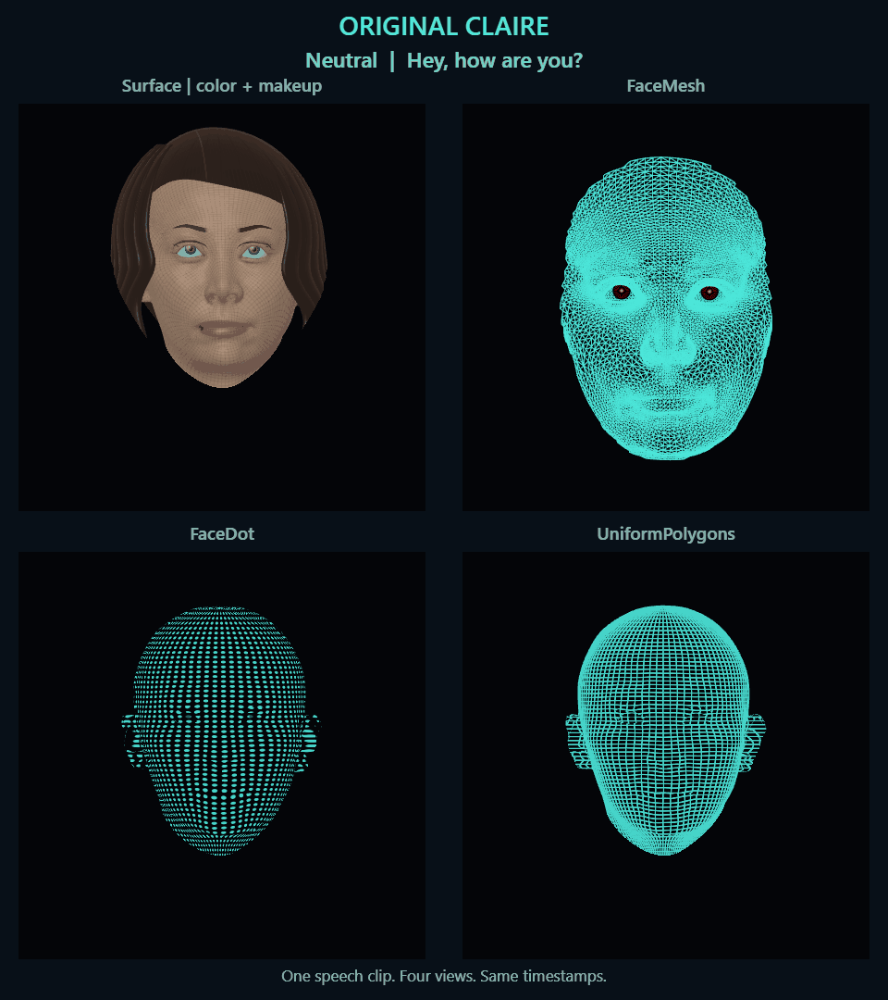
</p>

### Native MPFB

Independent native topology with Claire-to-native speech transfer and **all
four shared face types**. Native fitting precedes neutral-relative 2x/4x
geometric exaggeration, so a bounded fit no longer silently discards the gain.
Hair, makeup and eyelids are procedural approximations, not native rig assets.

<p align="center">
  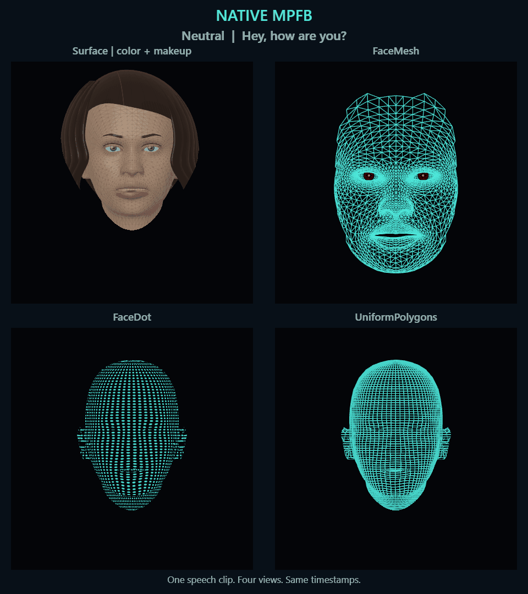
</p>

### Actual Mark

The original **Mark v2.3 network, PCA, conditioning and native-derived topology**,
not a renamed Claire or Male-SharpJawline sculpt. Uniform alignment preserves
its native shape. All four face types and shared controls are available.
**Short textured quiff** is now Mark's default, visible in all four face types;
choose **Classic side part** for a lower, neatly swept look. The refreshed
overview below uses the quiff instead of the old long waves.

<p align="center">
  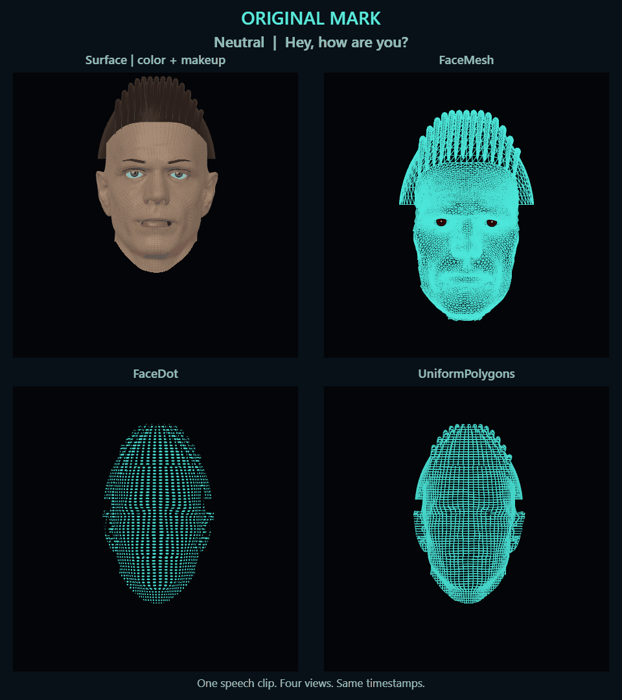
</p>

### Structural-reference Claire

A stronger experimental MPFB-reference geometric fit over Claire's speech
and topology, not the native MPFB head or an accepted likeness. Supports
**Claire, FaceMesh, FaceDot and UniformPolygons**, including both Claire materials.

<p align="center">
  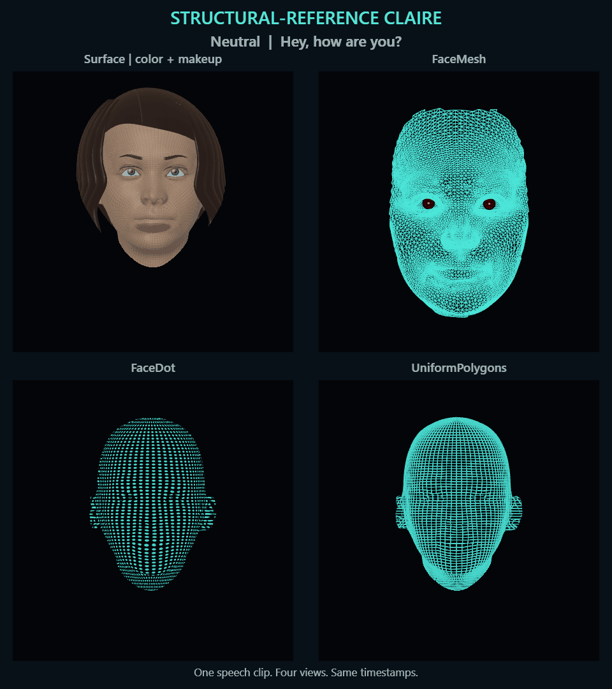
</p>

### Historical subtle-reference Claire

The earlier subtle fit, historically rejected and retained for comparison.
Supports **Claire, FaceMesh, FaceDot and UniformPolygons** with the same
material choices; keeping it available is not renewed approval.

<p align="center">
  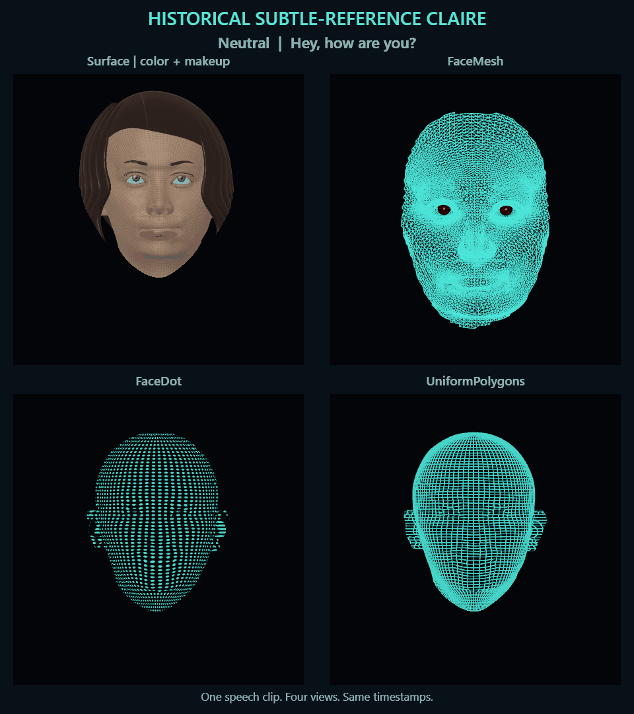
</p>

### Male-SharpJawline

The preserved owner-named sculpt over Claire motion, **not the Mark neural
identity**. Supports **Claire, FaceMesh, FaceDot and UniformPolygons**, including
the two Claire materials and shared hairstyle choices.

<p align="center">
  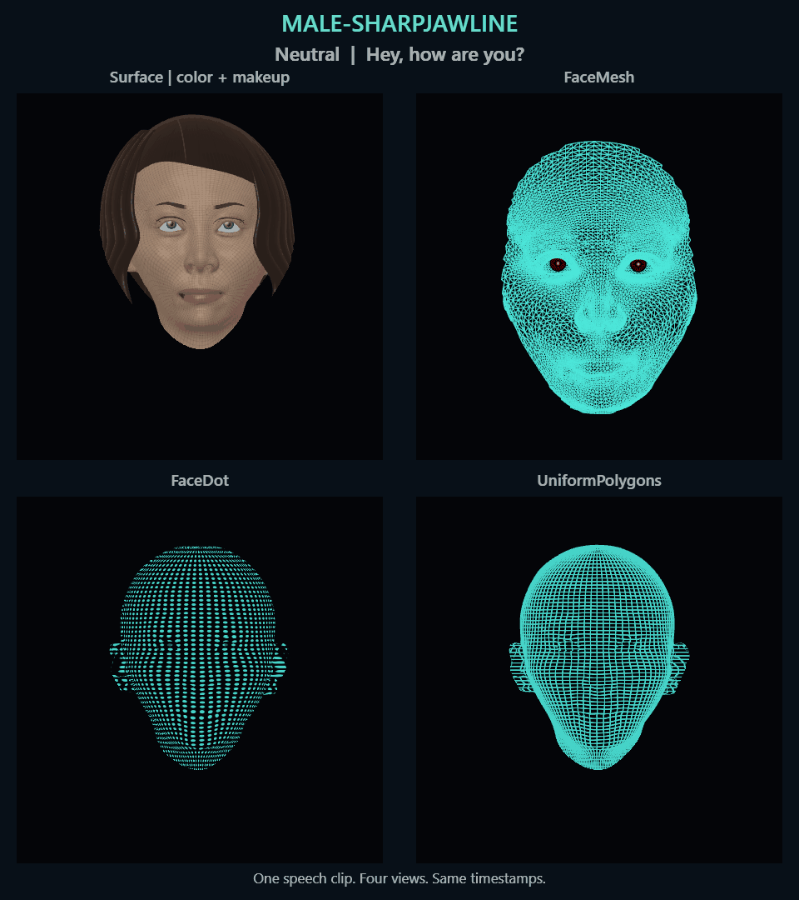
</p>

All previews use strength **0.6 / 4x**; neutral is not amplified.
MPFB's intermediate native fit is bounded to **0..1**, but its final exaggerated
geometry is not. Sideways cheekiness is a reversible cosmetic lip pull, not
another learned emotion. Expressions are explicit controls, not detected feelings
or accepted anatomy. Colors do not imply gender or a different speech network.
[Capture receipts and limitations](docs/media/README.md).

**Not implemented:** the future supplied-GLB **Realistic** view remains parked.

## Let a selected local agent session speak

Open the manager once. An opted-in local chat can create its own warm head:

```powershell
.\VeronaAgent.cmd create --session work --model claire --hair-color "#442211" --lips-color "#B03060"
.\VeronaAgent.cmd create --session review --model mpfb --eyebrows-color "#6677AA"
.\VeronaAgent.cmd list
.\VeronaAgent.cmd status --session work

# Another terminal or an explicitly opted-in local agent session:
'The build is ready.' | .\VeronaAgent.cmd say --session work
'A quick spoken update.' | .\VeronaAgent.cmd say --session work --voice-only
.\VeronaAgent.cmd configure --session work --hair-color "#113355" --lips-color "#DD5577"
```

Wait for `"ready": true` before speaking. Named Claire-family heads start in
**FaceMesh, bright spokes, 4x**, including native MPFB and actual Mark.
The host reuses its model, Windows speech worker and player. Voice-only skips
neural motion for faster narration; new animated sentences remain precomputed,
not instant. No global agent hook or automatic narration is installed.
[Commands, measured latency and cancellation](docs/prototype-guide.md#opt-in-speech-for-local-agent-sessions).

### Install the Verona agent skill

[The self-contained Verona skill](.github/skills/verona/SKILL.md) explains the
app, ownership/startup, all models, safe speech/cancellation, customization and
warm-host performance in depth. Its agent policy requires vivid, clearly
different color families across active heads, checking every feature before
and after creation/customization, not merely choosing another shade.
It documents simultaneous-agent reconciliation without pretending colors
are atomically reserved by the runtime. All application RGB choices stay free.

From a trusted checkout, Copilot CLI supports personal installation:

```powershell
copilot skill add .github\skills\verona\SKILL.md
```

For another Agency chat, including one already open, use the
[complete full-path handoff prompt](.github/skills/verona/SKILL.md#use-from-another-agency-session-including-an-already-open-chat).
The owner's identical library copy is
`C:\devdesk\homedesk\skill-library\skills\verona\SKILL.md`; no companion skill
files are required. The Verona checkout/runtime is still a separate prerequisite.

Installing instructions does not start a head, activate speech or devices,
download assets, or install an automatic narration hook. A prepared Windows
checkout and an explicitly opted-in local session are still required.

## All ten emotions - 4x and bright spokes

Each dedicated model GIF above covers the complete set: **Joy/Happy,
Sadness, Amazement/Surprised, Anger, Cheekiness, Disgust, Fear, Grief,
Out of breath and Pain**, plus the neutral speech baseline. Labels are
embedded in the same GIF frames; no separate caption animation can drift.

Choose one **Emotion**, strength **0..0.6**, and **2x or 4x** exaggeration.
These controls change the face, not the voice's emotion. Strong lids hide
covered optics; **Natural blinking** adds occasional procedural closure at
rest or during speech. It defaults off under reduced motion and can be
explicitly toggled. No combination or perfect human accuracy is implied.
The older individual emotion GIFs remain historical files rather than
repeating the model gallery here.

## Use this look in the app

Choose **View -> FaceMesh**, **Emotion exaggeration -> 4x**, then
**Generate face**. Select **FaceMesh eye glow -> Center + bright spokes**;
optical selection changes immediately. **4x doubles the previous 2x emotional
deformation**, not ordinary neutral speech. Natural eyelids still hide covered eyes.
Named manager heads already select4x/bright spokes; the preserved standalone
browser's defaults remain **2x** and **Center + rings + spokes**.

**Independent colors:** use the manager's five swatches or
the built-in color picker, or type a hex code such as `#4F46E5` or `#0FF`.
**Apply colors** updates the selected live head without regenerating speech.
**Restore original colors** removes custom overrides. Controls and colors are
session-local, not saved preferences. Feature visibility depends on the view.

Earlier comparisons remain available as history:
[2x](docs/media/comparison-emotion-2x.gif),
[4x](docs/media/comparison-emotion-4x.gif),
[bright spokes](docs/media/comparison-eyes-spokes.gif),
[bright rings](docs/media/comparison-eyes-rings.gif) and
[original center-glow preview](docs/media/expression-glow-preview.gif).
They are not the current feature demos.

## FaceMesh in every direction

<p align="center">
  
</p>

The huge opening loop stays front-facing to address the reader: smiles, anger,
surprise and sadness use explicit neural expression inputs. Its cyan phrase
captions are embedded in the **same GIF frames**, below the face, so they cannot
drift into a separate loop. The spooky dialogue is fictional; Verona does not
capture faces. GIFs are silent; the app plays the voice.

This separate loop demonstrates signed **X/Y/Z** rotation with glowing centers
and bright spokes. Concentric rings stay dark in this selected look; light never
shines through eyelids. The optional combined look retains its earlier dimming.

## Every hairstyle in motion

**Four choices: two preserved long styles and two new short designs for Mark.**
Choose a human **View**, enable **Hair (this view)**, then pick **Hairstyle (shared)**.
New Mark players start with **Short textured quiff**, hair on in every view.
Other models retain original waves, hair on in Surface/Claire and off elsewhere.
Each view remembers visibility until reload; the selected style is shared.
Hair follows that view's polygons, triangle edges, dots or grid.

<p align="center">
  <strong>Mark: Short textured quiff &middot; Classic side part</strong><br>
  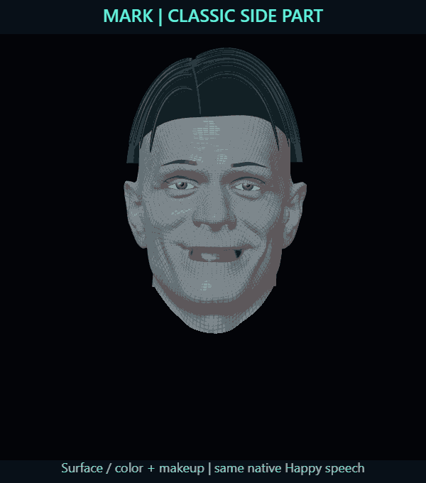
</p>

The **quiff** has a raised front with short swept-back ridges. The **side part**
has a lower asymmetric crown and strands swept away from the part. Both keep
the sides and back short—no long spiral locks. These new previews replay the
same native Happy greeting in Surface and FaceMesh with authored yaw.
The preserved long-style turntables below use Reference color + makeup,
Full bust and 80% zoom, and retain their earlier capture provenance.

<p align="center">
  <strong>Claire waves (original) &middot; Spiral curls</strong><br>
  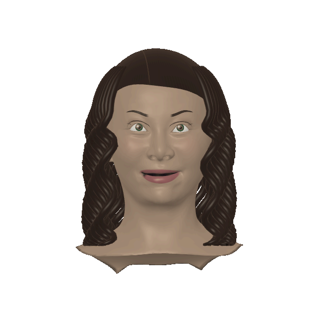
</p>

**One speech system, four hairstyles.** Spiral curls retain **48 locks instead
of 24**, keeping the same per-lock detail. The other nine styles and their
gallery GIFs have been removed, not hidden. Hair changes do not regenerate speech.
These are procedural geometric styles, not strand simulation. **Head and neck**
now trims skin, not hair: hairstyles retain their complete tips, and the
bounded jaw mask no longer rises through the ears.
[Before/after and mechanism](docs/chapters/10-desktop-overlay-and-gaze.md#preserve-ears-and-complete-hair-vr-70).

These are silent 10-fps sampled previews, not hair physics
or head motion inferred from speech. Only the selected alternative is built;
switching back restores the original Claire geometry.

## Four presentations. One speech session.

Change **View** without restarting or regenerating the current clip.

<p align="center">
  <strong>Claire &middot; FaceMesh</strong><br>
  <br>
  <sub>Claire: original head, optional hair, cool contours or reference color/makeup.<br>FaceMesh: front face only, mechanical red eyes, optional triangle-edge hair. <b>Mesh detail 1-5</b>, native face detail at 5.</sub>
</p>

<p align="center">
  <strong>FaceDot &middot; UniformPolygons</strong><br>
  <br>
  <sub>FaceDot: dots on face, ears, eyes and neck; no connecting lines. Optional dotted hair, off here.<br>UniformPolygons: rectangular surface-grid outlines on face, ears, eyes and neck. Optional grid hair, off here.</sub>
</p>

These previews manually turn a paused generated pose. All four views share
the same Claire skin and one audio clock. Grid cells follow the curved
face: this is **not quad retopology**. **Realistic**, the future supplied-GLB
identity, remains parked and is not an implemented view.
The FaceDot previews select **0.75x density / 20% gap** for readable dots;
the app's unchanged defaults are **1x / 0%**.

### Hair follows the head's format

<p align="center">
  <strong>Triangle-edge curls &middot; Dotted curls</strong><br>
  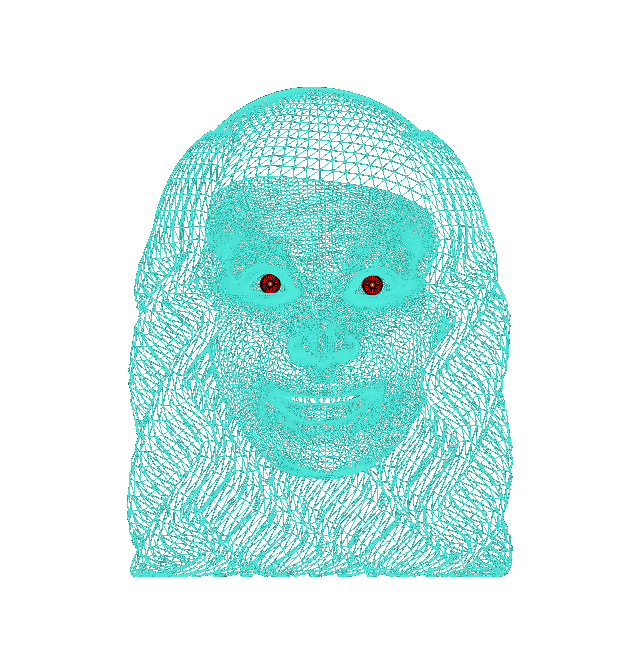
</p>

<p align="center">
  <strong>Surface-grid curls</strong><br>
  
</p>

Hair is **off by default outside Claire**. Enable it when you want it.
The same shared hairstyle follows each view's wire,
dots or grid without regenerating the speech.

### More dots. More cells. More space.

<p align="center">
  <strong>FaceDot density and gap &middot; UniformPolygons density and gap</strong><br>
  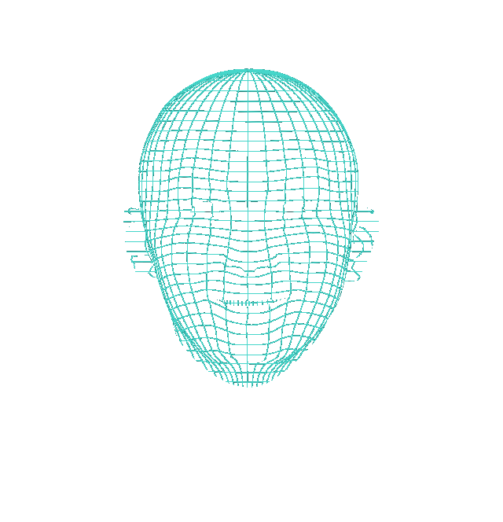
</p>

**Pattern density: 0.5x-3x. Cell gap: 0-80%.** Density changes the spacing and
number of surface samples; gap separates their visible marks. Each view retains
its own values until reload. These GIFs step through actual control states,
not new neural vertices, exact dot counts or performance measurements.

## Eyes follow, or the whole head follows

Enable **Follow cursor**, then select **Cursor mode**.

<p align="center">
  <strong>Eyes follow cursor &middot; Head follows cursor (eyes centered)</strong><br>
  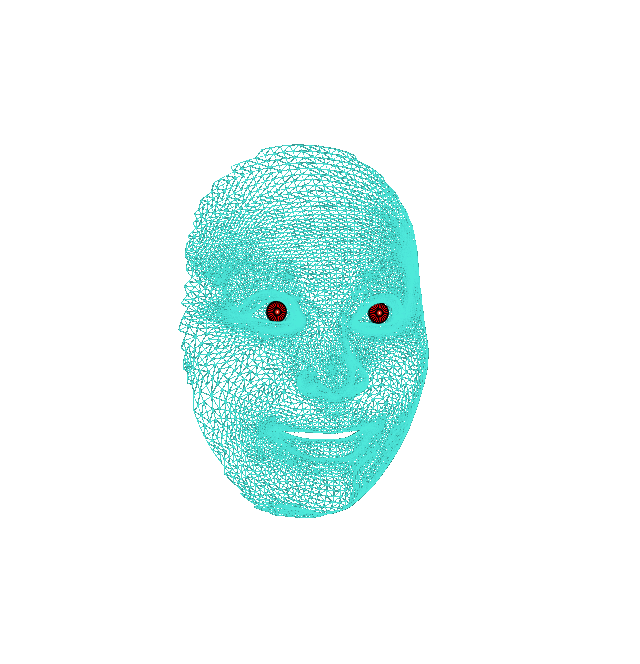
</p>

X/Y/Z remain manual orientation offsets. Tracking is bounded procedural aiming,
not calibrated 3D gaze or learned eye joints. These captures use synthetic pointer
positions inside the owned browser; they do not move the system cursor.

## A floating head, not a floating control panel

<p align="center">
  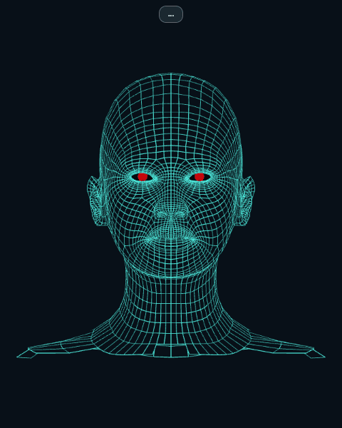
</p>

The native overlay starts with a **tiny translucent glass ... tab centered
above the head**. Click to expand; **Escape** or clicking outside collapses it.
Expand for **Drag to move**, **- / + / Fit**, **Close**, the name and pin.
The preserved standalone shell also has **Controls** to return from pop-out;
managed heads keep their controls in the central manager.
The native window remembers its placement across Controls/pop-out for this run;
restart resets it. **Always on top is enabled by default, independently for each
head.** Its toggle and the head name appear only inside the expanded menu.
Transparent areas may intercept clicks; topmost cannot override secure desktops.

This GIF alternates two production-menu/actual MPFB WebGL qualification
captures over an opaque dark composite. It is not a recording of desktop
dragging, OS pinning or speech; independent native pinning was qualified
separately. The glass effect styles Verona's own web content.

<p align="center">
  <strong>Decide how much neck is visible &middot; Zoom in and out</strong><br>
  
</p>

**Framing -> Head and neck -> Visible neck** previews a curved jaw-following cut:
**0-6 cm**, default **1.7 cm**. Full bust restores the complete original geometry.
**Zoom: 35-230%; Fit: 100%.** The GIF samples browser zoom states; the native
buttons use the same control. The native window grows with zoom and limits the
maximum to the monitor's usable area; browser-only high zoom can still crop.

## Shape the voice

Preview, adjust pitch/speed/bass/treble/emphasis, generate. **Hazel** remains the
reset default. Choose an explicit expression; it is not guessed from the words.
Claire's **Edges**, **Points** and **Hair** remain independent.
Disable **Colors** in Claire for grayscale skin, eyes, makeup and hair in either
material. Re-enable it to restore colors; neither option changes your speech.

<p align="center">
  
</p>

### Current manager

<p align="center">
  
</p>

The real manager is connected in an isolated empty test lane; the example name
is unsubmitted, not an invented live session. Select a created head for its
speech-first workspace, **Editable now** and **Read-only settings**. Original
vr-36 standalone screenshots remain [historical](docs/media/README.md).

## Prototype boundaries

The trained speech identity remains **Claire v2.3.1**. Reference color/makeup is a
stylized study, **not an accepted likeness, photorealism or perfect expressions**.
Teeth/tongue/eye joints and full SDK contact correction remain omitted.
Phonetic accuracy and independent listening acceptance are still open.

Speech is generated ahead of playback: **30-fps neural motion** interpolated on
the audio clock, with a **60-fps display target**, not live generation or a universal
performance guarantee. Color rendering caps pixel density at 1.5x; polygons at 2x.
Historical frame-time outliers remain documented.

**All GIFs are silent sampled previews**, not 60-fps recordings or an audio demo.
Hairstyle turntables show view rotation; control GIFs may show discrete states.
[Media provenance and timings](docs/media/README.md) identify their exact sources.
No private transcripts, reference sheets, model assets or voice recordings are
included in the gallery.
The stronger sideways-cheekiness comparison remains a **report-only proposal**,
not the expression shown throughout this release. No broader approval is implied.
The 38 GIFs are deliberately media-heavy, especially the large captioned
intro; loading may take a moment on slower connections.

[Engineering book](docs/README.md) &middot; [Third-party terms](THIRD_PARTY.md)
&middot; [Immutable prototype 1](https://github.com/Zanark/Verona/releases/tag/v0.1.0-prototype.1)
&middot; [Immutable prototype 2](https://github.com/Zanark/Verona/releases/tag/v0.1.0-prototype.2)
&middot; [Immutable prototype 3](https://github.com/Zanark/Verona/releases/tag/v0.1.0-prototype.3)

</details>
