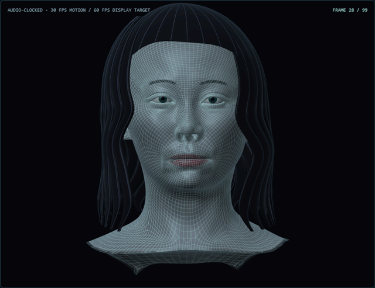
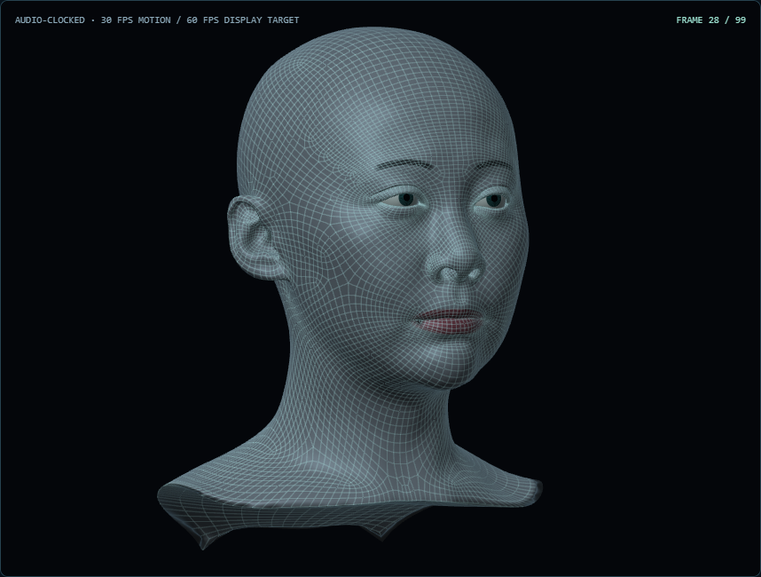
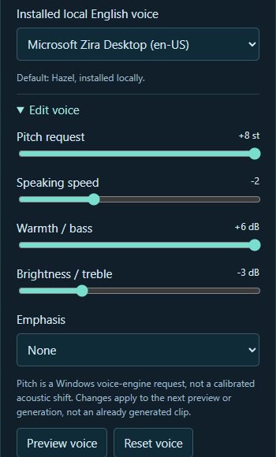

# Verona

**Type a sentence. Hear a local voice. Watch her speak.**


Windows voices, CPU neural motion, connected native contours. No camera, microphone or cloud runtime.

```powershell
.\Verona.cmd
```

**Generate face** then **Play**. Keep the terminal open; **Ctrl+C** stops it.
Fresh checkout? [Setup, controls and limits](docs/prototype-guide.md).

## The prototype


## Form and detail



| Three-quarter view | Native facial contours, hair off |
|---|---|
|  |  |

## Shape the voice



Preview, adjust, generate. Hazel remains the reset default.

**Early prototype:** static cosmetic eyes; articulation accuracy is not accepted.
Prepared playback met the local **60-fps display target**; neural motion is 30 fps,
not live generation. GIFs are silent, timeline-sampled previews.

[Engineering book](docs/README.md) · [Measured tradeoffs](docs/chapters/08-facial-definition-and-fluidity.md) · [Media provenance](docs/media/README.md) · [Third-party terms](THIRD_PARTY.md)
