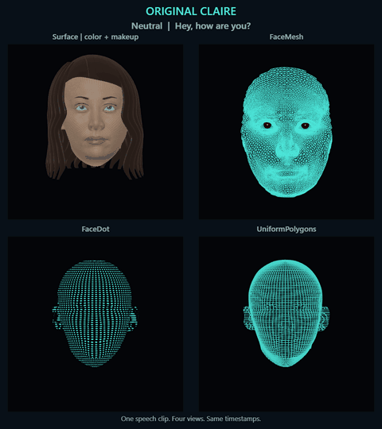
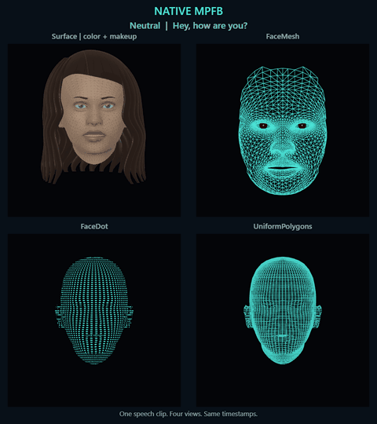
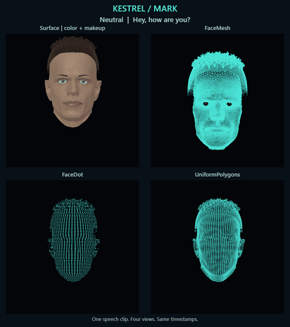
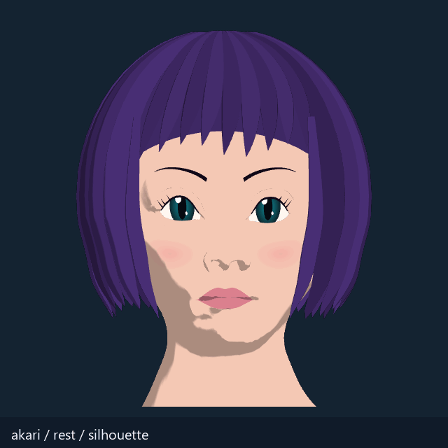
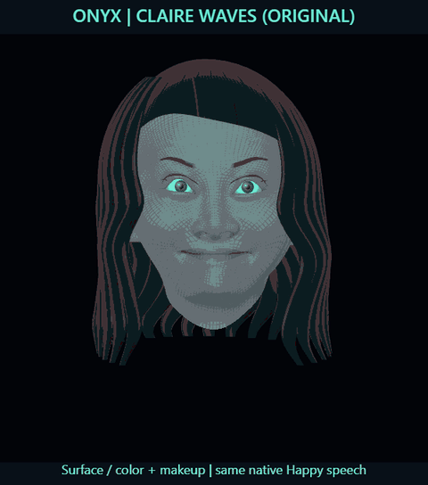
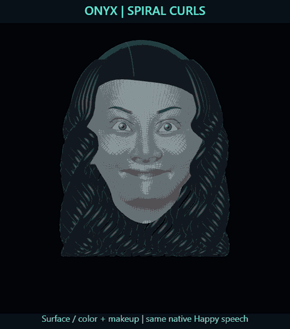
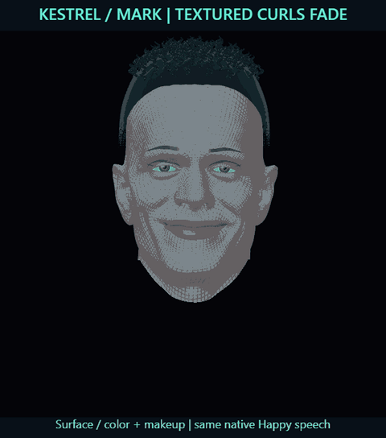
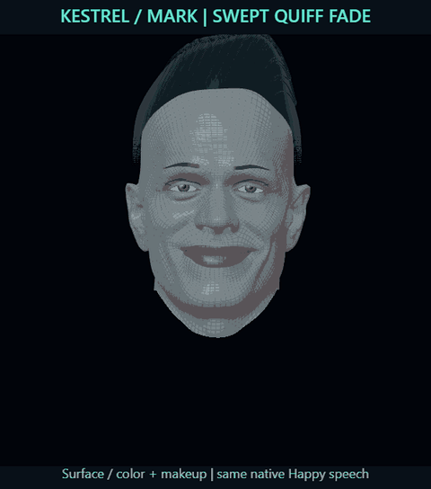
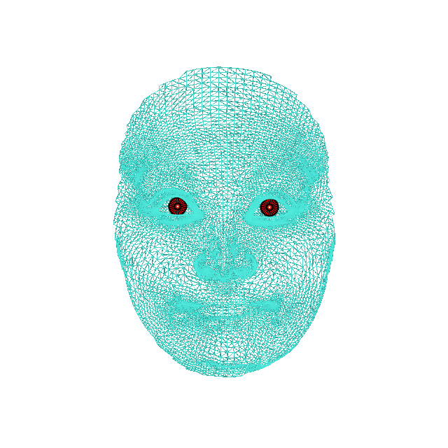

<p align="center">
  
</p>

<details>
<summary><strong>Explore Verona: seven faces and four hairstyles</strong></summary>

<p align="center">
  <picture>
    <source media="(prefers-color-scheme: dark)" srcset="docs/branding/verona-lockup-dark.png">
    
  </picture>
</p>

# Verona

**[v1.0.0 - First public release](https://github.com/Zanark/Verona/releases/tag/v1.0.0)** · Windows-local source release. [Release notes](docs/releases/v1.0.0.md)

**Type a sentence. Hear a local voice. Give it a face.**

Windows-local speech, CPU neural motion and an animated WebGL face.
No camera, microphone or cloud runtime.

[Setup & controls](docs/prototype-guide.md) · [Agent skill](.github/skills/verona/SKILL.md) · [Engineering book & journals](book/README.md) · [Media provenance](docs/media/README.md)

```powershell
.\Verona.cmd
```

One manager, separate named heads. Six selectable models; Windows voices plus
an explicitly installed optional 28-style Kokoro pack. A fresh checkout needs
[setup](docs/prototype-guide.md), not just this command.

## Meet the heads

**Six selectable combinations, plus Akari's anime preview.**
Neutral and all ten emotions; four shared views. Opaque mouths by default.

### Aster · Rowan

<p align="center">
  
</p>

Claire (`claire`) · Native MPFB with Claire motion (`mpfb`).

### Kestrel · Onyx

<p align="center">
  
</p>

Mark (`mark`) · Sharp-jaw Claire sculpt (`male-sharp`).

### Vale · Linden

<p align="center">
  
</p>

Structural Claire (`reference-structure`) · Subtle Claire (`reference-shell`).

### Akari

Teal eyes, attached lashes, rose lips, violet bob and restored toon shading.

<p align="center">
  
</p>

**Anime review, not yet selectable.** [Design & references](docs/research/claire-anime-woman.md).

## Hairstyles

### Women / Onyx — Claire waves · Spiral curls

<p align="center">
  
</p>

### Men / Mark — Textured curls fade · Swept quiff fade

<p align="center">
  
</p>

Shared choices, not separate neural models. New Mark heads default to textured curls fade;
existing heads keep their choices.

## FaceMesh in motion

<p align="center">
  
</p>

**Small print:** GIFs are silent sampled demonstrations, not live-FPS,
phonetic-accuracy or human-acceptance evidence. Six selectable shapes use two
neural identities; Akari remains experimental. Mouth transparency
requires explicit head-creation opt-in and only affects wide openings.
Controls, limits, optional voices and recovery: [prototype guide](docs/prototype-guide.md).

</details>
