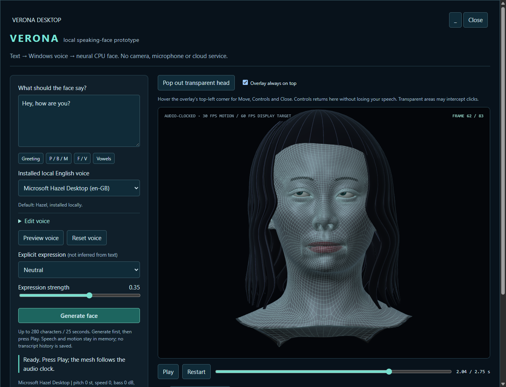
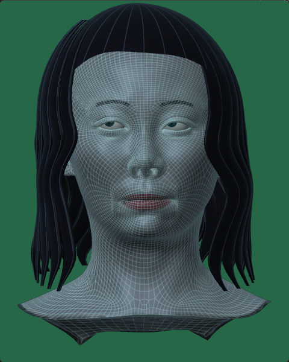
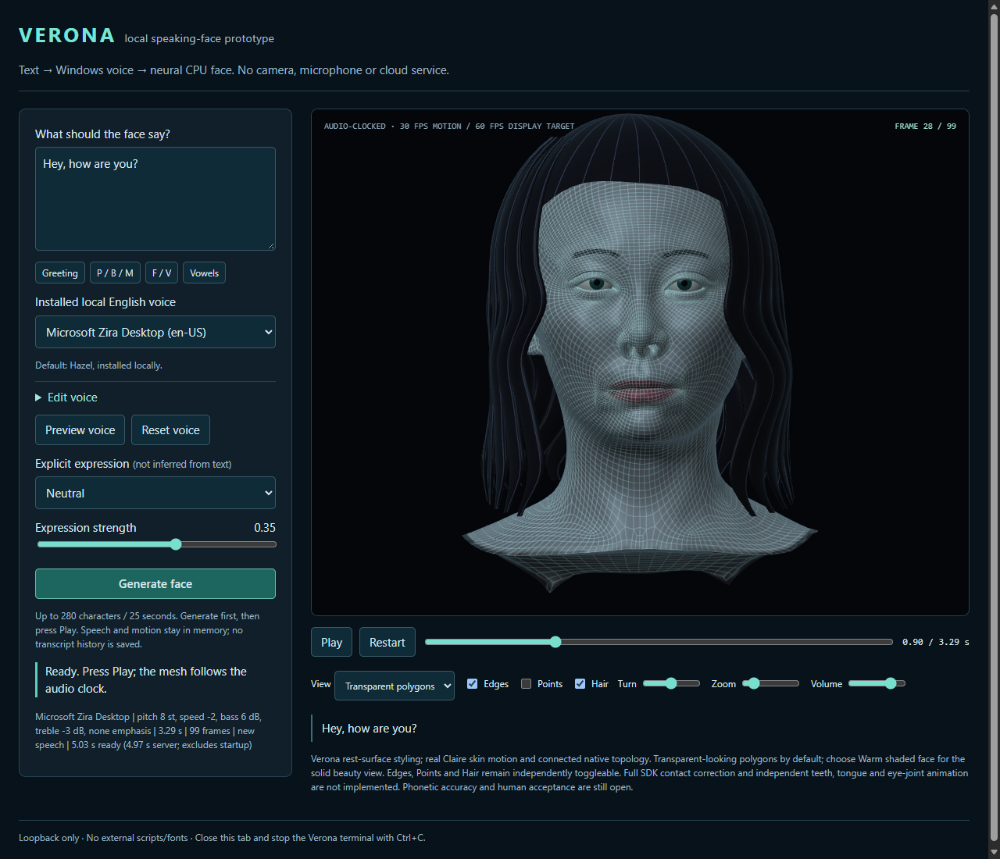
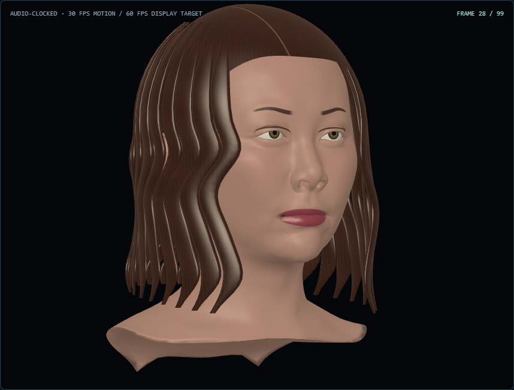
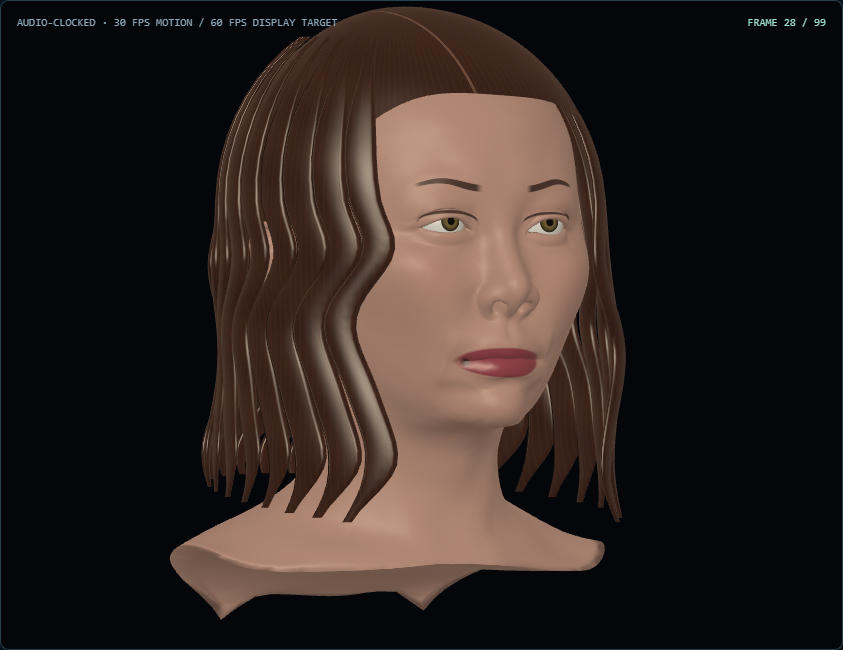

# Verona

**Type a sentence. Hear a local voice. Watch her speak.**


Windows voices, CPU neural motion, connected native contours. No camera, microphone or cloud runtime.

```powershell
.\VeronaDesktop.cmd
```

**Generate face**, **Play**, then **Pop out transparent head**.
Hover its top-left corner for **Move**, **Controls** or **Close**.
Eyes follow your cursor; X/Y/Z sliders rotate the head freely.
The browser version remains `.\Verona.cmd`.
Fresh checkout? [Setup, controls and limits](docs/prototype-guide.md).
[First source prerelease - earlier appearance](https://github.com/Zanark/Verona/releases/tag/v0.1.0-prototype.1).

## Desktop and transparent overlay





Always-on-top is optional. Transparent areas may intercept clicks.
Desktop setup: `.\Setup-VeronaDesktop.cmd` once; already prepared in this checkout.

## The prototype

Transparent polygons by default. Revised facial contours and layered waves.



## Form and detail


| Three-quarter view | Native facial contours, hair off |
|---|---|
|  |  |



## Shape the voice


Preview, adjust, generate. Hazel remains the reset default.
**View** switches between **Transparent polygons** (default) and **Warm shaded face**.
**Edges**, **Points** and **Hair** remain independent.

**Early prototype:** procedural cursor gaze, not learned eye joints; articulation accuracy is not accepted.
Playback targets **60-fps display** over 30-fps neural motion, not live generation.
Local measurements include occasional frame-time spikes. GIFs are silent previews.

[Engineering book](docs/README.md) · [Desktop mechanisms and limits](docs/chapters/10-desktop-overlay-and-gaze.md) · [Media provenance](docs/media/README.md) · [Third-party terms](THIRD_PARTY.md)
