<p align="center">
  
</p>

<details>
<summary><strong>Explore Verona: every head, anime studies and four hairstyles</strong></summary>

<p align="center">
  <picture>
    <source media="(prefers-color-scheme: dark)" srcset="docs/branding/verona-lockup-dark.png">
    
  </picture>
</p>

# Verona

**Type a sentence. Hear a local voice. Give it a face.**

Windows-local speech, CPU neural motion and an animated WebGL face.
No camera, microphone or cloud runtime.

[Setup & controls](docs/prototype-guide.md) · [Agent skill](.github/skills/verona/SKILL.md) · [Engineering book & journals](book/README.md) · [Media provenance](docs/media/README.md)

```powershell
.\Verona.cmd
```

One manager, separate named heads. Six selectable models; Windows voices plus
an explicitly installed optional 28-style Kokoro pack. A fresh checkout needs
[setup](docs/prototype-guide.md), not just this command.

## Six selectable heads

Fresh current-renderer captures: **neutral plus all ten emotions**, four
presentations at matching speech times. Mouths are opaque by default.
Review names below map to the actual model IDs.

### Aster / original Claire · Rowan / native MPFB

<p align="center">
  
</p>

`claire` · `mpfb` — original speech face versus native transferred topology.

### Kestrel / actual Mark · Onyx / sharp-jaw Claire sculpt

<p align="center">
  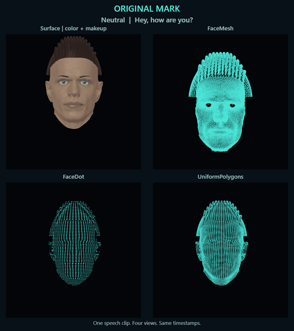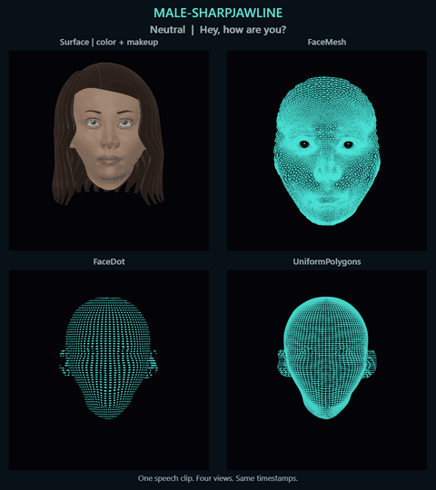
</p>

`mark` · `male-sharp` — Mark uses its own neural model; Onyx preserves Claire motion.

### Vale / strong structural fit · Linden / historical subtle fit

<p align="center">
  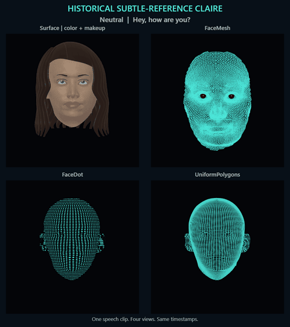
</p>

`reference-structure` · `reference-shell` — both retain Claire topology and motion.

## Akari / original anime study

**Toon shading is back.** Large teal eyes, attached upper lashes, rose lips and
an original violet bob. Rest, turns, blink and all ten speech emotions.

<p align="center">
  
</p>

**Review only, not a selectable head.**
[Design research & illustrated references](docs/research/claire-anime-woman.md) · [How it works](docs/chapters/09-verona-character-and-waves.md)

## Six supplied-GLB studies

Each pair uses one source: **original mesh driven by Claire** on the left,
**Claire reshaped toward that source** on the right. Clay shading exposes the
geometry. These are separate review candidates, **not installed models**.

### Lyra · Elara

<p align="center">
  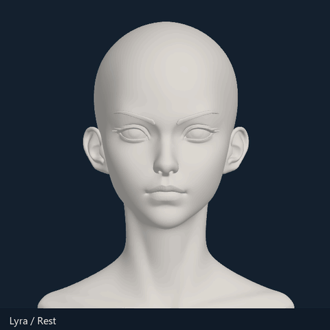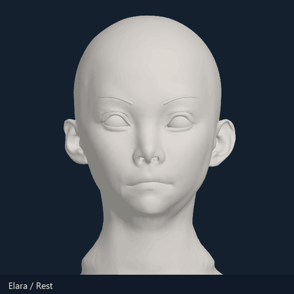
</p>

Anime source by [Rodesqa](https://sketchfab.com/rodesqa).

### Mira · Selene

<p align="center">
  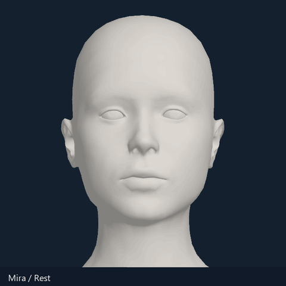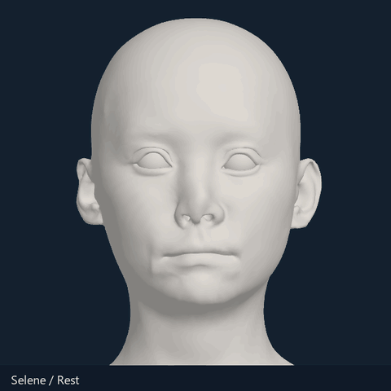
</p>

First woman basemesh by [mono](https://sketchfab.com/michela.000).

### Neris · Thalia

<p align="center">
  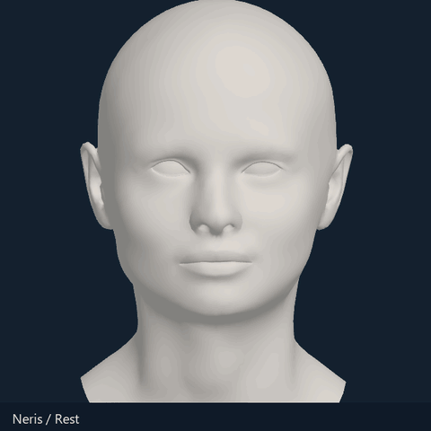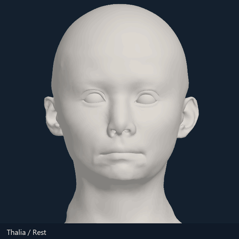
</p>

Second woman basemesh by [mono](https://sketchfab.com/michela.000).
All three sources: **CC BY 4.0**, modified for alignment/deformation or structural
fitting and common clay rendering. [Exact source links & credits](docs/media/README.md#supplied-glb-source-credits).

## All four hairstyles

### Claire waves · Spiral curls

<p align="center">
  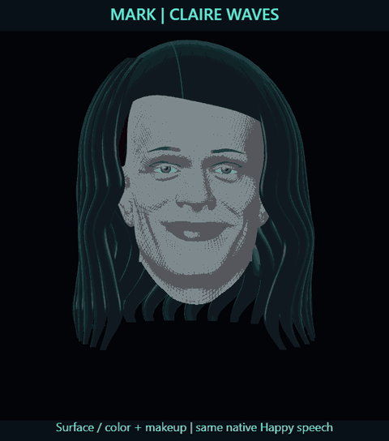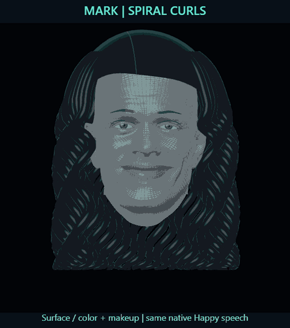
</p>

### Short textured quiff · Classic side part

<p align="center">
  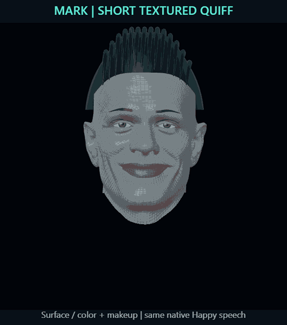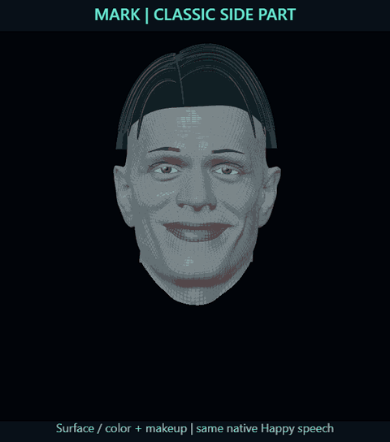
</p>

Shared choices, not separate neural models. New Mark heads default to the quiff;
existing heads keep their choices.

## FaceMesh in motion

<p align="center">
  
</p>

**Small print:** GIFs are silent sampled demonstrations, not live-FPS,
phonetic-accuracy or human-acceptance evidence. Six selectable shapes use two
neural identities; the seven studies remain experimental. Mouth transparency
requires explicit head-creation opt-in and only affects wide openings.
Controls, limits, optional voices and recovery: [prototype guide](docs/prototype-guide.md).

</details>
