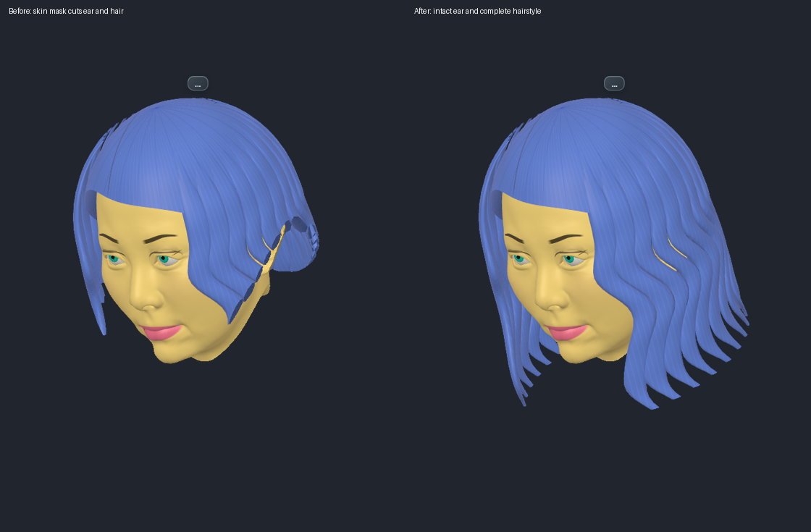

# Verona - living development journal

This dated continuation keeps small changes readable between rendered editions.
The existing M1, native-head and local-voice PDFs remain frozen at their stated
source cutoffs. This page is authored source, not a newly rendered PDF or a
claim that those editions include later work. Newest entry first.

## 2026-11-22 - Elara gets raised brows and upper lashes (vr-85)

The owner supplies a clay-model eye reference, not a request for a new face.
The first additive pass makes Elara's brows too thin/high inside; its capture
is retained. A revised fuller inner taper and raised arch follow the reference
more closely. Three tapered outer lashes per eye join a raised upper-lid band.
All detail is original procedural geometry in the same clay material.

Ray-projecting guides onto actual front skin avoids a guessed flat depth.
Exact triangle/barycentric displacement follows existing expression motion;
1,508 added vertices and 2,976 triangles leave every original Elara binary as
an exact prefix. Other five candidate folders and all their GIF/poster bytes
remain identical. All 60 lower-face crops match, retaining the lip correction.

One isolated Elara capture supplies a complete 7.5-second/42-distinct-frame GIF.
Candidate and final-path installed-Edge checks load all six, retain one-card
playback and fit desktop/mobile without page errors or external page requests.
The old report survives a before-vr85 backup and versioned-media/atomic HTML
promotion. The live manager/head and frozen books are unchanged. This is agent
technical/visual qualification, not owner approval or a separate blink rig.

## 2026-11-22 - Let the owner resume the same six-model review (vr-83)

The review names must remain stable while the rendering changes. Six serial
private workers therefore capture the original Aster/Rowan/Kestrel/Vale/Linden/
Onyx catalog again, twice per head. The six GLB experiments remain separate.
Aster's badge now says Female; the other five remain explicitly unassigned.
Every fresh GIF includes neutral plus ten emotions and the current lip fix.

The archive audit initially fails on LF-versus-CRLF source hashes. Converting
the exact pinned Git source into its Windows checkout form matches all four
motion-source receipts for all six heads; checking is not bypassed. Native rest
hashes match too. Only Rowan's quantized emotion-minus-neutral deltas are halved,
with a one-unit rounding bound. Other motion bytes and audio identity remain
unchanged. No network inference, audio replay or owner listening is claimed.

The encoder verifies every source sample through the full 30.25-second decoded
timeline. Candidate and final-path browser qualification load all twelve GIFs,
check one-card playback/pause, mobile layout and exact gender labels, without
external page requests or errors. Versioned assets precede an atomic HTML
switch; the original report and the earlier failed run remain preserved.
The historical idle-animation report and frozen PDFs stay untouched.

Separately, at18:49:41IST the owner's reopen request replaces only this
session's head333092with392392. Manager306384 and all fresh settings,
appearance and zoom1 are preserved; served lip-renderer hashes match the
qualified source. No other heads are present and no speech is replayed.

## 2026-11-22 - A transparent mouth must not mean a hole at rest (vr-84)

The owner's screenshots reveal that vr-81's aperture is applied even to a
closed mouth. Removing the opaque cavity was not enough: unconditional RGBA
clearing manufactured a visible neutral gap. The standalone GLB study repeats
the same error. `mouthShape` now separates actual front rims from curled
inner-lip folds; five outer-lip pairs supply a median neutral-relative opening.
`FaceRenderer.clearMouth` and the study renderer erase only beyond 0.65 cm.
Clip installation caches one four-byte scalar per frame; clearing releases it.
No new inference or per-draw CPU mesh traversal is introduced.

A first opaque cap looks zigzagged and is rejected. A Rowan-only seal then
looks too dark because it bypasses normal material shading. The final narrow
near-closed Surface seal follows the existing shading path; other heads and
wire presentations do not receive it. A constant conservative front plane
also stops the symmetric lipstick curve being clipped differently on the
two sides by native depth variation.

Actual final native captures cover all six neutral lips, wide speech/yawn,
blinks and 240 matrix checks. The neutral custom-color scan finds no interior
transparent or skin-colored pixels on any head. An isolated resource/blink
retry passes after an earlier concurrent-load cadence failure; the timing
assertion is unchanged. The 115 CPU checks pass. Six newly captured GLB GIFs
retain full 7.5-second motion and are verified at their original report path,
with versioned media and an intact old-report backup. Strong-pose native
creases remain possible; this is not owner visual or phonetic acceptance.
The original-six catalog refresh and owned live restart are still pending
at this implementation milestone. Frozen PDFs stay unchanged.

## 2026-11-22 - Compare two transfer directions on three supplied heads (vr-82)

The owner wants six review choices, not six renamed copies of Claire.
`glb_head_import.load_head` therefore retains actual original GLB topology,
applies complete scene transforms and rejects unsupported/external resources.
All three source models are static and unrigged. Public Sketchfab records
confirm embedded CC-BY4 credits for Rodesqa and mono; originals remain local.

The first full anime fit exceeds the existing five-centimeter bound at its
nape. Reducing the explicitly requested registration strength to 80% keeps
that gate intact. Another attempt exposes the third head's diagonal open neck.
Only temporary fitting geometry gets seam welding and a downward neck skirt;
neither change replaces original output geometry. The first strict surface
fit also rejects unsupported controls. The new experiment explicitly requires
192/256 supported controls under the unchanged two-centimeter correction limit,
records rejected samples, and leaves strict production defaults unchanged.

`batch_surface_binding` vectorizes exact closest triangle interiors and edges
under AABB bounds. Convex displacement embedding yields Lyra, Mira and Neris
on their original meshes; a 65% registered-fit blend yields Elara, Selene and
Thalia on Claire's skin topology. All six share archived synthetic speech,
the same 2x expression conversion, camera and clay shading. There is no new
trained facial rig. Native lip/neck creases remain possible, Mira's closed
mouth is less clearly open, and the hybrids intentionally retain Claire family
resemblance. Numerical shape differences are not owner identity acceptance.

An isolated serial WebGL2 capture produces six actual silent GIFs. The offline
report starts with posters, runs one GIF at a time, pauses while hidden and
offers direct GIF links. Common smoothed normals avoid mistaking UV-seam
shading for structural differences; native-rim alpha masks avoid black cavities.
115 CPU regressions pass; decoded GIFs each retain 42 distinct frames and
7.5 seconds. Installed Edge verifies every candidate, wide/mobile layouts,
one-at-a-time/reduced-motion behavior and no external page requests/errors.
Earlier rejected attempts remain under the owned qualification directory.
The active head/manager, previous reports and frozen PDFs are not replaced.

## 2026-11-22 - Follow the native lips instead of painting an oval (vr-81)

The owner's marked lip borders expose a coordinate mistake: moving one generic
ellipse cannot fit six different mouths. `facial-features.mjs:facialProfile`
instead supplies symmetric upper/lower curves in each head's native rest space.
The same smooth Cupid's-bow mask serves filled paint and feature ink. Removing
the old separate black cavity paint also removes Aster's artificial corner spot.
The owner identifies Aster as female; the other review genders stay unassigned.

The requested transparent mouth is a compositing problem, not a darker material.
Discarding cavity fragments reveals other head surfaces. A corner fan can sit
behind protruding central lips. `mouthAperture` selects paired native rim samples
once; `FaceRenderer.clearMouth` reuses animated GPU positions and clears RGBA in
a depth-tested strip, with a bounded0.8cm view-depth bias. Native seam registration
also prevents the idle yawn from stretching a broad intermediate pink sheet.
The pass preserves LEQUAL depth state. One small static index buffer and one
local draw add bounded work, not new inference or a whole-app cost measurement.
Strong native poses can still have angular rims; this is not oral retopology.

Rowan's eyelid skin gains a bounded0.16cm shader ridge that fades during blinking.
Its emotion gain is halved after native fitting: shared2x/4x becomes effective
1x/2x, including the optional sideways pull, without changing neutral speech or
other heads. Requested/effective metadata and visible labels remain distinct.

The105CPU regressions and three focused Node suites pass. The final shared
WebGL fixture verifies resources, blink closure and retirement behavior; an
initial navigation race is retained and corrected by waiting for the actual new
error element. Actual six-head capture08 adds30stills and240draw/optical cases.
All24model/view blink checks close fully and reopen, all GL checks pass, and
12front speech/yawn masks have no fully opaque depth residual against their
reference aperture. That comparison checks depth, not anatomical mask accuracy.
An independent pinned-network check verifies all eleven Rowan states, unchanged
audio and half-deltas within0.5quantization unit. Earlier rejected visual attempts
remain evidence; representative front/30-degree/profile inspection is agent
review, not owner visual or listening acceptance.

Existing GIF reports and frozen editions are preserved. README explicitly dates
its older captures rather than pretending these paint/compositing changes were
already recorded. At06:16:24IST the authorized switch replaces only this
session's head310488with333092. The manager remains306384; all fresh settings
and appearance match, including the then-current zoom1. No other heads are
present, no speech is replayed, and served renderer/module hashes match the
qualified candidate. This is live readiness, not independent human acceptance.

## 2026-11-22 - Give Mark two genuinely short silhouettes (vr-80)

The owner points out that the existing waves and curls were designed as long
feminine styles. Two original alternatives now give actual Mark a raised
textured quiff and a lower classic side part. They reuse the existing packed
mesh and parallel-transport sweeps, not a new character asset or neural model.
New Mark players begin with visible quiff hair in every presentation; other
models and already-running heads keep their prior state.

The first gallery attempt exposed a misplaced nested script block before
Electron could load it. Syntax preflight now runs before model work.
The next capture passed numerical checks but looked like a loose helmet.
Actual upper-skull measurements showed why: a long-hair clearance sphere
was too wide/deep. `shortScalp` instead fits independent axes to the resident
native rest points, with explicit clearance. A degree/radian capture error
was also corrected before accepting the front/three-quarter previews.
Rejected outputs remain private diagnostics, not the new README assets.

The final actual Mark run draws all eleven emotion clips in four views and
passes24 repeated native style/view hide/restore checks. The isolated synthetic
fixture separately proves stable per-style/view GPU bytes and no unlit normal
slots. Every420palette-converted source sample matches its decoded GIF timeline:
one30.25s overview and two5.5s hairstyle loops. Front/side contact sheets receive
representative agent review, not exhaustive frame review or owner acceptance.

The README retains its branding, speech hero, other five model previews and
two original long-style GIFs. Chapter09 explains the fit and ownership.
No inference, new timer, live-head restart, speech recording publication,
release rewrite or rendered-book edition is introduced.

## 2026-11-22 - Let the identity speak without a blue square (vr-79)

The owner asks for the existing face-mesh identity to become a transparent
head with purple hair and pink lips, and for large Verona lettering beside it.
The revised generated artwork keeps the cyan facial topology but removes the
navy background. Real RGBA alpha matters: converting the master to RGB during
icon generation would silently undo the request. `load_master` now rejects
opaque/empty artwork and filled corners before rebuilding any derivative.

`scripts/build_branding.py:lockup` pairs the head with Audiowide Regular.
Its squared curves echo geometry, while rounded forms and a small waveform
connect the name to voice. This is an authored design choice, not an objective
font ranking. The unmodified font, complete SIL OFL1.1 license, immutable
upstream blobs and hashes stay together in `docs/branding/fonts`.
Pre-rendered light/dark PNGs need no installed font or network request.
The [branding guide](../docs/branding/README.md) shows and explains both marks.

Actual Electron decodes every16..256px ICO frame plus the PNGs, preserving
visible artwork and transparent corners. Ten guarded HTTP cases and the
desktop-host fixture pass; derivative regeneration is exact and the README
speech hero/gallery remain unchanged. GitHub's actual GFM-rendered header is
checked in isolated Chromium at1100/390px in both themes: correct decoded
source, painted lettering, no overflow and no external requests.
The first hidden capture preceded complete painting; the observed image led
to explicit compositor/pixel readiness rather than accepting a blank preview.
Final wide-dark and narrow-light captures received representative visual review.

The complete candidate is prepared separately before canonical asset promotion.
Manager306384, head310488, settings and sibling sessions remain untouched.
Existing windows may retain cached icons until a deliberate restart.
No executable resources, releases, old book editions or private media change;
this is not a new taskbar acceptance, runtime benchmark or owner approval.

## 2026-11-22 - Use the supplied sneezes, not synthetic substitutes (vr-78)

The owner supplies female and male sneeze recordings after v0.3.0 delivery.
The existing offline helper now accepts `--kind=sneeze`, with a2.7s limit
matching the gesture. Mono conversion, silence trimming and25ms fades yield
0.93s male and2.7s female clips without modifying originals. The female tail
is shortened, not time-stretched; its measured main RMS peak remains inside
the kept interval. No independent listening acceptance is implied.

One shared kind/style loader replaces separate recorded-yawn/synthetic-sneeze
paths. Four exact authenticated routes validate per-kind frame limits; one
latest decoded buffer still replaces its predecessor. Missing files fail
visibly rather than invoking a synthetic or cloud substitute. Selected voice
metadata chooses both effects;20%cap and rare audible yawns stay unchanged.

Actual Claire playback passes120action/view cases and both fixed creation
policies pass. Native David/Hazel selection verifies the male/female buffers,
with cap, mute/cancel/error and speech preemption. Seven Node/twelve Python
cases pass; an obsolete static-file check expecting the removed synthesis
export was corrected. Previous six-model geometry qualification remains prior
evidence, not a new all-model rerun for this audio-only update.

At01:57:47IST only this session's head is replaced, keeping manager306384,
exact other controls/appearance, normal creation policy and other sessions.
Nine promoted source/test files and all four private effects match hashes.
Documentation/skill updates and a separate v0.3.1 source patch preserve the
earlier release tags and keep every supplied recording out of publication.

Published [v0.3.1](https://github.com/Zanark/Verona/releases/tag/v0.3.1) pins
source `6c9ec5ad9d6a38a97b32629ac7d3b93a72859fec`. All385remote source blobs
match the canonical archive, three uploaded assets were downloaded/hash-checked
and six older releases/tags/assets remain unchanged. Installed source/library/
personal skill bytes agree and external personal discovery passes. The large
source archive contains existing public previews, never the supplied sounds.

The owner then reports an unwanted ending and clarifies that it is the female
sneeze. Exactly one second is removed from that prepared clip,2.7s to1.7s,
with a new25ms fade to zero. Male sneeze, both yawns and the original MP3 stay
unchanged. Another120Claire native cases pass; the smoke fixture now reads the
actual prepared WAV duration rather than freezing a private trim length.
At02:08:11IST only the owned head is recreated with all settings restored to
discard the previously cached buffer. Published v0.3.1 is not rewritten, and
neither an independent listening verdict nor owner acceptance is claimed.

## 2026-11-22 - Release the current behavior, not private recordings (vr-77)

The owner asks to update instructions, documentation, release and pushed source.
The new v0.3.0 boundary collects the implemented changes since native-head
parity: optional offline voices, viewport/crop corrections, thirty autonomous
gestures, creation-only performance sleep and the corrected quiet rare yawn.
The existing runtime qualification remains its evidence; publishing notes is
not another performance test or independent listening acceptance.

The operating skill now records the actual vr-76 runtime baseline and tells a
resumed chat to reuse its recorded head name rather than reconstructing an
obsolete pre-rename descriptor. Fresh source has no supplied yawn recordings:
mute idle audio until authorized local files are prepared. Permission to trim
and play recordings locally is not permission to redistribute them.

Source delivery uses an exact committed tree, a member/hash manifest and
download verification. Installation updates only the Verona library/personal
skill copies; unrelated dirty library work is not staged or published.
Frozen release tags/assets and journal editions stay intact. The running head
does not need to restart merely because its documentation was published.
Source/library/personal instruction bytes agree; enabled personal discovery is
verified outside the project. The first discovery check was still inside the
repository and correctly found its inherited project skill, so the external
check was repeated from an actually external directory. Nine existing book
checks and71affected documentation file links pass.

Published [v0.3.0](https://github.com/Zanark/Verona/releases/tag/v0.3.0) points
at source `98b962f4131352e86d6281134e81a290f6c0300e`. All383remote source
blobs match the canonical archive, and the three uploaded assets were downloaded
and SHA-256 checked. The source ZIP is429,316,606bytes because it includes the
existing public preview media; it is not an environment or model bundle.
All five prior releases and their tags/assets remain unchanged. The source,
manifest and checksums exclude the supplied recordings and local editions.

## 2026-11-22 - A yawn needs an opening, not a protruding lip (vr-76)

The owner supplies two local recordings, asks for a20%maximum, and shows why
the first gesture is wrong: the lips bulge instead of separating. The revised
yawn has its own scalar field. Upper lip lifts, lower jaw drops with an oval
width envelope and gentler chin transition, eyes close and recovery remains
smooth. A dark inner-mouth band replaces the apparent protrusion across all
views. It is a cosmetic empty cavity, not teeth/tongue anatomy or a contact rig.
An initial overly uniform drop looked rectangular in actual rendered frames;
the oval envelope is a visual correction, not an inference from passing tests.

Already-installed Electron decodes the supplied sources offline without playing
them. Silence trimming, a4.2sbound and25ms fades yield1.24s male/4.2s female
effects; originals remain unchanged. Prepared files and provenance stay ignored.
Two exact authenticated routes validate bounded mono24kHzPCM16. Voice metadata
chooses the effect. The first native check finds that only the standalone
Windows inventory supplied style; the warm worker needs the same field.
This fixes real David/Hazel selection rather than guessing from head geometry.
Unknown styles retain an explicit model-presentation fallback.

The owner's later request is to make the sound rare. Visual yawn weighting
stays3x, but automatic sound has only a10%chance and at least ten minutes
between successful yawns. Most yawns are silent without creating an audio
context or loading a file. Explicit previews bypass rarity, not mute or the
hard20%gain cap. Speech still wins; fetch/resume/decode cancellation cannot
resurrect an old cue. Sneeze stays synthesized and obeys the same volume cap.

Six real heads/four views/thirty actions pass720native cases; both immutable
creation policies pass. Real supplied buffers, voice switching, actual gain/
range limits and speech/mute/cancel/error paths are qualified. Focused cases
cover rarity, minimum gap, trimming and pending fetch cancellation. The compact
all-six Surface sheet and Claire FaceMesh frames were reviewed, not every full
animation or independent listening. Failed receipts remain. Source publication
does not publish the recordings or establish redistribution rights.

At01:26IST only this session's head is replaced, retaining its manager, normal
policy and other latest settings. Sounds return enabled at20% with rare
automatic yawns. Other sessions are unchanged; fourteen promoted source/test
files and private-effect hashes match. Frozen editions/releases/GIFs stay
unchanged; no new CPU-saving or naturalness claim is made.

## 2026-11-22 - Eyes participate, and a yawn can be heard (vr-75)

The owner asks look-around to move the eyes too, five new eye actions, loud
sneeze/yawn, more frequent yawns and ten genuinely new facial composites.
The existing clock grows from fifteen to thirty actions rather than delegating
behavior to a chat. Deliberate gaze temporarily blends out cursor gaze in
either cursor mode. Two lid values select individual eyelids while reusing
the same skin/optical closure field. Ten composites each overlap three or more
facial fields, not just rigid turns or different speeds.

Yawn receives three equal lottery cells for every other eligible action's one;
recent-four exclusion remains, the old yawn rarity cooldown does not.
Sneeze retains its longer cooldown. New sounds are original deterministic
harmonic/breath/noise synthesis, not recordings, another neural voice or a
download. One lazy Web Audio context and latest short mono buffer bound
ownership. Level starts at75%, with independent mute. End/cancel suspends the
audio clock; speech/input/hide/sleep invalidates pending resume and stops output.
Autoplay/output errors use the visible overlay error path with explicit retry.
These are stylized cues; physical loudness and naturalness are not accepted.

Six real heads, four views and thirty actions pass720 native pixel cases.
Horizontal/vertical eyes reverse in both cursor modes, opposite lids close,
and zero gesture geometry uploads/buffer allocations/fetches are observed.
Actual local PCM/audio-clock and manager mute pass on each head. Final Claire
adds visible output-failure/retry and real face/voice preemption; both immutable
creation policies remain qualified. All test sound is host-muted, not listened
to independently. Two compact actual-frame sheets were visually reviewed.
Initial sound-test assertions mistook signed zero and decimal sample rounding
for bad audio; correct numeric silence/integer frame assertions fix the tests,
not the generated waveform. Historical fifteen-GIF report/frozen editions stay
unchanged. No new CPU, whole-machine saving or human-accuracy claim is made.

At01:01IST only this session's idle head is replaced with the qualified
source; the same manager remains running. Normal policy and every prior
control/appearance choice are restored. New sound controls start enabled at
75%; all eleven promoted source/test hashes match and other sessions are
unchanged. This is source/live delivery, not a new release or frozen edition.

## 2026-11-22 - Performance belongs to creation, not every head (vr-74)

The owner corrects the previous delivery: performance-only behavior must be
chosen when creating a head, never enabled by default on a normal one.
The session head is immediately returned to normal. The corrected manager
adds an unchecked New session checkbox; CLI create/host use an explicit flag.
A strict boolean travels with immutable appearance metadata to the shared
renderer. The child process receives the flag only when selected.

Normal heads retain ordinary idle animation/tracking and the opacity slider.
Performance-only heads retain10%idle/100%speaking sleep with no mutable toggle;
the floating menu shows a badge, and the manager labels policy read-only.
Live policy changes fail explicitly, including requests using stale control
metadata. Successful creation resets the next choice to unchecked.

Focused session/HTTP/media cases pass. The actual manager DOM verifies both
creation choices and immutable display. Two real Claire native heads cover
both policies across four views, real decoded audio and local face/voice
generation/play/cancel. Only opted-in heads suspend cursor reads/redraws.
Separate disposable profiles/caches/backends preserve the live normal head
during candidate qualification. Historical vr-73 CPU numbers are not rerun
or generalized; no release or frozen edition is rewritten.

At 00:36 IST the qualified source replaces only the owned manager and head.
The reopened Verona is normal, with all prior appearance/control choices
preserved except the removed live performance toggle. The delivery receipt
verifies all sixteen promoted source/test files and unchanged other sessions.

## 2026-11-22 - Make an unused head genuinely stop moving (vr-73)

The owner asked for more than a dimmer: an idle performance mode that becomes
90% transparent, stops following the cursor and avoids expensive waiting
behavior, then becomes fully opaque when it speaks. Lowering alpha alone
would still animate and poll, so the implementation separates visibility from
activity. One event-driven controller observes existing face/voice audio;
preparation stays asleep, playback wakes, pause/end/cancel/error sleeps.

Sleeping cancels the existing RAF and blink/idle clocks and clears the native
33-ms cursor interval. It keeps the user's follow/blink/gesture choices.
The menu's Performance switch and Normal opacity slider mirror canonical
manager settings. Only the canvas fades, so even 0% normal opacity leaves
controls readable. Performance overrides that saved value with 10%/100%;
turning it off restores it. No model or geometry is rebuilt on waking.

Six real heads and four presentations qualify. Native composited alpha
confirms one-tenth opacity across 61,103 sampled pixels, not merely an input
value. Actual decoded audio wakes each selected head; Claire additionally
prepares/plays/cancels real face and voice jobs and changes mode during speech.
The model, clip, audio clock and prior choices remain intact.

Eight counterbalanced 16-second windows measure the owned Electron processes.
Stationary-cursor CPU averages 2.786% of one core normally and 0.305% asleep;
moving-cursor CPU is 28.856% versus 0.368%. Sleep produces zero automatic
draws/cursor reads. The moving workload's working set is nearly unchanged:
755.68 versus 754.61 MiB. Retaining a warm neural engine deliberately gives
no substantial memory saving. These are isolated invisible-window process
measurements, not whole-machine load, GPU energy or human listening acceptance.

Initial harness mistakes remain in receipts: native screen access before
readiness, a forbidden multi-setting transaction and a premature fixed-delay
audio assertion. A missing pinned authored reference interrupted the next
model after Claire; supplying that existing input allows all six to pass.
No cloud fetch, hidden fallback or relaxed accuracy assertion fixes these.
Focused runtime/HTTP and the existing book checks pass in their own prepared
environments.

At 00:15:46 IST only this session's idle Verona head is replaced with the
qualified source. Fresh old appearance/controls are restored and Performance
enabled; its manager and other apps remain running. This adds source/book
chapters, not a rewritten frozen PDF or release package.

## 2026-11-21 - Put every idle action in a GIF report (vr-72)

The owner next asked to see all fifteen animations, not just read their names.
A separate invisible, unfocused native head sampled each complete action in
Surface and FaceMesh, with the same clock, phase and mirror direction.
The live head kept running with every setting unchanged. No speech, desktop
capture or new model download was needed.

The local report contains fifteen labelled paired GIFs, a short description
for each action and a clickable index. It starts with still posters and plays
one selected GIF at a time; Pause restores the poster. This avoids fifteen
simultaneous animations simply to browse a report. Everything loads from local
files, without remote scripts, fonts or images.

The 814 source captures become 407 encoded frames. Every decoded GIF timeline
matches its quantized source, including half-second neutral holds at both
ends. Switching from full-frame disposal to retaining/delta encoding reduces
the GIF set from about 58 MB to 19 MB without changing those decoded timelines.
These are deliberately resized, color-quantized 10-fps previews, not live
frame-rate measurements or a claim that the stylized sneeze is anatomical.

All fifteen GIFs decode in the local sandboxed browser. The paired contact
sheet, several decoded phases of sneeze/nod/stretch and wide/narrow report
layouts were inspected. The first hidden-window review had stale painted
snapshots despite correct DOM checks; its replacement waits for actual size
and paint in an invisible, unfocused owned window. Both attempts remain.
Only public-safe documentation/tracking is pushed: the report and its GIFs
remain local under `.local\reports\idle-animations`, not a new public gallery
or rewritten PDF edition.

## 2026-11-21 - Let the face wait without asking the chat (vr-71)

The owner asked for fifteen different occasional gestures, including a sneeze,
but made the ownership boundary explicit: the tool should choose and time
them, not the conversation. Research supported restraint and variation, not
the claim that random movement is automatically natural. The resulting catalog
mixes small lip, cheek, nose and brow movements with nods, scans, stretches,
an eye squeeze, a silent yawn and a silent sneeze.

One local timeout waits 12-28 seconds, then a weighted draw avoids the last four
actions. The conspicuous yawn and sneeze have longer cooldowns. A finite smooth
trajectory supplies one pose to the existing renderer and animation loop;
waiting adds no loop. Every model uses the same calibrated cosmetic layer,
without loading another model, rebuilding mesh buffers or asking a chat.

Speech and interaction take priority. A useful edge case emerged during the
real agent checks: cancelled speech retains a paused clip, but idle gestures
must not animate a mouth frozen halfway through a word. Terminal agent output
now uses the existing neutral buffers without deleting the clip or altering
its audio time. Manual replay returns to inspection ownership, and an
unfinished paused manual face/voice clip blocks idle until cleared.

The first exact-pixel checks failed on a few wireframe channels. Repeating an
unchanged neutral frame also varied, so calling that a gesture-restoration bug
would have been premature. Final qualification samples 65 unchanged frames per
view, demands exact filled-Surface pixels, and checks other restored channels
against their own measured neutral range. This preserves the failed receipts
and does not invent an explanation for the line-readback variation. A second
fixture correction samples the actual nod pulse, not its quiet inter-pulse gap.

The final native run covers 360 action/view cases across six heads, four views
and fifteen actions. Gestures allocate/upload no geometry and make no fetches;
six isolated 0.9-second waiting samples add zero frames or requests. A real
unprompted action starts and finishes. Actual face/voice playback, cancellation,
manual inspection, typing/held controls, the second hairstyle and disabling
idle life also pass. Compact real captures were inspected, but neither a
pixel difference nor a still image proves anatomical naturalness or owner
approval. The sneeze/yawn remain silent stylized cues.

The stable head stayed untouched until qualification. Only this chat's idle
head was then replaced, preserving its manager and every freshly read setting,
with Idle life enabled. Existing model GIFs, frozen PDFs and release assets
are unchanged. [Chapter11](../docs/chapters/11-autonomous-idle-life.md) contains
the catalog, mechanisms, controls, research and exact qualification limits.

## 2026-11-21 - A jaw mask should not cut the hair (vr-70)

The next image showed a cut near the ear, inside the enlarged window. This was
a different failure: the jaw parabola kept rising toward the sides of the head,
removing both native ear geometry and neighboring hair. More window space
could not bring those discarded pieces back.

The shared CPU/shader skin boundary now has a ceiling below the lateral ear
band, while retaining the inner jaw curve and the same Visible neck control.
The first candidate recovered the ear but still sheared the ends of the hair.
That exposed the second mistake: a jaw mask is not a hairstyle boundary.
Hair now retains its entire selected geometry, and the combined fit includes
its real tips. Skin still loses the lower neck and shoulders.

*Owned native captures, identical140% pose/colors/default neck, composited over
an authored background. Left: old internal cut. Right: intact ear and complete
waves, without restoring shoulders or shrinking away the problem.*

This keeps one selected hairstyle, not more loaded models. It removes duplicate
hair-crop indices and avoids rebuilding skin when hair changes, but draws more
hair:17,840 rather than11,353 triangles in the measured default case. That
tradeoff buys the missing strands; it is not a claimed performance speedup.

The original native mask loses1,278 protected witness samples. The final native
run has zero missing among44,124 samples across16 opposite pitch/yaw, material
and hairstyle combinations, plus exact full/cropped entire-hair alpha. The
existing48 zoom/view/style cases and six focused browser scenarios also pass.
Filled skin restores exactly; depth changes preserve speech and balance nine
created/deleted crop buffers. The before/after pair and eight shaded poses were
reviewed, not accepted on the owner's behalf.

Failed capped-only and contour-readback receipts remain. The full browser run
also encounters an iris-artwork assertion that fails identically on unchanged
delivered source; focused framing checks do not claim that unrelated gate.
The current head stayed protected during candidate work. After qualification,
only this chat's idle head was replaced; all freshly saved controls and colors
were restored and its manager stayed running. Frozen PDF editions and the
separate mouth-shading observation are unchanged.

## 2026-11-21 - Give an enlarged head a larger window (vr-69)

The owner showed the hair ending in straight cuts at 140% zoom. This was not a
missing part of Claire's model: the face grew inside a window that stayed
480x600. Making the head smaller would hide the symptom while defeating zoom.

The correction grows the native window with the requested head size, keeping
its center when possible. The renderer divides out that extra viewport growth
so 140% really means 140%, not a second accidental magnification. Cursor
following and the floating menu use the same coordinates.

*Two actual native web-content captures at their correct relative pixel sizes.
The authored solid background makes the transparent margins readable without
capturing other applications. Both show the same turned pose and waves.*

There is a physical limit: an enlarged window must fit the current monitor.
The control now shows that actual limit instead of promising a percentage the
screen cannot contain. Fit returns to 100%; a smaller zoom keeps the base
window. The new native bounds change only on input, mode or display changes,
not every animation frame. A bigger canvas still costs more pixels; there is
no claim that enlarging the face is free.

The final isolated native run, `overlay-zoom-03`, exercises 48 combinations of
presentation, hairstyle, pose and 100/140/190% zoom. Clear edges survive, rapid
requests settle to their latest value, an open menu stays open and the same
audio clock advances through enlargement. Focused host cases also cover a
small negative-origin monitor and a screen-limited maximum.

The first full run reached its final desktop-composition screenshot and
correctly refused it because the corners did not match the owned background
fixture. That failed receipt remains, and no unsafe screenshot was saved.
The final zoom-only run deliberately captures only the app's own web contents;
it does not relabel the composition gate as passed.

The shared correction covers the native viewport path used by every head.
It is not a new six-head visual certification, a promise for arbitrary manual
rotations or human acceptance. Existing frozen editions, optional voices,
model ownership and the audio pipeline are unchanged.

After isolated qualification, only this chat's idle head was replaced. Its
freshly saved voice, colors, makeup, cursor/blink settings and 120% zoom were
read back unchanged. The shared manager stayed running, no speech replayed and
the replacement confirmed the screen-fitting 190% maximum on this display.
