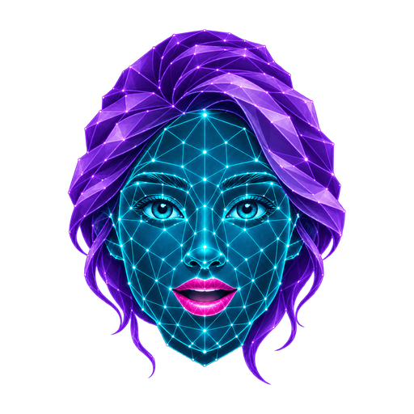
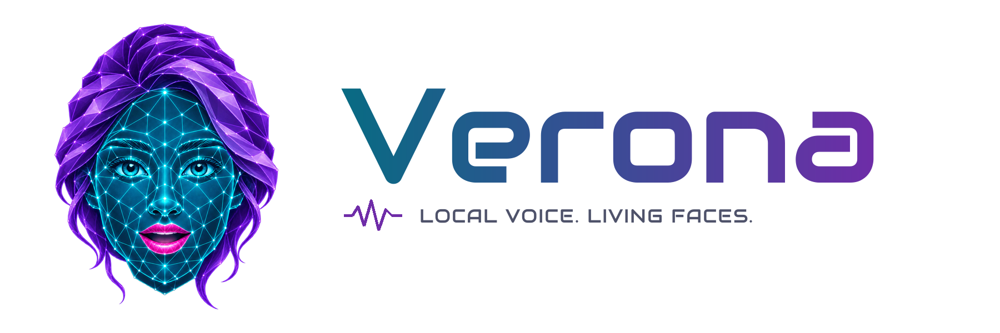

# Verona identity

The current `verona-master.png` is the owner's November22 revision of the
original generated face-mesh identity: **purple polygonal hair, pink speaking
lips and a cyan face on real RGBA transparency**. Only the complete head is
visible; the old navy square is removed. The previous vr-59 artwork remains
historical Git provenance, not another active icon.

<p align="center">
  
</p>

The transparent mark preserves the complete hair and face with safe inset
space. It is generated logo artwork, not a model capture, measured face or
reference anatomy; no runtime character colors are changed.

## Lettering that connects voice and geometry

The wordmark uses **Audiowide Regular**, designed by Brian J. Bonislawsky
(Astigmatic), under the [SIL Open Font License 1.1](fonts/OFL.txt).
Its squared curves echo polygonal construction while the rounded
forms suggest voiced motion rather than a terminal or generic robot badge.
This is the chosen design direction, not an objectively measured "best font."
The small waveform and **LOCAL VOICE. LIVING FACES.** line make the connection
explicit. The typeface itself is unmodified.

<picture>
  <source media="(prefers-color-scheme: dark)" srcset="verona-lockup-dark.png">
  
</picture>

The README lockup pairs a larger head with the wordmark. Separate light/dark
lettering maintains contrast without putting any rectangle behind the head.
`picture` selects the dark version; the light version is the fallback.
Both are pre-rendered PNGs: no network font request or installed font is needed.
Font source, exact hashes and attribution are in [fonts/README.md](fonts/README.md).

## Rebuild every current asset

With the already available Pillow authoring tool:

```powershell
python -m scripts.build_branding
```

This preserves alpha while rebuilding the512px `verona/web/verona-logo.png`,
32px favicon, seven-size16/24/32/48/64/128/256px Windows ICO and both
1800x600README lockups. An opaque/empty master or nontransparent corners fail
explicitly; missing source/font files are not replaced with defaults.
Use a candidate checkout to build/inspect the complete set before promotion.
Electron's source
`BrowserWindow` uses the ICO and Windows application identity `Zanark.Verona`.
The manager, Claire and native MPFB pages serve the same allowlisted local
favicons. Existing running windows can retain their loaded icons; loading the
new source icons requires a deliberate restart, not an automatic shared-manager
or sibling-head interruption. Browser icon caches are also host-owned.

This does not change the downloaded `electron.exe` file's embedded resources,
create an installer or replace existing shell shortcuts. No external font/image
request, new runtime dependency or executable patching is involved.
