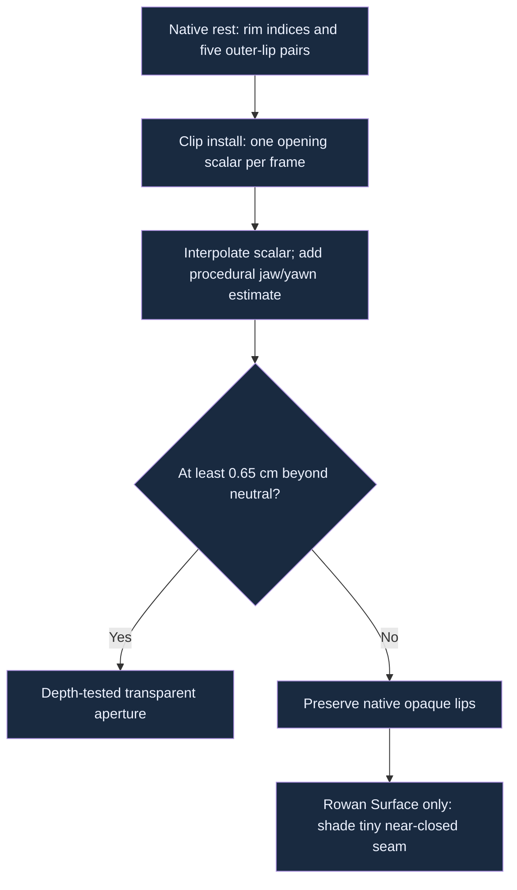
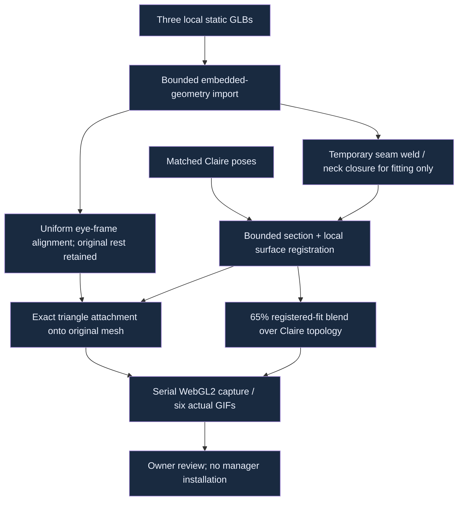
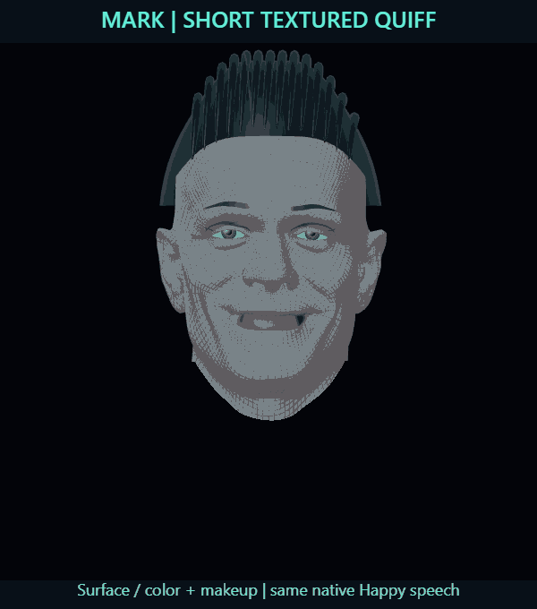
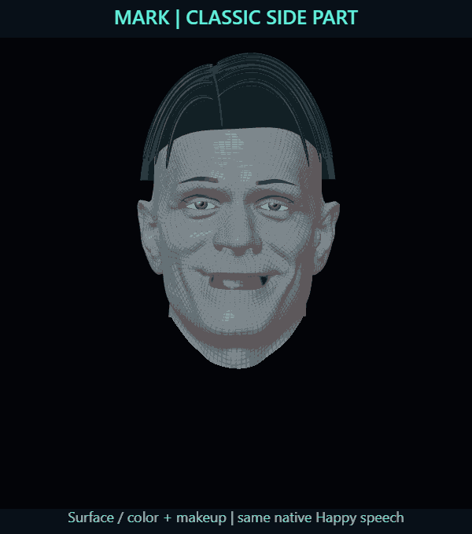

# 09 - Designing Verona without replacing the speech system

## Refresh the review, not its identities (vr-83)

The original-six catalog remains at
`.local\reports\model-gifs-20261122\index.html`. The owner explicitly keeps
GLB experiments separate. Aster/Rowan/Kestrel/Vale/Linden/Onyx retain their
names and technical model IDs; Aster is Female and the other five genders
remain unassigned. Twelve newly rendered GIFs show full head mesh and
face-only FaceMesh with the vr-84 closure fix, Rowan eyelids and reduced gain.

Six serial isolated production-renderer workers reuse hash-verified synthetic
same-audio motions. The source audit finds only Rowan's native emotion gain
needs a trajectory change: `round(qNeutral + .5*(qEmotion-qNeutral))` matches
the current post-fit half-delta rule within one packed quantization unit.
Neutral and the other five models retain their original bytes. This is
explicitly archived-motion derivation, not fresh network inference or listening.
Native rest hashes must match the qualification baseline.

The first provenance check fails because Git's LF blobs are compared with
Windows CRLF checkout hashes. Exact CRLF conversion matches all four motion
sources for all six archives; content checking is retained. The failed run
survives. Each final GIF encodes all 30.25 seconds, neutral plus ten emotions.
The encoder decodes every source time and compares the palette-quantized frame,
allowing lossless merging of identical neighboring frames, not timeline loss.

Candidate and final-path browser checks decode every GIF, verify bounded
one-card playback/pause and 1440/430 layouts without errors or external page
requests. Exact badge checks confirm Female plus five unassigned genders.
Versioned media is copied before the final HTML switch; the old report
survives in its before-vr83 backup. A failure before that switch leaves the
old review usable. The separate historical animation report stays unchanged.
No frozen edition is rewritten or report media uploaded.

## Closed lips first, transparent wide openings second (vr-84)

The owner's neutral-mouth screenshots expose a regression in vr-81's display
pass: `FaceRenderer.clearMouth` erased the native-rim strip on every draw,
including rest. A tiny native seam became a conspicuous transparent slit.
The standalone GLB renderer repeated the mistake, so Elara, Selene and Thalia
showed it too. This correction supersedes the unconditional erase below.

`mouthShape` identifies front upper/lower rim samples with side-specific
clearance. Five separate outer-lip pairs avoid lower-lip folds curled above
the seam; those folded vertices can move with the jaw despite looking like
upper-lip candidates at rest. `sampleMouthOpening` takes their median vertical
separation in centimeters. Transparency starts only at 0.65 cm beyond neutral;
it is a bounded authored display threshold, not anatomical calibration.
The GLB study uses the same sampler and gate on actual posed positions.



The scalar cache costs four bytes per clip frame and is released on clear.
Ten vertex reads per frame happen at clip installation, not every draw; no
extra full-motion copy or neural inference is retained. Procedural idle jaw
and yawn contribution is an explicit estimate. The threshold is discrete,
so crossing it changes the display mask rather than solving lip contact.
Rowan alone needs a tiny opaque Surface seam within 0.14 cm of its guide,
only below 0.1 cm opening. It uses the same cosmetic shading and depth test,
not a dark painted line; wire/dot/grid views get no filled cosmetic seal.

Lipstick keeps symmetric smooth XY curves and a conservative constant front
depth plane. The older X-varying depth threshold clipped opposite sides of
slightly asymmetric native geometry differently. This fixes that clipping,
not the heads' underlying topology or every lighting asymmetry.

Rejected all-model caps and a darker Rowan seam remain in qualification
captures. Final native capture-05 covers 30 actual stills and 240 matrix cases
without failures/external requests. A custom-color pixel scan finds zero
transparent or skin-colored pixels inside all six neutral lip contours.
The isolated shared WebGL resource/blink fixture and 115 CPU regressions pass;
an earlier concurrent blink-cadence failure is retained, not hidden by a
weakened timing assertion. Six recaptured GLB GIFs each retain 42 decoded
distinct frames and 7.5 seconds. Installed Edge verifies all six GIFs at the
same report path, one-at-a-time playback, mobile layout and no external page
requests/errors. The old report remains in its before-vr84 backup.

These are technical and agent visual checks, not owner approval or phonetic
accuracy. Native rims and transferred dense meshes can still crease in strong
poses. Original-six report regeneration is tracked separately in vr-83;
live owned-head replacement was pending at the initial source milestone.
At 18:49:41 IST, the owner's earlier explicit reopen request is fulfilled:
only head333092 becomes392392, manager306384 remains, and every fresh control
and appearance value is restored, including zoom1. Served renderer/module
hashes match qualified source. No other heads are present and no speech is
replayed. This is readiness/control preservation, not owner visual approval.

## Six supplied-GLB candidates, without a production import promise (vr-82)

The owner supplies three static heads and requests both transfer directions
before choosing a subset. This is a new bounded experiment, not permission
to resume every parked custom-avatar workstream or replace an active head.
The local review is `.local\reports\glb-six-head-review-20261122\index.html`.
It contains six real, silent GIFs with matched camera, material and motion:

| Supplied source | Original mesh + Claire motion | Claire mesh + source fit |
| --- | --- | --- |
| `stylized_anime_female_head.glb` | Lyra | Elara |
| `free_basemesh_head_woman.glb` | Mira | Selene |
| `head_woman_basemesh.glb` | Neris | Thalia |

These are review names, not owner-assigned genders. The native meshes have
414,028 / 9,447 / 6,696 vertices and 629,424 / 16,516 / 11,964 triangles.
Each hybrid retains Claire's 15,375 skin vertices and 30,746 triangles;
1,344 static cosmetic eye vertices add 2,432 display triangles. The denser
anime source is not quietly decimated, and a warped Claire head is never
labelled as original GLB topology.



`glb_head_import.load_head` accepts only bounded embedded GLB2 static triangle
geometry: 64 MiB input, one million vertices, two million triangles, 512 unique
scene nodes and 64 levels. Recursive column-major matrix/TRS transforms matter:
the second asset's oral/eye components have their own units and transforms.
Reflected transforms reverse winding. Offsets, strides, normalized vertex
colors and multiple primitives retain their own indices. External buffers,
required extensions, compression, sparse accessors, rigs and morphs fail
explicitly. Textures and imported normals are not transferred. No external
asset resource or downloaded scene script is executed.

The apparent mesh boundaries include duplicated UV/normal seam vertices.
`registration_surface` welds positions within 0.00001 cm only in temporary
fitting geometry. The third source's genuinely diagonal open neck prevents
supported horizontal sections; low closed boundary loops receive a downward
skirt for fitting, not new output vertices. Both original neutral coordinates
and triangle indexing remain intact after one uniform eye-frame alignment.
Front/profile grids support authored approximate eye/mouth anchors; they
are not anatomical ground truth.

`glb_head_study.register` reuses `structural_warp` at 80% strength, retaining
the existing five-centimeter bound. A rejected full-strength anime attempt
reaches 5.40 cm around the nape; its receipt is kept rather than raising the
limit. `refine_surface` then uses exact closest-triangle constraints with a
two-centimeter correction bound. This study explicitly requires at least
192 of 256 supported controls: anime and third-source fits reject six each;
the second retains all 256. Existing production callers still default to
full-strength registration and reject any unsupported surface control.

For original-base motion, `batch_surface_binding` traverses an exact AABB
tree and computes triangle-interior/edge nearest points, not vertex KNN.
Vectorized 2,048-query by 16-triangle leaves bound temporary arrays.
`attach` adds convex barycentric complete-pose displacement to the preserved
native rest, fading to fixed lower-neck vertices. Final maximum attachment
distances are 1.22 / 2.18 / 1.70 cm, below the existing three-centimeter gate.
The eight-centimeter motion gate also remains. The static supplied assets
have no facial rig: teeth/tongue/eyes receive no independent joints or contact
solver. In particular, Mira's closed source mouth opens less clearly.

For Claire-base output, 65% of the registered map reshapes each complete
Claire pose. This preserves substantial Claire eye/midface character rather
than producing three aliases for the native meshes. The three hybrids differ
by 0.46 to 0.85 cm whole-skin RMS in corresponding neutral positions, but that
number does not prove six unrelated perceptual identities. Family resemblance
is explicit in the review, and remaining native lip/neck creases are not hidden.

`build_glb_head_review` verifies the archived synthetic Hazel motion hashes
and identical audio hash. It halves the matched 4x emotion-minus-neutral
offset to 2x before fitting, preserving speech and changing no live defaults.
Each 7.5-second, eight-fps loop covers rest, speech, happy/surprised speech and
a rest turn through 90 degrees. `capture_glb_head_review.cjs` uses serial
isolated Electron windows, a private profile and an exact allowlisted
loopback capability route. Common area-weighted smoothed normals and clay
lighting remove unrelated material/UV-seam shading differences.
The existing paired native-rim helper supplies transparent mouth display
strips, with a study-only 0.55 cm forward bias; this is not oral retopology.

New output directories refuse overwrite. Import/fit/capture failures retain
receipts; capture has a five-minute deadline. An interrupted or failed build
is not a complete study and must restart into a new directory. No camera,
microphone, speech replay, source upload or active-head reload is involved.
`render_glb_review_report` packages the actual frames with explicit attribution,
direct GIF links, static posters and one animated card at a time; hiding the
page pauses it. Default/reduced-motion views remain static until requested.

Final qualification: 115 CPU regressions; six decoded GIFs with 42 distinct
frames each and exactly 7,500 ms; all six buttons/direct local GIF loads in
installed Edge; 1,280/430-pixel layouts without overflow, zero page errors
or external requests, and one-GIF/reduced-motion behavior. Source hashes are
unchanged. This is technical/agent visual review, not owner selection,
phonetic accuracy, independent listening, native-SDK parity or a new runtime
performance benchmark. Existing reports, frozen editions and the active
manager/head remain unchanged.

Attribution: [Stylized Anime Female Head](https://sketchfab.com/3d-models/stylized-anime-female-head-e8d04325a74e46a98a6494abe721a8b2)
by [Rodesqa](https://sketchfab.com/rodesqa);
[free_basemesh_head_woman](https://sketchfab.com/3d-models/free-basemesh-head-woman-3f0007b44b3e4b8d851c4395b60f4a42)
and [Head_Woman_basemesh](https://sketchfab.com/3d-models/head-woman-basemesh-f62bfd9c3ad047e08cd932fef6c40dc6)
by [mono](https://sketchfab.com/michela.000), all
[CC BY 4.0](https://creativecommons.org/licenses/by/4.0/).
Embedded metadata and independently fetched public Sketchfab metadata agree.
Alignment, derived fitting surfaces, deformation, structural hybrids and
review rendering are Verona modifications; original GLBs remain local.

## Native lip guides, transparent mouths and Rowan relief (vr-81)

The first model-catalog feedback names Claire **Aster** and native MPFB
**Rowan** for review. The owner assigns Aster female; the other catalog
genders remain unassigned. These aliases do not change the stored model IDs.
The base lips already have shape, but the old shared oval of lipstick ignores
their borders and Cupid's bow. The fixed dark cavity ellipse also paints a
black spot onto Aster's mouth corner, independent of actual opening.

`facial-features.mjs:facialProfile` supplies a small symmetric rest-space guide
for each of the six native silhouettes. Five upper/lower knots interpolate
smoothly with a central upper dip and two peaks; depth gates keep color off
recessed tissue. `FACIAL_FEATURE_GLSL:lipstick` is shared by filled material
and feature ink instead of maintaining two ellipse formulas. Native rest
coordinates attach the paint to animated vertices. These authored guides
are approximate cosmetics, not anatomical calibration or new trained lips.

The owner's later direction supersedes vr-76's opaque black mouth void:
an opening must reveal the background. Simply discarding the old dark
fragments exposes the closed oral sheet, back of the head or hair.
`mouthAperture` instead selects corresponding native upper/lower inner-rim
samples once. Local paired triangles span each neighboring pair; a single
corner fan sits behind the protruding center and leaves interior strips
visible. The cutout reuses existing neutral/motion GPU positions, blink and
idle deformation, not a second animated CPU copy or per-frame topology.
`FaceRenderer.clearMouth` then replaces RGBA with zero inside the depth-tested
opening, with blending off. A bounded0.8cm camera-depth bias avoids exposing
the original near-coplanar sheet; it is a display mask, not a contact solver.
WebGL alpha is enabled in the ordinary browser as well as the desktop shell.
A black webpage can still look black through a transparent opening, so
qualification uses a colored checkerboard and actual alpha bytes.

The native mouth guide also registers idle mouth fields. A narrow, curved
upper/lower seam distinguishes the two sides during yawning instead of
stretching an intermediate strip into a pink curtain. Speech positions and
all six original model topologies remain intact. One small static aperture
index buffer and one extra local draw replace opaque mouth paint; this is
not zero rendering cost or a new whole-app performance result.

Rowan alone adds a bounded0.16cm rest-space orbital ridge around the fitted
eye frame. The vertex shader adjusts its normal gradient and fades the relief
during closure, retaining the shared blink/optical mask. This defines the
upper/lower eyelid skin without replacing Rowan's head with Aster or adding
eye joints.

`apply_transfer(shared=True)` sets only Rowan's `expression_gain_scale` to
one half. `FaceEngine.generate` applies this after fitting conditioned and
same-audio neutral geometry: a shared4x request produces effective2x, and2x
produces1x. Neutral and zero-strength speech are not scaled. The requested
setting, scale and effective setting are distinct clip metadata; Rowan's
selector/details show effective values. Its optional sideways-cheekiness cue
is also halved. Mark and the four other Claire-derived heads retain their
previous gains and audio. No extra inference pass is added.

Missing native rim samples fail explicitly at initialization. Existing
generation cancellation, RAM-only latest-clip ownership and context-loss
behavior remain unchanged. Reload recreates the bounded guide/buffer and
loses unsaved clip/control state; an authorized head replacement must capture
and restore current controls, not replay speech or restart sibling sessions.
The private comparison captures and numerical/browser receipts distinguish
implementation from human visual, phonetic and listening acceptance.
The native rim can still look angular in strongly opened poses; this cosmetic
mask does not smooth or retopologize the underlying speech geometry.

## Short hair designed for Mark (vr-80)

The owner rejects reusing the long, feminine-styled waves/curls as Mark's only
hair choices. `hairstyles.mjs:createHairstyle` now adds two original short
geometries: **Short textured quiff** and **Classic side part**. Both share a
short ellipsoidal scalp rather than inheriting the long hanging curl locks.
The quiff raises the front and sweeps fourteen ridges back across the crown;
the lower side part fans eighteen ridges away from an offset part.
Parallel-transport tube frames avoid arbitrary normal flips along the sweeps.

The first actual Mark previews exposed an oversized helmet: the long-hair
clearance sphere was too wide and too deep for a short cut. Passing the
already-resident neutral skin to `createHairstyle` now lets `shortScalp`
measure samples above world y149. It centers the depth/width bounds, adds
0.25cm clearance, then expands the ellipsoid to enclose those samples with
another2.5% margin. New short geometry maps into those independent axes before
Int16 packing. Original waves/curls keep their previous fitting and geometry.
Finite coordinates, upper-skull presence and representable bounds fail
explicitly. Short sides end above the ears instead of keeping long locks
hidden below a mask. This bounded startup/selection fit is not a per-frame
collision solver, new neural identity, dynamic strands or learned hair motion.

`FaceRenderer` receives the selected model at initialization. Only new Mark
players select quiff and enable hair in all four presentations by default.
All models can manually select any of the four styles; the other models'
initial style/visibility stay unchanged. A manual selection is not replaced
during speech or view switches. Reload restores model-specific defaults;
existing running heads are not silently reconfigured.

One original source plus one selected alternative is retained on the CPU.
Changing styles releases replaced GPU resources; hiding hair releases its
buffers and restores them on demand. No additional frame loop, per-frame
geometry generation, inference or asset download is introduced.
The jaw crop continues to affect skin, not complete hair.

The refreshed Mark overview and two dedicated hairstyle GIFs use actual
Mark neural motion and production WebGL, not Claire renamed as Mark.
The capture's first attempted turn used degrees in a radian slider; the
corrected previews use actual plus/minus30-degree yaw, not a rear-head cut.
See the [media receipt](../media/README.md) for capture/encoding scope.
Silent sampled GIFs and geometric checks are not user visual acceptance,
hair physics or a new runtime performance measurement.



*The raised front and fourteen swept ridges preserve a short side silhouette;
the same native Happy greeting plays in Surface and FaceMesh.*



*A lower crown and eighteen offset-part ridges give the second short design
a distinct shape, rather than merely changing the quiff's color.*

## Shared native-head presentation and sideways cheekiness (vr-65/66)

Native MPFB and actual Mark now use the same `FaceRenderer` as Claire instead
of a reduced native-only player. Every selectable head supports Surface
(transparent polygons or shaded color/makeup), FaceMesh, FaceDot and
UniformPolygons, plus the same applicable framing, neck, detail, pattern,
hair, five feature colors, XYZ, cursor, zoom and blinking controls.
The internal surface view ID remains `claire` for existing agent callers;
native heads label it **Surface**, not a false Claire identity.

`mesh_payload` and `apply_transfer(shared=True)` preserve the actual selected
skin/topology. Mark's learned motion comes from Mark's network, not the
Male-SharpJawline sculpt. Uniform eye-span alignment supplies a common display
frame without a nonuniform identity warp. Model metadata supplies actual
optical centers and local blink radii. Mouth anchors place the existing cosmetic
fields in the native face's lip region; these approximate decoration coordinates
do not replace speech vertices or establish anatomical calibration.

Shared rendering also preserves selected-only ownership: inactive front/full/
cropped indices, hidden hair buffers and unlit animated-normal slots are
released. Skin and optional hair share the reversible jaw-following cutoff;
Full bust restores the complete source. Hair remains procedural decoration,
not part of either native trained identity. Both retained hairstyles are
available, including on MPFB; a hair color no longer secretly creates a separate
native-only scalp cap in the normal player.

The earlier `claire_cheekiness_study.sideways_lip_pull` is now an explicit
runtime cosmetic option, not something inferred from the learned channel.
**Sideways cheekiness**, enabled by default, adds a smoothly weighted
viewer-right/upward pull only when a cheekiness clip is loaded. The live
**Cheekiness pull** slider ranges from 0 to 1; disabling it or setting zero
restores the underlying neural/native fitted motion without regeneration.
The envelope scales with the clip's expression strength, not the gain again.

`FaceRenderer` evaluates the shared rest-space field in the skin vertex shader:
the same field reaches both lip sheets and nearby cheek, with a maximum
full-field vector of (1.65, 1.05, 0) display centimeters. It leaves eyes, hair
and geometry outside the field unchanged. Blink and cheekiness offsets share
the existing draw and create no extra model, buffers, inference pass or timer.
The shader retains original speech normals as a lighting approximation.
This intentionally exaggerated cue is not a new learned emotion, native rig
control, contact solver, or proof against lip self-intersections.

The old separate native renderer remains available to historical studies, not
as evidence that the new normal player still has only wire/surface controls.
`VeronaMpfb.cmd` now launches the shared player; legacy numerical/report callers
can explicitly retain `native_session(shared=False)` and its original meaning.

### Fit the decoration, not the native face

The first real MPFB/Mark gallery exposed scalp protruding through Claire's
procedural hair. Passing finite geometry and all control tests had not detected
that visual defect. Those first captures remain rejected diagnostic receipts.

`appearance.native_hair_scale` samples only the transformed native upper skull
(Y at least 149), not neck/bust extremes. It measures the maximum radius in the
shared scalp ellipsoid centered at (0, 148.2, -5.7), with axes (9.5, 11, 11.6).
The one-time scale is `max(1, maximum radius / 0.92)`, leaving a clearance
margin. Invalid/nonfinite or absent samples fail explicitly. MPFB/Mark need
roughly 1.086/1.115 here; the original Claire hairstyle remains unchanged.

`mesh_payload` applies that scale to original waves around the same anchor.
`hairstyles.createHairstyle` applies the recorded `hair.scale` to generated
curls before quantization. Skin, learned motion, hairstyle topology and
per-frame rendering cost are unchanged; no second hair model is loaded.
The common ellipsoid is a bounded decoration fit, not a general collision
solver or guaranteed clearance through every extreme expression.

The corrected `native-parity-gallery-02-*` captures use the actual six
production renderers, eleven speech states and all four presentations.
Each surface alternates transparent polygons and shaded makeup; captioned
matching timestamps distinguish presentation from identity. Exact decoded
GIF timeline checks are separate from representative visual review and do
not certify human emotion recognition, phonetic accuracy or listening.

## Occasional blinks without another model (vr-58)

`verona/web/blinking.mjs:createBlinkClock` owns one timeout, not a permanent
animation loop. A fresh wait is uniformly selected between 3.5 and 7.5 seconds.
The 290ms envelope closes with a smoothstep over 90ms, holds for 30ms and opens
over 170ms. Completion rearms the timeout. The existing speech/gaze RAF samples
that clock; an idle blink wakes that same rendering path only while moving.
Elapsed wall time wins over frame count: a delayed frame may skip a phase,
never replay a queue of missed blinks or stretch animation indefinitely.

The shared `BLINK_GLSL` uses each vertex's **rest** position to select the
nearest eye and normalize it by an eye-local radius. A smooth radial/front
weight moves upper/lower skin toward the eye-center height and forward over
the optical surface, multiplied by the current closure amount. Rest-space
selection avoids frame-to-frame nearest-vertex searches. Claire uses calibrated
eye centers; `createStudyRenderer` derives native MPFB centers/radii from its
actual mesh. The field is local to skin: hair and mouth receive no blink
offset. Eye fragments outside the shrinking aperture are discarded in every
optical presentation, including dots, grids and bright spokes.

This is a **cosmetic field**, not an anatomical eyelid rig, contact solver or
new neural expression. Original speech normals remain the shading approximation;
no separate lid-normal reconstruction or human-accuracy acceptance is claimed.
`FaceRenderer.draw(seconds, blink)` and native `renderAt(..., blink)` retain
explicit amounts for deterministic qualification; normal playback supplies the
shared clock's amount. No speech bytes, inference model or geometry buffer is
created for a blink. Native MPFB retains its existing pose-buffer uploads.

`attachBlinking` defaults the **Natural blinking** checkbox off for reduced
motion. An explicit choice overrides subsequent OS-preference changes for that
page. Hidden pages, pagehide and unavailable/lost renderers cancel the timeout
and reset closure. Resume waits anew. Choices are not persisted across reloads;
WebGL loss remains an explicit reload/restart condition. Native errors stop
the clock without recursive failure; an explicit new generation refreshes it.
Both human and native players initialize that preference before publishing
their first manager-control snapshot; markup's checked default must not leak
through as a false reduced-motion setting.

Deterministic clock/lifecycle tests and actual Claire/native MPFB software
WebGL qualification retain open/half/closed/reopened PNGs. All four human
presentations and native wire/surface restore exact open pixels, hide closed
optics and retain GPU allocation. Human blinks upload no geometry; disabled
idle rendering stops. The open/closed Claire and native contact-sheet samples
were visually reviewed. This is not every-frame, every-angle owner approval.
Under the slow software fixture the natural RAF samples can miss the brief
closed hold; deterministic endpoint renders verify closure separately rather
than treating a sampled peak as a frame-rate guarantee.
Actual isolated manager qualification also exercises off/on control round trips
and muted speech for all five selected models. An intermittent native close
timeout remains separately tracked as vr-64; a later unchanged-gate pass does
not establish its cause or repair it.

## One speaking overview per head, not a wall of duplicate GIFs (vr-60)

The README separates a **model** from its **presentation**. Original Claire,
the structural/subtle reference fits and Male-SharpJawline share four view
choices; native MPFB has a separate native wire renderer. Mark remains a
report-only model, and Realistic remains parked. Neither becomes selectable
because a screenshot exists.

`scripts/model_gallery.py:capture` creates one selected real CPU engine/adapter
at a time, synthesizes the fixed Hazel greeting and generates neutral plus all
ten single expressions at strength .6/4x source. MPFB retains its 0..1 native
control bounds. A private, exact-route fixture exposes those synthetic clips
to the production renderers; no live manager/head is driven. Only the fixture
adds read-only renderer access and native clip installation in served memory.
Its capability, cache, temporary files and offscreen desktop profile are owned.

`model_gallery.cjs` renders matching timestamps into one labelled 960x1080
composition per model. The Claire-family compositions show four simultaneous
views; the Claire panel alternates materials across emotions. Native MPFB shows
only the actual manager face type, not a fictitious four-view selector.
Views are sampled sequentially from the same clip, not four loaded speech
networks. At most forty composite canvases exist for one short greeting;
they are released before the next emotion. A deterministic shared-clock blink
is included, without sound playback.

`model_gallery.py:encode` uses a palette sampled across all eleven emotions
and transparent delta-frame compression. It then independently decodes the
entire GIF timeline and compares every palette-converted source sample,
including total duration, dimensions, looping and changing pixels. This is
10fps publishing media, not a live FPS or listening test. Source hashes and
private receipts distinguish capture-time implementation from later edits.
Historical media files and the existing motion demonstrations remain unchanged.

## An original identity across the local shell (vr-59)

**Refreshed in vr-79.** The original cyan/coral/navy branding is superseded by the owner's
revision: purple mesh hair, pink lips and the cyan face on real transparency.
It is generated branding, not a model screenshot or an imported character.
`scripts/build_branding.py:load_master` rejects opaque/empty inputs and preserves
RGBA through the512px PNG,32px favicon and all seven Windows ICO sizes.
Converting to RGB here would silently restore a solid rectangle, so the native
regression decodes every ICO frame and checks visible art/transparent corners.

The README adds a larger head beside **Verona** in Audiowide. Its squared
curves connect the geometric mesh to a more fluid, voice-oriented identity;
a waveform and short signature make that relationship explicit. The unmodified
font and its SIL OFL1.1 license are vendored only for authoring.
`build_branding.lockup` rasterizes it into light/dark transparent PNGs, avoiding
GitHub font substitution, external font requests and illegible single-theme
lettering. The actual speech hero/gallery stay unchanged.
The [branding guide](../branding/README.md) records sources and regeneration.

`desktop/main.cjs:start` supplies that ICO to `BrowserWindow` and sets Windows
application identity `Zanark.Verona`. This brands source-launched windows; it
does not patch the downloaded Electron executable or create an installer.

`server.BRANDING_STATIC` is an explicit shared allowlist for the manager,
normal head and standalone MPFB study. Their same-origin favicon links and the
manager's visible brand image require no external request or new runtime
dependency. HTTP tests exercise real guarded responses; a disposable Electron
test decodes the ICO/PNG and constructs a native window using the icon.
These checks do not claim manual Windows taskbar acceptance. Existing windows
must be deliberately restarted before they can display newly loaded branding.

## Cheekiness as a sideways lip pull: review before rollout (vr-49)

The owner selects the visibly tilted mouth in the retained
`mpfb-head-04/check-speech-162.png` study and wants that cue across variants.
The owner approved the first proposed Claire look, then requested further
exaggeration. The stronger follow-up remains a matched current/proposed report;
approval of the first preview is not automatic approval of the unseen revision.
Running heads and application expression behavior stay unchanged.

The reference and the current application use different mechanisms.
`scripts/mpfb_face_poses.mjs:FACE_POSES.cheekiness` authors a unilateral
`mouthSmileLeft=.9`, `mouthDimpleLeft=.65`, opposite `browOuterUpRight=.7`
and `eyeSquintLeft=.35`. Its apparent lip stretch is not the native
`mouthStretch` control, nor the later neural-to-native transfer.
`verona/engine.py:expression_condition` instead selects Claire's explicit
channel 2. `FaceEngine.generate` applies the chosen 2x/4x difference from the
same-audio neutral prediction. It contains no prescribed one-sided mouth recipe.

`scripts/claire_cheekiness_study.py:sideways_lip_pull` is deliberately
**report-only**. It adds one shared, smooth rest-space field to decoded original
Claire 4x poses: a viewer-right outward/upward corner pull, with falloff into the
front cheek and zero effect above/outside the mouth area. Both lip sheets use
that same field; no per-frame nearest-point attachment or upper/lower-lip
independent offsets are introduced. The stronger vector is 1.65 cm sideways and
1.05 cm up, about 66% more than the first 1.00/.62 cm proposal, not amplified by
4 again. Existing temporal speech displacement is retained
before repacking, within ordinary quantization error. This is a visible design
proposal, not calibrated anatomy, a contact solver or an MPFB-rig transfer.

The command below creates a **new** ignored output directory and refuses to
overwrite an earlier report. It requires the already prepared local models,
desktop and retained reference, and never downloads them:

```powershell
.\.local\cpu-env\Scripts\python.exe -m scripts.claire_cheekiness_study --output .local\qualification\<new-run-name>
```

`.local\qualification\cheekiness-claire-03\review.html` contains the stronger
production FaceMesh renderer comparison, mouth detail and 33 paired lossless
frames on one 12 fps review timeline. The source remains 83 frames at 30 fps.
The approved first proposal remains unchanged in `cheekiness-claire-02`.
Play/Pause, seeking and reset do not control a live head;
tab hiding pauses the report and reload resets it. Missing frame files show
an explicit error and keep controls disabled; retain its adjacent `frames`
folder and images. No sound autoplays or independent listening is claimed.
The source reference is byte-identical to the owner's selected screenshot;
its yaw -2/native-strength 1 pose is not falsely labelled camera-matched to Claire.

All 83 packed candidate frames retain 13,190 outside-field vertices bit-for-bit.
Maximum extra offset is 1.956 cm, with zero new near-collapses and 1,294 world-normal
hemisphere changes. These are geometry diagnostics, not proof of correct
contacts, self-intersection clearance or human emotion quality.
The first encoded-video attempt lost frames and remains as run01; deterministic
PNG sampling replaces it rather than relaxing that failed gate.
Three focused field tests and the actual offline reader cover deformation,
explicit invalid inputs, image/frame loading, playback/seek/reset,1440/600px
containment and missing-frame failure. A first animation timestamp earlier than the Play
event is clamped to zero and exercised explicitly, avoiding a negative frame
index. This is not claimed as the diagnosed cause of prior timing failures.
Agent visual review samples the
comparison, enlarged mouth, later speech pose and both reader layouts; it is
not the owner's approval or an inspection of every animation frame.

Capture owns a new loopback capability, derived cache/synthesis work and
sandboxed offscreen desktop profile. Only its served app.js receives a
process-local renderer reference; production files are not edited.
Its server/process/profile are cleaned; the protected manager is not driven,
reloaded or restarted. Model topology, static eyes/hair and audio are not
replaced. The report is offline after generation, not a live runtime monitor.

Future consistency needs model-specific adaptation: Claire-based shape maps
must preserve the cue on each final shape; native MPFB needs speech blended
with its selected smile/dimple character. The withdrawn armored character
is no longer an adaptation target. Those integrations and
approval of this exact candidate are **not implemented by vr-49**.

## Independent feature colors across named variants (vr-45)

The single manager described in chapter10 exposes mesh, eyes, hair, lips and
eyebrows independently for each named head. `session_config.colors_patch`
validates the whole partial patch, canonicalizes three/six-digit RGB hex and
uses null for original styling. The renderer's `window.veronaAppearance`
applies atomically and reports the full confirmed five-key appearance.
CLI `create`, `host` and live `configure` use the same schema; `default`
removes an override. No sentence regeneration, model reload or per-frame
geometry upload is needed just to change colors.

Original null/default styling is preserved. Feature visibility depends on
the selected view and region; color controls are not new anatomical geometry.
Robot hair maps to existing helmet/crest armor, lips to mouth plates and
eyebrows to brow plates. Native MPFB uses approximate cosmetic region masks
and an optional static hair cap, not Claire's animated hairstyle asset.
For native MPFB, choosing a non-null hair color shows that cap; restoring the
original hair color removes it. Lip/brow masks use rest coordinates scaled by
eye spacing, not separate anatomical meshes. The cap rotates with the head
but does not deform with its faceunits.
These are presentation controls, not accepted identity, contact or human
expression-accuracy improvements. Historical captures/reports remain immutable.

## Reverse transfer onto the actual MPFB head (vr-44)

The owner next requests the reverse: bring Claire's speech and expressive
fluidity onto the imported MPFB head, not another reshaped Claire.
`VeronaMpfb.cmd` selects `scripts/mpfb_speaking_study.py:native_session`.
It retains the pinned **4,461 native vertices and 4,434 native polygons**,
including the original neutral coordinates. Wire and surface views show the
same new head. The older authored pose viewer, both Claire reference studies,
Male-SharpJawline and normal app/agent defaults remain separate and preserved.

### Transfer, native constraints and actual failed approaches

`scripts/mpfb_motion_transfer.py:apply_transfer` leaves Claire's neural
conditioning, PCA basis, audio and original gain computation untouched.
The source first computes its original **4x neutral-relative emotion**.
The vr-43 map registers source rest to the eye-aligned MPFB surface.
`surface_binding` builds an AABB hierarchy, projects each active target point
onto the exact nearest nondegenerate source triangle, and stores its three
convex barycentric weights. Runtime samples only referenced source vertices;
it does not repeat nearest-surface searches or use authored emotion recipes.

`bind_motion` adds the weighted complete-pose displacement relative to the
registered source rest to the **original target rest**, not to substituted
Claire coordinates. Fixed weights avoid per-frame attachment switching.
The first probe fails its unchanged 3cm attachment bound at the extracted
lower-neck/shoulder rim (maximum 4.60cm); facial points above 132cm remain
within 1.79cm. The final binding fixes the 127 lower-rim points and smoothly
enables motion from 132 to 136cm in the aligned source coordinate system.
These are this asset's authored support guides, not anatomical gender ratios.

Closest geometry alone is not semantic lip/lid correspondence. The first
actual speaking capture visibly tears lip rows into tooth-like spikes.
Keep that failed report corpus as `mpfb-speaking-01`; these are skin artifacts,
not teeth. Direct displacement embedding is therefore only an intermediate
target, never the final displayed deformation.

`native_rig_fit` projects those actual trajectories into the imported head's
51 active faceunit deltas. A regularized least-squares objective is solved by
160 accelerated projected-gradient steps per clip, with a precomputed
51x51 Gram matrix. All frames are fitted as one bounded numerical batch.
No mapping from emotion name to native-control recipe is involved.
An initial 0..4 native-control range produces visible brow foldovers in pain;
`mpfb-speaking-02` preserves that failed experiment. The final **0..1 native
control bounds** avoid extrapolating each authored unit beyond its full target.
This is not a contact solver, a proof that combinations cannot intersect, or
a claim that all Claire detail survives. Saturation and residual RMS are
reported in every clip's `nativeRigFit`; 4x is the source input, not a promise
of four-times final native displacement or lossless emotional equivalence.

### Playback, ownership, errors and recovery

The opt-in CLI reuses the guarded `verona/server.py` loopback service: exact
Host/Origin checks, per-run capability, bounded requests and latest-only RAM.
It substitutes only an explicit native-page static allowlist in its own
process. JSON `/api/mesh` carries native rest/polygons/eyes; motion is finite
little-endian Float32 native centimeters (`frameFormat`), not Claire's Int16
format. Source-only quantization/skin diagnostics are removed or relabelled.
Missing or changed pinned assets and unbounded/nonfinite geometry fail explicitly.

`verona/web/mpfb.js` validates complete motion before installing its audio
Blob. The audio element's `currentTime` drives linear interpolation between
30fps poses; paused playback freezes, ending/Stop restores native rest, and
new generation clears the prior playable clip and revokes its object URL.
There is no autoplay. A replaced clip's fetch returns the original server's
stale404; errors are visible rather than empty success. WebGL loss stops
playback and requires reload. Page reload resets controls/client buffers;
Ctrl+C cancels generation, stops/joins the owned server and clears speech RAM.
Closing the browser tab alone does not stop its console. There is no new
device access, dependency, arbitrary file server or runtime transcript storage.

`verona/web/mpfb-renderer.mjs:createStudyRenderer` is shared with the existing
offline native-pose exporter. It preserves native polygon edge loops rather
than adding triangulation diagonals. Surface normals use reusable buffers;
wire view skips normal recomputation, and live playback does not call
`gl.finish`. The earlier offline qualification retains its explicit completed-GPU
draw option. Eyeballs remain static; independent teeth/tongue/eye joints,
hair, production Gender profiles and semantic/contact acceptance are omitted.

### Qualified review delivery

`.local\qualification\mpfb-speaking-06\review.html` contains a 30.25-second/
363-frame overview, eleven exact GIF slices, five native rest views and eleven
real CLI sound recordings. It was opened directly in Edge; the matching
window was observed. Agent review covers decoded samples of all eleven states,
rest views and the report, not every frame or independent listening.
Every saved video subsequently plays/decodes in its actual report disclosure.

67 CPU tests, two native-pose Node checks and the new playback-loop regression
pass. Real isolated browser cases cover pause/Stop/rest, visible generation
failure with no playable replacement, stale 404, missing-capability 403,
context loss and reload. Session cleanup clears speech and removes owned
cache/synthesis/profile resources. The protected user/browser lane is untouched.

The 913 exact Float32 output frames match real CLI hashes. There is zero new
near-collapse and 9,817 retained world-normal hemisphere diagnostics; these
are not proved inversions or contact clearance. GIF dimensions/delays/alpha
independently decode with zero alpha mismatches. Native controls saturate in
strong expressions; reported residual RMS makes lost motion explicit.

Actual cold binding is 5.08 seconds, not whole startup. These 83-frame greetings
measure 0.664-0.805 seconds for native transfer/fitting and 3.911-7.382 seconds
total generation. Dual-canvas submission median 1.10ms/max 5.80ms is not a
GPU-completed or locked 60fps measurement. All fitting precedes playback.

The first hidden-window sound capture had valid audio but only four decoded
video frames. Reject it, do not call it fluid video. Active offscreen painting
exposes a real duplicate-loop race: seek started another animation callback
without cancelling the preceding one, allowing a queued tick to replace
post-end rest. The player now replaces that callback on seek and guards rest
in `tick`; the focused regression fails without this fix. Final recordings
contain 39-86 decoded frames each and are checked again after persistence.
The report check also retains an unsupported offscreen `capturePage` failure;
its actual paint-image output succeeds. No failed receipt is erased.

## Whole-head structural refit after visual rejection (vr-43)

The owner cannot see a meaningful difference in vr-42's comparison. That
overrides its numerical success: the delivered report is a **rejected visual
baseline**, not an accepted identity. Its broad protected orbital strip and
short front-shell height range leave too much of Claire's silhouette intact.
`VeronaReference.cmd` now selects the new structural candidate; `--fit shell`
retains the old experiment. Normal app/agent launchers remain unchanged.

`scripts/claire_structural_fit.py:structural_warp` replaces front-only offsets
with complete-head cross-section correspondence. Exact triangle/height-plane
intersections produce 65 sections and 96 angular rays per section. The
eye-aligned reference supplies width, depth and crown; ordered vertical guides
control the front-central lower extent, mouth region and eye height. Native
`mouthPucker` displacement locates the reference mouth region; the source
140.15cm mouth guide is authored, not a measured anatomical correspondence.
For the original float rest, the crown moves from 157.926 to 158.819cm,
the lower front-central extent from 136.431 to 136.801cm, and the mouth guide
to 140.979cm. These are geometric measurements, not universal female ratios.

The radial map changes complete XYZ coordinates around each section's depth
center, not only cheek width. Matching static eye ellipsoids close orbital
holes **during fitting only**; original output eye buffers remain untouched.
Two Gaussian corrections constrain the original eye centers exactly without
freezing the entire orbital/brow region. Two circular binomial passes and
0.65cm physical-height Gaussian smoothing regularize the sampled profiles.
Neck blending, finite coordinates, supported sections, ordered guides and a
5cm radial-displacement bound fail explicitly rather than substituting Claire.

Silhouette registration alone still preserves too much nose/mouth surface.
`scripts/claire_surface_fit.py:closest_surface` projects onto actual reference
triangle interiors or clamped edges, not nearest vertices. `refine_surface`
selects 256 distributed front-head controls, rejects correspondences beyond
2cm and solves a regularized 1.3cm Gaussian residual field. It samples that
field **once** into a 37x45x39 XYZ lattice with 0.5cm spacing; generation uses
eight-corner trilinear interpolation and exact eye-center correction. The
lattice alone occupies about 1.49MiB, is speech-independent and dies with
the owned runtime. Active out-of-grid queries and corrections over 2cm fail.
Nearest geometry is not semantic lip/lid correspondence or a contact solver.
Original hair geometry is not refitted and remains off for this review.

`claire_reference_study.py:apply_reference(fit="structure")` reuses the same
complete-pose adapter: original Claire inference and **4x neutral-relative
emotion first**, then the identical map on rest and each complete pose.
All 15,375 original points, native indices/connectivity, audio and learned
basis remain. Geometry weight 1.0 is separate from emotion gain 4x; nonlinear
final motion is not literally four times another mapped displacement.
Mapping remains generation-only, with cancellation between frames. The CLI
keeps its existing owned capability/server/cache/synthesis/profile lifecycle;
missing/changed pinned assets fail, speech stays latest-only RAM, close/Ctrl+C
stops that lane and restart discards controls/field. No download or device use.

### Actual failures, speech and comparison evidence

The isolated structural probe retains failed experiments 01..04: hard eye
masking, open socket profiles, sharp angular corners, then severe chin-section
shear. At one corner, a negative finite-difference determinant converges
positive at smaller epsilon; that alone is not established inversion. The
chin case instead has a singular value near 0.025 despite positive determinant.
Physical-height smoothing resolves the radial stage in05 without relaxing
the 0.01cm finite-difference sampling or determinant/conditioning thresholds.
Probe06 adds the surface stage: all 15,375 rest vertices have sampled minimum
Jacobian 0.324/minimum singular value 0.368, zero new float near-collapse,
zero rest normal-hemisphere changes and exact eye anchors. Maximum rest
offset is 1.901cm; control RMS falls from 0.258 to 0.0595cm. Its measured
2.17-second fit is an isolated probe observation, not whole CLI startup time.

`.local\qualification\claire-structure-07\review.html` contains a direct
same-camera shape-blink GIF, five paired rest views, the 30.25-second paired
emotion tour, eleven exact GIF slices and eleven actual CLI sound videos.
The prior report04 and both earlier candidates remain intact. Press Play for
voice; no autoplay. Only these fixed synthetic demonstrations are persisted,
not arbitrary runtime sentences, recordings or conversations.

913 source frames per variant retain exact source motion/audio. Across
28,071,089 valid float triangle/frame comparisons there is zero new near-collapse
and **99 retained world-normal hemisphere changes**, with positive sampled
local Jacobian/conditioning at flagged vertices (minimum 0.505/0.434).
All 363 GIF frames decode
with correct alpha/delays/dimensions, 277 unique frames and zero ghost pixels;
the separate two-frame shape blink also independently decodes. Actual saved
WebMs play/decode through the report disclosures and have nonzero decoded PCM.
The report passes 1440/600px layout, closed sections and no-overflow checks.
Agent visual review covers rest views and one mid-speech sample of every state,
not every frame, independent listening or owner identity approval.

The 83-frame real CLI recordings measure 0.98-1.15 seconds for the added map
and 4.43-7.51 seconds total generation across emotions. No map runs on playback
frames; this is not instant narration, a new frame-cadence qualification or
an end-to-end guarantee. GIF fitting uses decoded rest while live fitting uses
original float rest, so their geometry is not claimed byte-identical.
62 CPU tests pass, including actual triangle-region selection, residual-field
improvement/eye anchors/bounds, full-head mapping and shared adapter behavior.
An initial report-check command used ambient Python and lacked ONNX Runtime;
rerunning with the pinned CPU environment passes without installing anything.

Positive samples, unchanged coincident points and source channels do not prove
global injectivity, self-intersection clearance, post-quantization contacts,
phonetic accuracy or perceived emotions. Static eyes may still disagree with
changed lids; full SDK contact correction and independently animated
teeth/tongue/eye joints remain omitted. This is a new **review candidate**, not
an accepted Female mode, production Gender/voice selector or transfer of the
separate MPFB rig. The rejected shell study below remains historical evidence.

## Reference-shaped Claire with its own neural speech (vr-42)

The owner finds Claire's expressions better than the distinct MPFB native-pose
recipes and asks to use the latter's head as a structural reference. Preserve
Claire's points, real speech and **4x emotion**, then return to the separate
MPFB rig later. This does not accept a female identity or complete transfer.

`scripts/claire_reference_study.py:reference_warp` aligns the pinned MPFB head
to Claire's eye spacing and orbital surface. It samples front-shell width/depth
cross-sections, pairs them using explicit height guides, and solves a regularized
Gaussian radial-basis displacement field using NumPy. These are approximate
geometric correspondences, not semantic vertex matches, a new trained model or
an exact reconstruction. Original native indices/connectivity remain Claire.
The map uses protected lip/lid cores, fades away from the head/front surface,
and bounds displacement. Its **0.7 head-fit weight is not the emotion gain**.
It preserves the original static eye geometry and shader-space eye anchors.

The first experiment moved only rest coordinates while retaining the old motion
vectors; changing the shape beneath strong expressions produced local distortion.
The maintained `apply_reference` instead maps both rest and each complete
audio-conditioned pose, **after** Claire computes its same-audio neutral-relative
4x emotion. Coincident input coordinates pass through the same map; this does not
prove that Claire's original contacts or discretized triangles were correct.
Outside the rigidly protected cores, final displacement is not algebraically
four times another mapped displacement: the geometry map is nonlinear.

The additional CPU map/finite packing runs during generation, not on each
playback frame. Original learned basis, voice audio, motion rate, cached renderer
buffers and audio-clocked interpolation are reused. Cancellation is checked
between mapped frames; missing/changed reference data, malformed anatomy,
nonfinite geometry and coordinate overflow fail explicitly. The study does not
download missing assets or silently substitute another identity.

`VeronaReference.cmd` opts into this separate desktop lane. It uses a fresh
derived-topology cache, synthesis directory, capability URL and Electron profile;
normal launchers and the warm agent host are unchanged. The study defaults to
4x, FaceMesh and bright spokes, with hair off for review. Close or Ctrl+C stops
only that owned desktop/server and discards speech; restart resets controls.
The ignored reference asset is required and SHA-pinned. Neither candidate
replaces the production identity or adds the eventual Gender/voice selector.

### Speaking review and bounded qualification

The local report at `.local\qualification\claire-reference-04\review.html`
opens in Edge with a sound-enabled speaking video, five matched rest views,
a 30.25-second paired GIF and closed disclosures for all ten emotions plus
neutral, as both individual GIFs and sound videos. Click Play for audio;
nothing autoplays. These are retained **fixed synthetic demonstration media**,
not persisted arbitrary runtime sentences, recordings or conversations.

The matched capture retains 15,375 Claire vertices, original connectivity and
audio correspondence across 913 source motion frames per variant. Float-space
triangle checks find no new near-collapse in 28,071,089 comparisons. They retain
**166 pain world-normal hemisphere changes**, rather than relabelling them as
zero failures: sampled local Jacobians remain positive (minimum about 1.0),
with minimum singular value 0.644. A world-space normal can rotate past 90 degrees
without a locally inverted coordinate map. Neither these samples nor the
preserved contacts of identical coordinates prove global injectivity, triangle
contacts after packing, self-intersection clearance or accurate expressions.
Runs 01-03 and their unsuccessful conservative checks remain available.

All 363 GIF frames independently decode with correct delays/dimensions/alpha,
278 unique frames and zero ghost pixels. All eleven real CLI recordings exercise
audio-clocked playback to ended, 4x and unchanged learned basis. Persisted WebMs
subsequently play through the actual report and decode video frames; their
recorded audio independently decodes to nonzero PCM. No independent listening
acceptance follows. The report passes 1440/600px layout and closed-disclosure
checks; 57 CPU tests pass. Agent review inspects mid-speech samples of all eleven
matched GIFs, not every frame or the owner's identity judgment.

The report check caught an important authoring failure: a WebM MIME type can
contain a comma in `codecs=vp9,opus`. Splitting a FileReader data URL at its first
comma wrote seven-byte files even though the in-memory recordings decoded.
The corrected authoring path uses the `;base64,` delimiter, verifies persisted
length/EBML header, regenerates and actually plays every exported video. Failed
files and checker receipts are retained under `speaking-first`/report errors.
Opening each disclosure and disabling test-window background throttling avoids
mistaking hidden video suspension for a failed foreground player.

An exact-output optimization separates Gaussian axes and omits RBF evaluation
in protected/unchanged regions. Run 05 verifies **byte-identical packed motion
for all 913 frames**, not an approximate speed/shape trade. An 83-frame greeting's
additional map cost falls from 3.773-3.956 seconds to 0.469-0.550 seconds in that
comparison. Fresh real CLI recordings measure 0.541-0.645 seconds for mapping
and 3.624-7.292 seconds total generation, depending on emotion inference.
These are local observations, not instant narration or a 60-fps guarantee.
No fit is evaluated on playback frames. Matched GIFs use decoded-rest fitting;
the runnable CLI starts from original float rest, so their geometry is not
claimed byte-identical. Normal production launchers and gallery stay unchanged.

## Female identity research and review-first study (vr-39..41)

The owner finds the current mesh masculine and requests a genuinely feminine
head, all emotion support and a Male/Female choice with overridable matching
voice defaults. This is not permission to claim success from a hairstyle or
label. Existing appearances are to remain under Male, while actual source
provenance remains Claire. Gender selection/default changes are not yet shipped.

[The five-stage investigation](../research/female-identity-study.md) traces
the current skin PCA/rest styling, triangle-versus-native edge topology,
static eye masks, cache identity and both ordinary/warm speech-default paths.
It compares MPFB, FLAME's exact version/license distinction, Blender binding
and deformation-gradient transfer. A face asset, rig, speech estimator and
presentation are separate contracts: preserving ten input channels does not
establish accurate expressions on a changed identity.

After research the owner chooses **existing assets/tools only first**. vr-40
investigates a bounded same-topology complete-pose map, not another downloaded
model or a production rest-only substitution. `sculpt_positions` in
`scripts/male_sharp_jawline.py` (originally `female_sculpt_study.py`) changes lower-face width/chin height and
cheek/nose/lip planes, fading to exact identity above146cm to preserve existing
cosmetic eyes. Both the rest and each complete speech pose use the same map.
Preserved coincident points are a mathematical property of that map, not proof
that original or discretized lip/lid contact is correct. Native topology and
the production app stay unchanged while matched hair-off previews are reviewed.

vr-41 records the distinct MakeHuman/MPFB head as a later experiment **after
review and future authorization**. No downloads or license acceptance follow
from that TODO; core asset CC0 does not clear an uninspected contributed pack.
It does not resume the old parked static avatar. Numerical bounds, real renders,
owner identity approval, expression/contact quality and performance each remain
separate gates. The stable app and existing README GIFs remain the baseline.

The bounded study is complete at
`.local\qualification\female-sculpt-02\review.html`: matched rest viewpoints,
30.25-second paired all-ten-plus-neutral GIF and individually collapsed clips.
Run01 revealed that identical UI camera values did not pin the renderer's
per-mesh fit. Run02 exposes only a private test reference and copies baseline
front topology/fit; stable renderer source is untouched. Its913frames per
variant preserve exact source audio/motion, pack finitely and pass float-space
triangle diagnostics. Independent363-frame GIF decoding finds no ghost alpha.
These are study evidence, not post-quantization contact/semantic/phonetic or
owner acceptance. The lower face visibly tapers, but still resembles the old
character; no claim of a convincing distinct female identity follows.

### Owner review: Male-SharpJawline, then a different MPFB head

The owner rejects the study as female, names it **Male-SharpJawline**, and
explicitly authorizes trying the recorded MPFB route. This supersedes the
earlier review/download gate, not the parked vr-16..19 roadmap. The preserved
helper's numerical map/revision and historical report remain unchanged.

`scripts/mpfb_head_study.py:main` is an **offline authoring/export command**,
not an application importer. Portable Blender4.5.16 LTS runs background,
factory-startup, no-autoexec and offline with two threads and a separate owned
configuration/scripts/extensions/datafiles/TEMP/home. The reviewed MPFB2.0.18
source is pinned to `d0a32e57a7f915cb2f2b95410e2117648c7bbb7e`. It remains
ignored offline tooling, not a per-frame runtime dependency. Core graphical
assets are CC0; the separate faceunits01 metadata specifically declares CC0
and Mika Suominen for every target. The add-on itself is GPLv3+; that is not
silently treated as the graphical output's license.

The exporter calls MPFB's `HumanService.create_human`, applies a female/adult
macro stack and three bounded native oval/chin targets, and extracts actual
head/neck body polygons using the authored neck joint. This produces4,461
vertices/4,434polygons/8,868triangles, unrelated to Claire's selected vertex
indices. The actual generated macro stack is recorded: the upstream scripting
example misleadingly calls gender1 a woman, while pinned `macro.json` assigns
the female endpoint to0. Verification uses the applied female-young targets,
not the example's variable name. A procedural label is not visual acceptance.

For each licensed source faceunit the exporter evaluates Blender's real
shape-key result and subtracts that candidate's evaluated rest positions.
`head.json` contains the distinct rest, native polygons, original index map,
52native deltas and eye centers/radii measured from MPFB's anatomical groups.
`blendFaceUnits` in `scripts/mpfb_face_poses.mjs` computes
`rest + strength * sum(weight_i * native_delta_i)` without accumulating drift.
That is an additive authoring rig, **not** a transfer of Claire's PCA basis or
its ten learned emotion-conditioned trajectories. `tongueOut` has no exported
head-surface effect; a source control's existence is not an implemented tongue.

`FACE_POSES` explicitly authors ten illustrative native-control recipes.
They must not be presented as the old neural emotion outputs, lip-sync,
equivalent4x amplification, complete accurate emotions or an accepted Female
mode. Semantic correspondence, speech/emotion transfer, contacts/correctives,
independent teeth/tongue/eye joints, the production selector and voice defaults
remain unimplemented/unqualified. Identity review is the next owner gate.

`mpfb_head_renderer.mjs`/`mpfb_head_viewer.html` form a self-contained offline
reviewer: matching wire/surface cameras, native quad edges rather than displayed
triangulation diagonals, real depth occlusion and static study eye optics.
One-time topology/buffers are reused; pose coordinates/normals update only for
an explicit redraw or selected animation. Uncheck Animate to cancel; reload
discards all state. No speech, app connection, network, device access or saved
preferences. Initialization/WebGL-context errors appear visibly. The exporter
rejects an unowned profile, online mode, unreviewed pack, wrong add-on version,
nonfinite geometry or an existing output directory; previous runs are retained.

### Native-head review evidence, not speech qualification

`.local\qualification\mpfb-head-03\review.html` contains five neutral viewpoints,
a36-second/432-frame dual-view overview and11individual exact GIF slices.
All52source-unit redraws and all11authored poses rendered in a separate hidden
sandboxed Electron profile, then that process/profile was cleaned. GPU-completed
dual-canvas redraw median8.30ms/max168.30ms is a bounded study observation,
not a production60-fps/end-to-end speech guarantee. There is no full SDK solver.

The671sample finite pose sweep found zero new near-collapses. Normal-hemisphere
diagnostics reached2/3/6triangles for angry/cheekiness/pain respectively;
these require inspection, not a blanket quality pass or a claim that every
sign change proves inversion. No contact/self-intersection guarantee follows.
Independent decoding checks all432GIFframe dimensions/delays/source alpha,
with zero ghost-alpha mismatches. Agent review samples each authored pose
and rest viewpoints, not every frame or independent listening.

Two focused native-blend tests and the existing53Pythoncases pass.
The first tool download timed out; resumed bytes passed the exact official
Blender checksum. Authoring01 failed because add-on preferences were not
registered before initialization;02/03 use the owned-profile registration.
Failed receipts remain. Production app, CLI, README/media and defaults stay
unchanged; no release/deployment or accepted accuracy follows.

Final ownership review found MPFB's early logger falling back to a relative
`mpfb` directory before its location service initializes. Those generated logs
are retained under the ignored run01 receipt, not committed. The exporter now
requires its working directory inside the owned profile as well as isolated
Blender resource paths. Run04 regenerates a byte-identical `head.json`, keeps
bootstrap logs inside that profile, and disables the inactive `tongueOut`
option with an explicit explanation. It qualifies51active controls, animation
stop/stable pixels, reload reset and visible forced-context-loss handling.
Five rest views plus eleven pose samples have byte-identical decoded **content**
pixels to03. Native scrollbar chrome is excluded: longer controls below the
capture change its thumb height; earlier full-image comparison failures remain.
The complete432-frame capture/decode remains03, with its exact source snapshot;
04 does not pretend to be a second full media capture.

## Live FaceMesh and optical colors without regeneration (vr-38)

The owner next asks for independent face-wire and eye colors through hex entry
or a built-in selector. `verona/web/index.html` adds a FaceMesh-only fieldset
with two native `input[type=color]` swatches, labelled hex inputs and Reset
colors. The installed browser/Electron supplies its standard color-selection
dialog; the supplied reference image is not copied or served. Native picker
appearance depends on that engine/platform. This is opaque RGB selection, not
alpha, saved palettes or a new drawing tool.

`parseFaceColor` in `verona/web/face-colors.mjs` accepts three/six hex digits,
optional `#`, either case and surrounding whitespace. It expands shorthand and
returns uppercase canonical hex plus normalized RGB. Named/CSS/alpha-bearing
or malformed values fail explicitly. The `app.js` input handlers validate
before changing state: incomplete input remains editable and visibly invalid,
with the last valid render retained. Valid typing previews immediately and
normalizes on change; a swatch synchronizes the hex field. Correcting one field
does not hide an error in the other. Reset clears both errors and defaults
without changing speech, orientation, glow selection or another view.

`FaceRenderer.setFaceColor` owns two RAM-only colors. `drawPresentation` applies
mesh RGB only for FaceMesh, including its optional matching wire hair and eye
contours. Dot/grid and Claire/robot materials are unchanged. The shader receives
eye RGB and a custom-color switch: only the FaceMesh emission branch transforms
its existing red-dominant light into the chosen hue. For old optical RGB `o`,
chosen RGB `c` and `p = max(c)`, the transform is
`c * (o.r - o.b) + vec3(o.b * p)`. The original pale core becomes a pale version
of the chosen hue; black produces zero optical emission. Existing radii,
antialiasing, alpha, dimming, glow modes and real depth occlusion remain.
Chosen base hex does not mean every shaded/blended pixel has that exact RGB.

The rounded default swatches are `#4DE8DB` and `#FF0406`. Their default/reset
path deliberately retains original floating cyan `.30/.91/.86` and the
unchanged multi-color red optical shader, avoiding a rounding or appearance
change to old demos. Other chosen values use normalized RGB. No per-edit
network call, synthesis/inference, topology work, GPU geometry upload or shader
recompile; only cached color values, uniforms and the existing draw path.
There is no new timer or render loop. The color values survive view changes
and native Controls/pop-out because the same renderer/page stays alive. Agent
speech inherits that host window's colors. Reload/restart discards them; no
localStorage, descriptor change, color API/CLI flags or global agent setup.
Existing context-loss, capability, cancellation, stale-clip and shutdown
contracts remain; reload also discards an unfinished color edit.

### Focused qualification and boundaries

Fifty Python cases, two color-input Node cases and existing renderer/player
math pass. `tests/face_colors_checks.mjs` runs through the existing isolated
Edge owner with `-m tests.run_browser_smoke --colors-only --output <new-path>`.
`facemesh-colors-03` passes six actual-browser checks: all three optical modes
show independently green wire/blue optics with zero remaining red-classified
pixels; malformed input leaves the image byte-identical; black/white and
matching hair work. Hidden color changes leave all four other presentations
byte-identical. Reset/reload restores default controls and the legacy branch.

Twenty varied input events during muted actual playback preserve its source,
do not seek/pause/regenerate, allocate/upload no geometry, and compile/link no
shader; actual audio ends normally. Forced GPU-completed input draws average
0.765ms, maximum1.900ms on this shared Ryzen7 PRO7840U/Edge environment at
1440x1400. These are bounded edit/draw samples, not a new 60fps claim or
speech-latency measurement. WebGL reports no errors or external page requests.
Desktop/mobile control samples were viewed; grouping each label/swatch/hex
prevents orphan fields on the390px layout. `facemesh-colors-01` remains as the
pre-grouping receipt. Final source review finds color listener registration
inside presentation synchronization, which would accumulate redraws after
view/control changes. Move registration to one-time module setup;03 asserts
exactly20draws for20input events after repeated view changes.01/02 are retained
as earlier technically passing receipts that did not detect that bug.

All runs use an owned headless/muted profile, separate capability/RAM,
derived cache and synthesis directory; owned server/browser/profile cleanup
passes. No audible output, camera/microphone activation, user/sibling app,
dependency/model download or existing media/release change. The native picker
dialog itself was not manually operated in a visible desktop session; tests
drive the real color input events and inspect actual rendered pixels. Existing
historical full-smoke optical-fixture failures are not weakened or relabelled
as green. No new listening, phonetic or human appearance acceptance is claimed.

## Refreshing every active README demo (vr-36)

The owner next requests updated GIFs for everything and all available emotions
inside the collapsed section. The earlier **unique-only** choice still applies:
ten explicit model emotions plus neutral, not mixture spoilers or every human
emotion. The huge captioned talking hero remains above the first heading;
everything else stays inside one default-closed disclosure.

Twenty fresh feature loops now demonstrate the same committed runtime,
`7735e0f436190cb9ef4ca2b05b2ab949362b0fd5`: talking hero, signed XYZ,
robot speech, both hairstyles, all human views, matching hair, pattern controls,
cursor modes, neck extent, zoom, colors and native overlay controls.
Their `gallery-vr36-*` names preserve the earlier captures rather than
overwriting their provenance. The twelve just-qualified vr-35 emotion GIFs
remain byte-identical; their recorded runtime fingerprints match this capture.
The README embeds **32 GIFs and two fresh interface screenshots**.
Five older comparison/preview GIFs become historical links, not active demos.

The selected capture settings are **4x emotion and glowing centers/bright
spokes**. The production renderer in `verona/web/app.js` and controls in
`verona/web/index.html` are unchanged. Non-reader feature speech uses Happy
at strength0.4; the hero keeps its nine authored neutral/happy/angry/surprised/sad
phrases. The emotion gallery retains strength0.6. Neutral stays unamplified,
robot optics stay cyan, and startup defaults remain2x/combined.
No new inference, shader, preference persistence, voice, model or dependency.

### Capture, encoding and presentation boundaries

The isolated hidden production Electron UI/preload/server/model uses a separate
capability, RAM clip, derived cache, synthesis directory and disposable profile.
Follow/pin are off and playback muted. Synthetic cursor inputs do not move the
system pointer; no user/sibling app, profile, camera or microphone is driven.
All owned capture and layout hosts/profiles are cleaned.

The new hero is800x920:800-square transparent face plus120px cyan dialogue strip,
321frames/26.59s, zoom0.95 and minimum face edge margin82px. Captions share the
actual GIF frames, so there is no second clock to drift. Manual turns and
stepped controls remain explicitly labelled; they are not inferred head motion
or live-cadence measurements. GIF transparency is binary, so the native glass
tab cannot retain its full partial-alpha shading.

[`gallery-vr36-provenance.json`](../media/gallery-vr36-provenance.json) records
source/Git/media/frame hashes, timings, speech settings, retained-emotion hashes,
cleanup and independent decoding. All967new frames pass exact source-alpha
threshold, dimensions/delays, changing-content and zero-ghost checks.
Decoded samples from all twenty groups were viewed over dark/light backgrounds,
plus a native decoded hero frame and both fresh interface screenshots.
This is sample review, not every-frame visual review or new owner approval.
The retained emotion gallery keeps its separate924-frame qualification below;
the unchanged eye shader retains vr-33's native optical qualification.

Actual GitHub GFM output, rendered locally with captured GitHub styles in hidden
Edge, passes1200/768/390px checks:34decoded images/32GIFs, only the hero visible
initially, all other content inside the closed disclosure,12equal/top-aligned
pairs,8centered solo GIFs, preserved aspect ratios and no overflow.
Closed desktop/mobile screenshots were also inspected. This is representative
local GitHub layout, not signed-in GitHub chrome. No new release, book edition,
listening, semantic, phonetic or human-accuracy acceptance is implied.

## All ten unique emotions, no combination previews (vr-35)

After vr-34's inventory, the owner explicitly selects **unique emotions only**
for this demo and leaves combinations as a future surprise. This supersedes
the proposed 56/1,024 gallery choice below. The delivered gallery is neutral
plus the ten named channels, using the preferred **4x/glowing-center/bright-spokes**
look. App defaults remain 2x/combined; mixture controls remain unimplemented.

`EXPRESSIONS` and `expression_condition` in `verona/engine.py` now expose the
six previously hidden single channels: cheekiness2, disgust3, fear4, grief5,
outofbreath7 and pain8. `verona/web/index.html` adds matching options. Existing
happy6/joy, sad9/sadness, surprised0/amazement and angry1/anger request IDs remain
compatible. Neutral is the all-zero explicit vector; the 16 implicit style
values stay intact. These are model labels, not every possible human emotion.

No new inference mechanism is needed. `generate` retains the bounded sequential
conditioned/reference passes and `N + gain * (E - N)` reconstruction over
identical audio windows. Only the emotion difference is amplified; neutral and
zero-strength speech retain their original single-pass bytes. Strength remains
0..0.6, gain remains 2 or 4, and invalid names/mixture strings/objects fail
explicitly. Existing latest-only cache identity includes the expression;
locking, errors, cancellation between batches and restart ownership do not change.
Selecting an expression requires Generate face again; optical selection is live.
No preference persistence, voice modification, model download or dependency is added.

### Actual full-clip and decoded-gallery evidence

`tests/test_face_clip.py` extends the existing deformation and zero-strength
cases to all ten names and checks exact one-hot indices, retained implicit
style and no mutation. `tests/test_local_server.py` rejects mixture-shaped
payloads through the existing API guard. All 40 CPU tests pass.

The isolated `unique-emotions-media-01` run drives all eleven choices through
the actual hidden production Electron UI/preload/server/model, with separate
capability/RAM, derived topology cache, synthesis directory and disposable
profile. Eleven 83-frame clips share the exact synthetic Hazel greeting/audio,
style, native FaceMesh detail, zoom0.85, fixed XYZ and sampling times.
All ten emotional inputs set exactly one correct channel to0.6 at gain4;
neutral remains unamplified. All eleven motion hashes differ. Measured packed
neutral-relative gains span3.9999822088..4.0000227723; maximum reconstruction
coordinate error is0.001024074cm including Float32/Int16 rounding, at
0.0019414421cm quantum. This is numerical evidence, not perceived accuracy.

[`emotions-all.gif`](../media/emotions-all.gif) is720x840/462frames/30.25s.
The eleven `emotion-*.gif` loops are42frames/2.75s each, exact slices of the
overview's captured frames and shared palette, not independently regenerated
speech. Their JSON receipts record source/Git/frame/media hashes, conditions,
timing and exact overview slices. Every924encoded frame is independently decoded:
source-alpha threshold at every pixel, dimensions/delays, cyan captions,
changing content and zero ghost pixels. Overview has342distinct decoded states;
each individual has31, except grief32. Minimum face-canvas edge margin is98px.

Decoded samples at two times for every state were viewed over dark and light,
plus a native pain frame; this is sample review, not every-frame visual review
or owner approval. Strong anger/pain lids cover the hot centers throughout
their42sampled frames; red spokes remain visible. Other states retain visible
hot centers. Existing vr-33 native optical qualification is retained, not
rerun: `verona/web/app.js` is unchanged. No light is forced through lids.

The local twelve-GIF review page also decodes every image in a hidden disposable
browser: equal/top-aligned pairs at1440px, stacking at600px, no overflow and
working light background. All owned capture/check hosts/profiles are cleaned.
No user/sibling window/profile/device is driven; playback is muted, so this
does not establish independent listening, phonetic accuracy or human semantics.
Old media/releases remain unchanged. The huge README hero remains first;
all other content, including this gallery, stays in one default-closed disclosure.

## Full-model emotion inventory before a larger GIF gallery (vr-34)

Historical research checkpoint: its four-control UI inventory and proposed
gallery sizes describe vr-34, before vr-35 exposed all singles and selected eleven states.

The owner prefers **glowing centers + bright spokes** and **4x** emotion,
then asks to see every emotion and combination. They explicitly choose to
research the additional model controls before defining the gallery. This is
appearance preference, not acceptance of semantic/phonetic accuracy, and not
an instruction to change the app's defaults.

The pinned Claire
[`network_info.json`](https://huggingface.co/nvidia/Audio2Face-3D-v2.3.1-Claire/blob/a46eafb067adfdd7cc8f5c7941586b309004561c/network_info.json)
declares the following **ten explicit channels**, in this exact order:

| Explicit index | Model name | Current Verona selector |
|---|---|---|
| 0 | amazement | Surprised |
| 1 | anger | Angry |
| 2 | cheekiness | Not exposed |
| 3 | disgust | Not exposed |
| 4 | fear | Not exposed |
| 5 | grief | Not exposed |
| 6 | joy | Happy |
| 7 | outofbreath | Not exposed |
| 8 | pain | Not exposed |
| 9 | sadness | Sad |

Neutral is all ten explicit channels at zero, not an eleventh channel.
`expression_condition` in `verona/engine.py` currently exposes only the four
mapped names plus neutral. Six additional controls exist in the pinned model,
but this research does not add them or mixed expressions to the API/UI.
These are model control labels, not a complete taxonomy of human emotion.
Out-of-breath/pain conditioning does not change the voice or synthesize breaths.

The network's 26-value conditioning input contains **16 implicit learned style
values followed by those ten explicit weights**. The first 16 are not 16 named
emotions. The verified implicit database contains 26,726 vectors across 84 named
shots; several shots/frames can represent one named expression or delivery
style. They are not 84 extra independent emotion sliders. Verona retains
`cp1_neutral` frame 212 throughout this comparison to avoid changing two things.

SDK `InferenceInputBuffers::GetExplicitEmotions` locates the explicit segment
after the implicit values. `GeometryExecutorCore::ReadExplicitEmotion` reads
it from the time-keyed accumulator, whose `Accumulate_Helper` checks dimensions,
timestamps and lifecycle before storing a vector; it does not normalize that
vector at this boundary. See [R02a](../research/speech-face-sources.md#r02a---full-claire-emotion-controls).
This establishes a multicomponent input path, not a guarantee that every
arbitrary combination produces a good-looking or semantically clear face.

### Actual bounded CPU research, not a completed gallery

The isolated `full-emotion-research-01` receipt uses the pinned local model,
CPUExecutionProvider, one synthetic Hazel greeting and audio frames 12, 28, 44, 60.
Every inference batch has four frames and the same implicit style. Cases:
neutral, ten single controls at 0.6, all 45 pairs at 0.3 per component, plus one
ten-way diagnostic at 0.06 per component. The total 0.6 budget is a conservative
**research sampling policy**, not an SDK sum-to-one/normalization requirement.
The same neutral-relative 4x coefficient formula is used before reconstruction.

All 57 cases produce finite, Int16-packable geometry and 57 distinct four-frame
packed results. Single-control maximum neutral-relative vertex distance over
these samples ranges from about 0.733 cm (cheekiness) to 3.682 cm (pain).
These distances are not emotion-quality scores or full-clip bounds.
For pairs, actual joint-network output differs from averaging the matching
single-control outputs: relative coefficient L2 residual 0.0120-0.3547. Therefore
future blends must run the joint condition through the network, not simply
average two already-rendered faces and call that the model's blended output.
No new assets, dependencies, application controls, recordings or GIFs are
created by this research; no user app/profile/device is driven.

### Finite gallery definition and limits

Continuous weights, changing strengths and transitions give infinitely many
possible clips. Even one equally weighted example for each subset of the ten
channels produces **1,024 cases including neutral**, not merely 16 cases from the
four currently exposed controls.

The proposed first gallery is **56 GIFs: neutral + ten singles + all 45 pairs**.
It covers every named channel and every pair, not every higher-order mixture.
Use 0.6 total explicit strength, divided equally among selected channels; 4x
neutral-relative amplification, FaceMesh native detail, glowing centers/bright
spokes, identical synthetic Hazel phrase/audio and fixed camera/timestamps.
Label every component rather than inventing names such as "bittersweet".
Keep pure-neutral speech unchanged. A future complete equal-subset gallery
would additionally include all triples through ten-way mixtures, still only
one sample per subset rather than all possible weighted expressions.

Actual rendering must first qualify full clips, geometry packing, eye/depth
occlusion, shared framing and decoded media. If one condition needs a wider
camera, use the same revised camera for the whole comparison, not a misleading
per-emotion zoom. Preserve old GIFs and the one closed README disclosure.
Gallery size, new mixed-control behavior and capture are a separate next slice;
this research leaves production behavior/defaults and prior media unchanged.

## Glowing centers and brighter eye structures at4x (vr-33)

The owner clarifies that the center must glow in **both** optical alternatives:
only the choice of bright spokes versus bright concentric rings differs.
They also select **4x** emotion for both GIFs. This supersedes vr-32's
centerless2x optical interpretation, not its2x/4x emotion comparison.
The app's2x/combined defaults remain unchanged.

The eye fragment in `FaceRenderer` (`verona/web/app.js`) retains the original
core, tight red corona and hot-center math for every FaceMesh optical choice.
An alternative still selects exactly one existing structure mask at0.95
emission, suppressing the broad halo and the opposite structure. After the
original0.70 RGB dimming, it restores the removed0.30 only along that selected
mask. Red peaks increase from about170 to243, about43%, without brightening
the head, the other structure or the center. Combined mode and robot cyan
take their unchanged branches; coverage and depth still hide covered eyes.
No new geometry, buffers, draws, inference or preference persistence is added.

`tests/browser_smoke.mjs` measures both choices using the same real mechanical
eye fixture, also executed by `tests/robot_smoke.cjs`. Native qualification
measures selected red excess237 versus5 for the suppressed structure in both
eyes, compared with166/5 before. Both preserve all45 hot-center pixels and
their RGBA values exactly, allocate zero buffers and restore combined optics
byte-for-byte. Existing robot motion/playback/cursor/resource checks pass.
The five focused JS suites also pass. This is optical qualification, not
human appearance acceptance or a new frame-cadence measurement.

Two fresh hidden production-renderer captures use identical4x motion, synthetic
Hazel audio, camera and timestamps. The earlier2x/4x emotion GIFs, original
preview and unrelated gallery media remain unchanged. Exact decoded-frame
evidence and review scope are recorded with the [media](../media/README.md).
Changing the live optical selector needs no generation; choosing4x still
requires **Generate face**. Reload restores2x/combined. No user app is
automatically restarted or driven, and no preference migration is required.

## Matched exaggeration and isolated eye-glow variants (vr-32; original checkpoint)

The centerless optical behavior below is historical and superseded by vr-33.
The emotion-gain implementation and its original comparison GIFs remain.

The owner next asks for another100% exaggeration to compare with2x, then
spokes-only and concentric-rings-only eye previews. **4x** is twice the
previous2x neutral-relative emotion difference. The existing2x/combined look
remains the default; adding comparison choices is not appearance acceptance.
The original GIF and its source receipt remain immutable.

`validate_expression_gain` in `verona/engine.py` accepts only numeric2/4,
rejecting booleans, strings, unsupported values and nonfinite numbers.
`FaceEngine.generate` applies the chosen gain to the same **N+gain*(E-N)**
skin coefficients, preserving neutral/zero one-pass motion, bounded inputs,
four-frame batches, finite packing and cancellation.4x needs no additional
inference pass over2x. Actual metadata distinguishes the selected gain from
the effective1x gain for neutral speech.

`Handler.do_POST` in `verona/server.py` validates optional `expressionGain`
before cache lookup or synthesis. Omission retains2x compatibility. Complete
clip identity now includes the gain; speech identity does not. Switching
2x/4x regenerates motion without synthesizing identical speech, and only the
latest successful clip remains. Invalid settings cannot reuse an old success.
The selector in `verona/web/index.html` is disabled during generation; changes
apply only after **Generate face**, not to already generated playback.

`FaceRenderer` in `verona/web/app.js` uses one additional scalar uniform for
the FaceMesh-only optical choice. The combined branch retains its original
center/corona, ring and spoke math. Spokes-only uses the existing angular/
radial spoke mask; rings-only uses the existing three radial bands. Both
isolated choices remove core and broad-halo emission and use the same0.95
component emission with the original0.70 red RGB multiplier. Thus their peaks
match; the combined look retains its original0.80 spoke coefficient. Existing
eye coverage/depth occlusion remains, with no new buffers, draws or targets.
The hidden control is ignored in other presentations, including robot cyan.
It repaints immediately and survives view switches without touching speech.
Reload/restart resets both selectors; no persistence or automatic user-app
restart is added.

The two expression GIFs use combined eyes; the two optical GIFs share the same
2x clips. All use identical synthetic Hazel dialogue, model strengths,
timestamps, canvas and fixed wider camera so4x can be compared without a
misleading size change. The new2x reference is freshly rendered rather than
resizing the prior GIF. Matching settings and numerical deformation do not
establish realism, independent listening, live cadence or owner acceptance.

The40-test CPU suite covers2x/4x deformation for all four emotions, unchanged
neutral/zero, invalid gains before inference, HTTP validation and gain-aware
clip reuse with unchanged speech synthesis. Focused JS checks and hidden
production-native02 pass. Isolated optics measure red excess166 for the
selected structure versus5 for the suppressed one in both eyes, with zero
hot-center pixels, zero new buffers and byte-identical combined restoration.
The initial fixture counted cyan wire's red76 as unwanted red emission;
native02 uses red-minus-max(green,blue). That failed receipt remains.

Four actual720x840/210frame/13.75second GIFs have matching camera/timing and
at least98px edge clearance. Independent all840frame decoding verifies source
alpha, dimensions, delays, captions, changing content and zero ghosts.
Real-model packed gains are1.99997..2.00000 and3.99998..4.00003. The fresh2x
motion bytes equal the previously delivered2x clips; neutral4x is identical
too. Decoded samples of all five expressions and enlarged eye details were
inspected over dark/light backgrounds.4x lids may hide the combined center;
this is preserved depth occlusion, not a reason to shine through the skin.
An isolated hidden browser decodes all four comparison-page images and checks
equal desktop pairs, responsive stacking and light background. All owned
hosts/profiles are cleaned; no user app is driven or restarted. Exact hashes,
source and limitations are in the [media receipts](../media/README.md).

## Glowing centers and doubled explicit emotions (vr-31; original checkpoint)

The owner next requests a glowing FaceMesh pupil center and **100% stronger
facial emotion structures**, followed by a result GIF. This changes the
current runtime, not the previously approved gallery's captured source.
It does not replace Claire, infer emotion from words or resume Realistic.

### Amplify the emotion difference, not the whole utterance

`FaceEngine.generate` in `verona/engine.py` now reconstructs expressive skin
from **N + 2(E - N)**, where E is the conditioned prediction and N is the
neutral-conditioned prediction for the **identical audio window and implicit
style vector**. The formula runs on the 140 skin PCA coefficients before
linear reconstruction over the existing styled rest. Consequently the
explicit-emotion difference doubles across the whole skin, not just selected
brows or mouth corners. The neutral-conditioned speech trajectory is not
multiplied. This separates a conditioning difference, not anatomically
independent speech/emotion channels: their learned interaction is also in E-N.

Doubling all coefficients would also exaggerate ordinary speech. Doubling the
emotion input would instead ask a nonlinear model for an unproven geometric
gain and could exceed its authored bound. `expression_condition` therefore
retains0-0.6 validation and the same happy/sad/surprised/angry channel mapping.
Default strength stays0.35. Neutral or zero strength matches the neutral
condition exactly and takes the original single inference path, byte for byte.
The multiplier is fixed, not a new unbounded control or a retrained identity.
Floating-point reconstruction and final Int16 rounding remain; “2x” describes
the pre-quantization neutral-relative deformation, not perceived realism.

`FaceEngine._predict` validates each model output's complete shape and finite
skin/tongue/jaw/eye values. Non-neutral clips use two sequential passes through
the **same CPU session**, each at most four frames, reusing identical windows.
Only batch-sized reference coefficients are kept, not a second full motion
clip or another model/session. Cancellation is checked between the two passes
and after inference, before packing/publishing. Invalid references and finite
coordinate overflow remain explicit failures; the server's existing
latest-success clip, busy lock and error path remain authoritative.

This deliberately costs another inference pass for uncached non-neutral
motion. Neutral/zero and complete-repeat cache hits do not acquire that cost.
There is no new steady-frame playback work, geometry topology, motion payload
format or persistent speech cache. Metadata records `expressionGain`,
`expressionReference` and `inferencePassesPerBatch`; network timing includes
both passes. Human presentations share this skin motion. The existing robot
retargets it through its original hard mechanical limits, so its armor is not
promised to move exactly twice as far. Strength changes require **Generate
face** again; an existing clip is not silently rewritten.

### A local red corona, not brighter whole eyes

The mechanical fragment branch in `verona/web/app.js` keeps the original
three rings/spokes and their0.70RGB multiplier. Only FaceMesh adds a tight
warm-white center transitioning through a red exponential corona, tapered to
zero before radius0.20. The outer rings and robot's cyan optics are untouched.
The visible bright center belongs to the existing eye surface and follows its
gaze, XYZ and skin/eyelid depth occlusion. Strong expressions may hide it
behind a lid; it must not shine through closed skin or the back of the head.
There is still no scene-light emission, fullscreen bloom, texture target,
new draw, GPU buffer or per-frame CPU geometry work.

The38-test CPU suite includes all four expressions at0.35/0.6, nonlinear fake
conditioning, unchanged neutral/zero, malformed/nonfinite references and
cancellation after either pass. Focused geometry/robot/hair/orientation tests
pass. Hidden production-native `expression-glow-native-02` verifies both hot
centers/red coronas, all three ring bands/spokes, same-clock speech, reversible
views, cursor modes, turns and resource cleanup. The initial fixture
incorrectly expected the outer ring to equal the old center's178 red value;
its original95% emission times70%RGB correctly peaks at170. Center localization
now uses hot pixels rather than treating the new corona as the old flat disc.
The failed receipt is retained; no runtime safety bound was relaxed.

The new [result loop](../media/expression-glow-preview.gif) shows the same
synthetic Hazel greeting through all five expressions:720x840,
210frames/13.75s. The real-model audit compares every packed coordinate with
independently reconstructed E/N skin; four measured gains are1.99997..2.00000
after rounding, maximum coordinate error below0.000987cm at0.001942cm quantum.
Neutral remains byte-identical to the original reconstruction. Independent
decoding verifies all210frames' dimensions/timing/binary alpha,156distinct
states, cyan labels and both hot centers in every frame. Decoded samples of
all five expressions over black/white plus native-size pupil detail were
visually inspected, not every frame or independent listening.

The capture uses a hidden production sandbox/preload, separate capability
server/RAM/cache/synthesis and disposable profile; follow/pin off, muted
speech and no user/sibling profile/window/device driven. Every canvas read
redraws synchronously. All owners stop and the profile is removed. Media01
correctly rejects tight88%neutral framing when amplified surprise reaches the
upper margin; Media02 recaptures everything at80%rest height with at least32px
edge clearance. The GIF uses the existing binary-alpha encoder, same-frame
cyan labels/phrase and rounded actual clip durations, not word alignment,
continuous one-take speech or real-time cadence. Exact public source/frame/
media hashes and limits are in
[`expression-glow-provenance.json`](../media/expression-glow-provenance.json).
The approved huge README hero remains first; this new centered solo preview
joins the other content inside its single default-closed disclosure.

## Original articulated armored robot (vr-30)

**Historical, withdrawn in vr-55.** The owner rejected this character and the
later Blender study. The following explains the former experiment, not available
controls or permission to restore it. Runtime geometry, selection, generators
and pictures are removed; the separate FaceMesh red-eye styling is retained.

**View -> Optimus-inspired robot** selects an independently authored blue/silver
helmet, tall side fins, layered cheek armor, mechanical cyan optics and segmented
mouth/jaw. The owner selected procedural armor over finding a rigged asset.
This is a distinct original stylized presentation, not a metallic Claire filter,
an official/movie model, extracted reference artwork, a character voice or a
resumption of the parked Realistic importer. Claire remains the initial view.

### Geometry, articulation and the shared clock

`createRobot` in `verona/web/robot.mjs` builds closed beveled plate prisms,
helmet bands and side rings. It validates metadata, source triangles and
coordinate range, normalizes plate winding, then groups 2,154 rigid triangles into
33 material/part groups. Their flat normals are computed once. Authored
centimetre coordinates use the existing model's center/scale/Int16 contract;
this avoids adding an asset loader, download, dependency or second projection.
The model has no skin, hairstyle, logo, imported texture or hidden alternative.

`bindRobot` selects seven nearby neutral Claire vertices for upper/lower lip,
mouth corners, brows and chin, rejecting a missing landmark within 4cm.
`sampleRobot` interpolates those vertices using the **same left/right frame
indices and blend** as the existing `audio.currentTime * 30` motion path.
Rest-relative differences become bounded jaw angle, lip opening, corner
spread/lift and two brow offsets. Mechanical gains deliberately amplify small
skin displacement: the initial real greeting's maximum jaw angle was only
about 0.03rad; the revised bounded mapping reaches about 0.093rad for that line.
The hard jaw limit is 0.38rad, lip opening 0.65cm, corner travel at most 0.45cm
and brow travel -0.55..0.8cm. These are authored retargeting choices, not
anatomical calibration, phoneme recognition or accuracy measurements.

`FaceRenderer.drawRobot` in `verona/web/app.js` sends six scalars to the shared
vertex shader. Lower plates rotate around a fixed jaw hinge; six upper/lower
mouth segments translate separately, and brow plates lift/tilt. Their normals
rotate with the rigid pieces. There is no per-frame mesh rebuilding, CPU normal
recomputation, volume detector, random mouth loop or independent timer.
Without a clip the pose is neutral. With a clip, Restart returns its first
learned frame, which need not equal geometric neutral; pause/seek and expression
motion remain properties of the existing speech session.

The metallic fragment branch uses flat face normals and bounded highlights,
not the human unlit contour style. Cyan cores/rings/spokes reuse the analytic
eye marks and depth/gaze path. They do not inherit FaceMesh's red color or its
new intensity reduction. This is emissive surface color, not scene lighting.

### Ownership, switching and failure boundaries

`FaceRenderer.createRobot` lazily constructs/binds/uploads only on entry:
two GPU buffers per group, **66 buffers and 34 draws** including the optic
overlay. `deleteRobot` deletes those buffers and drops the model on exit.
Existing human geometry and the current speech buffer remain owned by the
same renderer for reversible switching; keeping that unchanged speech buffer
is intentional, not a robot leak. Repeated turns and seeks allocate no buffers.

`updateFit` uses robot bounds, and `placeOverlayTools` reuses the bounded
support cache rather than scanning/rebuilding geometry each frame. Robot
framing is fixed to Armored head. Skin crop/detail/pattern/material/hair controls
are hidden or disabled; returning to a human view restores its own settings.
Both cursor modes, manual XYZ, zoom, collapsed glass tab, Controls/pop-out and
the current clip/clock use their existing owners. Density is capped at 1.5x.
Large manual rotations or zoom can still deliberately clip the head.

Construction/binding errors propagate to the existing visible status rather
than an empty successful view; partially uploaded robot buffers are cleaned up.
The existing context-loss handler pauses audio and requires reload, with no
invented recovery. Reload/restart restores Claire and unsaved controls. A view
switch neither cancels nor starts speech generation; its existing busy/error/
latest-success contracts still apply. `/robot.mjs` is one exact static-server
allowlist addition, not arbitrary file serving. Capability, loopback, RAM-only
speech and no automatic camera/microphone boundaries are unchanged.

### Evidence and limits

`tests/test_robot.mjs` checks deterministic nondegenerate packed topology,
unit normals, bounded fitting/retargeting, interpolation, saturation, neutral
reset and malformed input. `tests/run_robot_smoke.py` and
`tests/robot_smoke.cjs` run the real installed production Electron host with an
owned loopback server, isolated derived/synthesis data and disposable profile.
The window remains hidden and sandboxed; numeric pixels stay in memory.
No screenshot/GIF/capture API or user session is used.

The final local `articulated-robot-07/report.json` receipt records 25 real
generated-speech seek samples with 19 distinct poses and rendered pixel hashes,
actual Play/Pause progress, Restart, exact same-pose Claire pixel restoration,
both cursor modes and 30 XYZ samples without new buffers/GL errors. A native
Controls/pop-out round-trip preserves the paused source/time, transparent
boundary and collapsed tab. All four previous views still render and preserve
the source/time. Repeated exits delete every robot buffer; only one unchanged
speech buffer remains. Owned server/desktop/profile cleanup passes.

Earlier attempts remain retained: probe01 hid a startup error behind readiness;
02 exposed an actual cross-stage integer-uniform precision mismatch, fixed with
explicit fragment `highp int`. Probe03's leak assertion incorrectly counted
the retained speech buffer. Probe04 checked neutral iris structure after
speech had moved the eyelids. Probe05 read a discarded WebGL drawing buffer
across asynchronous turns; the test now redraws synchronously before reading.
Probe06 passed before stronger articulation and added playback/overlay checks;
07 qualifies the final runtime. No production drawing-buffer preservation or
security relaxation was added to accommodate these fixture corrections.

These are functional/environment checks, **not** subjective likeness review,
movie-quality rendering, realistic expression, independent listening, phonetic
accuracy or a new60fps cadence measurement. The runtime checkpoint itself had
no media capture. The owner later approved the current appearance and requested
the updated gallery below, including this mode. This is prototype appearance
approval, not listening/phonetic acceptance. No new release or book edition.

## Two retained hairstyles and mechanical red irises (vr-29)

The owner rejects nine alternatives and retains only **Claire waves (original)**
and **Spiral curls**. This supersedes the inventories in the historical sections
below. `HAIRSTYLES` and `createHairstyle` in `verona/web/hairstyles.mjs` contain
only those identities; the original still comes from the verified native hair.
Removed styles have no registry entries, geometry branches, helper ellipsoids,
prebuilt meshes or gallery GIF files in the current checkout. Retired IDs fail
before generation. Historical Git/release/evidence snapshots are not live
runtime caches and are not rewritten.

Curls increase from24 to48 separately swept locks, not more vertices along the
same24 locks. Each retains40 longitudinal sections/eight sides and the existing
radius/taper. The64x16 scalp plus48 tubes yields16,384 vertices/31,872 triangles.
The focused topology test counts49 connected components: one scalp and48
320-vertex locks, checks packed nondegeneracy/protected facial clearance and
determinism. Selected curls necessarily have more geometry; deleting unrelated
styles does not make this requested increase free. Original/latest-only GPU
ownership, crop cleanup, lazy wire edges and no steady-frame generation remain.

`FaceRenderer.drawPresentation` adds one FaceMesh-only eye-triangle draw through
fragment pass3 in `verona/web/app.js`. After the first soft-dot version, the
owner requests a mechanical optical design inspired by the supplied film
references, explicitly keeping red rather than their blue/cyan. A bright warm-red
core, three concentric emissive rings and24 radial spokes sit over dark iris
gaps, with an exponentially decaying local halo. These are original analytic
shader marks, not extracted reference artwork or added robot-head geometry.
Radial signed distances and angular sectors use screen derivatives to soften
subpixel boundaries. They use existing eye positions, gaze and rest coordinates.
The front-of-eye gate and existing skin/eye/hair depth prepass occlude the glow.
This is an emissive eye-surface treatment, not scene-light emission or a
fullscreen bloom pipeline: no texture targets, new geometry, normal updates
or per-frame allocations. Skin/hair stay in their wire style; Claire/dot/grid
retain their eyes. Turning or cursor aiming uses the same XYZ/gaze transforms.

The owner's subsequent request reduces only FaceMesh iris RGB to **70%** of
its former value. Alpha, shape, depth, gaze and dark gaps remain unchanged;
this is an RGB intensity multiplier, not calibrated photometric luminance.
The no-image vr-30 probe07 reads peak red 178 (approximately 255 * 0.70),
136 bright core pixels per eye, all three radial bands and 12/11 visible upper
spokes. The browser iris regression thresholds scale proportionally. Other
views, including the robot's cyan optics, do not use that multiplier.

**Media gate resolved:** the owner first paused capture to inspect the eyes,
then explicitly approved the current appearance and requested fresh screenshots,
GIFs, robot coverage and a push. The new gallery replaces the old24-lock preview.
The README starts with a huge transparent front-facing speaking
loop before even its title. A single closed-by-default HTML `details` contains
everything else, including the separate signed XYZ-turning FaceMesh
animation and only the two retained hairstyle turntables. Standalone GIFs remain centered;
paired hair previews have matching dimensions/angles and natural aspect ratio.
The outer hero directly addresses the reader; the inner loop turns left/right,
up/down, rolls both ways and combines axes. These are authored view rotations,
not head movements inferred from speech.

The owner's fictional horror dialogue expands with surprise/sadness and returns
to a smile. Each phrase is generated through the real local UI/model with an
explicit bounded expression, not an emotion inferred from words or a caption
that pretends the face changed. `verona.engine.EXPRESSIONS` adds **angry** at
channel1; `expression_condition` keeps the existing0-0.6 bound and copied neutral
conditioning. The HTML selector and `verona.generate` CLI expose the same option.
The official [SDK ordering test](https://github.com/NVIDIA/Audio2Face-3D-SDK/blob/main/audio2face-sdk/tests/test_core_parse_helper.cpp)
was read at blob`82d616a763a123da8d5c97f800a6cc64a0f4b674`: amazement0,
anger1, joy6, sadness9. The focused condition test and real inference distinguish
anger from neutral/happy without mutating the neutral vector.

The capture-only caption compositor adds the authored phrase below the raw face canvas in
RGB(77,232,219), the mesh ink color, within the **same GIF frames**. Phrase
boundaries follow actual synthesized clip durations rounded to centiseconds;
there is no independently looping HTML subtitle or claimed word-level forced
alignment. Successive explicit-expression clips are an edited presentation,
not continuous one-take speech. No raw speech/motion is published. GIFs are
silent, binary-alpha samples, not listening, realistic-expression, likeness or
phonetic acceptance. The joke does not add face capture or identity theft.

The earlier soft-dot build passed30 browser checks/26 cadence cases and16 native
checks. Browser02 narrowly missed the unchanged mean cadence gate in one case;
Browser03 passed, without relaxing it. These are not measurements of the later
mechanical fragment code. Its separate hidden, sandboxed native in-memory probe
(`mechanical-red-eyes-04`) finds three bright radial bands in both irises,
12/11 visible upper-half spokes, zero rear-facing red pixels, no red in other
views, no new buffers during30 turns and no GL errors. Native eyelids correctly
hide part of the outer ring; an initial full-circle averaging probe incorrectly
expected that occluded portion to remain bright. The corrected probe measures
visible horizontal wedges and the upper arc. No images were captured by these
post-pause probes. The exact added browser ring/spoke regression also executes
in that isolated native probe. Probe03's hidden-window timing attempt timed out;
it supplies no new cadence result and is retained, not counted as a pass.
These facts are technical evidence, not the owner's visual
acceptance, independent listening or a universal performance guarantee.

### Approved gallery: capture, encoding and responsive disclosure

The [current media receipt](../media/two-styles-red-mesh-provenance.json)
pins runtime source`f4bcdca27b54ac068d77135f6f0c0f5bb5c46236`, exact raw
source hashes and normalized Git blobs, published file hashes and original
PNG hashes. Runtime modules are unchanged. Twenty GIFs contain967 sampled
frames; two1280x1100 native interface screenshots show Claire and the robot.
The800x920 hero contains321 frames/26.59s, with an800-square face canvas and
120px caption area. Nine independently generated phrases use neutral/happy/
angry/surprised/sad inputs; editorial cues are not measured emotional realism.
The separate640-square XYZ loop lasts6s; the720-square robot loop lasts8s.
Both hair turntables now have48 frames/4.8s and the same authored turn sequence.
Three matching-format curl loops and a Claire color/grayscale loop make the
optional features visible. The FaceDot previews select0.75x density/20% gap
for legibility, not a change to the application's1x/0% defaults.

Capture uses the real production sandbox/preload/renderer in an owned hidden
Electron window, never shown or focused. A separate capability/RAM server,
derived cache, synthesis workspace and disposable profile isolate mutable data;
shared CPU/GPU work is bounded and sequential. Speech is muted, pin/follow
disabled and pointer samples are injected only into the owned renderer.
No user's window, browser profile, cursor or device is driven. Canvas PNGs
require synchronous redraw immediately before reading, because WebGL's default
drawing buffer can be discarded between asynchronous turns. UI screenshots
use actual`webContents.capturePage()` after three compositor captures: the
first hidden-window read can show a previous state. No production drawing-
buffer, CSP, sandbox or app behavior is changed for capture.

The existing local System.Drawing encoder chooses a shared255-visible-color
palette per sequence and reserves index0 for transparency. Source alpha
below128 becomes transparent; higher coverage becomes opaque. Full-size
GIF89a frames use disposal2 and infinite looping, preventing old-frame trails.
GIF cannot retain partial antialias coverage or the glass tab's full alpha.
An independent decoder checked **every frame's** alpha against its original
PNG threshold, dimensions, positive exact centisecond delays and changing
pixels. Decoded samples of all20 sequences, all nine hero phrases and both
native PNGs were visually inspected; this is sample review, not every-frame
visual review or independent listening.

The actual GitHub Markdown API output and public GitHub CSS were exercised
in an owned local browser container at1200/768/390px. Only the centered hero
is visible outside the untouched default-closed section; title and all other
images remain inside. Expanded content has seven equal-width/top-aligned pairs,
six centered solo GIFs, natural aspect ratios and no horizontal overflow.
This is not signed-in GitHub chrome. Closed/expanded screenshots were reviewed.
An initial fixture used layout-box size as a visibility proxy for descendants
of closed`details`; Chromium can retain those boxes. `checkVisibility()`
verifies actual visibility instead, without weakening the disclosure contract.

Earlier capture failures remain private: a misplaced screenshot block switched
out of overlay during the group loop; a sizing-only probe disproved a native
window-size fault. Dense-dot samples invalidated an excessive opaque-pixel
threshold; readable65%gap states replace the faint80% demonstration without
changing the real0-80% control. Completed frames are reused only after exact
runtime-source hash equality and exact PNG copies. Decoded visual review also
caught compositor lag and faint dot previews, recaptured before publication.
All owned processes stopped and disposable profiles were removed. The gallery
is deliberately large, silent sampled media, not a real-time60fps recording,
hair simulation, new source release, phonetic proof or a rendered book edition.

## Optional monochrome and matching-format hair (vr-28)

The owner wants Claire's added colors optional and the existing hairstyles
available in every view, disabled by default outside Claire. This supersedes
the earlier hair-free-only view restriction below, not the original geometry
or speech identity. **Colors** starts on; **Hair (this view)** starts on for
Claire and off for FaceMesh, FaceDot and UniformPolygons. Each view retains
visibility independently until reload. **Hairstyle (shared)** chooses one of
the same eleven styles for all views and is disabled while hair is off.

`FaceRenderer.constructor`'s fragment shader applies `tint` to Claire's final
lit RGB, including shaded/polygon fills, eye treatment, hair, contours and
diagnostic points. Colors off uses luminance weights0.2126/0.7152/0.0722 and
preserves alpha. It removes hues, not tonal makeup, lighting or geometry.
Colors on restores the original output. Other views keep their existing cyan
ink. These are renderer uniforms, not speech, model or transcript mutations.

`FaceRenderer.drawPresentation` includes enabled hair in both the invisible
triangle depth prepass and the visible style pass. FaceMesh lazily builds all
unique triangle edges with `topologyEdges`, rather than reusing Claire's sparse
hair contours. FaceDot and UniformPolygons send hair triangles through the same
surface-coordinate dot/grid fragment shader as skin, including density/gap.
There is no colored solid hair fill or visible connecting line in dot mode.
Depth hides rear marks; the generated hair remains static relative to the head,
not simulated strands or learned hair motion.

`setHairVisible`, `setHairStyle` and `updateFit` combine the face and visible
hair extents through `presentationFit`. Native face detail and maximum allowed
neck extent define stable fitting supports, so detail/crop sliders do not
reframe repeatedly. FaceMesh retains its front-only skin mask while optional
full hair surrounds it; its detail slider affects only the face. Dot/grid
Head and neck crops hair on the same jaw curve; Full bust retains long styles.
The latest hairstyle owns at most three combined fits (front/full/head-neck),
not a per-slider/per-frame cache. Turning hair off restores the original fit.
Claire's existing style-specific fit stays unchanged.

Presentation transitions defer refitting until the new identity/framing agrees,
and entering FaceMesh explicitly restores full hair after a cropped view.
Only original hair and the latest alternative remain allocated. Replaced
alternative position/normal/triangle/contour/optional-wire buffers are deleted;
original buffers are retained for restoration. Wire buffers are lazy and
hidden hair has no draw passes. Unlit playback still computes no animated
shading normals, allocates no steady-frame geometry and scans no whole mesh
for placement: `placeOverlayTools` reuses bounded directional supports including
enabled hair in all views.

Controls use the existing explicit error surface and transactional hairstyle
construction; failure does not silently choose another style. Reload/restart
discards unsaved visual choices and RAM speech as before. No device activation,
new bridge command, persistence, download, model or dependency is introduced.
The old GIFs remain historical samples of unchanged defaults, not new-feature
captures; releases remain immutable. Qualification and delivery receipts are
recorded with vr-28 separately from user appearance/listening acceptance.

Qualification on the current local AMD environment covers all eleven styles
in all three additional views, front and turned (66 samples), six grayscale
cases and26 live playback cases at1x/2x density, including curls/dense patterns
and monochrome Claire. Maximum per-case mean/p95 was16.660/16.800ms; steady
playback allocated no geometry and unlit views uploaded no animated normals.
Buffer churn peaked at19 watched buffers with only six permitted cache buffers
remaining. Native qualification adds18 front/turned curls/bun/tails combinations
with transparent bounds and tab headroom; selected rendered sheets/captures
were reviewed. These are local muted technical checks, not universal locked
60-fps, independent listening, phonetic accuracy or owner appearance acceptance.

The original hair-toggle fixture restored the checkbox without dispatching
its input event; per-view state correctly exposed that stale fixture. A later
wire byte-hash mismatch was isolated with repeated unchanged-state draws:
one RGB pixel varied by at most five channel levels while fitting uniforms
and coverage stayed identical. Restoration now asserts exact fitting/coverage
and that measured one-pixel wire envelope; dot/grid and Claire color restoration
remain byte-exact. Failed receipts remain. No production workaround was added.
Source `1553ea9cd2cbcf94777b55a0571dacae72d8fcce` is pushed and remotely
verified with all15 changed blobs and Zanark author/committer/trailers.
All51 earlier media blobs and all three existing release identities remain;
there is no new release or deployment. Issue27/original Project item carries
the finite workstream's completion separately from this source publication.

## Gallery correction: layout and genuine alpha (vr-27)

The owner reported a squeezed Long sleek layers preview beside Spiral curls
and requested a centered transparent FaceMesh opening animation. README now
uses equal-width centered cells, identical image widths and natural aspect
ratios. Titles have their own shared rows: at390px, a wrapped longer title
otherwise shifted its image down despite top-aligned cells. The unpaired
Braided crown spans both columns; every standalone GIF is centered.
Existing hair GIFs keep their common yaw sequence and style-specific fit
margins. Equal preview boxes do not promise identical head size or synchronized
independently downloaded GIFs.

Transparency must originate at the renderer, not from removing black pixels.
`FaceRenderer.constructor` in `verona/web/app.js` requests WebGL alpha only
when the real desktop bridge exists. `FaceRenderer.draw` clears alpha to0 in
overlay mode. A hidden owned Electron host therefore captures real transparent
FaceMesh canvas frames after synchronous redraws at synthetic Hazel greeting
timestamps, without a production code/bridge/security change or visible window.
The local GIF encoder reserves transparent index0, thresholds alpha at128 and
uses full-frame disposal2. The format loses partial antialias coverage: it is
binary transparency, not a fully alpha-blended video.

Every one of33 decoded frames matches the original PNG alpha threshold at
every pixel, with correct delays/dimensions,25 distinct frames and no trails.
Four samples were visually inspected on both black and white. Actual GitHub
GFM output with public GitHub CSS in an isolated representative container
qualified equal top-aligned pairs/centered solos at1200/768/390px with preserved
aspect ratios and no overflow; selected rendered screenshots were inspected.
This is not signed-in GitHub chrome, listening or accuracy acceptance.
[The media receipt](../media/README.md) records limits, failures and provenance.
Existing media, prototype.3 and runtime/model/dependencies are unchanged.
Correction source `d80c796dfeab47294528a3f6dac6f91a11a72c4b` is pushed and
read back with all23 GIFs/eleven styles, three centered solo GIFs and the new
transparent hero. All48 previous media/receipt blobs and three immutable
release tags/IDs/bodies/assets remain unchanged; no new release was created.

## Historical visual delivery: all then-available hairstyles (vr-26)

The [main gallery](../../README.md#every-hairstyle-in-motion) now shows every
entry in `HAIRSTYLES` from `verona/web/hairstyles.mjs`: original Claire plus all
ten generated alternatives. Eleven individual 32-frame turntable GIFs expose
front and both profile silhouettes. Full bust/80% zoom retains long hair and
updos; the first full-bust/100% capture clipped the bun and is not published.
This is a capture framing choice, not a runtime/model/fit change.

Twenty-three GIFs also cover the actual speech timeline, four presentations,
pattern controls, two cursor modes, jaw crop, zoom and native collapsed/expanded
controls. [Media provenance](../media/README.md) distinguishes manual view
rotation, sampled speech and discrete control states. Cursor demonstrations
dispatch synthetic pointer positions only in the owned browser; native controls
reuse same-source final qualification captures and flatten transparency to
black. Neither sequence proves physical pointer dragging or OS acrylic blur.

All 561 frames were independently decoded for exact count/timing/dimensions
and changing pixels; representative decoded samples of every sequence were
visually reviewed. That is not every-frame visual review, listening, likeness
or phonetic acceptance. No runtime source, speech model, dependency or asset
changes accompany the gallery. Exact source/media hashes, original failure
receipts, disposable-owner cleanup and publication identity remain separate
from appearance approval. See [prototype.3 notes](../releases/v0.1.0-prototype.3.md).

Gallery source `0ba9669a8c558c0e4944916e5608022c7e5f95d5` is published as
immutable `v0.1.0-prototype.3` (release `451583769`, 2026-11-19T16:05:49Z).
Readback verifies the exact tag/body, GitHub-rendered 24-image/23-GIF README,
all eleven named hairstyles, 24 media blobs and 15 unchanged runtime sources.
Twenty-three historical media blobs and both earlier release bodies/tags/IDs
remain unchanged. This source prerelease includes no installer/model assets.

## Direction and scope

The owner asked for an independently designed, more attractive adult character
with a polished office-glam direction and genuinely wavy hair. No new reference
or ethnicity target was supplied. Attractiveness remains the owner's judgment:
the following implementation and measurements are not subjective approval.

The design uses a more tapered lower face, lifted cheek volume, a refined bridge,
warm skin, hazel/gold eyes, tapered brows, restrained liner and rose satin lips.
Chestnut shoulder-length waves replace the bob. This is a deliberately styled
presentation over the existing Claire speech system, not a newly trained person,
photorealistic scan, new speech model or copied likeness.

Chapter 08 remains the native-connectivity and rendering foundation. This
chapter adds rest styling, waves and optional warm materials. The correction
below restores its cool polygon presentation as default. The first source
prerelease remains frozen; the main-branch gallery shows current development.
Chapter 10 subsequently adds a desktop compositor, full XYZ orientation and
procedural cursor-following irises; the eye geometry and learned speech basis
described here remain unchanged.

### Owner correction: preserve the polygon art direction

The owner rejected the first structure as unattractive and clarified that the
earlier cool, transparent-looking polygon presentation must remain the default.
Their screenshot refers to chapter 08's shaded blue surface and bright native
contours, not a literal see-through/X-ray material. Replacing that look with a
solid warm default was an unwanted change, not an accepted interpretation.

The correction restores those cool materials, lighting, eye treatment and
contour strength in **Transparent polygons**, selected on every fresh load and
reload. **Warm shaded face** remains an explicit alternative. The revised
structure narrows the lower face more strongly, lifts/shortens the chin, raises
cheek volume and refines the nose tip/sub-cheek plane. Actual pinned-rest
qualification measures a maximum 0.7884-cm offset and no reversed or collapsed
previously nondegenerate triangles. This is a geometric check, not a claim that
the owner now finds the face attractive.

## Change the rest shape, not every animated frame

`verona.appearance.verona_rest_shape` creates a bounded, deterministic offset
from the retained native rest positions. Smooth front-facing weights and
Gaussian/polynomial masks taper the lower contour, project cheek volume and
refine the bridge/chin. Flat protected regions leave the central resting lips,
eye area and back unchanged. The function copies its input.

`FaceEngine.__init__` applies this styling after native index selection. It does
not modify the pinned assets, native connectivity, retained indices or PCA
basis. With original rest `r`, style function `T`, basis `B` and coefficients
`c(t)`, generation is:

```text
previous: p(t) = r    + B c(t)
styled:   p(t) = T(r) + B c(t)
```

Consequently, frame-to-frame learned displacements are unchanged before normal
binary quantization. The static shape offset does not change according to a
phoneme, timer or guessed expression. This avoids applying a nonlinear beauty
warp independently to each moving frame. It does **not** prove correct contacts:
changing facial rest geometry can still change its appearance during speech,
and full SDK contact correction remains omitted.

Mesh/clip metadata retains `identity: Claire v2.3.1` for the actual model and
separately discloses Verona appearance/rest styling. The UI makes that distinction.
The numerical native-topology cache stays at `claire-native-control-v3`: it caches
connectivity, not styled vertices. Styling and hair are rebuilt at startup, so a
new style does not reuse an old styled surface or require deleting unrelated caches.

## Actual wavy geometry, not painted stripes

`claire_hair` now constructs an original scalp surface plus 26 layered locks.
The cap has 72 angular columns and 18 rows; each lock has 38 length sections
and eight vertices in an elliptical cross-section. Centers follow the crown,
then descend toward the shoulders. Tangential displacement combines an
approximately 1.24-cm main wave and a smaller harmonic; radial variation adds
depth. Smooth root growth, different end lengths and tapered widths create
layering rather than one straight shell.

The result is 9,200 static vertices, 2,332 optional contour edges and 17,840
triangles. Broad locks carry the silhouette; fine fiber variation and the
side part are procedural shader details. Neither is a downloaded texture.
Hair/eyes have no physics, independent joint animation, inferred gaze or blink
system. Hair remains independently toggleable and does not enter motion frames.

Actual first renders exposed two issues that structural checks did not settle:
the crown still read as a straight wig, and a hard forehead clamp introduced
stepped hairline corners. Fuller S-curves, softer tips, a continuous angular
hairline and a visible side part replaced those versions. A geometric
second-difference regression now rejects the discontinuous hairline, alongside
the existing central-face-clear check. These checks are not a beauty score.

## Materials and the default view

`FaceRenderer` keeps area-weighted normals and the two neighboring GPU normal
slots from chapter 08. Its shader now uses softer wrapped key/fill lighting,
warm rim/specular color and gamma-encoded output. Original rest-coordinate
brow, liner, shadow, cheek and lip masks move with the actual skin. Static
ellipsoids retain their original bounds; procedural hazel irises/pupils and
highlights replace the cold eye colors.
Signed cosmetic distances are squared by multiplication: GLSL `pow` on a
negative base is undefined even with an exponent of two. Other highlights
use nonnegative inputs. This avoids driver-dependent cosmetic masks.

`FaceRenderer.draw` sets the uniform `polygonView` from the View selector.
The polygon path restores chapter 08's cool shading and bright, blended native
contours; the optional warm path retains the styling described above. Neither
path changes geometry, regenerates speech, seeks audio or replaces a clip.
The default is **Transparent polygons**, **Edges/Hair on**, **Points off**.
All three toggles remain independent. Reload restores these view defaults;
existing voice/reset defaults remain Hazel. View settings are not persisted.

## Measured cost and qualification

### Superseding reference-guided color study (vr-15)

The owner subsequently supplied a multi-panel character sheet and requested
skin/eye color, makeup and a current visual gallery/release. This supersedes
the earlier absence of a reference, not the identity of the trained model.
The sheet supplies an appearance direction: softer oval lower face, balanced
cheeks/nose, dark side-parted waves, olive warmth, hazel-green irises and
rosewood/bronze cosmetics. It is not measured anatomy, a UV atlas or a rig.
Some labeled left/right panels repeat the same side; several articulation
panels do not establish the contact suggested by their labels. They must not
be treated as phonetic calibration or perfect-expression targets.

`verona_rest_shape` reduces the earlier jaw taper, cheek projection and chin
lift, and retains more bridge/tip volume. Central lips, eye centers and the
back remain protected. A separate smoothly bounded vertical eyelid offset
opens the rest aperture above/below each unchanged eye center; it does not
enlarge or translate the eyeballs. Its tanh core tapers with local eye-distance
and front-depth weights. The learned basis, source IDs and per-frame deltas
remain unchanged. A changed rest aperture is not correct blink/contact
retargeting, and no new animation controls are inferred from the sheet.

`claire_hair` keeps its existing topology/count but changes the continuous
front hairline asymmetry, broadens the locks and thickens their cross-sections.
The shader reduces bright fiber/specular bands and scalp-part contrast.
These remain procedural broad hair masses, not realistic individual strands,
physics, a scanned hairstyle or an exact recreation of the reference.

`FaceRenderer`'s optional **Reference color + makeup** replaces the old label
**Warm shaded face**, preserving its `shaded` value and the polygon default.
It adds green outer irises/amber centers, limbal darkening, lid shadow and a
small procedural catchlight. Rosewood lips, bronze shadow, an espresso wing,
more defined tapered brows and low-amplitude skin variation use rest-space
masks, not a pasted portrait. Fine variation fades with fragment derivatives
to limit aliasing; it is not photographic skin texture or physically measured
material data. Materials/framing/orientation still use one geometry/audio owner.
The supplied sheet is not copied into source, served by HTTP or redistributed.

Two initial high-DPI cases missed the unchanged timing budget: browser02's
full color+edges mean 18.677 ms / p95 33.3 / max 83.2, and browser04's full color
without edges mean 17.585 ms / p95 16.8 / max 66.6. Causes are not established.
The runtime now caps color rendering at 1.5x pixel density; polygons retain 2x.
At the test viewport this intentionally trades 1682x1270 for 1262x953 color pixels; no
polygon-count, neural-generation or physical-display speedup is inferred.

Final browser05 passes 23 scenarios/all 12 view/framing/density combinations.
Means are 16.659-16.660 ms, p95 at most 16.8, max 17.5, zero intervals >25 ms;
every mode performs 185-187 normal updates without GPU normal-storage allocations.
Requested 2x density is **not native 2x color resolution** after the cap.
Actual pixels include 210 green-iris and 1,743 rose-lip samples. The pinned rest
has maximum 0.533324-cm offset and zero reversed/collapsed previously
nondegenerate triangles. Thirty-six unit/HTTP checks and framing/XYZ math pass.
These checks do not prove likeness, beauty or correct expressions.

Browser01/03's crop comparison failed on one upper-face pixel. The diagnosed
03 difference was red 85->87, with green/blue unchanged; cause is not established.
The test now records all diagnostics and allows at most 8 changed upper pixels,
each at most 2/255 per RGB channel. Zero below-cut color and exact full-view
roundtrip remain strict. Final05 has zero upper differences and zero roundtrip
differences. Earlier failed receipts are retained, not replaced by the clean run.

Native01 passes 10 checks, including zero alpha below the neck in both materials,
real composition, gaze, orientation and lifecycle. Its 30-second/1,801-interval
sample has mean 16.659 ms / p95 16.8 / max 17.3 / zero >25 ms, 1,831 draws at 480x600.
Actual neutral/turned/color/polygon/hair-off/UI/overlay images were reviewed.
The new GIFs were independently decoded as 40/24 frames and representative
speech/turn samples reviewed. This remains a stylized 3D color study: not a
photorealistic reconstruction, accepted likeness, perfect-expression system,
independent listening test or universal 60fps guarantee.

No active Verona runtime existed before edits. Qualification retained isolated
owned profiles/cache/synthesis and fixture-only capture over shared hardware;
all owned processes/profiles were stopped/removed. No package/model download,
device activation, user/sibling app interaction or global setting change.
Restart the engine to load changed rest geometry; reload alone changes frontend
materials but not a running backend's rest surface. Stop discards speech RAM.
Existing context-loss, capability, cancellation, stale-clip and error recovery
contracts remain; there is no new empty-success fallback.

Source milestone `f097d8c0b60ff55d6622ed0f28c875ac9aafc103` is published as
immutable source prerelease `v0.1.0-prototype.2` (release `451303877`).
Exact tag/source/body, nine remote media blobs, thirteen runtime blobs and
the GitHub-rendered nine-image/two-GIF README were read back. There is no
installer/model bundle, and the original prototype.1 remains unchanged.

### Preserved Claire and extensible presentations (vr-20)

The owner likes the present lip motion/expressions and names the existing view
**Claire**. Preserve that implementation and prioritize performance while adding
**FaceMesh**, **FaceDot** and **UniformPolygons**. These change presentation,
not the trained identity, PCA coefficients, expression conditioning or audio
timeline. The parked GLB direction is named **Realistic**; it is not resumed.
This feedback is not a claim of perfect articulation or approved reference likeness.

`PRESENTATIONS` and `presentation` in `verona/web/presentations.mjs` form a small
explicit registry: display name, rendering style and initial framing.
`FaceRenderer.setPresentation` reuses the loaded mesh, motion buffer and audio
owner. It restores per-view framing; Claire's separate material and hair/point/
edge choices remain untouched. Unrecognized views fail explicitly rather than
silently substituting Claire. The narrow static-route allowlist in
`verona.server.STATIC` serves the new local module; no generic importer is added.

**FaceMesh** uses `frontFaceTopology`: a measured Claire-specific rest-space
mask (Y135.7-157cm, Z at least-0.7cm, absolute X at most7.5cm) retains triangles
whose vertices all lie on the front facial region. This is not a generic asset
segmentation model. Ears, neck, hair and back disappear; the open facial patch
remains an open patch when rotated. Triangle edges are deduplicated explicitly.
Native level5 retains original front indices. Lower levels use bounded spatial
cells but contract only *connected native edges*, never merely nearby points
on unrelated sheets. Lip, lid and nose regions are protected. Contractions
must pass shared-neighbor/incident-face checks and preserve incident rest-triangle
winding; a synthetic fold regression rejects a tempting but invalid contraction.
These rest checks are not a proof of contact correctness in every moving frame.
Representatives remain original animated vertex IDs; full speech storage/inference is unchanged.
Lower levels can alter detail outside protected regions, not create new phonetic
accuracy. Actual counts are shown instead of calling a detail step a polygon
percentage. Only the latest front index buffers are retained; replacing detail
deletes the previous three GPU buffers. No topology is rebuilt per animation frame.

**FaceDot** renders only circular points. `FaceRenderer.drawPresentation` first
draws animated skin and static eyes with color writes disabled, filling depth
without coloring polygons or making the background opaque. The point pass then
uses depth testing to hide rear/occluded points. Skin includes the ears, eyes and
selected neck/bust extent; procedural hair is intentionally absent. It is not
an X-ray cloud or a free reduction of all background geometric work.

**UniformPolygons** draws an antialiased grid from cylindrical rest-surface
coordinates in the fragment shader. Coordinates interpolate over the same
deformed triangles, so rows/columns move with the face under speech and XYZ
rotation instead of remaining a screen overlay. Cells are approximately
rectangular surface-grid cells, not perfect planar rectangles or a newly
retopologized quadrilateral rig. The hidden depth pass still uses triangles.
Eye pattern contrast retains bounded procedural gaze, not independent eye joints.

New unlit styles use existing neutral normal buffers as unused attributes and
do not call animated `normalBuffer`; interpolation remains audio-clocked.
`presentationFit` computes rest bounds only when selecting an extent and caches
them; FaceMesh keeps the same fit across density changes. Cursor projection
receives the fitted center/scale. Claire uses identity fitting to preserve its
previous framing/pixels. Dot/grid initially choose Head and neck and can expand
to Full bust; FaceMesh fixes its framing. New ink views retain a2x pixel cap;
Claire's optional color remains1.5x.

Switching preserves playback, seeking, expression and desktop ownership, including
pop-out/Controls. Reload resets unsaved view choices and clip state; server stop
still clears RAM speech. Context loss pauses audio and requires explicit reload,
as before. No asset/tool install, new model, microphone/camera, speech history,
external resource request or automatic Realistic activation is introduced.
Qualification and human visual approval remain separate; measurements are
recorded after actual browser/native runs, not inferred from this design.

#### vr-20 qualification

The guarded implementation passes36Python/HTTP checks plus focused JS geometry,
rotation and framing checks. Browser02 passes24scenarios/18playback workloads,
including allthree newviews at1x/2x density. All workload means are16.659ms,
maximum p9516.9ms, maximum interval18ms and zero intervals>25ms.
New unlit workloads perform zero animated-normal updates; all18 perform zero
per-sample GPU storage allocations. These are RAF/submission measurements,
not isolated GPU timings or a universal scanout guarantee.

Actual FaceMesh detail1..5 skin depth triangles:
**11,158 /12,190 /13,456 /14,600 /15,123**. Five detail changes create15 and
delete15GPU buffers. Returning to Claire produces **zero pixel differences**
and restores its material, hair, edges and Full bust framing with the same clip.
Colored draw-call inspection confirms only points for FaceDot and only lines
for FaceMesh; their triangle passes write depth without color.

Native01 passes12checks. At480x600, Claire's30-second sample has1801intervals,
mean16.659ms, p9516.8ms, max17ms. Each new view has181sampled intervals,
mean16.660ms, p9516.8ms, max at most17.2ms, no interval>25ms and no normal
updates; the FaceMesh case uses detail1. Actual transparent native images of
allthree and lowest-detail FaceMesh were inspected. Native pop-out/Controls,
clip continuity, framing restoration, gaze and XYZ remain qualified.

An intermediate numerical audit found more triangles opposed to average native
vertex normals at low detail. That diagnostic alone does not establish inverted
source winding; nevertheless it exposed a contraction risk. Incident
rest-winding and shared-neighbor guards plus the fold fixture now reject that
unsafe move. Browser01 is retained; Browser02/native receipts qualify the guarded
source. Owned test processes stop and their profiles are removed.
Playback was muted, not an independent listening or owner visual acceptance.
No new dependency, model, Realistic integration, release or deployment.

### Adjustable dot/cell density and gaps (vr-25)

The owner next asks to change both the number and spacing of dots/polygons.
`FaceRenderer.patterns` keeps one `[density, gap]` pair for FaceDot and another
for UniformPolygons, initialized to `[1, .6]` and `[1, 0]`. The Controls sliders
select density0.5-3 and gap0-0.8. Switching views restores their separate values;
reload resets them. Claire/FaceMesh hide these controls and keep their original
mechanisms; FaceMesh still exposes protected triangle detail.

The fragment shader uses the rest-space coordinates
`grid = [atan(x,z+4)*12, y*2.7] * density`. Thus increasing density scales both
axes, approximately squaring count per surface area before occlusion/sampling.
Reducing density increases center-to-center spacing. Gap independently shrinks
the visible marks within the same cells: FaceDot uses circular distance from
each cell center with radius `(1-gap)*.36`; the grid insets each rectangular
outline by `gap/2`. Screen derivatives antialias boundaries. Zero grid gap
preserves the original continuous grid calculation.

**This supersedes vr-20's fixed one-native-vertex/one-dot draw in FaceDot.**
Color now comes from patterned triangles with everything outside dots/outlines
discarded, not visible filled polygons. The existing depth-only skin/eye passes
still prevent rear-surface marks leaking through. Pattern coordinates deform
with their source surface instead of sliding across a screen overlay. No new
mesh buffers, point array, denser neural model, quad retopology or extra speech
generation is needed. Changing two uniforms does not increase triangle count;
fragment work and appearance can still depend on zoom, resolution and sampling.
The cylindrical parameterization stretches at anatomy/poles and has a seam;
it is not a mathematically uniform geodesic remeshing. Subpixel marks can soften
or merge. Gap is a fraction of a cell, not a physical-distance guarantee.

### Preserved waves and ten selectable hairstyles (vr-22)

The owner asks for at least ten unique options without replacing the Claire
motion they like. `HAIRSTYLES`, `hairstyle` and `createHairstyle` in
`verona/web/hairstyles.mjs` separate display/fit metadata, validation and geometry.
The original Claire waves remain the default and come from the unchanged,
verified backend mesh. Alternatives are built in the browser only on selection:
no new asset, speech model, download or per-frame hair construction.

| Alternative | Vertices | Triangles |
|---|---:|---:|
| Tapered pixie | 4,608 | 8,832 |
| Rounded bob | 6,400 | 12,288 |
| Asymmetric angled bob | 6,400 | 12,288 |
| Long sleek layers | 6,400 | 12,288 |
| Spiral curls | 8,704 | 16,896 |
| High ponytail | 3,392 | 6,480 |
| Twin tails | 5,760 | 11,040 |
| Coiled top bun | 2,240 | 4,272 |
| Double space buns | 3,456 | 6,624 |
| Braided crown | 4,864 | 9,552 |

A shared continuous ellipsoid cap uses 64 columns and 16 rows. Swept tubes
follow crown-to-tip paths; length/asymmetry/taper produce the short/long cuts.
Curls displace centers helically in X/Z, not just shader stripes. Tails sweep
behind/alongside the head; rippled ellipsoids and coiled sweeps construct buns,
and three interwoven closed paths form the crown braid. Parallel-transport-like
normal projection keeps tube cross-sections continuous rather than flipping
at a reference-axis threshold. Tube winding is outward. Positions are packed
into the existing coordinate/quantization contract; invalid IDs, coordinates,
stationary sweeps and Int16 overflow fail explicitly.

`FaceRenderer.setHairStyle` retains the original four hair GPU buffers plus
only the selected alternative's four buffers (positions, normals, triangles,
contours). It validates/builds the replacement jaw crop before replacing the
active references; a crop-validation failure deletes the candidate hair buffers
and rethrows through the normal error banner, retaining the previous selection.
Old alternative buffers and the latest five crop indices are deleted. Returning
to original waves reuses their exact original geometry, not an approximation.
The registry is a bounded explicit list, not an arbitrary importer or accumulated
per-style GPU cache.

All styles use existing materials, contour toggle and shared rest-space jaw
clipping. Full bust exposes their longer extent; a chosen jaw crop intentionally
removes lower hair too. `updateFit` reserves style-specific room for long hair
and updos; original Claire's fit stays exactly one. Zoom and manual XYZ remain.
Hair-free presentations hide the selector/toggle but retain the chosen style.
Reload resets to original waves; context loss still requires explicit reload.
No async hair request can revive a stale selection; speech/audio ownership is
untouched. Static procedural masses are not realistic strands, collision
simulation, scanned hairstyles or new rigging.

The first geometry test caught curls exceeding the original 17,840-triangle
budget. Reducing longitudinal sections from44 to40 preserves helical geometry
at16,896 triangles. Actual first front/turned galleries also exposed long-hair
clipping and a ponytail passing through the rear scalp. Explicit fit margins
and a farther-rear tail sweep corrected those defects; geometry hashes alone
would not have found them. Human style/beauty approval remains separate.

#### vr-22/25 qualification

The final browser receipt `hair-controls-browser-05` passes28scenarios and
18playback workloads: means16.6587-16.6598ms, maxp9516.9ms, maxinterval17.7ms,
none>25ms. All11 styles produce distinct front and0.8-radian turned images;
actual galleries were inspected. Original pixels restore exactly. Instrumented
style/crop switching peaks at14 new live GPU buffers and ends at0;515created/
520deleted includes deletion of five pre-instrumentation crop buffers.

Thresholded real-pixel connected components increase799->4976 for FaceDot and
616->3797 for separated grid cells at0.5x->1.5x density. These are isolated image
components, not exact global anatomical dot counts. Gap0->80% reduces covered
pixels53588->4310 and55003->8859 respectively. Input changes allocate zero new
mesh buffers and preserve paused audio source/time and separate view settings.
Reload resets original hair/eyes mode/zoom and default dot sampling.

`hair-controls-native-06` passes15checks and actually renders maximum3x density/
80% gap at480x600: each pattern workload has181intervals, means16.659ms,
max16.9ms and zero animated-normal updates. Curls/head-follow's30-second sample
has1801intervals/1831draws, mean16.659ms,p9516.8,max17.3,none>25ms.
Actual native views/hair images were inspected. Focused geometry/pose/crop and
36Python/HTTP checks pass. Earlier Browser03's nine>25ms/max49.9ms intervals
remain historical evidence; a clean final sample is not a universal60fps claim.
All owned processes/profiles close; shared-machine RAF/submission and muted
playback remain distinct from GPU timing, independent listening or owner approval.

### Deferred custom-avatar direction (vr-16 through vr-19)

The owner explicitly rejected the vr-15 likeness, then supplied a static GLB
as a possible future shape source. That inspection found 239,092 vertices and
479,436 triangles in one connected surface, without a skeleton, facial morphs,
UVs, materials or textures. Actual six-view inspection establishes a sculpt,
not an animation-ready identity. Edge-manifold checks do not establish facial
edge flow, usable mouth/eye interiors, correct articulation or display cadence.
The asset, source paths and private inspection images are not redistributed.

The owner has **parked implementation for later** and requested detailed
planning/tracking only. Four workstreams retain that boundary:

1. [vr-16: feasibility and identity gate](../../TODO/16_CUSTOM_AVATAR_FEASIBILITY.todo):
   establish rights, approved neutral likeness and a tested deformation route.
   A documented no-go ends an investigation, not the downstream prerequisite.
2. [vr-17: animation-ready asset](../../TODO/17_ANIMATION_READY_AVATAR.todo):
   preserve reviewed shape while preparing suitable topology, eyes/mouth,
   materials and documented facial controls with an independently checked export.
3. [vr-18: import and speech retargeting](../../TODO/18_CUSTOM_AVATAR_INTEGRATION.todo):
   implement an opt-in adapter and an actual motion mapping. Claire's PCA
   displacements refer to its own vertex IDs; assigning them to unrelated
   vertices cannot be presented as a valid replacement rig.
4. [vr-19: qualification and handoff](../../TODO/19_CUSTOM_AVATAR_QUALIFICATION.todo):
   measure comparable display workloads and record owner likeness, listening
   and articulation gates separately. A release/default switch needs later
   authorization and rights clearance; passing automation is not human approval.

Dependencies are vr-16 -> vr-17 -> vr-18 -> vr-19, with completed vr-14 framing
also required for vr-18. All four are **NOT_STARTED / deferred**, mapped to
Open/Todo on the existing Project. Explicit owner resumption is required before
implementation; a negative feasibility decision blocks downstream asset work.
Keep the current Claire runtime, polygon default, local privacy boundaries and
immutable prototype tags unchanged. Nothing here promises automatic likeness
reconstruction, an installed modeling stack or universally accurate expressions.

### Historical vr-12 qualification

The skin remains 15,375 vertices / 30,759 edges / 30,746 triangles. An 83-frame
clip remains 7,656,750 motion bytes. The complete mesh grows from chapter 08's
827,084 to **1,032,460 bytes**, including the more detailed static hair and eyes.
No new package, model, voice asset or runtime download was introduced.

Final correction `polygon-correction-03`, 1280 x 980 CSS viewport:

| View | Density | Mean interval | p95 | Maximum | Intervals >25 ms | Actual draws |
|---|---:|---:|---:|---:|---:|---:|
| Default polygons | 1x | 16.660 ms | 16.8 ms | 16.9 ms | 0 | 382 |
| Default polygons | 2x | 17.086 ms | 16.8 ms | 50.0 ms | 7 | 373 |
| Warm shaded | 1x | 16.941 ms | 16.8 ms | 48.6 ms | 5 | 373 |
| Warm shaded | 2x | 17.037 ms | 16.8 ms | 50.0 ms | 6 | 375 |
| Warm shaded + edges | 1x | 16.846 ms | 16.8 ms | 49.9 ms | 3 | 377 |
| Warm shaded + edges | 2x | 16.846 ms | 16.8 ms | 50.1 ms | 3 | 378 |

Cases have 352-361 sampled intervals after warmup. The 1x/2x
canvases are 841 x 635 / 1682 x 1270. This qualifies local headless-Edge RAF
cadence and actual draw submission, **not GPU timing, physical display scanout
or a universal 60-fps guarantee**. All cases pass the existing bounded
mean <17.55-ms / p95 <20-ms checks, but this is not locked 60 fps: occasional
49-50-ms intervals remain. An earlier correction run had one 50-ms interval;
its receipt is retained rather than selecting only a clean run. Their cause
was not established. The unchanged model generates 30-fps motion;
audio-clocked interpolation supplies intermediate display positions.

Thirty-five unit/HTTP checks and 19 real-browser scenarios pass. Added cases
cover bounded rest styling/protected features, generated clips retaining the
styled rest plus known PCA deltas, genuine alternating hair silhouette and
continuous hairline. Actual neutral/speaking/turned/hair-off renders were
inspected; no page exceptions or nonlocal page requests occurred. Playback was
muted, not an independent listening/phonetic or attractiveness acceptance.
The mode-switch regression checks visible pixel differences, exact restored
pixels and unchanged clip URL, time, frame, voice and hair selection. Reload is
tested after deliberately selecting warm shading and disabling edges. The first
correction harness read an already-presented WebGL backbuffer; its false round-
trip failure was fixed by drawing before synchronous pixel readback, not by
weakening the equality check. The failed receipt is retained.

## Ownership, failure and delivery

The owner briefly ran Verona while feedback arrived, then explicitly closed it.
Before runtime edits, a fresh process check found no Verona Python/Node runtime.
An unused clean detached candidate worktree was removed. Qualification uses
the existing owned test helper's private RAM, capability, ephemeral loopback
port, numeric cache, synthesis directory and disposable Edge profile. Model
inputs are read-only; bounded CPU/GPU work still shares the machine. Only owned
browser/server processes are stopped. Earlier qualification/capture receipts
are retained, with no user/sibling profile or global setting changes.

Missing assets, corrupt numeric caches, synthesis errors, cancellation and lost
graphics contexts retain their existing explicit recovery paths. No new
failure-to-empty-success path or hidden fallback was added. Stop/start
`Verona.cmd` to load a changed backend style; reload alone does not reconstruct
an already-running engine. Restart discards speech/clip RAM, not model assets.

The [current gallery](../../README.md) and [media provenance](../media/README.md)
use actual isolated synthetic captures. Silent GIFs sample the timeline at
12 fps; yaw changes are camera/view controls, not predicted head motion.
The source milestone is distinct from the original frozen prerelease,
an installer, a book edition or deployment.

## Claire interchange; withdrawn armor study (vr-54, vr-55)

The owner now rejects the earlier app robot and wants Claire exported for their
own Optimus-inspired Blender modeling. That changes the direction of asset
authoring, not the historical record of earlier feedback or the running app.
The former workshop delivered two local GLBs, native `.blend` source and a
15-page PDF/offline HTML guide, all withdrawn except Claire in vr-55.
It explains every reference region with saturated distinct colors, matches
armor labels to those regions, and shows equal-scale registration, profile,
back, optics, manual jaw motion and exploded layers. Approximate colored
teaching masks are not independently separated muscles or calibrated anatomy.

The retained `scripts/claire_blender_export.py:prepare_claire` verifies pinned Claire
v2.3.1 hashes, numerically parses the Maya scene and reuses `native_control_mesh`
and `verona_rest_shape`. It exports the existing 15,375 selected skin vertices,
30,746 triangles and all 140 matching PCA deltas as named shape keys, plus Basis.
It never starts inference, speech or Maya. `to_blender` changes centimeters to
meters and source Y-up/Z-front to Blender Z-up/-Y-front around the source
eye-height origin. Standard Y-up GLB is the interchange format. The saved
native-index map establishes this export's correspondence, not a guarantee
that arbitrary edited/reimported geometry will retain vertex identity.

The removed `build_robot` authored 55 original separate volumetric armor meshes: wrapped
crown, crest, tall antennae, ear housings, optics, bridge, cheek/vent assemblies,
split faceplate and neck ribs. `create_rig` assigns each rigid mesh to Head, Jaw,
Brow.L or Brow.R. The two-second `MANUAL_JawInspection_NOT_Speech` action is a
manual inspection pose, not speech, gaze, a voice or an accepted final likeness.
The old runtime robot is neither copied nor replaced. Claire's eye/hair meshes
remain static; learned PCA modes are not semantic viseme controls. The export
does not contain a full teeth/tongue/eye rig, networks, audio or WebGL cosmetics.

`verify_exports` performs a factory reset before each actual GLB import. All 141
Claire key-coordinate arrays match within 7.45e-9 m; the imported robot jaw moves
0.01665 m with zero sampled helmet motion. An initial checker wrongly counted
Blender's generated Icosphere bone widget as an unrigged asset. The correction
matches exact GLB mesh names and admits only extras actually used as pose-bone
custom shapes, without relaxing attachment checks. Candidate 02 also corrects
a real static iris occlusion and flat guide colors; candidate 01 was subsequently deleted by the owner's explicit vr-55 request.

The removed `scripts/claire_blender_guide.py` composed actual renders into searchable native
PDF headings/captions and image-heavy plates, with a matching offline reader.
Agent layout/geometry review is not owner approval or full collision testing.
The isolated background/factory Blender lane uses disposable configuration,
disabled autoexec, CPU rendering and two threads. Existing live heads, profiles
and sibling apps are not driven. New-output refusal, explicit pinned-input/
topology/import failures and retained partial runs support cancellation/restart;
the handbook documents preserving receipts before another verification.
All model-derived assets stay ignored/local, with underlying rights notices.
No automatic runtime import, model download, publication or release mutation
follows from producing this authoring kit.

### Owner-directed retirement (vr-55)

The next owner instruction rejects both created armored versions, not Claire.
`session_config.MODELS`, `variants.prepare_variant`, `web/presentations.mjs` and
the server static allowlist no longer accept/serve the old model or module.
`web/app.js` removes its shader paths, geometry ownership, controls and startup
selection. An old host identifying itself with the retired model fails visibly
instead of silently displaying Claire. Five named variants and four human views
remain; the desired FaceMesh red mechanical eyes are not the rejected head.

The [Claire-only handoff](../claire-blender-export.md) preserves the actual
verified GLB, native-index map and five Claire reference renders in a clean
directory. Both mixed export candidates, dedicated robot qualification/media,
current gallery images and directly copied local journal depictions are removed.
The journal's v2 source omits those four figures and explicitly labels the
historical experiment withdrawn. This does not rewrite earlier commits, tags
or the published v0.1.0 release. Historical audit text records the decision;
it must not be interpreted as current runtime or regeneration instructions.

The removal was qualified at the surviving boundaries, not only by searching
names. Eighty CPU tests and four retained JavaScript suites pass.
`tests/test_appearance_rendering.mjs` verifies byte-identical default pixels
against the pre-removal source for all four human views and both MPFB canvases,
feature-color/reset behavior, and a retired-host error before any mesh request.
`tests.run_session_smoke` in `retirement-sessions-01` initializes all five actual
native models and exercises independent heads, cancellation, manager/CLI
lifecycle, external ownership and parent death without driving the owner's
existing manager. Muted playback is not independent listening acceptance.

The reviewed purge removed 968 files / 374,853,063 bytes, plus three obsolete
bytecode files. The original 26,804,876-byte Claire GLB is unchanged; actual
factory reimport compares all 141 native rest/PCA arrays within 7.45055e-9 m.
The new Claire-only generator separately builds and reimports an editable
`.blend` and self-contained GLB. The replacement local journal has 83 pages,
31 dated entries and 105 figure occurrences; every PDF page was reviewed and
the actual Edge reader decoded all 105 images with working local navigation.
These are technical/environmental checks, not approval of a new character.

## Full-width gallery without GitHub table borders (vr-56)

The owner wants the README previews to fill their content column without table
lines. GitHub applies its own table styling and sanitizes author CSS, so adding
`border="0"` or inline styles is not the solution. `README.md` instead uses
centered paragraphs: adjacent `width="50%"` images occupy an entire paired row,
and former unpaired gallery entries use `width="100%"`. Keeping each pair's
image tags adjacent avoids an inline whitespace gap wrapping the second image.
Labels and caption limits remain ordinary text, not baked into new media.

All 39 image sources, alt texts and ordering remain unchanged: 38 GIFs and one
PNG. The opening hero stays outside the single default-closed disclosure.
Actual GitHub REST GFM HTML with retained public GitHub CSS qualifies all
15 pairs and two full-width solos in isolated Edge at 1200, 768 and 390 pixels:
equal top-aligned halves, edge-to-edge rows, natural aspect ratios, decoded
images, no table elements, no image/link/paragraph borders and no horizontal
overflow. Wide heads/hair and narrow heads/collapsed hero were visually reviewed.
The fixture models a 980-pixel content container, not signed-in GitHub chrome;
full width means the available README column, not the browser viewport.
No application, media, model, dependency or release changes accompany this edit.
