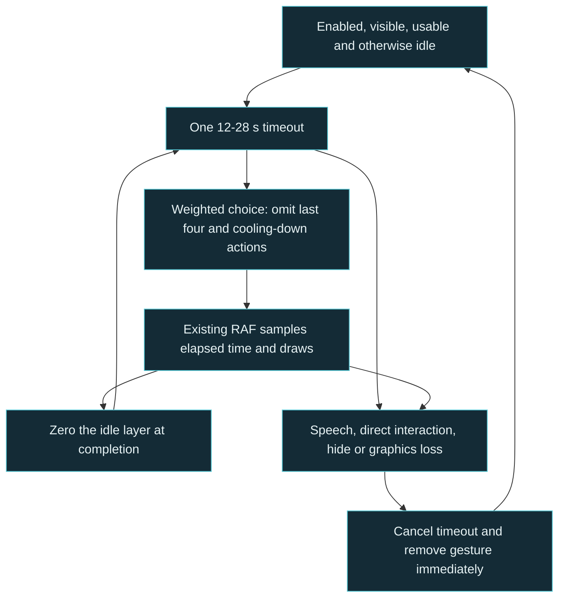

# 11. A face that can wait without freezing

Verona chooses and plays thirty occasional gestures locally. A chat
does not select an animation, send an idle prompt, run a timer or spend model
tokens on this behavior. The same layer serves all six heads and Surface,
FaceMesh, FaceDot and UniformPolygons. Natural blinking remains independent.

The [primary-source research](../research/idle-life.md) explains why restrained,
non-repeating procedural motion fits this prototype better than random
per-frame movement, more neural models or a general behavior engine.
The timing below is an authored product choice, not a measured human rhythm.

## One clock, thirty actions (vr-75)

`verona/web/idle-life.mjs:IDLE_ACTIONS` defines the complete catalog.
`sampleIdleAction` turns elapsed time into a bounded reusable pose. Smooth
cubic pulses provide anticipation, holds and recovery; mirror direction is
chosen once, never randomized each frame.

| Action | Different motion | Duration |
|---|---|---|
| Soft smile | Both mouth corners lift | 2.6 s |
| Crooked smirk | One corner pulls; small glance in eyes-only mode | 2.3 s |
| Curious brow | One brow rises | 1.9 s |
| Brow furrow | Inner brows lower and draw inward | 2.1 s |
| Nose scrunch | Nose/upper-lip area lifts | 1.5 s |
| Lip press | Lips compress toward their center | 1.8 s |
| Lip purse | Lips narrow and project | 2.2 s |
| Cheek puff | Cheeks expand outward and forward | 2.4 s |
| Jaw loosen | Lower face opens slightly and shifts sideways | 3.0 s |
| Yawn | Oval open lips, lowered jaw, closed eyes and rare optional recorded cue | 4.2 s |
| Loud sneeze | Anticipation, eye closure, forward dip and noisy burst/recovery | 2.7 s |
| Look around | Head scan with left/right and up/down eye-leading in both cursor modes | 3.4 s |
| Double nod | Two diminishing pitch pulses | 1.9 s |
| Neck stretch | Opposite side rolls and return | 3.9 s |
| Eye squeeze | Sustained closure, cheeks and slight smile | 1.8 s |
| Horizon eye scan | Eyes scan horizontally, then inspect higher/lower directions | 3.1 s |
| Thoughtful eye arc | Smooth upward iris arc with sideways travel | 2.8 s |
| Playful wink | One eyelid closes, with a small smile and glance | 1.8 s |
| Alternating winks | First eye closes/reopens, then the opposite eye | 2.9 s |
| Reading glances | Three stepped sideways glances over two lower eye levels | 3.3 s |
| Delighted recognition | Smile, brow rise, jaw opening and cheek lift/puff | 3.1 s |
| Skeptical appraisal | One brow, smirk and lip press with sideways eyes/roll | 3.2 s |
| Fleeting distaste | Nose scrunch, brow furrow, pressed lips and small jaw opening | 2.3 s |
| Startled realization | Brow rise, open jaw and rounded/pursed mouth, eyes upward | 2.4 s |
| Pensive lip shift | Pursed/pressed lips, sideways lower face and raised brow | 3.6 s |
| Silent chuckle | Smiling corners, bouncing jaw, cheeks and narrowing eyes | 3.0 s |
| Thoughtful chew | Alternating jaw/side shift, lip compression and cheek puff | 3.4 s |
| Air kiss and wink | Pursed lips, cheeks, one lid and a recovering smile | 2.7 s |
| Brief wince | Nose, lip press, brow furrow and eye squeeze | 2.1 s |
| Resolute reset | Furrow/pressed lips relax into brow lift and a small smile | 3.5 s |

The five eye-focused additions and ten new composites extend the original
fifteen, rather than relabelling mirrors or speed variants. Each new composite
overlaps at least three facial deformation/lid fields; head rotation and
gaze alone do not count toward that requirement. These are stylized cues, not
respiratory simulation. Contact correction and independent teeth/tongue joints
remain absent; passing pixel checks does not make the expressions anatomically
accurate or human-accepted.

`createIdleClock` waits **12-28 seconds** after an action or interruption,
then makes a weighted local choice excluding the last four actions. **Yawn has
weight 3; every other action has weight 1.** That is three times the chance of
each other currently eligible action, not an exact threefold observed frequency:
recent exclusions and availability still matter. The old additional 90-second
yawn cooldown is removed; sneeze retains 120 seconds from its planned end.
A small fixed catalog, four-ID
history, bounded cooldown map and one reusable pose bound scheduler state.

Waiting itself does not request animation frames. `begin` wakes the existing
renderer once; `app.js:draw` continues its single RAF only while something
actually moves. A cancelled callback carries an obsolete revision and cannot
resurrect an action. A timeout more than two seconds late starts a fresh wait;
a late animation sample finishes without replaying missed frames.

## Geometry without another model

`idle-life.mjs:IDLE_GLSL` supplies three `vec4` uniforms to the shared vertex
shader in `app.js:FaceRenderer`. Smooth, front-gated mouth, cheek, nose and brow
fields use the existing calibrated feature frame. Zero uniforms skip the
extra field math. A separate `idleLids` `vec2` drives unilateral closures.
The vr-76 yawn adds one `idleYawn` scalar shared by vertex and fragment stages.
It replaces the old small jaw/purse combination: upper lip rises while the
lower jaw descends, with an elliptical width envelope and a gentler chin
transition. The original vr-76 dark inner-mouth band is superseded by
vr-81: [chapter09](09-verona-character-and-waves.md#native-lip-guides-transparent-mouths-and-rowan-relief-vr-81)
explains the actual transparent opening and native lip-rim mask. Native mouth
registration and an upper/lower seam avoid stretching a closed strip through
the opening. This remains a cosmetic display mask, not a physical jaw joint,
teeth/tongue rig or contact solver. Interrupted/completed yawns restore the
original pose; the mouth mask also follows ordinary speech. No vertex buffer,
topology, model, TTS voice or speech clip is created per idle action. The small
static aperture indices are built once with the renderer; normals retain the
cosmetic approximation.

`FaceRenderer.draw` combines the existing blink amount with the gesture's eye
squeeze using a maximum. `blinking.mjs:blinkAmount` then takes the maximum with
that eye's individual wink value, keeping eyelid skin and optical aperture together.
Rigid pitch/yaw/roll act on the whole selected head, including eyes and hair.
`orientation.mjs:trackedHeadPose` composes that pose with manual/cursor
rotation about the same eye-midpoint pivot. Nothing writes the user's sliders
or tracked-angle state. Head-following **cursor** gaze remains centered, but
deliberate idle gaze works in either mode. A smooth `gazeWeight` temporarily
reduces the cursor contribution while the authored eye motion looks around;
the original tracker state/preferences are never overwritten. Interruption
removes the idle contribution immediately; ordinary tracking resumes.

The existing selected-only ownership remains: one chosen head/hairstyle and
one speech engine, not every model in the catalog. An active gesture costs
rendered frames and shader arithmetic; it is not free GPU work or a promise of
unchanged whole-machine CPU. There is no session-side polling, server
animation request, inference, model download or new process.

## Quiet supplied yawn and sneeze (vr-76/78)

The owner supplies local female/male effects for both yawns and sneezes,
replacing the earlier synthesized cues.
`scripts/prepare-idle-yawns.cjs` uses the already-installed Electron decoder
offline, with no audible playback, microphone or network. It averages channels
to mono24kHz, finds active10ms RMS blocks above a relative/absolute silence
threshold, retains40ms edge room and fades25ms boundaries. The default
`--kind=yawn` keeps at most4.2seconds; explicit `--kind=sneeze` keeps at most2.7.
Only excessive sample peaks are attenuated; quiet source is never boosted.
The original files are untouched. A longer active recording is cropped rather
than pitch-shifted; no independent listening/naturalness claim follows.

The prepared PCM16 WAVs and private trim/hash receipt remain in ignored
`.local/idle-sounds`; recordings are neither committed nor packaged, and
redistribution rights have not been independently established.
`idle_audio.py:read_effect` serves only four exact authenticated effect routes,
with bounded bytes, channels, rate and frame-count checks. There is no arbitrary
path serving or runtime download. Missing/unreadable/invalid audio returns an
explicit503 error; motion still works, but no synthetic effect silently replaces
the requested recording. Fresh checkouts need explicit permitted local input.

Voice metadata supplies male/female style for Windows and optional neural
voices. `app.js` uses the selected voice, not an inference about the user.
Only unknown voice styles fall back to Mark/Male-SharpJawline's male
presentation and the other heads' female presentation. These labels choose
effects, not anatomical or personal identity. Changing voice stops any old cue.
Both effects use the same style selection. The old synthesized sneeze path is
removed; changing kind/style replaces the single latest decoded buffer rather
than retaining all four clips.

**Yawn and sneeze sounds** defaults on; **Idle sound level** starts at20% and
is adjustable0-20% independently of speech. Both the actual control range and
the WebAudio output gain enforce the20%maximum, including stale callers.
Mute/zero keeps gestures silent. Actual loudness still depends on the recording,
system mixer and speakers;20% is a gain limit, not a calibrated sound-pressure
level or a limit on speech playback.

The owner's later rarity request applies to **audible** yawns. Each automatic
visual yawn has only a10%chance of sound, and a successful yawn sound suppresses
further automatic yawn audio for at least ten minutes. Most yawns therefore
stay silent without loading audio or creating a context. Visual3x weighting
and other gesture timing stay unchanged. Explicit local previews bypass rarity
for inspection, still honor mute/20% and update the next automatic sound time.
Reload resets this RAM-only history. No extra timer or session decision is added.

`createIdleSound` lazily creates one Web Audio context, one playing source/gain
and one latest mono 24-kHz buffer (at most 403,200 retained PCM sample bytes,
plus browser objects/temporary decode copy). Repeated matching cues reuse
that buffer; switching kind or male/female effect replaces it. Only an uncached
audible effect fetches its bounded exact local route. End/cancel disconnects the source and
gain and suspends the context, rather than processing silence forever.
Ordinary silent gestures and waiting create no audio context.

The existing clock calls sound start/stop alongside motion. There is no second
scheduler. Speech/generation, direct input, hide, graphics loss, idle-off and
performance sleep cancel the source, abort pending asset fetch and invalidate
pending resume/decode work. An asynchronous start uses the elapsed gesture
offset after decoding; an already finished
gesture is never replayed late. Normal and performance-only creation semantics
are unchanged: a sleeping performance head never starts an idle sound or wakes
itself because of a yawn.

Managed native heads permit existing local agent autoplay. A browser can
require an explicit gesture: **Controls > Enable / retry idle sound** unlocks
output. Device/resume/autoplay errors appear both in the controls and existing
overlay error banner, not as silent success. Retry or mute clears only that
audio-owned banner, never a later unrelated error. Motion remains available;
this is an optional sound error, not a fallback to cloud speech.

## Speech, inspection and lifecycle priority

`app.js:idleAvailable` blocks actions during generation, agent locks, face or
voice playback, seeking and unfinished manual paused-clip inspection.
`attachIdleLife` also gates on visibility, page lifecycle, graphics availability
and held pointer controls. Keyboard, input and wheel interaction remove a
running gesture and restart the quiet interval. Passive cursor movement does
not permanently suppress idle life.

Agent terminal output is different from manual paused inspection. After
completion, cancellation or failure releases the agent lock, a paused
agent-owned clip returns to neutral. `FaceRenderer.draw` binds the existing
neutral position/normal buffers and suppresses clip-only cheekiness without
deleting the retained clip or changing audio time. Manual Play, Restart,
Seek or voice-preview playback takes inspection ownership back; a paused
unfinished clip then blocks idle again. This avoids animating a mouth frozen
halfway through cancelled speech.

The **Idle life** checkbox is exposed through existing manager controls.
Standalone player controls also offer one-shot **Preview idle action** and
**Clear speech**. Preview is explicit local inspection, not how automatic
selection works; the selector is excluded from the manager's shared settings.
Clear speech discards the current face/voice samples and returns to idle.
It is unavailable during generation or agent ownership.

Reduced-motion preference defaults idle life off. An explicit per-page choice
wins over subsequent OS preference changes; blinking has its own switch.
Hidden/page-hidden states cancel rather than accumulate actions, and resume
waits anew. Graphics loss cancels work and retains the existing visible
reload error. Reload starts fresh without persisting gesture history.
An ineligible preview reports an error, never a successful-looking no-op.

## What was actually qualified

### Supplied-sneeze update (vr-78)

The supplied male clip becomes0.93s and the female2.7s after bounded trimming,
mono24kHz conversion and25ms fades. The female's active tail extends beyond
the bound and is shortened; its main RMS peak remains inside the selected
window. These are preparation measurements, not independent listening.
Source files stay unchanged and private, as do the derived clips/receipts.

After the owner reports an unwanted ending and specifies the female recording,
exactly one second is removed from that prepared clip:2.7s becomes1.7s.
A new25ms fade reaches zero at its endpoint. The original MP3, male sneeze
and both yawns remain unchanged. `female-sneeze-tail-native-01` repeats the120
Claire action/view cases with actual1.7s female playback; the smoke check reads
the prepared WAV's duration instead of assuming every private trim is2.7s.
Only the owned head is recreated with saved settings to discard its previous
RAM buffer; the shared manager and other sessions remain intact. This is a
private asset correction, not a replacement of the published v0.3.1 archive
or independent listening approval.

`supplied-sneeze-claire-01` passes120 real-native action/view cases. Actual
David/Hazel switches load the respective male/female yawn and sneeze buffers;
gain/range cap, mute/cancel/output failure and speech preemption pass.
`supplied-sneeze-policies-01` checks both creation policies in four views each.
The six-head geometry qualification remains the earlier vr-76 result, not a
new claim that every model was rerun for an audio-only change.
Seven focused Node runner cases and twelve Python server/audio cases cover
four authenticated routes, per-kind frame bounds, style/cache replacement,
missing-file errors and cancelled fetches. An old static-file assertion still
expected the removed synthesis export; it was corrected to the actual public
controller export. No new CPU saving, acoustic quality or anatomical claim.

### Supplied-yawn correction (vr-76)

The first native pass exposed missing voice style in the warm Windows worker,
despite the standalone inventory already exposing it. Updating both inventories
fixes actual David-versus-Hazel selection; the failed receipt is retained.
An initial overly uniform jaw drop produced a rectangular cavity. Real rendered
frames motivated the elliptical opening envelope/gentler chin transition,
not a claim that a numeric pose alone proves a natural yawn.

`supplied-yawn-claire-02` and the remaining-model native03 receipts cover
six heads/four views/thirty actions, real voice-matched supplied buffers,
the native gain/range cap and speech/mute/cancel/error behavior. Surface and
FaceMesh yawn frames were visually inspected; this is not full animation,
independent listening, anatomical acceptance or user approval. Existing buffer
ownership is unchanged; bounded local effect fetches replace the old no-fetch
audio claim. Both fixed creation policies remain covered. Focused sound cases
also exercise rare selection, ten-minute exclusion, explicit preview, pending
fetch cancellation and non-overwriting bounded trim behavior.

### Eye/audio expansion (vr-75)

Historical synthesis/75% defaults below are superseded by vr-76 above.

Focused cases cover thirty finite/distinct/reachable trajectories, exact neutral
endpoints, five real eye-field paths and ten composites with at least three
simultaneous facial fields above their numerical activity threshold. History,
cooldowns, input/lifecycle/reduced-motion gates and the one waiting timer remain
covered. Sound cases exercise finite non-clipping PCM, quiet boundaries,
mute/zero gain, latest-buffer reuse, end/cancel, delayed/cancelled resume and
visible failure handling. They do not prove perceptual naturalness.

Private `idle-eyes-native-01` qualifies **720 action/view cases: six real heads
x four views x thirty actions**. All change actual pixels and restore their
neutral envelope, with exact filled-Surface restoration and zero gesture-created
GPU buffers/uploads/fetches. Native shader gaze changes both horizontal and
vertical signs in both cursor modes; alternating lid uniforms close opposite
eyes. Actual yawn PCM has approximately 0.9 peak, 0.468 RMS and a running audio
clock; manager mute cancels and suppresses future output, with one context.
The host output is muted during qualification; this is not independent listening.
Two compact contact sheets were reviewed, not every full animation by eye.

The later Claire-only `idle-eyes-audio-final-02` receipt additionally exercises
the visible overlay audio error and explicit recovery.
`idle-eyes-policy-01` checks normal and performance-only creation with sound
controls present, including a 13-second sleeping sample with no new frames.
The earlier fifteen-GIF report below stays a historical vr-72 artifact; it has
not been regenerated to pretend it contains the new catalog.

### Original fifteen-action qualification (vr-71, historical)

`tests/test_idle_life.mjs` verifies finite distinct trajectories, exact neutral
endpoints, all fifteen reachable in 400 deterministic automatic choices,
last-four exclusion, cooldowns, a single waiting timer, cancellation, stale
callbacks/frames, reduced-motion overrides and lifecycle/input gates.
`test_orientation.mjs` checks roll composition and the fixed pivot;
`test_blinking.mjs`, `test_agent_player.mjs` and nine local HTTP tests pass.

`tests/run_idle_smoke.py` and `tests/idle_smoke.cjs` run actual selected engines,
native adapters, the production sandboxed Electron shell and real agent
playback. Final private run `idle-life-native-07` passes **360 action/view
cases: six heads x four views x fifteen actions**. Every sampled action changes
more than 50 actual color/alpha bytes, returns its uniforms to zero and
restores its measured neutral rendering. There are zero gesture-created or
deleted GPU buffers, buffer-storage calls, motion uploads or fetches.
Each head's isolated 0.9-second waiting sample adds zero frames and requests
with independent blinking/cursor following disabled.

Claire additionally starts and finishes an unprompted real-time random action,
then exercises actual face and voice agent playback/cancellation. Speech
preempts an active yawn; the same audio source/time advances. Cancellation
restores true neutral while retaining the clip, manual paused face/voice
inspection blocks idle, and Clear speech restores eligibility. Held-pointer
and typing cancellation, a second hairstyle and the off switch also pass.
Owned test processes, servers, profiles and capability descriptors are removed.

The first qualification attempts remain recorded, not silently replaced.
Exact wireframe byte equality failed even between unchanged neutral draws:
the final per-view 65-frame baselines observe 12-20 varying wireframe channels,
but zero varying Surface/FaceDot/grid channels. The cause is not established.
The final gate requires **exact filled-Surface pixels** and, in other views,
every restored channel within its own observed neutral minimum/maximum.
There is no arbitrary global pixel tolerance. Original strict failures remain;
this is not a claim of byte-identical wireframe readback.

A separate bad sample landed between the two nod pulses. Sampling the first
pulse fixed the fixture rather than altering the animation. Compact owned
captures were inspected for all fifteen Claire actions and representative
Surface/wireframe poses of the five other heads. Static captures and
time-offset automated sampling do not prove continuous naturalness, universal
frame rate, OS composition, independent listening or owner acceptance.
The earlier broad-suite iris-artwork failure is not claimed fixed by this work.

## Inspect all fifteen complete loops (vr-72)

The owner-requested private report lives at
`.local\reports\idle-animations\index.html` in the prepared checkout. Each action
has one labelled GIF pairing Surface and FaceMesh on original Claire at
matching phases. All fifteen are present, including full anticipation/recovery
and half-second neutral holds. It starts paused and plays only one selection
at a time; the other cards retain static posters.

814 native captures produce 407 encoded frames. Complete decoded timelines
match their resized, quantized sources; delta encoding reduces the set from
57,727,158 to 18,761,888 bytes without changing those timelines. A local
sandboxed browser decodes all fifteen, checks controls and wide/narrow layout,
and makes no external requests. This illustrates two views of one model,
not another all-six-head acceptance claim. Source runtime is `77e3951`.
The report, GIFs and raw captures stay ignored/local, not published media.

## Let a silent head sleep (vr-73)

**vr-74 supersedes vr-73's live toggle:** performance-only mode is an explicit,
unchecked **creation-time** option. Ordinary heads do not dim automatically or
expose a performance switch. The manager's New session checkbox and CLI
`create --performance-mode` / `host --performance-mode` select this immutable
policy; changing it requires a new head. `SessionManager.create` passes the
validated boolean to the child CLI, and `appearance.performanceMode` carries
it to the common player. Omitted values mean false, including old configuration.
Non-boolean values and live `performance-mode` settings are rejected, not
silently coerced or accepted. The manager displays the policy read-only.

On an opted-in head it does not erase the user's
Follow cursor, Natural blinking or Idle life choices. While neither face speech
nor voice-preview audio is playing, the canvas is **10% opaque / 90% transparent**.
Both audio paths wake it to **100% opacity**. Preparation alone does not wake
the renderer; pause, cancellation, completion and playback failure return it
to sleep. Muted playback still counts as playback, not acoustic detection.

`performance-mode.mjs:attachPerformanceMode` derives this state from the two
existing media elements' events. There is no inactivity timer or polling loop.
Duplicate state notifications do not call the rendering/native update again.
`app.js` cancels its pending RAF, gates automatic redraws and cursor events,
centers the procedural gaze/head offset, and refreshes the existing blink/idle
controllers with unavailable status. Their waiting timers are cancelled rather
than allowed to fire invisibly. No catch-up motion runs after waking.

`desktop/main.cjs` receives the existing trusted command channel's `sleep`
boolean and clears its 33-ms cursor interval. This is different from discarding
cursor packets after continuously sampling them. The saved `follow` preference
remains separate from `dormant`; waking starts the interval only if following
is still selected and requests a fresh position. Manual settings, resizing,
dragging and error recovery can still cause a single explicit draw.

The floating menu has a **Normal opacity** quick control.
The normal opacity slider is 0-100%, independent of audio volume and surface
material. Performance-only heads override it with fixed 10%/100% values.
Their badge is informational, not a toggle. Only the canvas is faded,
never the dock/menu or error message. Even 0% normal opacity is recoverable.
`attachSessionControls` exposes canonical `head-opacity` to the manager,
excluding its quick mirror. Performance is not a mutable native control.

This is **warm sleep**, not unloading or shutting down a head. The existing
model, selected GPU resources and retained clip stay available; opacity alone
would not release them. The required host watch, authenticated speech socket,
server and manager metadata handling remain alive. No voice/clip regeneration,
audio-clock reset, quality reduction, renderer restart or extra dependency
occurs on a wake. Closing a head remains the way to release its full model and
process memory. Controls remain RAM-only and reset on head restart.

The native qualification uses a separate selected engine, disposable profile,
derived cache and backend, with an invisible/unfocused owned window. Synthetic
cursor coordinates replace only that process's cursor-read function: the real
desktop cursor and live head are not driven. Historical vr-73 counterbalanced off/on/on/off
windows compare owned Electron cumulative CPU and process memory, not total
machine load or energy. A stationary-cursor case distinguishes occasional
gestures from continuous cursor-follow work. See chapter07 for those measured results;
they were collected before replacing the toggle with creation-only policy.

vr-74 separately qualifies a normal and a performance-only actual Claire head
across all four presentations. Normal heads stay opaque and continue native
cursor sampling/rendering; opted-in silent heads have zero sampled automatic
draws/uploads/cursor reads. Both retain opacity controls, reject live policy
changes, and complete real decoded WAV plus local face/voice preparation,
playback and cancellation under their selected policy. The actual manager DOM
qualifies unchecked creation, explicit opt-in forwarding, resetting the next
creation to unchecked and read-only identity. These cases do not rerun or
extend the historical CPU percentages or establish human acceptance.
