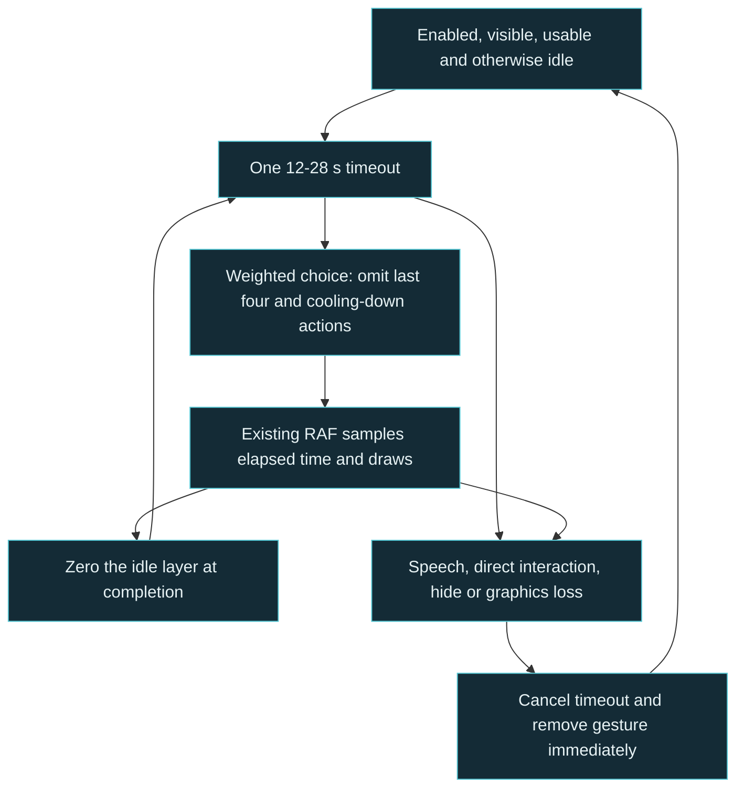

# 11. A face that can wait without freezing

Verona chooses and plays fifteen occasional silent gestures locally. A chat
does not select an animation, send an idle prompt, run a timer or spend model
tokens on this behavior. The same layer serves all six heads and Surface,
FaceMesh, FaceDot and UniformPolygons. Natural blinking remains independent.

The [primary-source research](../research/idle-life.md) explains why restrained,
non-repeating procedural motion fits this prototype better than random
per-frame movement, more neural models or a general behavior engine.
The timing below is an authored product choice, not a measured human rhythm.

## One clock, fifteen actions

`verona/web/idle-life.mjs:IDLE_ACTIONS` defines the complete catalog.
`sampleIdleAction` turns elapsed time into a bounded reusable pose. Smooth
cubic pulses provide anticipation, holds and recovery; mirror direction is
chosen once, never randomized each frame.

| Action | Different motion | Duration |
|---|---|---|
| Soft smile | Both mouth corners lift | 2.6 s |
| Crooked smirk | One corner pulls; small glance in eyes-only mode | 2.3 s |
| Curious brow | One brow rises | 1.9 s |
| Brow furrow | Inner brows lower and draw inward | 2.1 s |
| Nose scrunch | Nose/upper-lip area lifts | 1.5 s |
| Lip press | Lips compress toward their center | 1.8 s |
| Lip purse | Lips narrow and project | 2.2 s |
| Cheek puff | Cheeks expand outward and forward | 2.4 s |
| Jaw loosen | Lower face opens slightly and shifts sideways | 3.0 s |
| Silent yawn | Slower opening, narrowing eyes, upward head tilt | 4.2 s |
| Silent sneeze | Anticipation, eye closure, forward dip, recovery | 2.7 s |
| Look around | Two-sided head scan; eye-leading in eyes-only mode | 3.4 s |
| Double nod | Two diminishing pitch pulses | 1.9 s |
| Neck stretch | Opposite side rolls and return | 3.9 s |
| Eye squeeze | Sustained closure, cheeks and slight smile | 1.8 s |

These are fifteen spatial/temporal composites, not fifteen speeds or mirrors
of one action. Yawns and sneezes are deliberately silent stylized cues, not
respiratory simulation. Contact correction and independent teeth/tongue joints
remain absent; passing pixel checks does not make the expressions anatomically
accurate or human-accepted.

`createIdleClock` waits **12-28 seconds** after an action or interruption,
then makes a weighted local choice excluding the last four actions. The yawn
has a 90-second cooldown; the sneeze has 120 seconds, both counted from their
planned end. Ordinary actions are more likely. A small fixed catalog, four-ID
history, bounded cooldown map and one reusable pose bound scheduler state.

Waiting itself does not request animation frames. `begin` wakes the existing
renderer once; `app.js:draw` continues its single RAF only while something
actually moves. A cancelled callback carries an obsolete revision and cannot
resurrect an action. A timeout more than two seconds late starts a fresh wait;
a late animation sample finishes without replaying missed frames.

## Geometry without another model

`idle-life.mjs:IDLE_GLSL` supplies three `vec4` uniforms to the shared vertex
shader in `app.js:FaceRenderer`. Smooth, front-gated mouth, cheek, nose and brow
fields use the existing calibrated feature frame. Zero uniforms skip the
extra field math. No vertex buffer, topology, model, voice or clip is created
for an idle action. Normals retain the renderer's cosmetic approximation.

`FaceRenderer.draw` combines the existing blink amount with the gesture's eye
squeeze using a maximum, keeping eyelid and optical aperture behavior together.
Rigid pitch/yaw/roll act on the whole selected head, including eyes and hair.
`orientation.mjs:trackedHeadPose` composes that pose with manual/cursor
rotation about the same eye-midpoint pivot. Nothing writes the user's sliders
or tracked-angle state. Head-following mode keeps the irises centered; bounded
idle gaze is added only in eyes-only mode.

The existing selected-only ownership remains: one chosen head/hairstyle and
one speech engine, not every model in the catalog. An active gesture costs
rendered frames and shader arithmetic; it is not free GPU work or a promise of
unchanged whole-machine CPU. There is no session-side polling, server
animation request, inference, model download or new process.

## Speech, inspection and lifecycle priority

`app.js:idleAvailable` blocks actions during generation, agent locks, face or
voice playback, seeking and unfinished manual paused-clip inspection.
`attachIdleLife` also gates on visibility, page lifecycle, graphics availability
and held pointer controls. Keyboard, input and wheel interaction remove a
running gesture and restart the quiet interval. Passive cursor movement does
not permanently suppress idle life.

Agent terminal output is different from manual paused inspection. After
completion, cancellation or failure releases the agent lock, a paused
agent-owned clip returns to neutral. `FaceRenderer.draw` binds the existing
neutral position/normal buffers and suppresses clip-only cheekiness without
deleting the retained clip or changing audio time. Manual Play, Restart,
Seek or voice-preview playback takes inspection ownership back; a paused
unfinished clip then blocks idle again. This avoids animating a mouth frozen
halfway through cancelled speech.

The **Idle life** checkbox is exposed through existing manager controls.
Standalone player controls also offer one-shot **Preview idle action** and
**Clear speech**. Preview is explicit local inspection, not how automatic
selection works; the selector is excluded from the manager's shared settings.
Clear speech discards the current face/voice samples and returns to idle.
It is unavailable during generation or agent ownership.

Reduced-motion preference defaults idle life off. An explicit per-page choice
wins over subsequent OS preference changes; blinking has its own switch.
Hidden/page-hidden states cancel rather than accumulate actions, and resume
waits anew. Graphics loss cancels work and retains the existing visible
reload error. Reload starts fresh without persisting gesture history.
An ineligible preview reports an error, never a successful-looking no-op.

## What was actually qualified

`tests/test_idle_life.mjs` verifies finite distinct trajectories, exact neutral
endpoints, all fifteen reachable in 400 deterministic automatic choices,
last-four exclusion, cooldowns, a single waiting timer, cancellation, stale
callbacks/frames, reduced-motion overrides and lifecycle/input gates.
`test_orientation.mjs` checks roll composition and the fixed pivot;
`test_blinking.mjs`, `test_agent_player.mjs` and nine local HTTP tests pass.

`tests/run_idle_smoke.py` and `tests/idle_smoke.cjs` run actual selected engines,
native adapters, the production sandboxed Electron shell and real agent
playback. Final private run `idle-life-native-07` passes **360 action/view
cases: six heads x four views x fifteen actions**. Every sampled action changes
more than 50 actual color/alpha bytes, returns its uniforms to zero and
restores its measured neutral rendering. There are zero gesture-created or
deleted GPU buffers, buffer-storage calls, motion uploads or fetches.
Each head's isolated 0.9-second waiting sample adds zero frames and requests
with independent blinking/cursor following disabled.

Claire additionally starts and finishes an unprompted real-time random action,
then exercises actual face and voice agent playback/cancellation. Speech
preempts an active yawn; the same audio source/time advances. Cancellation
restores true neutral while retaining the clip, manual paused face/voice
inspection blocks idle, and Clear speech restores eligibility. Held-pointer
and typing cancellation, a second hairstyle and the off switch also pass.
Owned test processes, servers, profiles and capability descriptors are removed.

The first qualification attempts remain recorded, not silently replaced.
Exact wireframe byte equality failed even between unchanged neutral draws:
the final per-view 65-frame baselines observe 12-20 varying wireframe channels,
but zero varying Surface/FaceDot/grid channels. The cause is not established.
The final gate requires **exact filled-Surface pixels** and, in other views,
every restored channel within its own observed neutral minimum/maximum.
There is no arbitrary global pixel tolerance. Original strict failures remain;
this is not a claim of byte-identical wireframe readback.

A separate bad sample landed between the two nod pulses. Sampling the first
pulse fixed the fixture rather than altering the animation. Compact owned
captures were inspected for all fifteen Claire actions and representative
Surface/wireframe poses of the five other heads. Static captures and
time-offset automated sampling do not prove continuous naturalness, universal
frame rate, OS composition, independent listening or owner acceptance.
The earlier broad-suite iris-artwork failure is not claimed fixed by this work.

## Inspect all fifteen complete loops (vr-72)

The owner-requested private report lives at
`.local\reports\idle-animations\index.html` in the prepared checkout. Each action
has one labelled GIF pairing Surface and FaceMesh on original Claire at
matching phases. All fifteen are present, including full anticipation/recovery
and half-second neutral holds. It starts paused and plays only one selection
at a time; the other cards retain static posters.

814 native captures produce 407 encoded frames. Complete decoded timelines
match their resized, quantized sources; delta encoding reduces the set from
57,727,158 to 18,761,888 bytes without changing those timelines. A local
sandboxed browser decodes all fifteen, checks controls and wide/narrow layout,
and makes no external requests. This illustrates two views of one model,
not another all-six-head acceptance claim. Source runtime is `77e3951`.
The report, GIFs and raw captures stay ignored/local, not published media.

## Let a silent head sleep (vr-73)

**Performance mode** is a separate opt-in control. It does not erase the user's
Follow cursor, Natural blinking or Idle life choices. While neither face speech
nor voice-preview audio is playing, the canvas is **10% opaque / 90% transparent**.
Both audio paths wake it to **100% opacity**. Preparation alone does not wake
the renderer; pause, cancellation, completion and playback failure return it
to sleep. Muted playback still counts as playback, not acoustic detection.

`performance-mode.mjs:attachPerformanceMode` derives this state from the two
existing media elements' events. There is no inactivity timer or polling loop.
Duplicate state notifications do not call the rendering/native update again.
`app.js` cancels its pending RAF, gates automatic redraws and cursor events,
centers the procedural gaze/head offset, and refreshes the existing blink/idle
controllers with unavailable status. Their waiting timers are cancelled rather
than allowed to fire invisibly. No catch-up motion runs after waking.

`desktop/main.cjs` receives the existing trusted command channel's `sleep`
boolean and clears its 33-ms cursor interval. This is different from discarding
cursor packets after continuously sampling them. The saved `follow` preference
remains separate from `dormant`; waking starts the interval only if following
is still selected and requests a fresh position. Manual settings, resizing,
dragging and error recovery can still cause a single explicit draw.

The floating menu has **Performance** and **Normal opacity** quick controls.
The normal opacity slider is 0-100%, independent of audio volume and surface
material. Performance mode overrides it with fixed 10%/100% values; turning
the mode off restores the chosen normal value. Only the canvas is faded,
never the dock/menu or error message. Even 0% normal opacity is recoverable.
`attachSessionControls` exposes the two canonical settings to the manager,
excluding their quick mirrors to avoid conflicting duplicate control values.

This is **warm sleep**, not unloading or shutting down a head. The existing
model, selected GPU resources and retained clip stay available; opacity alone
would not release them. The required host watch, authenticated speech socket,
server and manager metadata handling remain alive. No voice/clip regeneration,
audio-clock reset, quality reduction, renderer restart or extra dependency
occurs on a wake. Closing a head remains the way to release its full model and
process memory. Controls remain RAM-only and reset on head restart.

The native qualification uses a separate selected engine, disposable profile,
derived cache and backend, with an invisible/unfocused owned window. Synthetic
cursor coordinates replace only that process's cursor-read function: the real
desktop cursor and live head are not driven. Counterbalanced off/on/on/off
windows compare owned Electron cumulative CPU and process memory, not total
machine load or energy. A stationary-cursor case distinguishes occasional
gestures from continuous cursor-follow work. See chapter07 for measured results.
