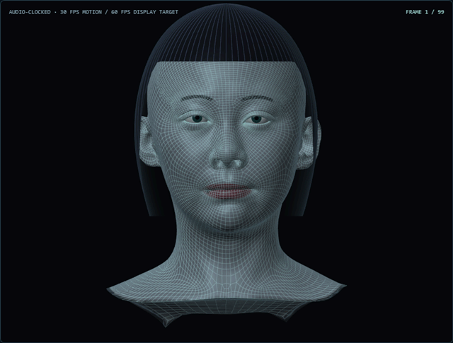

# Verona v0.1.0-prototype.1

The first **Windows source prerelease** of Verona: type plain text, generate
local speech and play a synchronized connected female face. This is not a
standalone executable, installer or deployment.



- Native Claire female facial contours, directional shading, defined lips/brows,
  static cosmetic eyes and independently toggleable original hair.
- Installed Hazel by default; David/Zira selection, pitch request, rate,
  emphasis, bass/treble, preview and reset.
- Audio-clocked play/pause/restart/seek, explicit expressions and bounded CPU
  inference. Latest-only RAM caches and numeric topology cache; no transcript history.
- Local playback met the 60-fps display target at 1x/2x pixel density.
  Motion samples remain 30 fps; generating a new sentence is precomputed, not live.

## Run

Download/extract the source ZIP or clone this tag, then follow the
[fresh-clone setup](../prototype-guide.md#fresh-clone-setup).
Requires Windows, Python (qualified on 3.13), an installed English desktop
System.Speech voice and a WebGL2-capable browser (qualified in Edge).
Dependencies and about 337 MB of pinned model/topology data are **not bundled**.
Setup explicitly downloads reviewed, size/hash-verified assets; runtime is local.

```powershell
.\Verona.cmd
```

Generate face, then Play. Keep the terminal open; Ctrl+C stops it.
Do not share the private local capability URL.

## Qualification and limits

Thirty-three unit/HTTP checks and eighteen isolated Edge scenarios passed.
At a 1280 x 980 CSS viewport, measured 1x/2x playback intervals averaged 16.691 ms,
with p95 16.8 ms and zero sampled intervals over 25 ms. These are local observations,
not universal refresh guarantees, GPU scanout measurements or 60-fps inference.

Playback checks were muted. Human listening, lip-contact/phonetic accuracy,
subjective beauty and expressive quality remain unaccepted. Eyes/hair are static
cosmetics; independent teeth, tongue and eye joints and full SDK contact/smoothing
are omitted. Recording import, microphone/camera use and assistant conversation
are not included. No model, personal recording or reference artwork is bundled.

[Setup and controls](../prototype-guide.md) ·
[Engineering mechanism and measurements](../chapters/08-facial-definition-and-fluidity.md) ·
[Media provenance](../media/README.md) · [Third-party terms](../../THIRD_PARTY.md)
