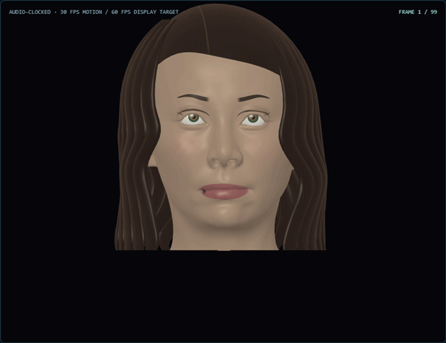
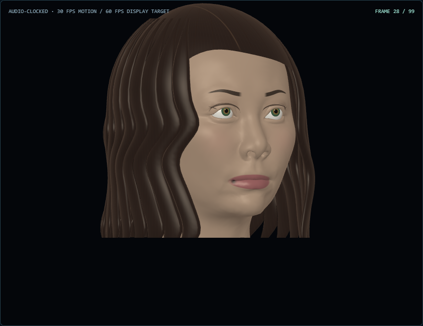
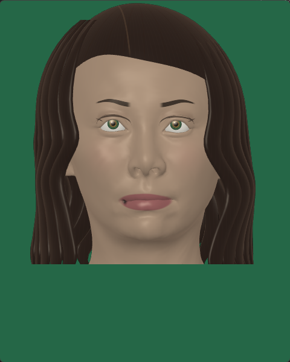

# Verona prototype 2 - desktop, framing and a reference-guided color study

Run `.\VeronaDesktop.cmd` after the documented local setup.
Choose **View -> Reference color + makeup** for olive skin, hazel-green eyes,
rosewood/bronze cosmetics and espresso waves. **Transparent polygons** stays
the default. This is a stylized study, not a photorealistic reconstruction or
accepted likeness of the supplied sheet.

This source prerelease includes the optional native transparent desktop,
cursor-following irises, XYZ orientation and reversible Head and neck framing.
Framing removes hidden triangle submissions/normal work without speeding up
speech generation. Full bust remains available/default.

Color rendering caps high-DPI density at 1.5x; polygons retain 2x.
Final local browser/native checks pass bounded cadence budgets; historical
outliers remain documented. This is not a universal 60fps guarantee.
Speech remains precomputed 30fps neural motion with audio-clocked interpolation.
Teeth/tongue/eye joints, SDK contact correction, correct expressions, phonetic
accuracy and human listening/beauty acceptance remain unqualified.

This is **source**, not an installer or self-contained executable/model bundle.
No new dependency/model download is introduced by this revision. Existing
setup, model terms and installed Windows voices still apply.

[Setup and limits](../prototype-guide.md) · [Media provenance](../media/README.md)
· [Engineering book](../README.md) · [Third-party terms](../../THIRD_PARTY.md)

The original `v0.1.0-prototype.1` tag/release remains unchanged.
