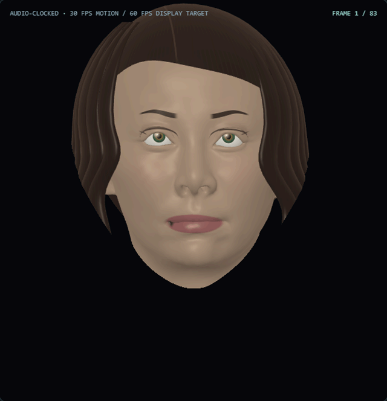
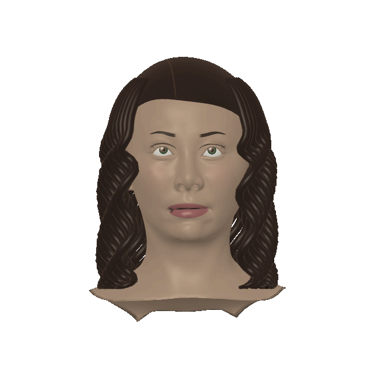
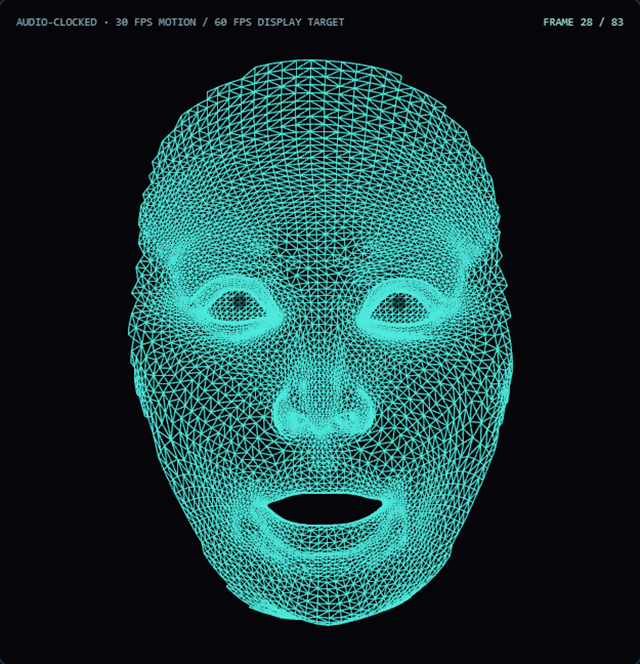
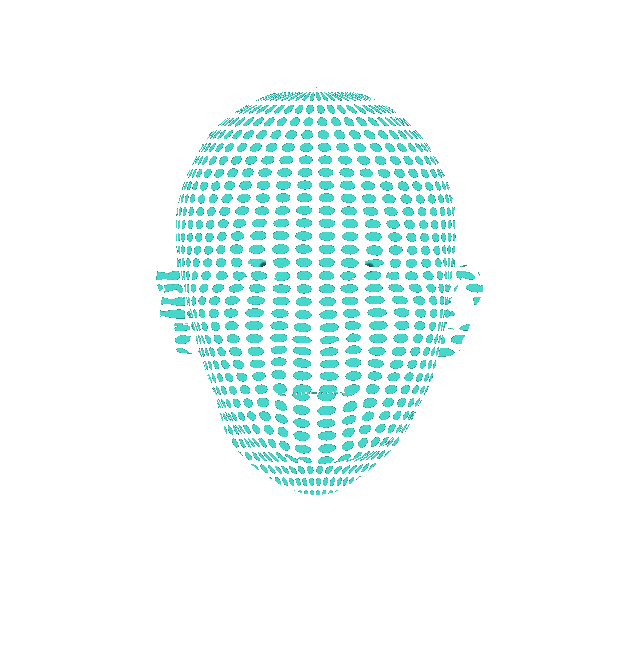
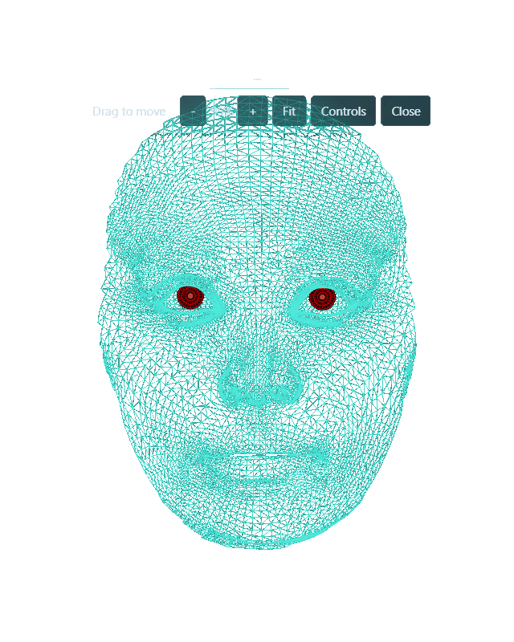

# Verona prototype 3 - eleven hairstyles and a GIF-first gallery

**Original Claire waves plus ten alternative hairstyles**, four presentation
views, exclusive eye/head cursor tracking and compact floating-head controls.
The [README gallery](../../README.md#every-hairstyle-in-motion) showcases
**every hairstyle by name**, with 23 actual-render GIFs across the complete page.

## Included since prototype 2

- Claire is preserved; FaceMesh, FaceDot and UniformPolygons present the same motion.
- Original waves, tapered pixie, rounded bob, asymmetric angled bob, long sleek
  layers, spiral curls, high ponytail, twin tails, coiled top bun, double space
  buns and braided crown.
- Eyes-only or centered-eye whole-head cursor modes, with manual XYZ offsets.
- Jaw-following head/neck cutoff and live 0-6 cm neck extent.
- Per-view dot/grid density 0.5x-3x and cell gap 0-80%.
- Native drag region, zoom 35-230%, Fit and RAM-only placement restoration.
- Tiny default-collapsed glass tab above the head; expand, Escape/outside collapse.

Run `.\VeronaDesktop.cmd` after [setup](../prototype-guide.md), or `.\Verona.cmd`
for the browser player. This is a **source prerelease**, not an installer,
self-contained executable or model/voice bundle. No new dependency or asset
download is introduced by this gallery release.

The latest runtime is locally qualified; this release adds documentation/media,
not a new speech model. GIFs are silent sampled previews, not live inference,
60fps recordings, independent listening or proof of phonetic accuracy.
Hairstyles are procedural geometry, the rectangular grid is not quad retopology,
and web glass is not an OS-desktop acrylic promise. Beauty, likeness, physical
gaze and perfect expressions are not accepted. The Realistic model stays parked.

[All hairstyles and feature GIFs](../../README.md) &middot;
[Media provenance](../media/README.md) &middot;
[Engineering book](../README.md) &middot; [Terms](../../THIRD_PARTY.md)

Existing prototype.1 and prototype.2 tags, releases and historical media remain unchanged.
