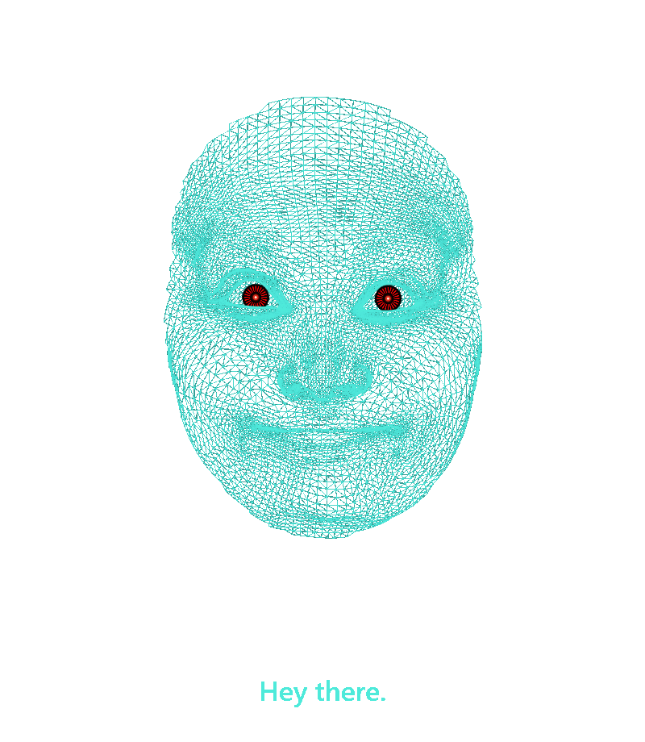

# v1.0.0 - First public release

**Type a sentence. Hear a local voice. Give it a face.**

Verona's first public product release brings its Windows-local speaking-face
workspace together. Earlier v0.x prototype and engineering milestones remain
available unchanged. This is a **source release**, not a prepared environment,
executable installer, stable-API promise or human-accuracy certification.



The captioned demo above is preserved historical footage. The
[current19GIF gallery](../../README.md) shows all six selectable heads, seven
separately labelled review studies and four hairstyles with current provenance.

## What is here

- **Local speech and motion:** installed Windows English voices, CPU neural
  facial animation, audio-clocked WebGL2 and an optional transparent Electron
  desktop. No cloud speech, camera or microphone activation.
- **Six selectable shapes:** `claire`, `mpfb`, `mark`, `reference-structure`,
  `reference-shell` and `male-sharp`. These use two neural identities, not six
  independently trained models. Mark uses its own network/PCA; native MPFB
  transfers Claire motion through its selected adapter.
- **Four presentations:** Surface, FaceMesh, FaceDot and UniformPolygons share
  colors, framing/neck depth, XYZ/cursor motion, natural blinking and four
  procedural hairstyles. New Mark heads default to the short textured quiff.
- **One manager, separate heads:** local agent opt-in, per-head speech jobs,
  cancellation and an optional explicitly installed28-style Kokoro English pack.
  Performance-only sleep remains creation-time opt-in, not the normal default.
- **Current face corrections:** original opaque mouth surfaces by default;
  wide-opening transparency only with explicit creation opt-in. Lip cosmetics,
  Rowan's effective gain and the latest eye/lash work are preserved.
- **Review studies stay studies:** restored Akari cel shading and six
  supplied-GLB candidates are illustrated, not silently installed as model IDs.
  [Media receipts and CC BY4.0 source credits](../media/README.md) distinguish
  original work, supplied geometry and the modifications.

## Get started

Download `Verona-v1.0.0-source.zip` below, or obtain this exact source tag:

```powershell
git clone --branch v1.0.0 https://github.com/Zanark/Verona.git
Set-Location Verona
```

Follow [fresh-clone setup](../prototype-guide.md#fresh-clone-setup) before
running `.\Verona.cmd`. Requirements include Windows, a supported local Python,
an installed English System.Speech voice and WebGL2; native heads additionally
need Node.js/npm and explicit pinned Electron setup.

Model/native assets and dependencies are **not bundled**. The guide's initial
setup prepares Claire; other choices need their respective assets/adapters,
and author-checkout-only studies/reports are not promised in a fresh clone.
Setup is explicit and verifies pinned downloads; runtime never downloads.
The optional voice pack is separate, with its own dependency/license terms.
Keep idle sound muted until authorized local yawn/sneeze files are prepared;
those recordings and derived effects are not distributed.

## Evidence and limits

This publication does not change application runtime code. It carries forward
the qualified source and focused checks documented in the chapters, not a new
full-system or clean-machine certification.

The current gallery includes six freshly generated synthetic Hazel
four-presentation tours, latest-geometry study renders and hairstyle loops
reusing the exact new Mark Happy motion. All17new public GIF timelines match
their decoded parents. Actual GFM with retained GitHub CSS passes
1200/768/390px: hero first, one closed disclosure, borderless half/full-width
rows and natural aspect ratios. The initial local text-codec fixture error was
corrected; representative views, not every frame, were visually inspected.

GIFs are silent sampled demonstrations, not live-FPS or listening evidence.
Native fitting, mouth contact, makeup, hair and eyelids remain approximations.
Phonetic/anatomical/identity accuracy, naturalness and subjective appearance
are not accepted. Eight allowed heads is a safety cap, not eight-way performance
qualification; warm heads multiply CPU/RAM. Recording import and a conversational
assistant remain future work. Cancellation can discard synchronous inference
without immediately interrupting it.

## Exact source, not a binary bundle

The source ZIP, `release-manifest.json` and `SHA256SUMS.txt` identify the exact
release commit and archive members. Every member is compared with canonical
Git bytes; uploaded files are downloaded and SHA-256 checked. The manifest
distinguishes inherited qualification from publication verification.

Excluded: private context/conversations, credentials/capabilities, profiles,
recordings/audio, model/native binaries, prepared Python/Electron environments
and local PDF editions. Frozen books and old releases are not rewritten.
Public previews retain their [third-party terms](../../THIRD_PARTY.md);
optional GPL/LGPL components are not relicensed by the model weights' license.
No new license grant or combined binary/model redistribution is implied.

[Setup, controls and recovery](../prototype-guide.md) ·
[Opt-in agent skill](../../.github/skills/verona/SKILL.md) ·
[Engineering chapters](../README.md) ·
[Previous release](v0.3.1.md)
