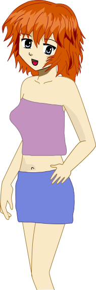
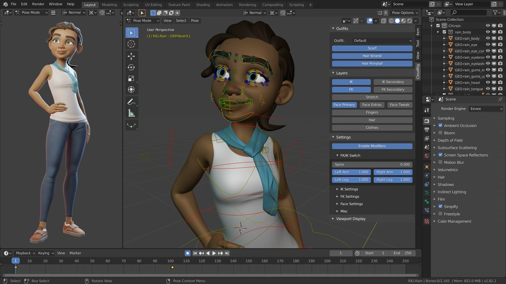
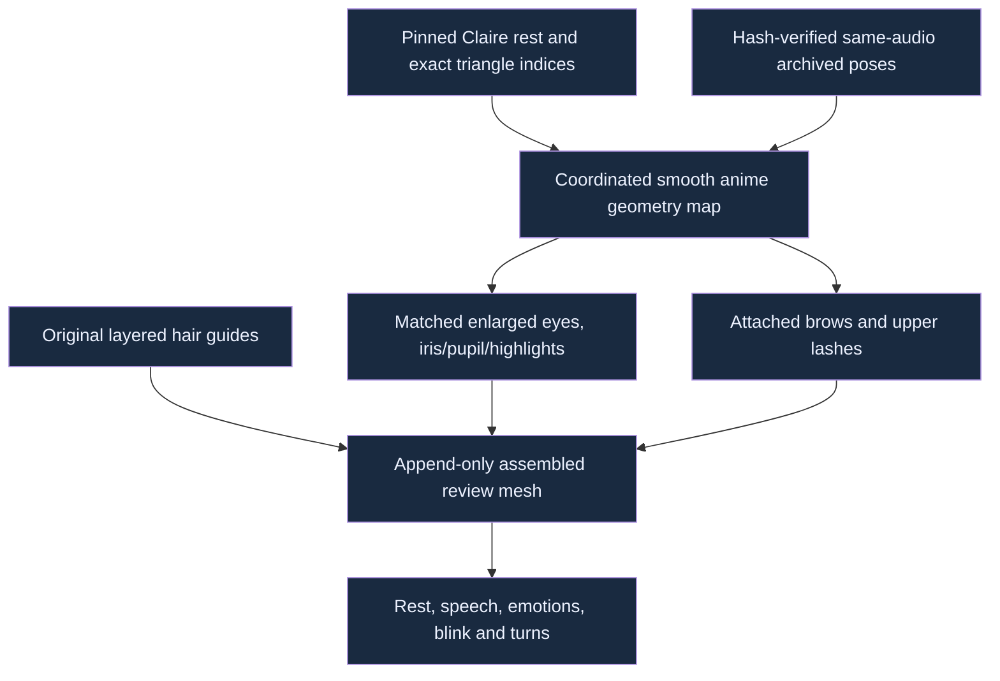

# Akari: a separate Claire-based anime woman

Research and design decision, 22 November 2026. **Research precedes the first
implementation.** Akari is a new, original adult-woman character direction,
not a replacement for Claire, Elara or the other heads. This document selects
a bounded local implementation; it does not claim that attractiveness,
gender presentation, likeness or animation quality has been accepted.

## 1. Structural survey: anime is a system, not an eye-size slider

**Finding / HIGH confidence:** VRoid's official face editor separates eye
sets into iris, highlight, sclera, eyeliner and lashes; it also treats lids,
brows, nose, mouth, lips and cheeks separately [S1]. Its hairstyle editor
separates guides, bundles, cross-sections, taper, materials and motion [S2].
Therefore changing only Claire's chin or attaching eyelashes is insufficient.

**Design inference / MEDIUM confidence:** a coherent anime reading should
combine an oval/heart outline, tapered lower jaw, shorter lower face, softer
cheeks, reduced nose projection, larger almond openings, large colored irises,
dark upper lashes, small highlights and a clearly designed hair silhouette.
These are a selected style, not universal anatomical rules for women or anime.
An adult direction should avoid an oversized infant cranium/tiny lower-face
combination. Numerical proportions below are authored starting points, not
measurements extracted from the reference images.

**Reference 1 — silhouette and graphic simplification.** *Anime Lady* by j4p4n,
2017, from Openclipart; CC0/public domain [I1]. The clothed illustration is
reference only. Study simplified nose/mouth, eye emphasis and large coherent
hair masses; do not copy its costume or reproduce its identity. The drawing's
age is not established by its licensing page.

**Reference 2 — coherent stylized 3D construction, not an anime target.**
*Rain Rig*, Blender Foundation / Blender Studio, official v1 preview [I2].
Rain is not evidence that the planned result is anime. The useful comparison
is readable eyelids, cheek/chin transitions and a silhouette that survives a
turn rather than working only in one front screenshot. Preview unchanged.
Credit: Rain Rig (c) Blender Foundation | cloud.blender.org. CC-BY, as stated
on the official character page; that page does not specify a license version.

The images are licensed research illustrations, **not new Verona model
renders**. No external model, texture, hairstyle or rig is imported.

### Existing Verona boundary / HIGH confidence

`verona/appearance.py:claire_eyes` constructs static ellipsoids. It does not
predict eye joints. `verona/web/blinking.mjs:BLINK_GLSL` supplies cosmetic lid
displacement plus optical clipping, separate from the learned motion.
`scripts/build_glb_head_review.py:build` verifies matching 15,375-vertex Claire
rest/motion archives, reconstructs poses, and serializes review candidates.
`scripts/glb_head_study.py:elara_eye_details` adds triangle-bound clay brows
and lashes, but deliberately does not enlarge eyes or create a hairstyle.

**Consequence:** do not relabel Elara or paint large irises on unchanged
Claire and call it a fully new model. Retain Claire vertex correspondence,
but change the coordinated rest geometry, eye optics, detail and hair.

## 2. Data flow and motion: preserve correspondence, not every proportion

**Finding / HIGH confidence:** the current synthetic donor archives retain
all ten single emotions and same-audio neutral speech. The previous review
builder hash-checks motion and audio and derives 2x expressions by halving
archived 4x emotion-minus-neutral deltas. That is reuse of recorded numerical
motion, not new inference or evidence of phonetic accuracy.

Two strategies:

| Route | Advantage | Cost / failure mode | Decision |
|---|---|---|---|
| Warp complete Claire poses with a smooth coordinated map | Same vertex IDs and known lip trajectories; no training | Strong local gradients can distort contact, eyelids and normals | **Selected for first candidate** |
| New anime topology plus closest-surface transfer | More freedom in silhouette and eye loops | Claire contacts may not correspond; closed mouths and cheeks can crease | Not the first slice |
| Dedicated anime rig / hand-authored blendshapes | Best opportunity for intended blink and expression shapes | New rig, retargeter, rights and human review; not a free automatic conversion | Future if deformation limits remain |
| VRoid/VRM model as a replacement | Complete authoring/export ecosystem | Different topology and expression semantics; not actually Claire-based | Research reference only |

The selected map should narrow the jaw smoothly, lift/shorten the lower face,
soften cheeks, reduce nose projection and enlarge the orbital region. Apply
the same map to both rest and speech. Do not separately drag opposing lips
apart or silently add an opaque black mouth to hide a failure.

Original skin triangle indices must remain unchanged. Preserve exact baseline
and donor hashes, and report actual rest displacement and storage. Validate
finite geometry, nondegenerate faces and visible changes; count differences
alone do not establish an attractive identity.

## 3. Integration and visual construction

### Eyes and lashes

**Finding / HIGH confidence:** VRoid treats neutral and expression settings as
different states; an all-zero parameter state is not necessarily its named
NEUTRAL expression [S3]. VRM explicitly documents double closure and
over-opening when procedural blink/mouth channels combine with emotions [S4].
An enlarged neutral opening alone is not a valid blinking implementation.

**Selected design / MEDIUM confidence until rendered:** horizontally wider,
more vertically open almond eyes, slightly lifted outer corners; visible
off-white sclera; large teal irises with a darker limbal edge, dark vertical
pupils and two small highlights. Dark, thicker upper contours with tapered
outer lash tufts; restrained lower contour and slim arched brows. Eye layers
must depth-test behind the lids; no flat decals floating in front of the face.

For the first review, perform an explicit deterministic blink demonstration.
If inherited cosmetic closure is insufficient after enlargement, adapt the
orbital geometry/clipping together rather than assert it is solved. Do not
combine a full authored closed-eye pose with another full blink deformation.
No independent gaze or learned eye joints are implied.

### Chin, cheeks, nose and lips

**Selected design / MEDIUM confidence:** broad soft upper cheeks relative to
a tapered V/rounded-point chin, not a sharp needle; less heavy jaw corners;
moderately shortened lower face, smaller softened nose bridge/tip, restrained
lip volume. Preserve a touching neutral seam and the recent wide-opening-only
background reveal. These are authored character choices, not a gender classifier.

The mouth needs complete speech and strong-pose review. Existing smooth
Cupid's-bow profiles in `verona/web/facial-features.mjs:facialProfile` are a
starting contour; moving a generic lipstick ellipse is specifically rejected
by the owner's earlier feedback. Avoid adding another misregistered lip layer.

### Hairstyle

**Finding / HIGH confidence:** VRoid supports hand-guided and procedural hair,
with guide control, count, cross-section and material editing [S2]. This
supports a guide-and-clump approach, not the claim that imported hair is free
of scalp intersections. Existing `verona/appearance.py:claire_hair` already
uses swept cross-sections over a scalp shell, but its loose waves are not a
distinct anime cut.

**Selected design / MEDIUM confidence:** an original dark-violet layered bob,
large tapered crown/back clumps, split/swept forehead fringe, and two longer
cheek-framing locks. Keep the eyes, brow arches and mouth readable. Avoid a
single featureless helmet and avoid thin noisy spaghetti strands. Use actual
closed or double-sided geometric locks, not external transparent hair cards.
The first slice has rigid head-following hair, not a spring-bone simulation.

### Shading

**Finding / HIGH confidence:** MToon's official description mixes lit and shade
colors, controls the transition and optionally adds outlines [S5]. A realistic
skin shader with realistic nose shadows can undermine an anime sculpt.

Use an original lightweight two-band/soft-transition shader and coordinated
skin/eye/hair/lash colors in the isolated review. It is **toon-inspired, not
MToon compliance**, because no VRM material extension/runtime is implemented.
Include a clay/no-hair view to distinguish sculpt changes from styling.
Do not silently change the production renderer's default appearance.

## 4. Patterns, risks, rights and operating cost

**Critical integration finding / HIGH confidence:** the production manager
owns native head selection, geometry caches, capabilities, separate RAM clips
and blink/idle controls. A local study binary is not automatically a new
production selector option. The first Akari implementation should be an
explicit separate review candidate with its own local viewer/captures, leaving
the currently running manager/head and all existing reports untouched.

| Risk | Required mitigation |
|---|---|
| Big eyes expose holes, eyeball edges or lashes that float | Rest/front/three-quarter/profile plus full blink; matched eye warp and depth |
| Lower-face warp breaks neutral contact or strong expressions | Same map for rest and poses; neutral and all ten emotions; keep rejected captures |
| Brows/lashes drift | Convex exact skin-triangle binding before the final structural map |
| Bangs obscure expressions / back hair intersects skull | Scalp-supported radial guides, tapered locks, front and side review |
| One pretty screenshot hides unchanged Claire underneath | Baseline/clay comparison and quantitative same-index shape displacement |
| Unbounded CPU/GPU/memory from new tooling | No new network/model/dependency; bounded geometry, serial isolated captures; report actual counts/bytes, no invented FPS |
| A future generic importer is accidentally resumed | Separate original Claire-based study, not arbitrary VRM/GLB importer work |
| Copyright of examples is confused with model reuse | Named source/license per image; no model/texture copying or actor/franchise likeness |

**Licensing finding / HIGH confidence:** VRoid's own conditions say some sample
models are CC0 and others have separate terms [S6]. In particular the page
separates AvatarSample A/B/C from CC0 models. Do not assume "VRoid sample" means
CC0. The official studio guidelines also place conditions on tools that
generate meshes from VRoid-provided assets [S7]. None is needed for an original
procedural model derived from the already pinned Claire assets.

The two reference images do not change Claire's existing model/asset license.
External artwork is not a trained motion source. Do not execute downloaded
scene files or download a new avatar/texture pack as a side effect.

**Research retrieval limitation:** Wikimedia's image host rate-limited a
download. The CC0 illustration was retrieved from its original Openclipart
publisher instead. No blocked image was reconstructed or unverified SVG
substituted; the separately researched Oni Lukos eye diagram [S8] is linked
only, not copied into this document or incorporated into model code.

## 5. Synthesis and implementation contract

**Mental model:** keep Claire as the motion-coordinate system, then build an
original coordinated anime identity around it. Geometry, eyes, facial detail,
hair silhouette and toon shading must agree; none alone makes the conversion.

**What this hides:** native skin topology still bounds eye shape, mouth contact
and expression quality. Static eye layers and rigid hair do not become an anime
facial rig, and passing finite/binary tests cannot establish femininity,
beauty or owner acceptance.

1. **HIGH:** preserve Claire and create a separately named candidate, Akari.
2. **HIGH:** use verified local synthetic motions and original procedural
   geometry; no new model download, neural training or external rig.
3. **MEDIUM:** implement the coordinated adult anime direction above, then
   inspect actual clay/finished/front/turn/blink renders and revise failures.
4. **HIGH:** capture neutral plus all ten existing emotions, with explicit
   provenance and no audio above the owner's 20% cap (silent GIFs are safest).
5. **HIGH:** keep production integration separate from review delivery.
   The initial implementation is not an accepted replacement for any head.

### Running knowledge map at research cutoff

**Explored:** face/eye component taxonomy [S1]; hair guide construction [S2];
expression authoring [S3]; procedural expression conflicts [S4]; toon lighting
[S5]; model/image rights [S6,S7,I1,I2]; actual Claire eye, blink, rest, archive
and geometric attachment mechanisms cited above. Confidence HIGH.

**Partially explored:** exact visual outcome of the selected proportions and
how all ten archived emotions deform them. Requires real candidate captures,
not more generic web search. Confidence MEDIUM.

**Unexplored / deliberately excluded:** body, clothing, spring-bone hair,
independent eye-joint/gaze rig, VRM export, new model training and production
session-manager installation. These are not silently claimed as implemented.

**Open validation questions:** do the enlarged lids close cleanly, does the
fringe reveal the eyes, do side views retain a credible scalp/hair silhouette,
and does the neutral seam remain closed? Resolve by isolated implementation
and captures, without asking the AFK owner to choose technical parameters.

## Sources and image credits

Accessed 22 November 2026. Primary documentation supports mechanisms and
constraints, not guarantees of visual quality.

- **S1:** [pixiv VRoid, How to edit faces](https://vroid.pixiv.help/hc/en-us/articles/4406164546969-How-to-edit-faces).
- **S2:** [pixiv VRoid, How do I customize hairstyles?](https://vroid.pixiv.help/hc/en-us/articles/900005678786-How-do-I-customize-hairstyles).
- **S3:** [pixiv VRoid, How to use the Expression Editor](https://vroid.pixiv.help/hc/en-us/articles/4408150140825-How-to-use-the-Expression-Editor).
- **S4:** [VRM Consortium, VRMC_vrm expressions specification](https://github.com/vrm-c/vrm-specification/blob/master/specification/VRMC_vrm-1.0/expressions.md).
- **S5:** [VRM, MToon documentation](https://vrm.dev/en/univrm/shaders/shader_mtoon/).
- **S6:** [pixiv, sample-model conditions](https://vroid.pixiv.help/hc/en-us/articles/4402614652569-Do-VRoid-Studio-s-sample-models-come-with-conditions-of-use).
- **S7:** [VRoid Studio guidelines](https://vroid.com/en/studio/guidelines).
  Direct retrieval returned HTTP 403; the relevant terms above were visible
  in the web index extract. Recheck the full current terms before asset reuse.
- **S8:** [Oni Lukos, Anime eye](https://commons.wikimedia.org/wiki/File:Anime_eye.svg), CC BY-SA 2.5. Linked only; not embedded or reused.
- **I1:** [j4p4n, Anime Lady](https://openclipart.org/detail/270292/anime-lady),
  [CC0](https://creativecommons.org/publicdomain/zero/1.0/);
  local SVG unchanged, downloaded from the original publisher.
- **I2:** [Rain v1, Blender Studio](https://studio.blender.org/characters/rain/v1/),
  CC-BY as declared there; preview unchanged, no rig download or model reuse.
  Rain Rig (c) Blender Foundation | cloud.blender.org.

Local mechanism references: `verona/appearance.py:37-69` (`claire_eyes`),
`:80-136` (`claire_hair`); `verona/web/blinking.mjs:58-96`
(`BLINK_GLSL`, `CLAIRE_BLINK`); `scripts/build_glb_head_review.py:23-120`
(`build`); `scripts/glb_head_study.py:13-102` (`elara_eye_details`);
`verona/web/facial-features.mjs:1-23,26-104` (native lip guides and wide gate).
